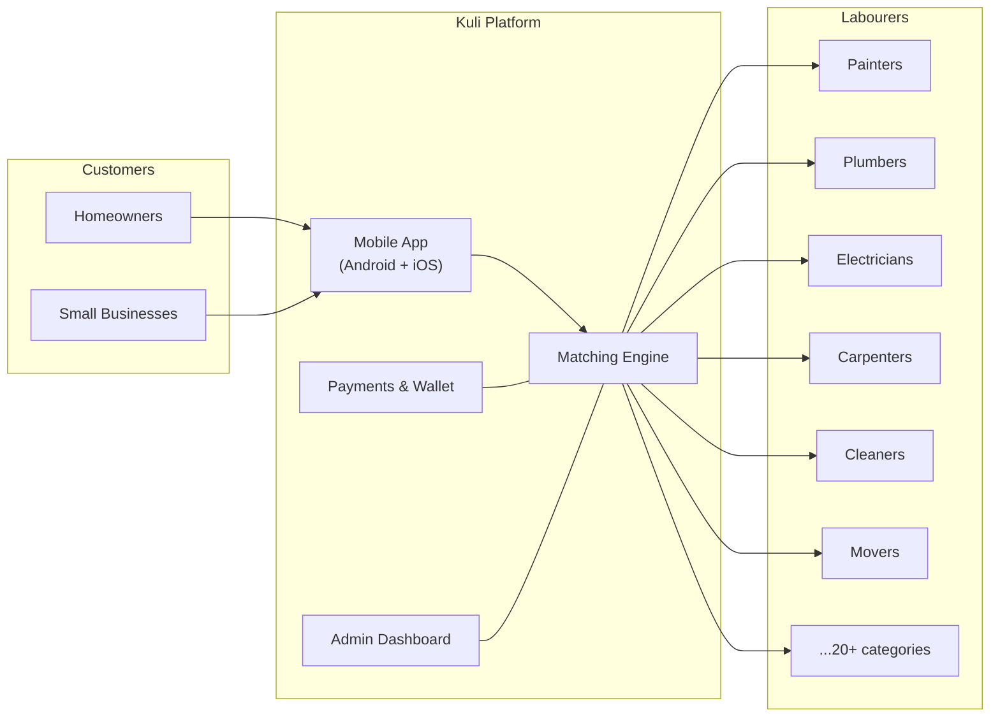
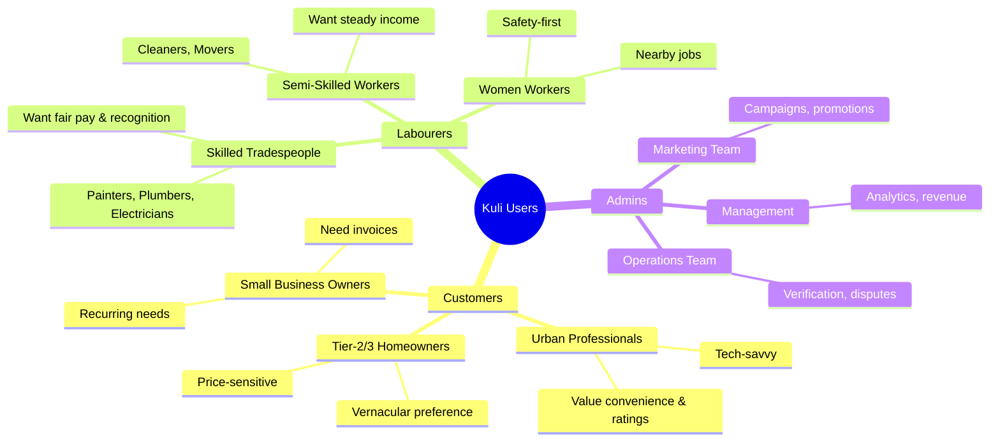
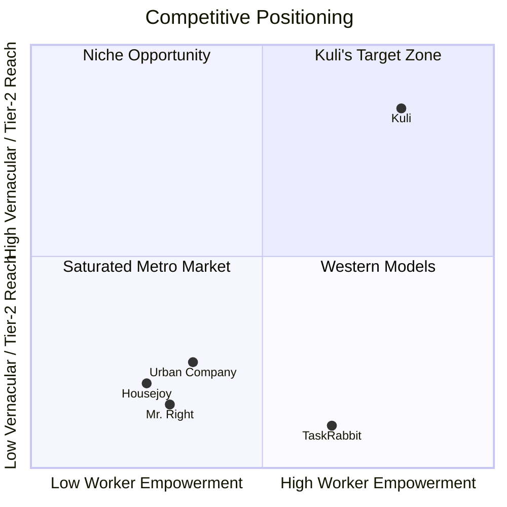
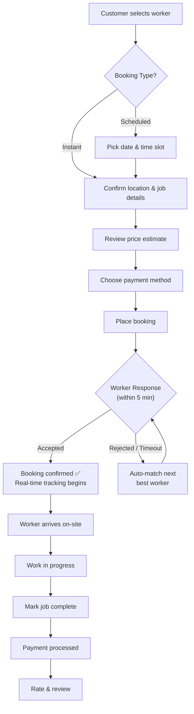
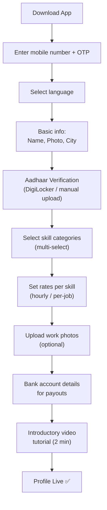
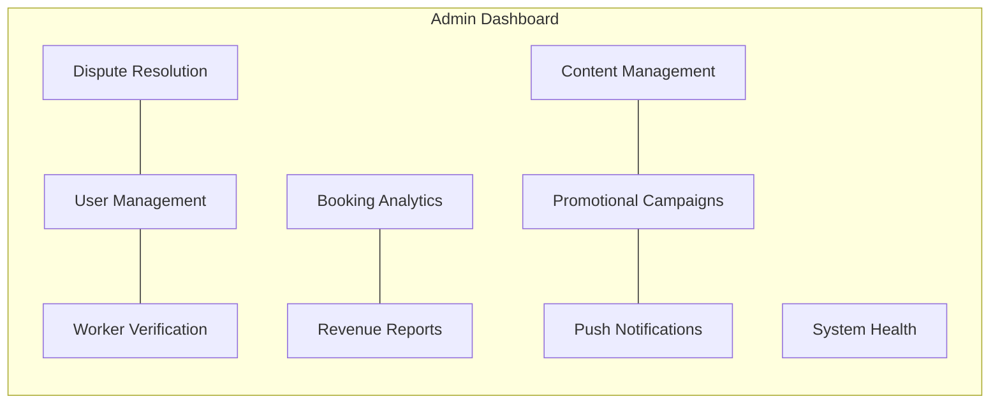
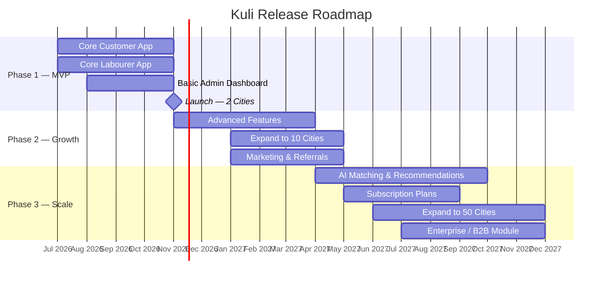
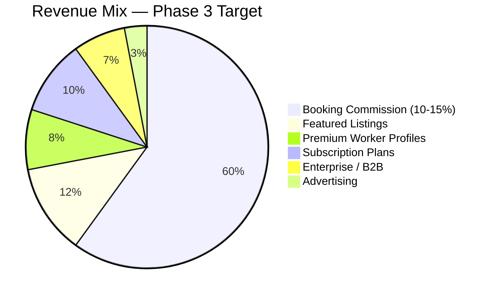

# 📋 Kuli — Product Requirements Document (PRD)

| Field              | Detail                                      |
| ------------------ | ------------------------------------------- |
| **Document Title** | Kuli Labour App — Product Requirements      |
| **Version**        | 1.0                                         |
| **Date**           | 1 June 2026                                 |
| **Status**         | Draft                                       |
| **Author**         | Product Team                                |
| **Stakeholders**   | Engineering, Design, QA, Marketing, Finance |

---

## Table of Contents

1. [Executive Summary](#1-executive-summary)
2. [Product Overview](#2-product-overview)
3. [Target Audience](#3-target-audience)
4. [Market Analysis](#4-market-analysis)
5. [Core Features](#5-core-features)
6. [Non-Functional Requirements](#6-non-functional-requirements)
7. [User Stories](#7-user-stories)
8. [Release Phases](#8-release-phases)
9. [Success Metrics / KPIs](#9-success-metrics--kpis)
10. [Risks & Mitigations](#10-risks--mitigations)
11. [Appendix — Glossary](#11-appendix--glossary)

---

## 1. Executive Summary

### 1.1 Vision

> *"Dignified work for every skilled hand; reliable help at every doorstep."*

Kuli envisions a future where India's 450 million+ informal-sector workers can find dignified, on-demand employment through a transparent digital marketplace — while homeowners and small businesses get vetted, affordable, and trackable services at their fingertips.

### 1.2 Mission

To build India's most trusted on-demand blue-collar labour platform by:

1. **Empowering labourers** with steady income, digital identity, skill recognition, and social-security linkages.
2. **Delighting customers** with one-tap access to verified, rated, and fairly-priced workers across 20+ service categories.
3. **Operating responsibly** with transparent pricing, fair commissions, and worker-welfare programs.

### 1.3 Problem Statement

| Pain Point | For Labourers | For Customers |
|---|---|---|
| **Discovery** | Stand at *naka* (street corners) daily hoping for work | Rely on word-of-mouth; no way to compare workers |
| **Trust** | No formal identity; skills unrecognised | Fear of inviting strangers home; no background checks |
| **Pricing** | Exploited by middlemen taking 20–40 % cuts | Opaque pricing; frequent overcharging |
| **Payments** | Cash-only; delayed/withheld wages | No digital trail; disputes hard to resolve |
| **Safety** | No insurance; no recourse for non-payment | No SOS mechanism; no accountability |

> [!IMPORTANT]
> India's blue-collar gig economy is estimated at **$250 billion** (2025) yet remains 90 %+ unorganised. Kuli addresses this massive gap with a mobile-first, vernacular, trust-driven marketplace.

### 1.4 Solution Summary

---

## 2. Product Overview

### 2.1 What Is Kuli?

Kuli (Hindi: कुली — *porter / labourer*) is an **on-demand labour hiring platform** (analogous to Uber for daily-wage workers). It connects **customers** who need skilled or semi-skilled services at their home or workplace with **verified labourers** available in their vicinity.

The platform comprises:

| Component | Technology | Primary Users |
|---|---|---|
| Mobile App (Android + iOS) | React Native | Customers & Labourers |
| Admin Web Dashboard | React.js + Next.js | Operations, Support & Management |
| Backend Services | Node.js / NestJS | — (internal) |

### 2.2 Value Proposition

#### For Customers

| Benefit | Description |
|---|---|
| **One-Tap Booking** | Browse, compare, and book a worker in under 60 seconds |
| **Trust & Safety** | Aadhaar-verified profiles, ratings, reviews, and SOS button |
| **Transparent Pricing** | Upfront rate cards; no hidden charges or middleman fees |
| **Real-Time Tracking** | Track worker's ETA on a live map once a booking is confirmed |
| **Vernacular UX** | Full interface in Hindi + 6 regional languages |
| **Digital Payments** | UPI, cards, wallets — no cash hassles; automatic invoicing |
| **Quality Guarantee** | Re-service or refund within 48 h if work quality is unsatisfactory |

#### For Labourers

| Benefit | Description |
|---|---|
| **Steady Income** | Digital demand pipeline replaces uncertain *naka* waiting |
| **Fair Rates** | Set your own rates; platform takes a transparent 10–15 % commission |
| **Digital Identity** | Verified profile acts as a portable resume across jobs |
| **Skill Growth** | Badge system, in-app training modules, and skill certification |
| **Financial Inclusion** | Earnings dashboard, instant bank payouts, micro-insurance linkages |
| **Safety Net** | In-app SOS, accident insurance, and grievance redressal |

### 2.3 Supported Service Categories (MVP)

| # | Category | Example Tasks |
|---|---|---|
| 1 | Painting | Interior painting, exterior painting, texture work |
| 2 | Plumbing | Leak repair, pipe fitting, bathroom installation |
| 3 | Electrical | Wiring, switch/socket, fan/light installation |
| 4 | Carpentry | Furniture repair, door/window fitting, custom woodwork |
| 5 | Cleaning | Deep cleaning, post-construction, kitchen/bathroom |
| 6 | Moving / Shifting | Packing, loading, local shifting |
| 7 | AC Service | Installation, gas refill, deep cleaning |
| 8 | Appliance Repair | Washing machine, refrigerator, microwave repair |
| 9 | Gardening | Lawn care, tree trimming, landscaping |
| 10 | Masonry | Tiling, plastering, brickwork |

> [!NOTE]
> Additional categories (pest control, vehicle washing, event staffing, etc.) will be added in Phase 2 and Phase 3 based on market demand and city-level data.

---

## 3. Target Audience

### 3.1 Customer Persona — "Priya" (Urban Professional)

| Attribute | Detail |
|---|---|
| **Name** | Priya Sharma |
| **Age** | 32 |
| **Occupation** | IT professional (Bengaluru) |
| **Income** | ₹12–18 LPA |
| **Tech Comfort** | High — daily Swiggy, Uber, Amazon user |
| **Languages** | English, Hindi, Kannada |
| **Scenario** | Just moved to a new apartment; needs a painter for 2 rooms, a plumber to fix the kitchen sink, and deep cleaning before the housewarming |
| **Frustrations** | 1) Asked neighbours for contacts — unreliable; 2) Called two painters — both didn't show up; 3) One plumber overcharged ₹2,500 for a simple fix |
| **Goals** | Wants a trusted, rated worker who shows up on time with transparent pricing |
| **Decision Factors** | Ratings/reviews, verified profiles, upfront pricing, digital payment option |
| **Preferred Channel** | Mobile app (Android/iOS) |

### 3.2 Customer Persona — "Rajesh" (Tier-2 City)

| Attribute | Detail |
|---|---|
| **Name** | Rajesh Patel |
| **Age** | 45 |
| **Occupation** | Shop owner (Surat, Gujarat) |
| **Income** | ₹6–10 LPA |
| **Tech Comfort** | Medium — uses WhatsApp, Google Pay; limited English |
| **Languages** | Gujarati, Hindi |
| **Scenario** | Needs electricians and cleaners periodically for his shop; currently hires through a local *thekedaar* (contractor) who charges a 30 % markup |
| **Frustrations** | Middleman takes a large cut; workers vary in quality; no receipts for tax deduction |
| **Goals** | Cut out the middleman, get consistent quality, have digital invoices |
| **Decision Factors** | Gujarati language support, UPI payment, price comparison |

### 3.3 Labourer Persona — "Suresh"

| Attribute | Detail |
|---|---|
| **Name** | Suresh Kumar |
| **Age** | 28 |
| **Occupation** | Freelance painter (Ahmedabad) |
| **Income** | ₹8,000–15,000/month (inconsistent) |
| **Tech Comfort** | Low-to-Medium — uses WhatsApp, YouTube; ₹8,000 Android phone |
| **Languages** | Hindi, Gujarati |
| **Scenario** | Stands at the local *naka* from 7 AM; some days gets 2 jobs, other days none. A contractor takes ₹200 per job as commission. No digital profile. |
| **Frustrations** | 1) Uncertain income; 2) No recognition for 8 years of painting experience; 3) Contractor takes too much; 4) No insurance — broke his arm on-site and lost 2 months' income |
| **Goals** | Steady daily jobs, fair payment directly to bank, recognition of skills, basic insurance |
| **Decision Factors** | Simple Hindi UI, quick registration, daily/weekly payouts, training to learn new techniques |

### 3.4 Labourer Persona — "Lakshmi"

| Attribute | Detail |
|---|---|
| **Name** | Lakshmi Devi |
| **Age** | 35 |
| **Occupation** | Domestic cleaner & cook (Chennai) |
| **Income** | ₹6,000–10,000/month |
| **Tech Comfort** | Low — basic Android phone; husband helps with apps |
| **Languages** | Tamil, basic Hindi |
| **Scenario** | Works for 4 families monthly but wants more jobs; has no way to advertise her cooking skills |
| **Frustrations** | Families sometimes delay payment; no way to show she also cooks well; unsafe travel to new locations |
| **Goals** | Get nearby jobs, showcase cooking skill alongside cleaning, SOS button for safety, digital payment |
| **Decision Factors** | Tamil language UI, location-based jobs within 5 km, SOS feature, female-friendly verification |

### 3.5 Persona Map

---

## 4. Market Analysis

### 4.1 Indian Gig Economy for Blue-Collar Workers

| Metric | Value | Source |
|---|---|---|
| Informal workforce size | ~450 million workers | NITI Aayog, 2024 |
| Blue-collar gig economy (TAM) | ~$250 billion | RedSeer, 2025 |
| Serviceable Addressable Market (SAM) | ~$35 billion (home services) | IBEF, 2025 |
| Serviceable Obtainable Market (SOM — Year 3) | ~$500 million (10 cities) | Internal estimate |
| Smartphone penetration (urban India) | 78 % | TRAI, 2025 |
| UPI monthly transactions | 16+ billion | NPCI, 2025 |
| Workers with formal contracts | < 10 % | ILO India, 2024 |

> [!TIP]
> The convergence of **rising smartphone adoption**, **UPI ubiquity**, and **post-COVID trust in digital services** creates an inflection point for a platform like Kuli to organise the unorganised home-services market.

### 4.2 Competitive Landscape

| Feature / Dimension | **Kuli** | Urban Company | Housejoy | Mr. Right | TaskRabbit (US) |
|---|---|---|---|---|---|
| **Primary Focus** | Daily-wage labourers (painters, plumbers, etc.) | Beauty, wellness, home services | Home services | Home services | General tasks |
| **Target Market** | India (Tier-1 to Tier-3) | India (metro-first) | India (metros) | India (metros) | US, UK, EU |
| **Worker Model** | Gig freelancers set own rates | Employed/trained professionals | Freelance + in-house | Freelance | Gig freelancers |
| **Pricing** | Worker-set rates + transparent commission | Platform-set standardised pricing | Platform-set pricing | Platform-set pricing | Worker-set rates |
| **Vernacular Support** | Hindi + 6 regional languages | Hindi + English | Hindi + English | Hindi | English only |
| **Worker Welfare** | Insurance, training, badges, welfare linkages | Training programs | Minimal | Minimal | None |
| **Aadhaar Verification** | ✅ Core requirement | ✅ | Partial | Partial | N/A |
| **Real-Time Tracking** | ✅ | ✅ | ❌ | ❌ | ❌ |
| **SOS / Safety** | ✅ (both sides) | ✅ (customer-side) | ❌ | ❌ | ❌ |
| **Tier-2/3 City Focus** | ✅ Strong | ❌ Metro-centric | ❌ | ❌ | ❌ |
| **Commission Model** | 10–15 % (worker-friendly) | 25–35 % | 20–30 % | 20–25 % | 15–20 % |

### 4.3 Kuli's Differentiation

**Key Differentiators:**

1. **Worker-First Philosophy** — Lower commissions, skill badges, training, insurance, and welfare programme access.
2. **Deep Vernacular** — Full app experience in Hindi, Gujarati, Marathi, Tamil, Telugu, Bengali, and Kannada (not just translated labels — culturally adapted flows).
3. **Tier-2 / Tier-3 Expansion** — Purpose-built for smaller cities where Urban Company has no presence.
4. **Transparent Worker-Set Pricing** — Workers set their own rates; customers compare and choose.
5. **Dual-Sided Safety** — SOS button and insurance for both customers and workers.

### 4.4 SWOT Analysis

| | Helpful | Harmful |
|---|---|---|
| **Internal** | **Strengths**: Worker-first model; deep vernacular; low commission; mobile-first | **Weaknesses**: New brand (no trust yet); bootstrapped; limited operations capacity |
| **External** | **Opportunities**: Massive TAM; UPI ubiquity; govt. push for e-Shram/digital identity; under-served Tier-2/3 | **Threats**: Urban Company's brand; regulatory changes; worker attrition to competitors; low digital literacy |

---

## 5. Core Features

### 5.1 Customer Features

#### 5.1.1 Registration & Login

| Feature | Description | Priority |
|---|---|---|
| OTP-Based Login | Register/login with mobile number + OTP (no passwords) | P0 |
| Social Login | Optional Google / Facebook sign-in | P1 |
| Profile Setup | Name, profile photo, saved addresses (home, office, other) | P0 |
| Language Selection | Choose preferred language during onboarding (persists across sessions) | P0 |
| Guest Browse | Browse workers and categories without registration; prompt login at booking | P1 |

#### 5.1.2 Browse & Search

| Feature | Description | Priority |
|---|---|---|
| Category Grid | Visual grid of service categories (icons + labels in selected language) | P0 |
| Skill-Based Search | Free-text search for skills ("bathroom tiling", "fan installation") | P0 |
| Location Filter | Auto-detect GPS or manual pin-drop; filter workers within 5/10/25 km | P0 |
| Rating Filter | Filter by minimum rating (3★, 4★, 4.5★) | P0 |
| Price Range Filter | Slider or min/max input for hourly/daily rate | P0 |
| Availability Filter | Show only workers available "Now", "Today", or on a specific date | P1 |
| Sort Options | Sort by: Nearest, Highest Rated, Lowest Price, Most Jobs Completed | P0 |
| Verified Badge Filter | Toggle to show only Aadhaar-verified workers | P0 |

#### 5.1.3 Worker Profiles

| Feature | Description | Priority |
|---|---|---|
| Profile Header | Photo, name, verification badges, overall rating, jobs completed | P0 |
| Skills & Rates | List of skills with per-skill rate (hourly / per-job) | P0 |
| Work Portfolio | Photo gallery of past work (up to 20 photos) | P0 |
| Experience | Years of experience, bio / description | P0 |
| Reviews | Paginated list of customer reviews with star rating and text | P0 |
| Availability Calendar | Visual calendar showing available dates/times | P1 |
| Response Rate | Percentage of job requests accepted within 5 minutes | P1 |

#### 5.1.4 Booking Flow

| Feature | Description | Priority |
|---|---|---|
| Instant Booking | Book a worker for immediate service (within 1–2 hours) | P0 |
| Scheduled Booking | Book for a future date and time slot | P0 |
| Job Description | Free-text field + optional photos to describe the task | P0 |
| Price Estimate | Auto-calculated estimate based on worker's rate + estimated hours | P0 |
| Booking Confirmation | Push notification + in-app confirmation with booking ID | P0 |
| Auto-Reassignment | If worker doesn't accept within 5 min, auto-match next best | P1 |

#### 5.1.5 Real-Time Tracking

| Feature | Description | Priority |
|---|---|---|
| Live Map | Google Maps / Mapbox view showing worker's live location after booking accepted | P0 |
| ETA Display | Estimated time of arrival (auto-updated) | P0 |
| Status Updates | Push notifications at key stages: "On the way", "Arrived", "Work started", "Completed" | P0 |
| Route View | Show worker's route from current location to job site | P1 |

#### 5.1.6 Communication

| Feature | Description | Priority |
|---|---|---|
| In-App Chat | Text messaging between customer and worker (within active booking) | P0 |
| VoIP Call | Masked voice call (customer ↔ worker) — no personal number exposure | P0 |
| Chat History | Retained for 30 days after booking for dispute resolution | P0 |
| Quick Replies | Pre-set messages in selected language ("I'm here", "Running 10 min late") | P1 |
| Photo Sharing | Share photos in chat to clarify job scope | P1 |

#### 5.1.7 Payments

| Feature | Description | Priority |
|---|---|---|
| UPI Payment | Pay via any UPI app (Google Pay, PhonePe, Paytm, BHIM) | P0 |
| Credit/Debit Cards | Visa, Mastercard, RuPay support | P0 |
| Mobile Wallets | Paytm, PhonePe, Amazon Pay wallets | P1 |
| Kuli Wallet | In-app wallet for quick payments; top-up via UPI/card | P1 |
| Cash on Delivery | For Tier-2/3 markets with low digital adoption | P0 |
| Split Payment | Split between wallet + UPI/card | P2 |
| Digital Invoice | Auto-generated invoice with GST details (PDF download) | P0 |
| Tip / Bonus | Optional tip to worker after job completion | P1 |
| Refund Management | Automated refund to original payment method within 5–7 business days | P0 |

#### 5.1.8 Post-Service

| Feature | Description | Priority |
|---|---|---|
| Star Rating (1–5) | Mandatory rating after job completion | P0 |
| Written Review | Optional text review (min 20 characters) | P0 |
| Photo Review | Upload photos of completed work | P1 |
| Favourite Worker | Save worker to "My Favourites" for re-booking | P0 |
| Booking History | Complete history with status, date, worker, amount, invoice download | P0 |
| Re-Book | One-tap re-book the same worker for the same service | P1 |
| Report Issue | Flag issue: no-show, poor quality, safety concern, overcharging | P0 |

#### 5.1.9 Safety & Support

| Feature | Description | Priority |
|---|---|---|
| SOS Button | Visible emergency button during active booking; triggers alert to emergency contacts + local police helpline | P0 |
| Emergency Contacts | Customer can set up to 3 emergency contacts | P0 |
| Live Location Sharing | Share live location with emergency contacts during booking | P1 |
| In-App Help | FAQ, chatbot, and escalation to human support | P0 |
| Dispute Resolution | File a dispute within 48 h; mediated by Kuli support team | P0 |

#### 5.1.10 Personalisation & Localisation

| Feature | Description | Priority |
|---|---|---|
| Multi-Language Support | Full UI in: Hindi, English, Gujarati, Marathi, Tamil, Telugu, Bengali, Kannada | P0 |
| Location-Based Defaults | Auto-detect city and show relevant categories and workers | P0 |
| Push Notification Preferences | Manage notification frequency and types | P1 |
| Dark Mode | System-aware + manual toggle | P2 |
| Accessibility | Screen reader support, minimum touch targets (48×48 dp), high contrast mode | P1 |

---

### 5.2 Labourer Features

#### 5.2.1 Registration & Onboarding

| Feature | Description | Priority |
|---|---|---|
| Mobile + OTP Registration | Same simple flow as customers | P0 |
| Aadhaar Verification | Integration with DigiLocker API or manual Aadhaar upload + face-match | P0 |
| Skill Tagging | Multi-select from predefined skill tree (e.g., Painting → Interior, Exterior, Texture) | P0 |
| Rate Setting | Set hourly rate and/or per-job rate for each skill | P0 |
| Work Photos | Upload up to 20 photos of past work | P0 |
| Bank Account | Link bank account (IFSC + account number) or UPI ID for payouts | P0 |
| Video Onboarding | 2-minute tutorial video explaining how the app works (in selected language) | P1 |
| Background Check | Optional police verification badge (facilitated by Kuli) | P1 |

#### 5.2.2 Profile Management

| Feature | Description | Priority |
|---|---|---|
| Edit Skills & Rates | Add/remove skills; update rates anytime | P0 |
| Work Portfolio | Manage photo gallery; add captions | P0 |
| Bio / Description | Free-text bio (displayed on profile) | P0 |
| Service Area | Set preferred working radius (1–25 km from home) | P0 |
| Availability Toggle | Global ON/OFF toggle + per-day availability calendar | P0 |
| Profile Completeness | Progress indicator showing % completion with prompts to fill gaps | P1 |

#### 5.2.3 Job Management

| Feature | Description | Priority |
|---|---|---|
| Job Requests | Push notification + in-app alert for new job requests | P0 |
| Accept / Reject | Accept or reject within 5 minutes; optional rejection reason | P0 |
| Job Details | Customer name, location (map), job description, photos, estimated duration, rate | P0 |
| Navigation | One-tap open Google Maps / built-in map for navigation to job site | P0 |
| Job Status Updates | Update status: "On my way" → "Arrived" → "Work started" → "Completed" | P0 |
| Active Jobs Dashboard | List of current and upcoming accepted jobs | P0 |
| Job History | Complete log of past jobs with earnings | P0 |
| Cancel Job | Cancel with reason (penalty applied if within 1 h of scheduled time) | P0 |

#### 5.2.4 Earnings & Payouts

| Feature | Description | Priority |
|---|---|---|
| Earnings Dashboard | Daily, weekly, monthly earnings summary with charts | P0 |
| Payout Schedule | Auto-payout to bank every 24 h (or manual withdrawal) | P0 |
| Transaction History | Line-item breakdown: gross earnings, commission deducted, net payout | P0 |
| Payout Methods | Bank transfer (NEFT/IMPS), UPI | P0 |
| Earnings Goals | Set daily/weekly income targets with progress tracking | P2 |
| Tax Summary | Annual earnings summary for ITR filing | P1 |

#### 5.2.5 Skill Badge System

| Badge | Criteria | Benefit |
|---|---|---|
| ✅ **Verified** | Aadhaar verification complete | Shown in search results; trust signal |
| ⭐ **Top Rated** | Average rating ≥ 4.5 with 50+ reviews | Priority in search; "Top Rated" label |
| 🏆 **Expert** | 200+ jobs completed in a category | "Expert" badge; eligible for premium pricing |
| 🎓 **Trained** | Completed Kuli training module | "Kuli Trained" badge |
| 🛡️ **Background Checked** | Police verification complete | Additional trust signal; access to premium customers |
| ⚡ **Quick Responder** | 90 %+ acceptance rate; < 2 min avg. response time | Priority in matching algorithm |

#### 5.2.6 Training & Growth

| Feature | Description | Priority |
|---|---|---|
| Training Videos | Skill-specific training content in vernacular languages | P1 |
| Safety Guidelines | Workplace safety protocols and checklists | P1 |
| Customer Service Tips | How to communicate professionally, handle disputes | P1 |
| Certification | In-app quiz after training completion; earns "Trained" badge | P2 |
| Community Forum | Peer-to-peer discussion board for tips and advice | P2 |

#### 5.2.7 Insurance & Welfare

| Feature | Description | Priority |
|---|---|---|
| Accident Insurance | Free basic accident coverage for on-job incidents (partner: ICICI Lombard / equivalent) | P1 |
| Health Check-Up | Annual subsidised health check-up in partnered clinics | P2 |
| e-Shram Linkage | Guide and link workers to government e-Shram portal for social security | P1 |
| Emergency Fund | Kuli-contributed emergency corpus for critical medical situations | P2 |
| Financial Literacy | Short modules on savings, banking, and UPI usage | P2 |

---

### 5.3 Admin Dashboard Features

| Module | Key Features | Priority |
|---|---|---|
| **User Management** | View/edit/suspend/delete customer & worker accounts; search by phone/name/ID; activity logs | P0 |
| **Worker Verification** | Aadhaar document review queue; approve/reject with notes; face-match results; background check status | P0 |
| **Booking Analytics** | Real-time booking count; heatmaps by city/category; funnel analysis (search → book → complete); cancellation rates | P0 |
| **Revenue Reports** | Daily/weekly/monthly revenue; commission earned; payout summary; city-wise breakdown; export CSV/PDF | P0 |
| **Dispute Resolution** | Ticket queue; view chat history, booking details, photos; assign to agent; resolve with refund/warning/ban | P0 |
| **Promotional Campaigns** | Create discount coupons; referral program management; featured listing management; A/B test campaigns | P1 |
| **Content Management** | Manage service categories, FAQs, training content, app banners, T&Cs, privacy policy | P1 |
| **Push Notification Management** | Send targeted push notifications by segment (city, category, activity status); schedule notifications; view delivery/open rates | P1 |
| **System Health** | API response times, error rates, server status, database health, alert configuration | P0 |

---

## 6. Non-Functional Requirements

### 6.1 Performance

| Metric | Target |
|---|---|
| App cold start time | < 3 seconds on mid-range Android device |
| API response time (p95) | < 500 ms |
| API response time (p99) | < 1,000 ms |
| Search results load | < 2 seconds |
| Map / tracking render | < 1.5 seconds |
| Push notification delivery | < 5 seconds |
| Image upload (5 MB) | < 4 seconds on 4G |
| Concurrent users (MVP) | 10,000 |
| Concurrent users (Year 2) | 100,000 |

### 6.2 Security

| Requirement | Implementation |
|---|---|
| Data encryption in transit | TLS 1.3 for all API calls |
| Data encryption at rest | AES-256 for PII and financial data |
| Authentication | JWT tokens with 15-min access + 7-day refresh tokens |
| OTP Security | Rate limiting (5 OTP attempts / 10 min); OTP expires in 5 min |
| Aadhaar Data | Stored in encrypted, access-controlled vault; not logged; not exposed in APIs |
| PCI DSS | Payment processing via PCI-compliant gateway (Razorpay/Cashfree) — no card data stored |
| OWASP Top 10 | All APIs audited for injection, XSS, CSRF, IDOR, etc. |
| Penetration Testing | Quarterly third-party pen-test |
| Data Retention | Booking data: 5 years; Chat logs: 1 year; Deleted account data: purged in 90 days |

### 6.3 Scalability

| Aspect | Strategy |
|---|---|
| Horizontal Scaling | Stateless API servers behind load balancer; auto-scale groups |
| Database | Read replicas for PostgreSQL; sharding strategy for high-write tables (bookings, locations) |
| Caching | Redis for session, OTP, search results, worker availability |
| CDN | CloudFront for static assets, images, training videos |
| Queue | Message queue (SQS/RabbitMQ) for async tasks (notifications, payouts, analytics) |

### 6.4 Accessibility

| Requirement | Detail |
|---|---|
| WCAG 2.1 AA Compliance | Target for all customer-facing screens |
| Screen Reader | TalkBack (Android) and VoiceOver (iOS) support |
| Touch Targets | Minimum 48×48 dp |
| Font Scaling | Support system font scaling up to 200 % |
| Colour Contrast | Minimum 4.5:1 for normal text; 3:1 for large text |
| Motion | Respect "Reduce Motion" system setting |

### 6.5 Offline Capabilities

| Feature | Offline Behaviour |
|---|---|
| Browse cached data | Show last-loaded worker list and categories |
| View booking details | Show cached active booking details |
| Queue actions | Cache "mark complete", "rate" actions; sync when online |
| Notification | Show banner "You are offline — some features may be limited" |
| Map caching | Cache last-viewed map area for basic navigation |

### 6.6 Reliability & Availability

| Metric | Target |
|---|---|
| Uptime SLA | 99.9 % (excluding scheduled maintenance) |
| RTO (Recovery Time Objective) | < 30 minutes |
| RPO (Recovery Point Objective) | < 5 minutes |
| Scheduled Maintenance Window | Tuesday 2:00–4:00 AM IST |

---

## 7. User Stories

### 7.1 Customer User Stories

#### US-C01: OTP Registration
| Field | Detail |
|---|---|
| **As a** | new customer |
| **I want to** | register using my mobile number and OTP |
| **So that** | I can start using the app quickly without remembering passwords |
| **Acceptance Criteria** | 1) Enter 10-digit Indian mobile number → receive OTP within 10 s; 2) OTP valid for 5 min; 3) Max 5 retry attempts; 4) On success, prompt for name + language selection; 5) Profile created and redirected to home screen |

#### US-C02: Search Workers by Category
| Field | Detail |
|---|---|
| **As a** | customer |
| **I want to** | browse workers by service category (e.g., "Plumbing") |
| **So that** | I can find the right type of worker for my job |
| **Acceptance Criteria** | 1) Home screen shows category grid with icons; 2) Tapping a category shows worker list sorted by nearest; 3) Each worker card shows: photo, name, rating, rate, distance, verification badge; 4) Results load within 2 s |

#### US-C03: Filter and Sort Workers
| Field | Detail |
|---|---|
| **As a** | customer |
| **I want to** | filter workers by rating, price, distance, and availability |
| **So that** | I can quickly find the best match for my budget and timeline |
| **Acceptance Criteria** | 1) Filter panel accessible via "Filter" button; 2) Filters: min rating, price range, max distance, availability (now/today/date); 3) Sort: nearest, highest rated, lowest price; 4) Applied filters shown as chips; 5) Results update in < 1 s |

#### US-C04: Book a Worker (Instant)
| Field | Detail |
|---|---|
| **As a** | customer |
| **I want to** | book an available worker for immediate service |
| **So that** | I can get my problem fixed right away |
| **Acceptance Criteria** | 1) Select worker → tap "Book Now"; 2) Confirm address (auto-filled from saved or GPS); 3) Describe job (text + optional photos); 4) See price estimate; 5) Choose payment method; 6) Submit booking → notification sent to worker; 7) Worker has 5 min to accept; 8) On acceptance, confirmation shown with ETA |

#### US-C05: Real-Time Tracking
| Field | Detail |
|---|---|
| **As a** | customer who has booked a worker |
| **I want to** | track the worker's live location on a map |
| **So that** | I know when they will arrive and can prepare |
| **Acceptance Criteria** | 1) After booking accepted, map view shows worker's live pin; 2) ETA updates every 30 s; 3) Status notifications: "On the way", "Arriving in 5 min", "Arrived"; 4) Map loads within 1.5 s |

#### US-C06: Rate and Review
| Field | Detail |
|---|---|
| **As a** | customer who has received a service |
| **I want to** | rate the worker (1–5 stars) and leave a review |
| **So that** | future customers can make informed decisions |
| **Acceptance Criteria** | 1) Rating prompt appears after job marked complete; 2) Star rating mandatory; 3) Written review optional (min 20 chars if provided); 4) Photo upload optional (max 5); 5) Review visible on worker profile within 1 min; 6) Worker notified of new review |

#### US-C07: SOS Emergency
| Field | Detail |
|---|---|
| **As a** | customer who feels unsafe during a booking |
| **I want to** | press an SOS button to alert my emergency contacts and authorities |
| **So that** | I can get help immediately |
| **Acceptance Criteria** | 1) SOS button visible on active booking screen (red, prominent); 2) On press, confirmation dialog ("Are you sure?"); 3) On confirm: SMS with live location to up to 3 emergency contacts; 4) Local police helpline (112) auto-dialed; 5) Kuli safety team alerted in admin dashboard; 6) Booking flagged for review |

#### US-C08: Multi-Language Support
| Field | Detail |
|---|---|
| **As a** | customer who prefers Gujarati |
| **I want to** | use the entire app in Gujarati |
| **So that** | I can understand all features without relying on English |
| **Acceptance Criteria** | 1) Language selection on onboarding (8 options); 2) All UI text, labels, notifications, and categories in selected language; 3) Language changeable from Settings anytime; 4) Chat auto-translate between mismatched customer/worker languages (P2) |

---

### 7.2 Labourer User Stories

#### US-L01: Quick Registration
| Field | Detail |
|---|---|
| **As a** | labourer |
| **I want to** | register with just my phone number and Aadhaar |
| **So that** | I can start getting jobs quickly without complicated forms |
| **Acceptance Criteria** | 1) Phone + OTP login; 2) Basic info (name, photo, city); 3) Aadhaar upload or DigiLocker link → verification within 24 h; 4) Select skills from visual category list; 5) Set rate per skill; 6) Bank details for payout; 7) Profile live within 24 h of verification |

#### US-L02: Accept / Reject Job
| Field | Detail |
|---|---|
| **As a** | labourer |
| **I want to** | see job details and choose to accept or reject |
| **So that** | I only take jobs I can fulfil |
| **Acceptance Criteria** | 1) Push + in-app notification for new job; 2) Job card: customer name, location (distance), job description, rate, estimated hours; 3) Accept or Reject buttons; 4) 5-min window; auto-reject on timeout; 5) Rejection reason optional; 6) Acceptance rate tracked and displayed on profile |

#### US-L03: Earnings Dashboard
| Field | Detail |
|---|---|
| **As a** | labourer |
| **I want to** | see my daily, weekly, and monthly earnings |
| **So that** | I can track my income and plan my finances |
| **Acceptance Criteria** | 1) Dashboard shows today's earnings, this week, this month; 2) Chart showing daily trend; 3) Breakdown: gross amount, Kuli commission (%), net payout; 4) Payout status: "Processing" / "Paid" with date; 5) Tap any entry to see job details |

#### US-L04: Availability Toggle
| Field | Detail |
|---|---|
| **As a** | labourer |
| **I want to** | toggle my availability ON/OFF |
| **So that** | I only receive job requests when I'm ready to work |
| **Acceptance Criteria** | 1) Prominent toggle on home screen; 2) When OFF, no new job notifications; 3) When ON, location shared and worker appears in search; 4) Scheduled availability: set available days/hours for the week ahead; 5) Status syncs across devices within 2 s |

#### US-L05: Navigation to Job
| Field | Detail |
|---|---|
| **As a** | labourer who has accepted a job |
| **I want to** | get turn-by-turn directions to the customer's location |
| **So that** | I can arrive efficiently without getting lost |
| **Acceptance Criteria** | 1) "Navigate" button on accepted job card; 2) Opens Google Maps or built-in map; 3) Live location shared with customer; 4) ETA visible to both parties |

#### US-L06: Skill Badges
| Field | Detail |
|---|---|
| **As a** | labourer |
| **I want to** | earn badges for my skills and reliability |
| **So that** | I stand out from other workers and get more jobs |
| **Acceptance Criteria** | 1) Badge criteria clearly explained in profile; 2) "Verified" badge auto-assigned on Aadhaar approval; 3) "Top Rated" badge auto-assigned when rating ≥ 4.5 with 50+ reviews; 4) Badges displayed on profile and search cards; 5) Notification when a new badge is earned |

#### US-L07: Work Portfolio
| Field | Detail |
|---|---|
| **As a** | labourer |
| **I want to** | upload photos of my past work |
| **So that** | customers can see the quality of my work before booking |
| **Acceptance Criteria** | 1) Upload up to 20 photos; 2) Add captions to each photo; 3) Reorder photos by drag-and-drop; 4) Photos compressed and uploaded within 4 s each on 4G; 5) Portfolio visible on public profile |

---

### 7.3 Admin User Stories

#### US-A01: Worker Verification Queue
| Field | Detail |
|---|---|
| **As an** | admin |
| **I want to** | review and approve/reject worker Aadhaar documents |
| **So that** | only verified workers can appear on the platform |
| **Acceptance Criteria** | 1) Dashboard shows pending verifications (FIFO queue); 2) View Aadhaar image, face-match score, selfie; 3) Approve or Reject with notes; 4) Worker notified of outcome via push + SMS; 5) Rejected workers can resubmit with corrected documents; 6) SLA: process within 24 h |

#### US-A02: Dispute Resolution
| Field | Detail |
|---|---|
| **As an** | admin |
| **I want to** | review disputes and take appropriate action |
| **So that** | both customers and workers have a fair resolution |
| **Acceptance Criteria** | 1) Dispute ticket queue with priority sorting; 2) View booking details, chat history, photos, ratings; 3) Contact customer / worker via in-app message or call; 4) Resolution options: refund (full/partial), warning, suspend account, no action; 5) Resolution note logged; 6) Both parties notified of outcome; 7) SLA: resolve within 48 h |

---

## 8. Release Phases

### 8.1 Phase Overview

### 8.2 Phase 1 — MVP (Month 1–4)

**Goal**: Launch in 2 pilot cities (Ahmedabad + Bengaluru) with core booking flow.

| Feature Area | Included | Excluded |
|---|---|---|
| Customer: Registration (OTP) | ✅ | — |
| Customer: Browse/Search/Filter | ✅ | Advanced AI recommendations |
| Customer: Worker Profiles | ✅ | Availability calendar |
| Customer: Instant Booking | ✅ | Scheduled booking |
| Customer: Real-Time Tracking | ✅ | Route view |
| Customer: In-App Chat | ✅ | VoIP calling |
| Customer: Payments (UPI + Cash) | ✅ | Wallets, Kuli Wallet |
| Customer: Rating & Review | ✅ | Photo reviews |
| Customer: SOS Button | ✅ | Live location sharing |
| Customer: Hindi + English | ✅ | Regional languages |
| Labourer: Registration + Aadhaar | ✅ | Police verification |
| Labourer: Profile + Skills + Rates | ✅ | Training modules |
| Labourer: Accept/Reject Jobs | ✅ | — |
| Labourer: Navigation | ✅ | — |
| Labourer: Earnings Dashboard | ✅ | Tax summary |
| Labourer: Availability Toggle | ✅ | Weekly calendar |
| Admin: User Management | ✅ | — |
| Admin: Verification Queue | ✅ | — |
| Admin: Basic Analytics | ✅ | Advanced reports |
| Service Categories | 5 (Painting, Plumbing, Electrical, Carpentry, Cleaning) | Remaining categories |

### 8.3 Phase 2 — Growth (Month 5–9)

**Goal**: Expand to 10 cities; add engagement and monetisation features.

| Feature | Detail |
|---|---|
| Scheduled Booking | Book for future date/time |
| VoIP Calling | Masked calls between customer ↔ worker |
| 6 Regional Languages | Gujarati, Marathi, Tamil, Telugu, Bengali, Kannada |
| Kuli Wallet | In-app wallet with top-up |
| Card Payments | Credit/debit card support |
| Worker Training Modules | Video-based skill training in vernacular |
| Skill Badges (Top Rated, Expert) | Automated badge assignment |
| Photo Reviews | Customers upload photos of completed work |
| Referral Program | Customer: ₹100 credit; Worker: ₹200 per successful referral |
| Featured Listings | Workers can pay for priority placement in search |
| Promotional Campaigns | Admin can create city/category-specific discounts |
| Push Notification Management | Targeted push campaigns from admin dashboard |
| 5 More Service Categories | AC Service, Appliance Repair, Gardening, Masonry, Moving |
| Advanced Analytics | Heatmaps, funnel analysis, cohort retention |

### 8.4 Phase 3 — Scale (Month 10–18)

**Goal**: AI-driven platform; 50 cities; B2B module; subscription model.

| Feature | Detail |
|---|---|
| AI-Powered Matching | ML model for optimal worker-customer matching (skill fit, proximity, rating, price) |
| Smart Recommendations | "Recommended for you" based on past bookings and preferences |
| Subscription Plans | Customer: ₹299/month for discounted rates; Worker: ₹199/month for priority listings |
| Premium Worker Profiles | Enhanced profiles with video intro, portfolio, trust score |
| Enterprise / B2B Module | Companies can book labour teams for offices, construction sites, events |
| Insurance Integration | On-the-job accident insurance for all active workers |
| Auto-Translate Chat | Real-time translation between mismatched languages |
| Dark Mode | System-aware + manual toggle |
| Offline Mode (Enhanced) | Queue bookings and sync when online |
| Community Forum | Worker-to-worker discussion board |
| Financial Literacy Modules | Banking, savings, UPI training for workers |
| API for Partners | Open API for property management companies, housing societies |

---

## 9. Success Metrics / KPIs

### 9.1 North Star Metric

> **Monthly Completed Bookings** — the single most important indicator of platform health.

### 9.2 KPI Dashboard

| Category | Metric | Phase 1 Target | Phase 2 Target | Phase 3 Target |
|---|---|---|---|---|
| **Acquisition** | Monthly App Downloads | 10,000 | 100,000 | 500,000 |
| **Acquisition** | Customer Registration Rate | 60 % of downloads | 65 % | 70 % |
| **Acquisition** | Worker Registration Rate | 500 workers/city | 1,000/city | 2,500/city |
| **Engagement** | DAU (Daily Active Users) | 2,000 | 25,000 | 150,000 |
| **Engagement** | MAU (Monthly Active Users) | 8,000 | 80,000 | 500,000 |
| **Engagement** | DAU/MAU Ratio | > 25 % | > 30 % | > 35 % |
| **Booking** | Bookings/Day | 200 | 3,000 | 25,000 |
| **Booking** | Booking Completion Rate | > 75 % | > 82 % | > 88 % |
| **Booking** | Cancellation Rate | < 20 % | < 15 % | < 10 % |
| **Booking** | Avg. Time to Accept | < 4 min | < 3 min | < 2 min |
| **Supply** | Worker Utilization (hrs/day) | 4 h | 5.5 h | 7 h |
| **Supply** | Active Worker Rate (monthly) | > 60 % | > 70 % | > 75 % |
| **Revenue** | Monthly GMV | ₹20 L | ₹3 Cr | ₹30 Cr |
| **Revenue** | Monthly Net Revenue (Commission) | ₹2.5 L | ₹40 L | ₹4 Cr |
| **Revenue** | Avg. Commission per Booking | ₹125 | ₹135 | ₹160 |
| **Satisfaction** | Customer NPS | > 40 | > 50 | > 60 |
| **Satisfaction** | Worker NPS | > 35 | > 45 | > 55 |
| **Satisfaction** | Avg. Worker Rating | > 4.0 | > 4.2 | > 4.3 |
| **Retention** | Customer D7 Retention | > 40 % | > 50 % | > 55 % |
| **Retention** | Customer D30 Retention | > 20 % | > 30 % | > 35 % |
| **Retention** | Worker D30 Retention | > 50 % | > 60 % | > 70 % |
| **Safety** | SOS Triggers / 1,000 bookings | < 2 | < 1.5 | < 1 |
| **Support** | Dispute Resolution Time | < 48 h | < 24 h | < 12 h |

### 9.3 Revenue Model Breakdown

---

## 10. Risks & Mitigations

| # | Risk | Likelihood | Impact | Mitigation Strategy |
|---|---|---|---|---|
| R1 | **Low worker adoption** — labourers resist app due to low digital literacy | High | Critical | Vernacular UI; video onboarding; on-ground "Kuli Champions" for hands-on training; simple 3-step booking flow |
| R2 | **Low customer trust** — customers hesitant to invite unverified strangers | High | Critical | Mandatory Aadhaar verification; ratings/reviews; SOS button; optional police verification badge; quality guarantee |
| R3 | **Worker supply-demand mismatch** — too many workers in one area, too few in another | Medium | High | Geo-based supply incentives; heat maps for workers showing demand zones; dynamic pricing signals |
| R4 | **High cancellation rate** — workers or customers cancel frequently | Medium | High | Cancellation penalties (progressive); reliability score; auto-reassignment; buffer matching |
| R5 | **Cash dependency** — Tier-2/3 customers prefer cash, reducing platform's transaction visibility | High | Medium | Support COD in MVP; incentivise digital payments (₹20 off first UPI payment); gradual nudges |
| R6 | **Regulatory risk** — gig worker classification laws may change (e.g., Social Security Code 2020) | Medium | High | Maintain gig-freelancer model; proactively offer welfare benefits; legal counsel on standby; comply with e-Shram |
| R7 | **Data privacy breach** — Aadhaar or payment data compromised | Low | Critical | Encrypted vault for PII; regular pen-tests; minimal data collection; OWASP compliance; incident response plan |
| R8 | **Competition from Urban Company** — Urban Company enters same Tier-2 markets | Medium | High | Move fast in underserved cities; lower commissions; stronger worker loyalty programs; vernacular depth |
| R9 | **Seasonal demand volatility** — festive seasons spike, monsoon drops | High | Medium | Diversify categories (monsoon: waterproofing, leak repair); dynamic promotions; predictive demand modelling |
| R10 | **Payment gateway failures** — Razorpay/Cashfree downtime | Low | High | Dual gateway integration (Razorpay primary, Cashfree fallback); retry logic; cache transactions for sync |
| R11 | **Negative viral incident** — safety incident goes viral on social media | Low | Critical | Proactive safety features; rapid response team; PR crisis playbook; transparent communication policy |
| R12 | **Worker exploitation claims** — media or NGOs accuse Kuli of exploiting gig workers | Medium | High | Lower-than-market commission; insurance; training; welfare programs; publish annual worker impact report |

> [!WARNING]
> Risks R1 (worker adoption) and R2 (customer trust) are existential at launch. The first 90 days must prioritise on-ground activation teams and a "100 % Verified Workers" marketing campaign.

---

## 11. Appendix — Glossary

| Term | Definition |
|---|---|
| **Kuli** | Hindi (कुली) — porter/labourer; the platform's brand name honouring the dignity of physical work |
| **Naka** | Informal labour market gathering point (street corner) where daily-wage workers wait for hiring |
| **Thekedaar** | Labour contractor / middleman who matches workers to jobs and takes a commission |
| **Aadhaar** | India's 12-digit unique identity number linked to biometrics; used for KYC verification |
| **DigiLocker** | Government digital document storage platform; used for paperless Aadhaar verification |
| **e-Shram** | National Database of Unorganised Workers — government portal for social security registration |
| **UPI** | Unified Payments Interface — India's real-time inter-bank payment system |
| **GMV** | Gross Merchandise Value — total value of all bookings before commissions |
| **NPS** | Net Promoter Score — customer/worker satisfaction metric (−100 to +100) |
| **DAU / MAU** | Daily Active Users / Monthly Active Users |
| **OTP** | One-Time Password — used for phone-based authentication |
| **KYC** | Know Your Customer — identity verification process |
| **P0 / P1 / P2** | Priority levels — P0: must-have (MVP), P1: should-have, P2: nice-to-have |
| **COD** | Cash on Delivery — cash payment upon service completion |
| **ETA** | Estimated Time of Arrival |
| **IDOR** | Insecure Direct Object Reference — a common web security vulnerability |
| **SOS** | Emergency distress signal feature |
| **TAM / SAM / SOM** | Total / Serviceable / Obtainable Addressable Market |
| **ITR** | Income Tax Return |
| **LPA** | Lakhs Per Annum (Indian salary notation; 1 Lakh = ₹100,000) |
| **NEFT / IMPS** | National Electronic Funds Transfer / Immediate Payment Service — bank transfer mechanisms |
| **FCM** | Firebase Cloud Messaging — push notification service |
| **JWT** | JSON Web Token — token-based authentication standard |
| **WCAG** | Web Content Accessibility Guidelines |
| **RTO** | Recovery Time Objective — max acceptable downtime |
| **RPO** | Recovery Point Objective — max acceptable data loss window |

---

> [!NOTE]
> This PRD is a living document. It will be updated as market feedback, user research, and technical feasibility assessments refine the product direction. All feature priorities are subject to review during sprint planning.

---

*End of Document — PRD v1.0*
