# 🛠️ Kuli — Technical Requirements Document (TRD)

| Field              | Detail                                      |
| ------------------ | ------------------------------------------- |
| **Document Title** | Kuli Labour App — Technical Requirements    |
| **Version**        | 2.0                                         |
| **Date**           | 3 June 2026                                 |
| **Status**         | Final Draft                                 |
| **Author**         | Engineering Lead                            |
| **Reviewers**      | CTO, Backend Lead, Mobile Lead, DevOps Lead |
| **PRD Reference**  | `01_PRD.md` v1.0                            |

---

## Table of Contents

1. [Technical Overview](#1-technical-overview)
2. [System Architecture](#2-system-architecture)
3. [Tech Stack — Detailed Breakdown](#3-tech-stack--detailed-breakdown)
4. [API Architecture](#4-api-architecture)
5. [Third-Party Integrations](#5-third-party-integrations)
6. [Security Requirements](#6-security-requirements)
7. [Scalability Plan](#7-scalability-plan)
8. [DevOps & Infrastructure](#8-devops--infrastructure)
9. [Performance Requirements](#9-performance-requirements)
10. [Data Flow Diagrams](#10-data-flow-diagrams)
11. [Error Handling Strategy](#11-error-handling-strategy)
12. [Testing Strategy](#12-testing-strategy)
13. [Monitoring & Observability](#13-monitoring--observability)
14. [Technical Debt & Evolution Strategy](#14-technical-debt--evolution-strategy)

---

## 1. Technical Overview

### 1.1 Architecture Philosophy

Kuli adopts a **Modular Monolith** architecture for MVP — a single deployable unit with strictly separated internal modules (Auth, Booking, Payment, Chat, Notification, Admin). This gives us the development velocity of a monolith with the logical separation needed to extract microservices later.

> [!IMPORTANT]
> **Why not microservices from Day 1?** For a 9-person team building an MVP, microservices add operational overhead (service discovery, distributed tracing, network latency, deployment orchestration) that slows down iteration without proportional benefit. The modular monolith lets us ship in 12 weeks and split services in Phase 3 when traffic demands it.

### 1.2 Architecture Decision Records (ADRs)

| ADR # | Decision | Rationale | Alternatives Considered |
|---|---|---|---|
| ADR-001 | **Modular Monolith** over Microservices | Team size (9), MVP speed, operational simplicity | Microservices (rejected: too much infra overhead), Serverless (rejected: cold starts hurt real-time UX) |
| ADR-002 | **NestJS** over Express.js | TypeScript-native, built-in DI, module system matches our architecture | Express (rejected: no structure), Fastify (rejected: smaller ecosystem) |
| ADR-003 | **PostgreSQL + PostGIS** over MongoDB as primary DB | ACID compliance for financial transactions, PostGIS for geospatial queries | MongoDB (rejected: no ACID for payments), CockroachDB (rejected: operational complexity) |
| ADR-004 | **React Native** over Flutter | Larger talent pool in India, mature ecosystem, easier to hire | Flutter (rejected: Dart talent scarcity), Native (rejected: 2x development cost) |
| ADR-005 | **Socket.IO** over raw WebSockets | Built-in reconnection, rooms, namespaces, Redis adapter for horizontal scaling | ws (rejected: too low-level), SSE (rejected: unidirectional) |
| ADR-006 | **Razorpay** over Cashfree as primary payment gateway | Superior UPI experience, Route API for split payouts, stronger brand trust in India | Cashfree (kept as fallback), Stripe (rejected: weak UPI support) |
| ADR-007 | **BullMQ** over Agenda.js for job queues | Redis-backed (already in stack), battle-tested, better dashboard (Bull Board) | Agenda (rejected: MongoDB dependency), SQS (rejected: added AWS coupling) |
| ADR-008 | **Cloudinary** over raw S3 for user images | On-the-fly transformations, auto-optimization, responsive breakpoints, face detection | S3 + Lambda (rejected: custom code overhead), imgix (rejected: cost) |

### 1.3 Key Technical Constraints

| Constraint | Impact | Mitigation |
|---|---|---|
| Labourers use ₹8,000–12,000 Android phones (Android 10+, 2–3 GB RAM) | Must optimize app size (<25 MB APK), memory usage, and battery drain | Hermes JS engine, lazy loading, aggressive image compression |
| Unreliable 4G/3G in Tier-2/3 cities | API calls may fail frequently; real-time features may lag | Optimistic UI, offline queue, request retry with exponential backoff, delta sync |
| Aadhaar data subject to UIDAI regulations | Cannot store raw Aadhaar numbers; must handle biometric data per law | Store only hashed Aadhaar; use DigiLocker API for verification; auto-purge raw images post-verification |
| UPI transaction limits (₹1,00,000/day) | Large B2B bookings (Phase 3) may exceed limits | Support NEFT/RTGS for enterprise; split payments for large orders |

---

## 2. System Architecture

### 2.1 High-Level Architecture

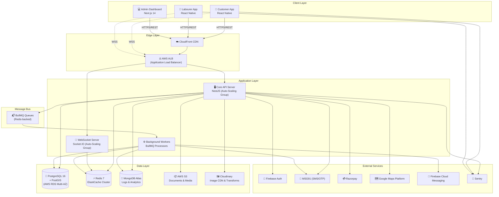

### 2.2 Module Architecture (Modular Monolith)

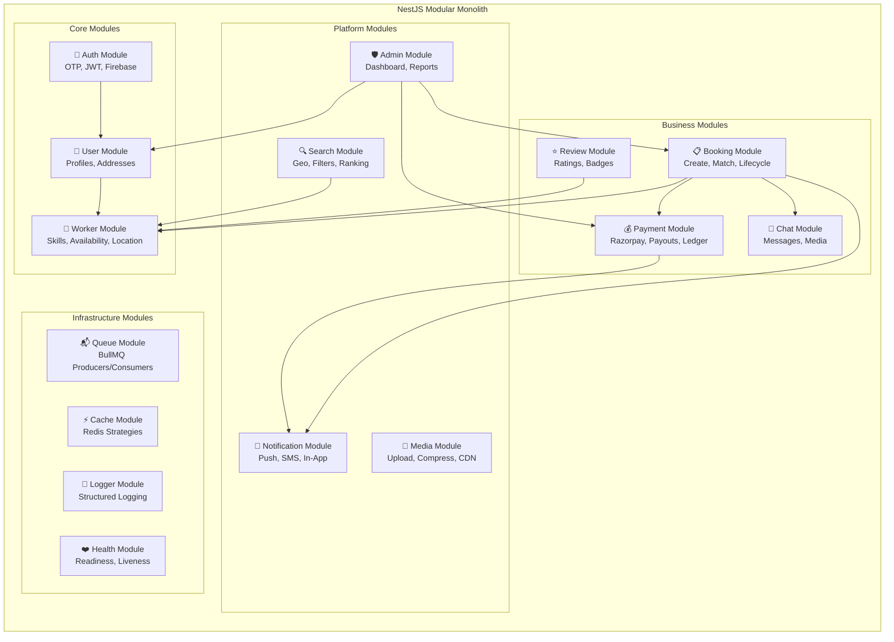

### 2.3 Deployment Architecture

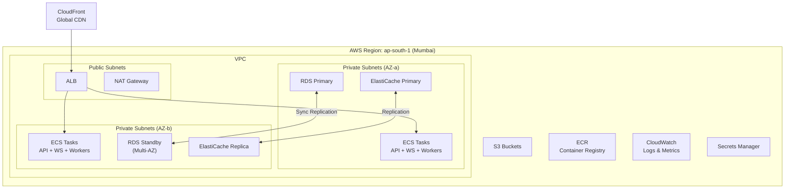

---

## 3. Tech Stack — Detailed Breakdown

### 3.1 Frontend — Mobile (React Native)

| Component | Technology | Version | Purpose |
|---|---|---|---|
| Framework | React Native | 0.74+ | Cross-platform mobile (Android + iOS) |
| JS Engine | Hermes | Bundled | Faster startup, lower memory on budget Android devices |
| Navigation | React Navigation | 6.x | Stack, tab, drawer navigation |
| State Management | Zustand | 4.x | Lightweight global state (preferred over Redux for simplicity) |
| Server State | TanStack Query (React Query) | 5.x | API caching, background refetch, optimistic updates |
| Forms | React Hook Form + Zod | Latest | Form handling + schema validation |
| Maps | react-native-maps | Latest | Google Maps integration |
| WebSocket | socket.io-client | 4.x | Real-time chat and tracking |
| Localization | react-i18next + Intl | Latest | 8-language support with Devanagari, Tamil, Telugu scripts |
| Image Handling | react-native-fast-image | Latest | Cached, prioritized image loading |
| Push Notifications | @react-native-firebase/messaging | Latest | FCM push notifications |
| Camera / Documents | react-native-camera + vision-camera | Latest | Aadhaar scanning, work photos |
| Offline Storage | WatermelonDB | Latest | Local SQLite for offline capability |
| Animations | react-native-reanimated + Lottie | Latest | 60fps UI animations, micro-interactions |
| Deep Linking | React Navigation deep links | Built-in | Share booking links, notification deep links |
| OTA Updates | CodePush (App Center) | Latest | Push JS bundle updates without app store review |
| Crash Reporting | @sentry/react-native | Latest | Crash tracking with source maps |

> [!TIP]
> **APK Size Budget:** Target < 25 MB (download), < 60 MB (installed). Use ProGuard, Hermes bytecode, and split APKs by ABI to stay within budget for labourers on low-storage devices.

### 3.2 Frontend — Admin Dashboard (Next.js)

| Component | Technology | Purpose |
|---|---|---|
| Framework | Next.js 14 (App Router) | SSR for SEO pages, client-side for dashboard |
| UI Library | shadcn/ui + Radix UI | Accessible, composable component library |
| Styling | Tailwind CSS 3 | Rapid utility-first styling |
| Charts | Recharts | Analytics dashboards, revenue graphs |
| Maps | Mapbox GL JS | Booking heatmaps, worker coverage maps |
| Data Tables | TanStack Table | Sortable, filterable, paginated data grids |
| State | Zustand + React Query | Consistent with mobile stack |
| Auth | NextAuth.js | Admin email/password + 2FA (TOTP) |
| File Upload | react-dropzone | Bulk worker document upload |
| Real-time | socket.io-client | Live booking feed, support tickets |

### 3.3 Backend — NestJS

| Component | Technology | Purpose |
|---|---|---|
| Framework | NestJS 10 | Modular, DI-based Node.js framework |
| Language | TypeScript 5.4+ | Type safety across the stack |
| ORM | Prisma 5 | Type-safe database access with migrations |
| Validation | class-validator + class-transformer | DTO validation on all endpoints |
| API Docs | Swagger (via @nestjs/swagger) | Auto-generated OpenAPI 3.0 documentation |
| Auth | Passport.js + custom JWT strategy | Firebase token verification + internal JWT issuance |
| Rate Limiting | @nestjs/throttler + Redis store | IP-based and user-based rate limiting |
| Caching | @nestjs/cache-manager + Redis | Response caching, query caching |
| WebSocket | @nestjs/websockets + Socket.IO adapter | Real-time events with Redis Pub/Sub for multi-instance |
| Job Queue | BullMQ + @nestjs/bullmq | Async jobs: notifications, payouts, analytics, image processing |
| File Upload | Multer + Cloudinary SDK | Multi-part upload with streaming to Cloudinary |
| Logging | Pino + pino-pretty | Structured JSON logging (12-factor app compliant) |
| Health Checks | @nestjs/terminus | Kubernetes/ECS-compatible health endpoints |
| Config | @nestjs/config + Joi | Environment-based config with schema validation |
| Testing | Jest + Supertest | Unit and integration test framework |

### 3.4 Database Layer

| Database | Engine | Hosting | Purpose | Data Examples |
|---|---|---|---|---|
| **PostgreSQL 16** | PostgreSQL + PostGIS | AWS RDS Multi-AZ | Primary transactional store | Users, bookings, payments, reviews, skills |
| **Redis 7** | Redis Cluster | AWS ElastiCache | Caching, sessions, real-time state, queues | OTP codes, JWT blacklist, worker locations, booking status, rate limits |
| **MongoDB 7** | MongoDB | MongoDB Atlas | Analytics, logs, unstructured data | API logs, search logs, analytics events, location history trails |

### 3.5 Infrastructure & DevOps

| Component | Technology | Purpose |
|---|---|---|
| Containers | Docker | Application containerization |
| Orchestration | AWS ECS Fargate | Serverless container orchestration (no EC2 management) |
| Registry | AWS ECR | Private Docker image registry |
| CI/CD | GitHub Actions | Build, test, deploy pipelines |
| IaC | Terraform | Infrastructure as Code for all AWS resources |
| Secrets | AWS Secrets Manager | API keys, DB passwords, JWT secrets |
| CDN | AWS CloudFront | Static assets, images, API caching |
| DNS | AWS Route 53 | Domain management, health-based routing |
| SSL/TLS | AWS Certificate Manager | Free SSL certificates, auto-renewal |
| Mobile CI | Fastlane + GitHub Actions | Automated iOS/Android builds and store deployment |
| OTA Updates | CodePush (App Center) | Over-the-air JS bundle updates |

---

## 4. API Architecture

### 4.1 Design Principles

| Principle | Implementation |
|---|---|
| **RESTful** | Resource-oriented URLs, proper HTTP verbs, standard status codes |
| **Versioned** | URI prefix: `/api/v1/...` — new major versions for breaking changes |
| **Authenticated** | Bearer JWT in `Authorization` header; public endpoints explicitly marked |
| **Rate-Limited** | Per-IP and per-User limits via Redis sliding window |
| **Idempotent** | POST endpoints accept `X-Idempotency-Key` header for safe retries |
| **Paginated** | Cursor-based pagination for lists (`?cursor=xxx&limit=20`) |
| **Filtered** | Query params for filtering (`?status=active&city=ahmedabad`) |
| **Documented** | Auto-generated Swagger UI at `/api/docs` |

### 4.2 Standard Response Envelope

**Success Response:**
```json
{
  "success": true,
  "data": {
    "id": "bk_abc123",
    "status": "confirmed",
    "worker": { "id": "usr_xyz", "name": "Suresh Kumar" }
  },
  "meta": {
    "requestId": "req_7f3a8b2c",
    "timestamp": "2026-06-01T12:00:00.000Z",
    "pagination": {
      "cursor": "eyJpZCI6MTAwfQ==",
      "hasMore": true,
      "total": 245
    }
  }
}
```

**Error Response:**
```json
{
  "success": false,
  "error": {
    "code": "BOOKING_NOT_FOUND",
    "message": "Booking with ID bk_abc123 was not found.",
    "details": [
      { "field": "bookingId", "issue": "No booking exists with this identifier" }
    ]
  },
  "meta": {
    "requestId": "req_7f3a8b2c",
    "timestamp": "2026-06-01T12:00:00.000Z"
  }
}
```

### 4.3 Authentication Flow

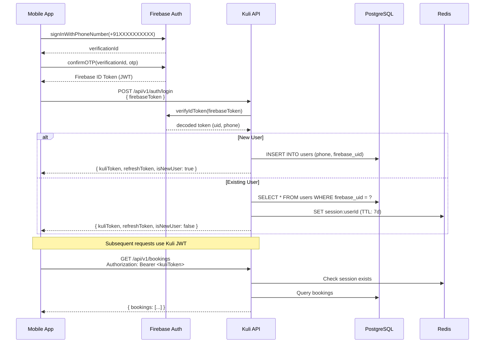

### 4.4 JWT Token Specification

| Token | Payload | TTL | Storage |
|---|---|---|---|
| **Access Token** (Kuli JWT) | `{ sub: userId, role: "customer"/"labourer"/"admin", iat, exp }` | 15 minutes | In-memory (mobile), httpOnly cookie (admin) |
| **Refresh Token** | `{ sub: userId, jti: tokenId, iat, exp }` | 7 days | Secure storage (mobile), httpOnly cookie (admin) |
| **Firebase ID Token** | Firebase-managed | 1 hour | Used only during login exchange |

**Token Refresh Flow:**
- Client detects 401 → calls `POST /api/v1/auth/refresh` with refresh token
- Server validates refresh token, issues new access + refresh token pair
- Old refresh token is invalidated (rotation) to prevent replay attacks
- If refresh token is also expired → user must re-login via Firebase OTP

### 4.5 Rate Limiting Tiers

| Endpoint Category | Rate Limit | Window | Strategy |
|---|---|---|---|
| `POST /auth/send-otp` | 5 requests | 10 minutes | Per phone number (prevent OTP bombing) |
| `POST /auth/verify-otp` | 5 attempts | 5 minutes | Per phone number (brute force protection) |
| Authentication endpoints | 20 requests | 1 minute | Per IP |
| Standard API endpoints | 100 requests | 1 minute | Per user |
| Search endpoints | 60 requests | 1 minute | Per user (expensive queries) |
| WebSocket connections | 5 connections | Per user | Max concurrent sockets |
| File uploads | 20 uploads | 1 hour | Per user |
| Admin endpoints | 200 requests | 1 minute | Per admin user |

### 4.6 API Versioning Strategy

| Version | Status | Support Policy |
|---|---|---|
| `v1` | Active | Maintained with bug fixes and non-breaking additions |
| `v2` (future) | — | Created only for breaking changes; v1 deprecated with 6-month sunset |

**Non-Breaking Changes (added to existing version):**
- Adding new optional fields to responses
- Adding new endpoints
- Adding new optional query parameters

**Breaking Changes (require new version):**
- Removing or renaming response fields
- Changing authentication scheme
- Altering required request parameters

---

## 5. Third-Party Integrations

### 5.1 Integration Map

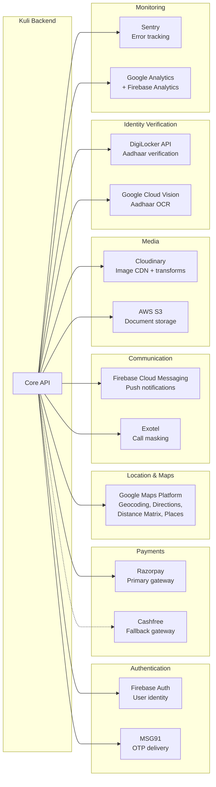

### 5.2 Integration Details

| Service | Purpose | API Type | Monthly Cost Estimate (MVP) | Fallback |
|---|---|---|---|---|
| **Firebase Auth** | User identity, phone auth | REST + SDK | Free tier (10K verifications/mo) | Custom OTP + DB |
| **MSG91** | SMS OTP delivery in India | REST | ₹15,000 (50K SMS) | Twilio (more expensive) |
| **Razorpay** | Payments (UPI, Cards, Wallets) | REST + Webhooks | 2% per transaction | Cashfree |
| **Razorpay Route** | Split payouts to workers | REST | ₹5/payout | Manual NEFT |
| **Google Maps Platform** | Geocoding, directions, places | REST | $200 (10K requests/day) | OpenStreetMap + Nominatim |
| **Firebase Cloud Messaging** | Push notifications | REST + SDK | Free | OneSignal |
| **Exotel** | Call masking (privacy) | REST | ₹10,000 (5K calls) | Twilio (more expensive) |
| **Cloudinary** | Image hosting, transforms | REST + SDK | Free tier (25K transforms) then $89/mo | S3 + Sharp (self-hosted) |
| **DigiLocker** | Aadhaar e-KYC | REST (Gov API) | Free (gov API) | Manual upload + admin review |
| **Google Cloud Vision** | Aadhaar OCR text extraction | REST | $50 (5K images) | Tesseract OCR (self-hosted) |
| **Sentry** | Error/crash tracking | SDK | Free tier (5K events) | Self-hosted Sentry |
| **Firebase Analytics** | User behavior analytics | SDK | Free | Mixpanel / Amplitude |

### 5.3 Webhook Architecture

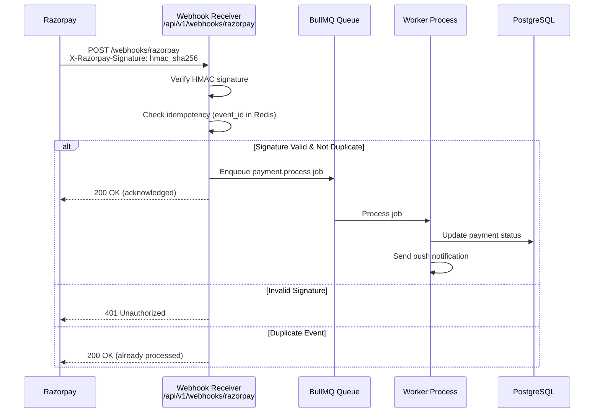

**Webhook Security:**
- All webhooks verified using HMAC-SHA256 signature
- Webhook events are idempotent — duplicate deliveries ignored via `event_id` dedup in Redis (TTL: 72h)
- Failed processing retried 3 times with exponential backoff via BullMQ
- Dead-letter queue for permanently failed webhook events → admin alert

---

## 6. Security Requirements

### 6.1 Security Architecture Overview

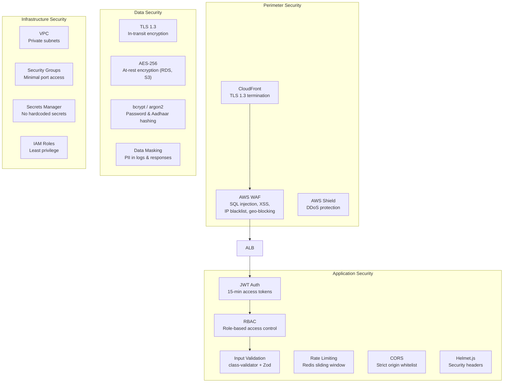

### 6.2 OWASP Top 10 Compliance

| OWASP Risk | Mitigation |
|---|---|
| **A01: Broken Access Control** | RBAC middleware on every route; user can only access own resources; admin endpoints require admin role + 2FA |
| **A02: Cryptographic Failures** | TLS 1.3 everywhere; AES-256 at rest; bcrypt for hashes; no PII in logs |
| **A03: Injection** | Prisma ORM (parameterized queries); class-validator on all DTOs; no raw SQL |
| **A04: Insecure Design** | Threat modeling during design; security reviews in PR checklist |
| **A05: Security Misconfiguration** | Terraform-managed infra; security headers via Helmet; no default credentials |
| **A06: Vulnerable Components** | `npm audit` in CI; Dependabot alerts; Snyk scanning |
| **A07: Auth Failures** | Firebase-managed OTP; JWT rotation; rate-limited auth endpoints; account lockout after 5 failures |
| **A08: Data Integrity Failures** | Webhook signature verification; signed URLs for S3; CSP headers |
| **A09: Logging Failures** | Structured logging via Pino; all auth events logged; logs shipped to CloudWatch; 90-day retention |
| **A10: SSRF** | No user-supplied URLs fetched server-side; URL allowlist for webhooks |

### 6.3 Aadhaar Data Handling (UIDAI Compliance)

> [!CAUTION]
> Aadhaar data is classified as **sensitive personal data** under India's Digital Personal Data Protection Act (DPDP) 2023 and UIDAI regulations. Violations can result in penalties up to ₹250 crore.

| Data | Storage Policy | Access |
|---|---|---|
| Aadhaar Number (12 digits) | **NEVER stored raw.** Only store SHA-256 hash for dedup. Display only last 4 digits in admin UI. | Hash accessible to verification service only |
| Aadhaar Card Image | Uploaded to encrypted S3 bucket. **Auto-deleted 72 hours after verification** (success or failure). | Admin can view during verification window only |
| Face Photo (for face-match) | Stored in encrypted S3. Deleted after verification. | Verification service only |
| Aadhaar Verification Status | `verified` / `pending` / `rejected` stored in `labourer_profiles` table | Admin + worker (own status) |

### 6.4 PCI DSS Compliance

Kuli does **not** store, process, or transmit card data. All payment processing is delegated to **Razorpay** (PCI DSS Level 1 certified). The mobile app uses Razorpay's hosted checkout / SDK, and the backend only receives `razorpay_payment_id` after successful payment.

### 6.5 Data Classification

| Classification | Examples | Storage | Access | Retention |
|---|---|---|---|---|
| **Restricted** | Aadhaar hash, bank account (encrypted), payment gateway IDs | Encrypted DB columns, encrypted S3 | Authorized services only | Per regulation |
| **Confidential** | Phone numbers, addresses, chat messages, location history | Standard DB (encrypted at rest) | User (own data), admin | 5 years bookings, 1 year chats |
| **Internal** | Booking IDs, worker skills, ratings, earnings aggregates | Standard DB | User (own), admin, API responses | 5 years |
| **Public** | Category names, general worker ratings, FAQs | Standard DB, CDN cache | Anyone | Indefinite |

---

## 7. Scalability Plan

### 7.1 Scaling Tiers

| Phase | Concurrent Users | Bookings/Day | DB Read QPS | DB Write QPS | WebSocket Connections |
|---|---|---|---|---|---|
| **MVP (2 cities)** | 5,000 | 200 | 500 | 100 | 2,000 |
| **Growth (10 cities)** | 50,000 | 3,000 | 5,000 | 1,000 | 20,000 |
| **Scale (50 cities)** | 500,000 | 25,000 | 50,000 | 10,000 | 200,000 |

### 7.2 Horizontal Scaling Strategy

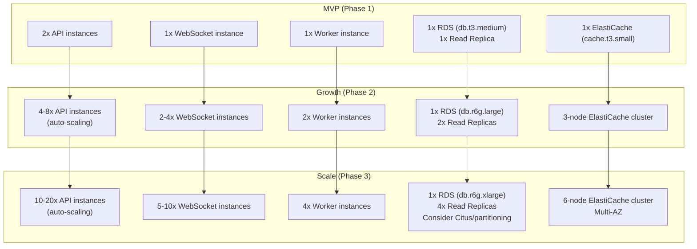

### 7.3 Database Scaling Strategy

| Strategy | When | Implementation |
|---|---|---|
| **Read Replicas** | Phase 1+ | Search and listing queries routed to read replicas via Prisma `$queryRaw` or connection-level routing |
| **Connection Pooling** | Phase 1+ | PgBouncer in front of RDS to manage connection count (ECS tasks share pool) |
| **Table Partitioning** | Phase 2+ | Partition `bookings`, `payments`, `chat_messages` by `created_at` (monthly ranges) |
| **Materialized Views** | Phase 2+ | Pre-computed analytics: daily booking counts, worker leaderboards, revenue summaries |
| **Citus / Sharding** | Phase 3 | If single-primary PostgreSQL hits write limits, shard `bookings` by `city_id` using Citus |

### 7.4 Caching Strategy

| Cache Layer | Data | TTL | Invalidation |
|---|---|---|---|
| **CDN (CloudFront)** | Static assets, category icons, training videos | 24 hours | Deploy-time cache bust |
| **API Response Cache** | Category lists, skill trees, FAQ content | 1 hour | Admin update triggers purge |
| **Redis — Hot Data** | Worker availability map, nearby workers, active booking status | 30 seconds | Updated on every location ping / status change |
| **Redis — Session** | User sessions, JWT blacklist | 7 days (session), 15 min (blacklist) | Logout / token refresh |
| **Redis — OTP** | Phone → OTP mapping | 5 minutes | Auto-expire |
| **Client (React Query)** | API responses | 5 minutes (stale), 30 min (gc) | `invalidateQueries` on mutation |
| **Client (WatermelonDB)** | User profile, active booking, chat messages | Persistent | Delta sync on app foreground |

### 7.5 WebSocket Scaling with Redis Adapter

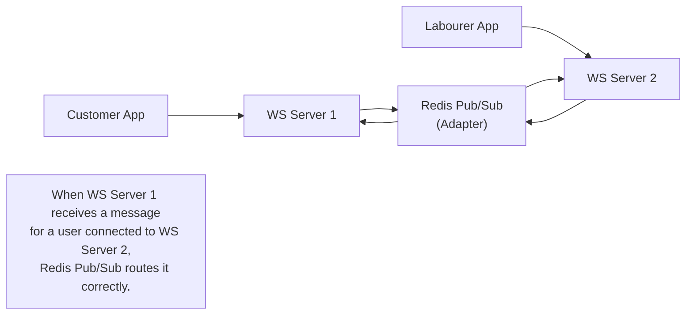

---

## 8. DevOps & Infrastructure

### 8.1 Environment Strategy

| Environment | Purpose | Infrastructure | Data | URL |
|---|---|---|---|---|
| **Local** | Developer machines | Docker Compose (PG + Redis + Mongo) | Seed data | `localhost:3000` |
| **Development** | Shared dev testing | ECS (1 instance each) | Anonymized subset | `dev-api.kuli.app` |
| **Staging** | QA & UAT | ECS (mirrors prod config) | Full clone (anonymized) | `staging-api.kuli.app` |
| **Production** | Live users | ECS (auto-scaling, multi-AZ) | Real data | `api.kuli.app` |

### 8.2 CI/CD Pipeline

```mermaid
graph LR
    subgraph "Developer"
        CODE["Push to GitHub<br/>(feature branch)"]
    end

    subgraph "CI Pipeline (GitHub Actions)"
        LINT["1. Lint<br/>ESLint + Prettier"]
        TEST["2. Test<br/>Jest (unit + integration)"]
        BUILD["3. Build<br/>Docker image"]
        SCAN["4. Security Scan<br/>npm audit + Snyk"]
        PUSH["5. Push to ECR"]
    end

    subgraph "CD Pipeline"
        DEV_DEPLOY["Deploy to Dev<br/>(auto on merge to develop)"]
        STG_DEPLOY["Deploy to Staging<br/>(auto on merge to main)"]
        E2E["6. E2E Tests<br/>(Staging)"]
        APPROVE["7. Manual Approval<br/>(Prod gate)"]
        PROD_DEPLOY["Deploy to Production<br/>(rolling update, zero-downtime)"]
    end

    CODE --> LINT --> TEST --> BUILD --> SCAN --> PUSH
    PUSH --> DEV_DEPLOY
    DEV_DEPLOY --> STG_DEPLOY --> E2E --> APPROVE --> PROD_DEPLOY
```

### 8.3 Docker Configuration

```dockerfile
# Multi-stage build for production
FROM node:20-alpine AS builder
WORKDIR /app
COPY package*.json ./
RUN npm ci --production=false
COPY . .
RUN npm run build
RUN npm prune --production

FROM node:20-alpine AS runner
WORKDIR /app
RUN addgroup -g 1001 -S nodejs && adduser -S nestjs -u 1001
COPY --from=builder --chown=nestjs:nodejs /app/dist ./dist
COPY --from=builder --chown=nestjs:nodejs /app/node_modules ./node_modules
COPY --from=builder --chown=nestjs:nodejs /app/package.json ./
USER nestjs
EXPOSE 3000
HEALTHCHECK --interval=30s --timeout=3s CMD wget -q --spider http://localhost:3000/health || exit 1
CMD ["node", "dist/main.js"]
```

### 8.4 Infrastructure as Code (Terraform)

```
terraform/
├── modules/
│   ├── vpc/           # VPC, subnets, NAT, security groups
│   ├── ecs/           # ECS cluster, services, task definitions
│   ├── rds/           # PostgreSQL RDS instance + read replicas
│   ├── elasticache/   # Redis cluster
│   ├── s3/            # S3 buckets (media, documents, backups)
│   ├── cloudfront/    # CDN distribution
│   ├── alb/           # Application load balancer
│   └── monitoring/    # CloudWatch dashboards, alarms
├── environments/
│   ├── dev/
│   ├── staging/
│   └── production/
├── main.tf
├── variables.tf
└── outputs.tf
```

### 8.5 Database Migration Strategy

| Tool | Prisma Migrate |
|---|---|
| **Migration Files** | Timestamped SQL files in `prisma/migrations/` |
| **Forward Migrations** | `prisma migrate deploy` (applied in CI/CD before app deployment) |
| **Rollback** | Each migration has a corresponding rollback SQL; manual execution if needed |
| **Schema Validation** | `prisma validate` runs in CI to catch schema errors before build |
| **Seed Data** | `prisma db seed` with `seed.ts` for development and staging |
| **Shadow Database** | Prisma uses a shadow DB to detect drift and generate migration diffs |

**Migration Safety Rules:**
1. **Never drop columns** in production — deprecate first, remove after 2 releases
2. **Always add columns as nullable** or with defaults — avoid locking large tables
3. **Index creation** uses `CONCURRENTLY` to avoid table locks
4. **Data migrations** run as separate BullMQ jobs, not in Prisma migrate

---

## 9. Performance Requirements

### 9.1 API Performance SLAs

| Endpoint Category | p50 Latency | p95 Latency | p99 Latency | Error Rate |
|---|---|---|---|---|
| Auth (OTP send/verify) | < 200ms | < 500ms | < 1s | < 0.1% |
| Search (nearby workers) | < 300ms | < 800ms | < 1.5s | < 0.5% |
| Booking (create/update) | < 200ms | < 500ms | < 1s | < 0.1% |
| Payment (create order) | < 500ms | < 1s | < 2s | < 0.1% |
| Profile (read) | < 100ms | < 300ms | < 500ms | < 0.1% |
| File upload (5MB image) | < 2s | < 4s | < 6s | < 1% |
| WebSocket (message delivery) | < 100ms | < 300ms | < 500ms | < 0.1% |

### 9.2 Mobile App Performance Targets

| Metric | Target (Android) | Target (iOS) | Measurement |
|---|---|---|---|
| Cold start (first launch) | < 3s | < 2s | Time to interactive |
| Warm start (background resume) | < 1s | < 0.5s | Time to interactive |
| JS bundle size | < 2 MB (Hermes bytecode) | < 3 MB | After tree-shaking |
| APK download size | < 25 MB | < 40 MB (IPA) | Play Store / App Store |
| Memory usage (idle) | < 80 MB | < 100 MB | Profiler |
| Memory usage (active booking) | < 150 MB | < 180 MB | Profiler |
| Battery drain (tracking active) | < 5%/hour | < 4%/hour | 10s location interval |
| Frame rate | 60 fps | 60 fps | UI thread |
| Crash-free rate | > 99.5% | > 99.7% | Sentry |
| ANR rate (Android) | < 0.2% | N/A | Play Console |

### 9.3 Database Performance Targets

| Query Type | Target Latency | Index Required |
|---|---|---|
| User lookup by phone | < 5ms | `idx_users_phone` (unique) |
| Nearby workers (PostGIS radius) | < 50ms | `idx_worker_locations_geom` (GiST) |
| Booking by ID | < 5ms | Primary key |
| Bookings by customer (paginated) | < 20ms | `idx_bookings_customer_id_created_at` |
| Worker search (category + location + rating) | < 100ms | Composite index + PostGIS |
| Payment by booking | < 5ms | `idx_payments_booking_id` |
| Chat messages by booking (paginated) | < 15ms | `idx_chat_messages_booking_id_created_at` |

---

## 10. Data Flow Diagrams

### 10.1 Complete Booking Lifecycle

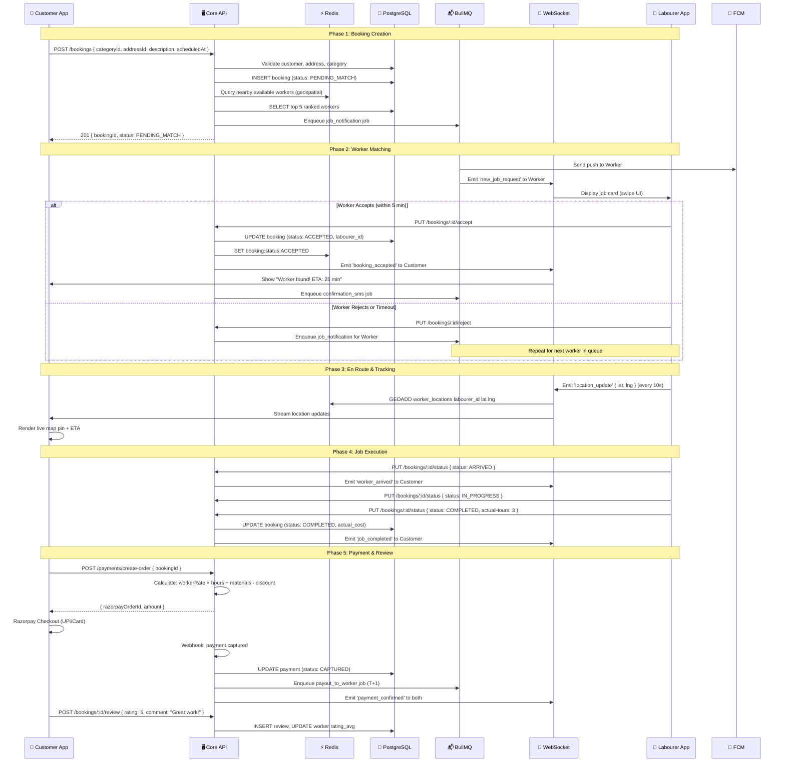

### 10.2 Real-Time Location Tracking Flow

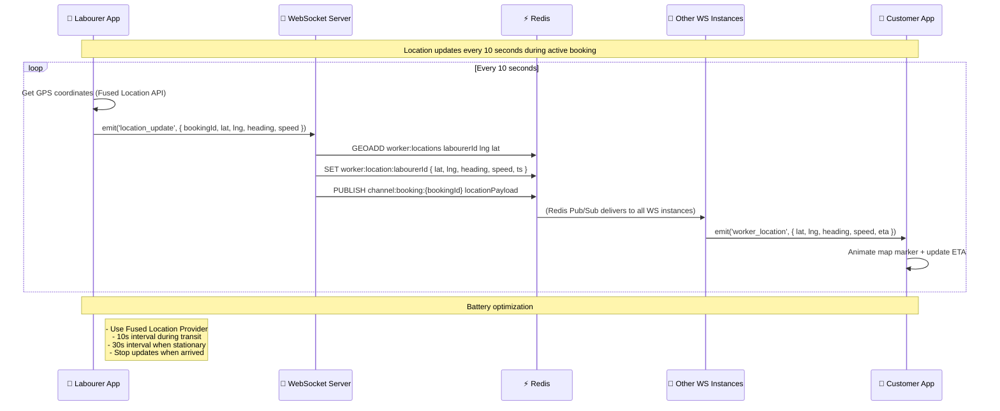

### 10.3 Payment Settlement & Payout Flow

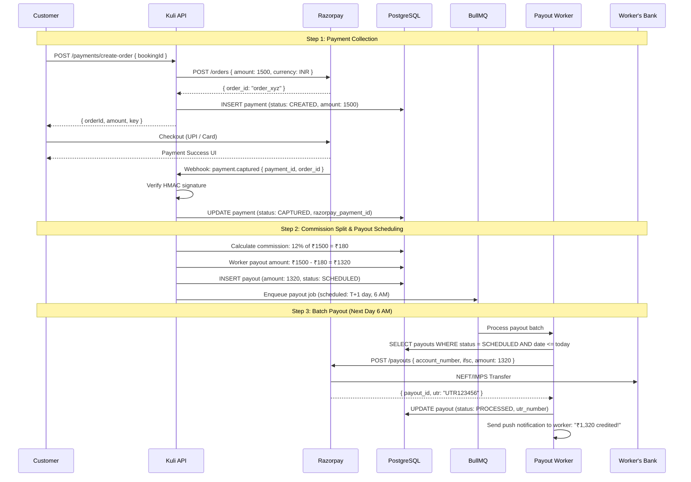

---

## 11. Error Handling Strategy

### 11.1 Error Classification

| Category | HTTP Status | Error Code Pattern | Example | Retry? |
|---|---|---|---|---|
| **Validation** | 400 | `VALIDATION_*` | `VALIDATION_PHONE_INVALID` | No — fix input |
| **Authentication** | 401 | `AUTH_*` | `AUTH_TOKEN_EXPIRED` | Yes — refresh token |
| **Authorization** | 403 | `FORBIDDEN_*` | `FORBIDDEN_NOT_OWNER` | No |
| **Not Found** | 404 | `*_NOT_FOUND` | `BOOKING_NOT_FOUND` | No |
| **Conflict** | 409 | `CONFLICT_*` | `CONFLICT_BOOKING_ALREADY_ACCEPTED` | No |
| **Rate Limit** | 429 | `RATE_LIMIT_EXCEEDED` | — | Yes — after `Retry-After` header |
| **Server Error** | 500 | `INTERNAL_*` | `INTERNAL_DATABASE_ERROR` | Yes — with backoff |
| **Service Unavailable** | 503 | `SERVICE_UNAVAILABLE` | Razorpay down | Yes — with backoff |

### 11.2 Global Exception Filter (NestJS)

```typescript
// Pseudocode for global exception handling
@Catch()
export class GlobalExceptionFilter implements ExceptionFilter {
  catch(exception: unknown, host: ArgumentsHost) {
    // 1. Classify the error
    // 2. Log structured error to Pino (includes requestId, userId, stack)
    // 3. Report to Sentry (if 5xx)
    // 4. Return standardized error envelope to client
    // 5. Never expose stack traces or internal details to client
  }
}
```

### 11.3 Client-Side Error Handling

| Scenario | Mobile App Behavior |
|---|---|
| **Network offline** | Show offline banner; queue mutations in WatermelonDB; sync on reconnect |
| **API timeout (>10s)** | Show "Taking longer than expected…" with retry button |
| **401 Token Expired** | Silently refresh token; replay original request; if refresh fails → force re-login |
| **429 Rate Limited** | Show "Too many requests, please wait" with countdown from `Retry-After` |
| **500 Server Error** | Show "Something went wrong" with "Try Again" button; auto-retry 2x with 2s/4s backoff |
| **Payment Failure** | Show specific error (e.g., "UPI timeout — please try again"); retain booking in PENDING state for 15 min |
| **WebSocket Disconnect** | Auto-reconnect with exponential backoff (1s, 2s, 4s, 8s, max 30s); show "Reconnecting…" indicator |

### 11.4 Idempotency

All **mutating** endpoints (POST for create, PUT for status changes) support idempotency:

1. Client generates a UUID v4 as `X-Idempotency-Key` header
2. Server checks Redis for key existence before processing
3. If key exists → return cached response (no re-processing)
4. If key doesn't exist → process, cache response in Redis (TTL: 24h), return response

**Critical for:** Payment creation (prevent double charge), booking creation (prevent duplicate bookings), OTP sending (prevent OTP flooding).

---

## 12. Testing Strategy

### 12.1 Testing Pyramid

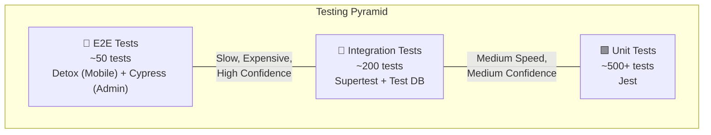

### 12.2 Test Coverage Targets

| Layer | Tool | Coverage Target | What's Tested |
|---|---|---|---|
| **Unit Tests** | Jest | > 80% line coverage | Service logic, utility functions, validators, guards |
| **Integration Tests** | Jest + Supertest + Testcontainers | > 70% of API endpoints | Full request/response cycle with real DB (Dockerized PG + Redis) |
| **E2E Tests (Mobile)** | Detox | Critical flows (8 flows) | Registration, search, booking, payment, chat, review, SOS, earnings |
| **E2E Tests (Admin)** | Cypress | Critical flows (5 flows) | Login, verification queue, dispute resolution, analytics, user management |
| **Load Tests** | k6 | Pass SLA targets | 500 RPS sustained for 10 min; 5000 concurrent WebSockets |
| **Security Tests** | OWASP ZAP + Snyk | Zero critical/high vulnerabilities | API scan, dependency audit, container scan |

### 12.3 Test Data Strategy

| Environment | Strategy | Tool |
|---|---|---|
| **Unit Tests** | In-memory mocks, factory-generated data | `@faker-js/faker` + custom factories |
| **Integration Tests** | Dockerized PostgreSQL + Redis with seed data | Testcontainers + Prisma seed |
| **E2E / Staging** | Anonymized production snapshot (monthly refresh) | `pg_dump` + anonymization script |
| **Load Tests** | Generated realistic dataset (100K users, 500K bookings) | Custom k6 scenario scripts |

### 12.4 CI Test Execution

```
on push/PR:
  1. Lint (ESLint + Prettier) — 30s
  2. Unit Tests (Jest) — 2 min
  3. Integration Tests (Supertest + Testcontainers) — 5 min
  4. Security Scan (npm audit + Snyk) — 1 min
  ─── Total CI time: ~8 min ───

on merge to main (staging deploy):
  5. E2E Tests (Detox + Cypress on staging) — 15 min
  6. Load Test (k6 smoke test — 100 RPS for 2 min) — 3 min
  ─── Total staging gate: ~18 min ───

weekly (scheduled):
  7. Full Load Test (k6 — 500 RPS for 10 min) — 15 min
  8. Security Scan (OWASP ZAP full scan) — 30 min
  9. Dependency Audit (Snyk deep scan) — 5 min
```

---

## 13. Monitoring & Observability

### 13.1 Observability Stack

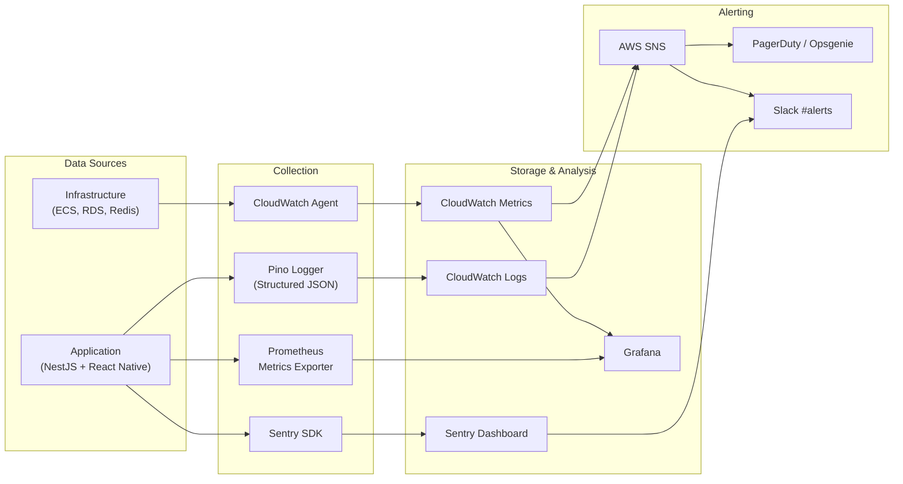

### 13.2 Key Dashboards

| Dashboard | Metrics | Audience |
|---|---|---|
| **API Health** | Request rate, error rate, latency (p50/p95/p99), active connections | Backend team |
| **Business Metrics** | Bookings/hour, booking completion rate, cancellation rate, revenue | Product + Management |
| **Infrastructure** | CPU, memory, disk I/O, network (ECS tasks, RDS, ElastiCache) | DevOps |
| **Worker Matching** | Match success rate, avg time to accept, rejection rate, worker coverage map | Product + Ops |
| **Payment Health** | Payment success rate, avg settlement time, failed payouts, refund rate | Finance + Backend |
| **Mobile Health** | Crash-free rate, ANR rate, app load time, JS error rate | Mobile team |

### 13.3 Alerting Rules

| Alert | Condition | Severity | Notification Channel |
|---|---|---|---|
| **API Error Rate Spike** | 5xx rate > 5% for 5 min | P1 — Critical | PagerDuty + Slack |
| **API Latency Degradation** | p95 > 2s for 10 min | P2 — High | Slack |
| **Database Connection Exhaustion** | Active connections > 80% pool | P1 — Critical | PagerDuty + Slack |
| **Redis Memory Warning** | Memory > 80% capacity | P2 — High | Slack |
| **Payment Failure Spike** | Failure rate > 10% for 5 min | P1 — Critical | PagerDuty + Slack + Email to CTO |
| **Worker Payout Failure** | Any payout batch fails | P2 — High | Slack + Email to Finance |
| **Mobile Crash Rate** | Crash-free < 99% for 1 hour | P2 — High | Slack |
| **Disk Space Low** | RDS storage > 85% | P2 — High | Slack |
| **SSL Certificate Expiry** | Certificate expires in < 14 days | P3 — Medium | Slack |
| **Zero Bookings** | No bookings created in 30 min (during business hours) | P1 — Critical | PagerDuty (possible outage indicator) |

### 13.4 Structured Logging Format

Every log line is a JSON object with these standard fields:

```json
{
  "timestamp": "2026-06-01T12:00:00.000Z",
  "level": "info",
  "message": "Booking created successfully",
  "service": "booking-module",
  "requestId": "req_7f3a8b2c",
  "userId": "usr_abc123",
  "traceId": "trace_xyz789",
  "method": "POST",
  "path": "/api/v1/bookings",
  "statusCode": 201,
  "durationMs": 145,
  "metadata": {
    "bookingId": "bk_def456",
    "categoryId": "cat_plumbing",
    "city": "ahmedabad"
  }
}
```

**Logging Rules:**
- ✅ Log all API requests (method, path, status, duration, userId)
- ✅ Log all business events (booking created/accepted/completed, payment captured, payout processed)
- ✅ Log all errors with stack traces
- ❌ Never log PII (phone numbers, Aadhaar, bank accounts) — mask or omit
- ❌ Never log request/response bodies containing sensitive data
- ❌ Never log JWT tokens or API keys

---

## 14. Technical Debt & Evolution Strategy

### 14.1 Planned Technical Migrations

| Phase | Migration | Trigger | Effort |
|---|---|---|---|
| Phase 2 | Extract **Notification Service** into standalone microservice | > 50K push/day causing queue congestion | 2 weeks |
| Phase 2 | Extract **Chat Service** with dedicated MongoDB | Chat volume > 100K messages/day | 3 weeks |
| Phase 3 | Extract **Payment Service** | PCI audit requirements, payment logic complexity | 4 weeks |
| Phase 3 | Migrate from **ECS Fargate → Kubernetes (EKS)** | Team grows beyond 15 engineers, need advanced orchestration | 6 weeks |
| Phase 3 | Add **GraphQL gateway** (Apollo Federation) alongside REST | Mobile team needs flexible queries, reduce over-fetching | 4 weeks |
| Phase 3 | Implement **Event Sourcing** for bookings | Need complete audit trail, support undo/replay | 6 weeks |

### 14.2 Technology Radar

| Adopt (Using Now) | Trial (Evaluating) | Assess (Watching) | Hold (Not Yet) |
|---|---|---|---|
| NestJS, React Native, PostgreSQL, Redis, BullMQ | GraphQL (Apollo), Kubernetes (EKS), Terraform CDK | gRPC (inter-service), Apache Kafka (event streaming), EdgeDB | Microservices (premature), Serverless-only (cold starts), Blockchain (unnecessary) |

---

> [!NOTE]
> This TRD is a living document maintained by the Engineering Lead. It is updated alongside major architectural decisions, tech stack changes, or scaling events. All changes require review by the CTO and relevant tech leads.

---

*End of Document — TRD v2.0*
