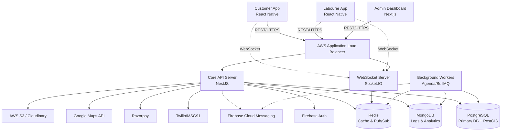
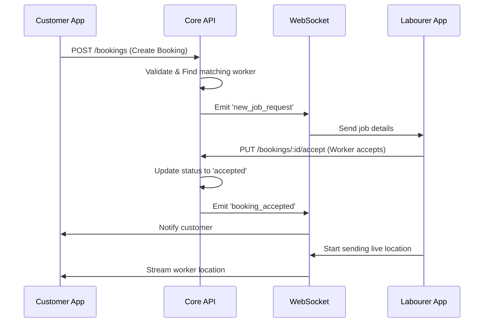
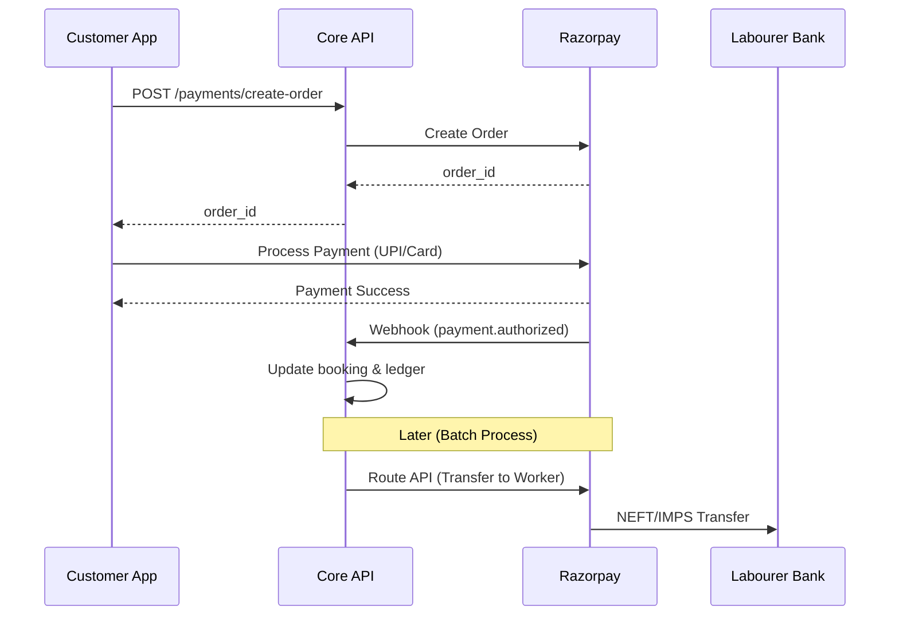

# Technical Requirements Document (TRD) - Kuli Labour App

## 1. Technical Overview

**Architecture Summary:** 
Kuli Labour App employs a modern microservices-oriented monolithic backend (modular monolith) architecture for the MVP phase, designed to easily scale into true microservices as traffic demands. The system separates concerns between the mobile client APIs, the admin web APIs, and background processing workers. The real-time nature of the app (live location tracking and chat) relies heavily on WebSocket connections alongside a RESTful core.

**Tech Stack Rationale:**
- **React Native** allows a single codebase for both Android and iOS, crucial for fast MVP delivery and keeping maintenance costs low.
- **Node.js (NestJS)** provides a highly structured backend architecture utilizing TypeScript, improving type safety and team collaboration.
- **PostgreSQL** is chosen for its ACID compliance and powerful geospatial query capabilities (PostGIS) which are essential for radius-based worker matching.
- **Redis** is indispensable for low-latency operations like real-time worker availability, sessions, and fast caching.
- **MongoDB** is selected for unstructured data like audit logs, search history, and unstructured chat messages.

## 2. System Architecture



## 3. Tech Stack

- **Frontend:** React Native (Mobile), React.js + Next.js (Admin Dashboard)
- **Backend:** Node.js with NestJS framework (TypeScript)
- **Database:** PostgreSQL (Primary transactional DB), Redis (Caching/Sessions/Geospatial cache), MongoDB (Logs/Analytics)
- **Real-time:** Socket.IO for chat and live tracking
- **Maps & Routing:** Google Maps API (Geocoding, Distance Matrix, Places)
- **Payments:** Razorpay integration (UPI, cards, wallets, bank transfer, split payouts)
- **Authentication:** Firebase Auth with OTP verification via Twilio or MSG91
- **Push Notifications:** Firebase Cloud Messaging (FCM)
- **File Storage:** AWS S3 for documents, Cloudinary for profile image optimization
- **Hosting:** AWS (EC2, RDS, ElastiCache, S3, CloudFront)
- **CI/CD:** GitHub Actions
- **Monitoring & Observability:** Sentry (Crash reporting), CloudWatch (Infra metrics), Grafana/Prometheus (App metrics)

## 4. API Architecture

- **Design:** RESTful architecture for standard CRUD operations. WebSockets for real-time data.
- **Versioning:** URI versioning implemented from day one (e.g., `/api/v1/users`, `/api/v1/bookings`).
- **Rate Limiting:** IP-based and User-ID-based rate limiting via Redis. Stricter limits on authentication endpoints (OTP generation).
- **Authentication:** 
  - Firebase Auth issues short-lived JWTs.
  - Backend verifies Firebase JWTs and issues a custom internal JWT containing user roles and permissions.
  - Refresh token rotation implemented for security.
- **Format:** Standardized JSON responses.
  ```json
  {
    "success": true,
    "data": { ... },
    "error": null,
    "meta": { "timestamp": "...", "requestId": "..." }
  }
  ```

## 5. Third-Party Integrations

1. **Google Maps API:** Used for customer address autocompletion, calculating distance between worker and customer, and providing turn-by-turn navigation data for workers.
2. **Razorpay:** Handles booking hold amounts, final captures, and automated periodic payouts (Razorpay Route) to laborer bank accounts.
3. **Firebase & MSG91:** Firebase for managing user identities. MSG91 for reliable SMS OTP delivery in India.
4. **Sentry:** Captures uncaught exceptions on mobile and backend.
5. **AWS S3 & Textract (Optional):** S3 for storing Aadhaar images. AWS Textract/Google Cloud Vision for OCR to auto-read Aadhaar numbers during onboarding.

## 6. Security Requirements

- **Data Encryption:** TLS 1.3 for all in-transit data. AES-256 for data at rest in RDS and S3.
- **OWASP Compliance:** Protection against SQL Injection (using ORM/Query Builders), XSS, CSRF, and timing attacks.
- **Aadhaar Data Handling:** Aadhaar numbers must be masked in the database (store only the last 4 digits) or hashed. Full images must be stored in private, strictly controlled S3 buckets and deleted after verification (if legal compliance permits).
- **GDPR / DPDP Act (India):** Users must have the ability to request data deletion. Explicit consent required for location tracking.

## 7. Scalability Plan

- **Horizontal Scaling:** API and WebSocket servers are stateless. Can be scaled infinitely behind the ALB.
- **WebSocket Scaling:** Use Redis Pub/Sub adapter for Socket.IO to broadcast events across multiple WebSocket server instances.
- **Database Scaling:** Read-replicas for PostgreSQL to handle heavy read traffic (e.g., worker searches). Redis handles the highest frequency operations (location updates).
- **CDN:** CloudFront caches all static assets and profile images.

## 8. DevOps & Infrastructure

- **Environments:** 
  - `Development`: Rapid iteration, mock external APIs.
  - `Staging`: Mirror of production for QA and user acceptance testing.
  - `Production`: Highly available, multi-AZ deployment.
- **CI/CD Pipeline:** 
  - GitHub Actions triggers on push.
  - Runs linting, unit tests, and integration tests.
  - Builds Docker images and pushes to Amazon ECR.
  - ECS updates services with zero-downtime rolling deployments.
  - Mobile: Fastlane for automated builds and deployment to App Store/Play Store.

## 9. Performance Requirements

- **API Response Times:** 95th percentile < 200ms for standard endpoints. < 50ms for cached data (e.g., nearby workers).
- **Mobile App Load Time:** < 2 seconds to interactive state.
- **Concurrent Users:** MVP architecture must support 5,000 concurrent active WebSocket connections and 500 API requests per second.
- **Location Updates:** Worker app should transmit location every 10 seconds during an active job journey without draining battery excessively.

## 10. Data Flow Diagrams

### 10.1 Booking Flow Sequence



### 10.2 Payment Flow Sequence



## 11. Error Handling Strategy

- **Global Exception Filter:** Catches all unhandled exceptions, logs to Sentry, and returns a standardized error response to the client.
- **Client-Side:** Graceful degradation. If network fails, show a friendly offline screen. Retry mechanisms with exponential backoff for failed API calls.
- **Idempotency:** Payment and booking creation endpoints must be idempotent to prevent duplicate charges or bookings during network hiccups (using `X-Idempotency-Key` headers).

## 12. Testing Strategy

- **Unit Testing:** Jest for testing individual services, controllers, and utility functions. (Target: 70% coverage).
- **Integration Testing:** Supertest for API endpoint testing against a test database instance.
- **End-to-End (E2E) Testing:** Detox for React Native to simulate real user interactions on emulators (login, booking flow).
- **Load Testing:** Artillery or k6 to simulate thousands of concurrent users and WebSocket connections to identify bottlenecks before launch.
