# 📱 Kuli Labour App — App Flow Document

> **Document 3 of the Full Project Documentation Suite**
> **Version**: 1.0.0 | **Last Updated**: 2026-06-01
> **Status**: Final Draft

---

## Table of Contents

1. [Flow Overview](#1-flow-overview)
2. [Onboarding Flow — Customer](#2-onboarding-flow--customer)
3. [Onboarding Flow — Labourer](#3-onboarding-flow--labourer)
4. [Service Booking Flow — Customer](#4-service-booking-flow--customer)
5. [Job Acceptance Flow — Labourer](#5-job-acceptance-flow--labourer)
6. [Payment Flow](#6-payment-flow)
7. [Chat & Communication Flow](#7-chat--communication-flow)
8. [Dispute & Support Flow](#8-dispute--support-flow)
9. [Admin Dashboard Flow](#9-admin-dashboard-flow)
10. [Navigation Map](#10-navigation-map)
11. [State Diagrams](#11-state-diagrams)

---

## 1. Flow Overview

The Kuli app supports three distinct user personas, each with its own entry point, feature set, and flow topology. Every flow has been designed to accommodate **low-literacy users** with minimal reading, icon-driven navigation, and voice-assisted input wherever applicable.

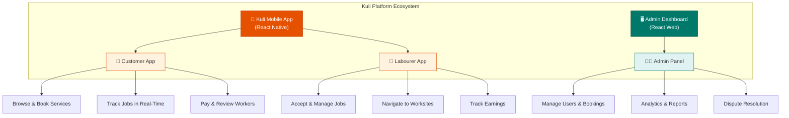

### Flow Design Principles

| Principle | Description |
|-----------|-------------|
| **Minimal Steps** | Every flow is optimized for the fewest possible taps to completion |
| **Progressive Disclosure** | Complex information is revealed step-by-step, not all at once |
| **Error Recovery** | Every error state has a clear recovery path with retry options |
| **Offline Awareness** | Graceful degradation when network is unavailable |
| **Accessibility First** | Large touch targets (48dp+), voice input, icon+text pairing |
| **Bilingual Support** | All flows work in Hindi and English with dynamic text sizing |

---

## 2. Onboarding Flow — Customer

The customer onboarding is designed for simplicity — a user can go from first launch to browsing workers in **under 90 seconds**.

### 2.1 High-Level Flow

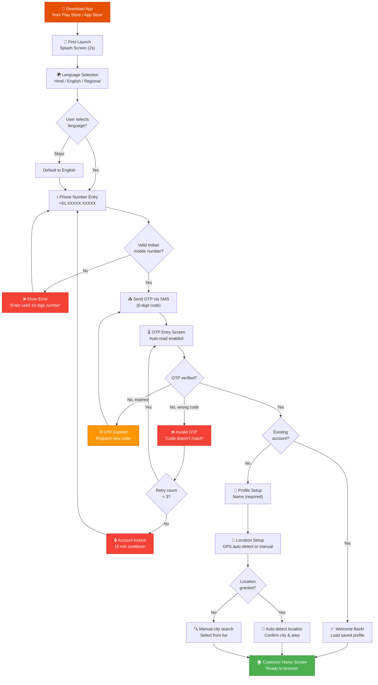

### 2.2 Screen-by-Screen Detail

| Step | Screen | Key Elements | Validation | Error State |
|------|--------|--------------|------------|-------------|
| 1 | Splash Screen | App logo, tagline animation, loading indicator | — | Crash recovery → restart |
| 2 | Language Selection | Grid of language tiles with flag icons and native script | At least one selected | Default fallback to English |
| 3 | Phone Entry | Large numeric keypad, country code locked to +91 | 10 digits, starts with 6-9 | Inline error, red border |
| 4 | OTP Entry | 6 separate input boxes, auto-focus, countdown timer | 6 digits, within 5 min | Wrong code toast, expiry redirect |
| 5 | Profile Setup | Name field, optional profile photo | Name ≥ 2 characters | "Name is required" hint |
| 6 | Location Setup | Map view, GPS button, search bar, popular cities | Valid Indian city | "Couldn't detect location" fallback |
| 7 | Home Screen | Category grid, search bar, recent bookings | — | Empty state with suggestions |

### 2.3 Edge Cases & Error Handling

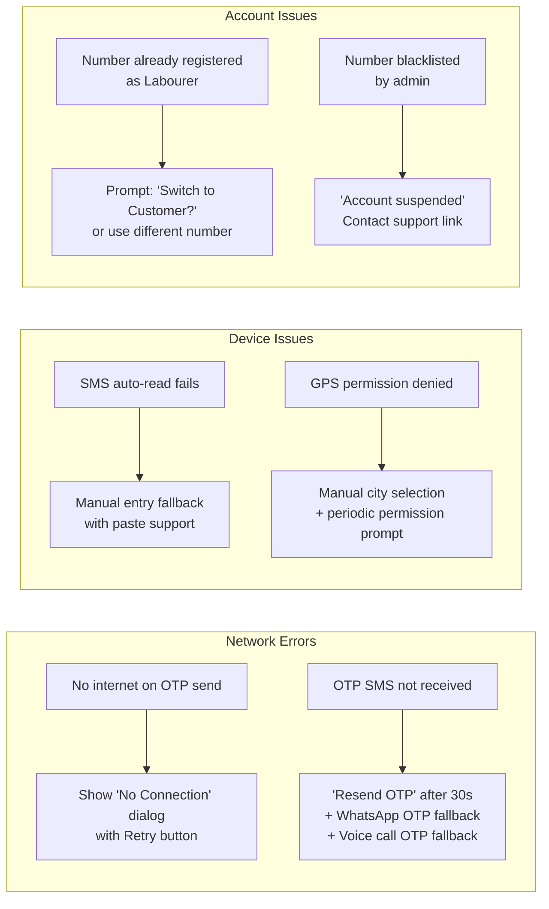

---

## 3. Onboarding Flow — Labourer

The labourer onboarding is more involved due to **identity verification** (Aadhaar KYC) and **skill profiling**. The flow is designed with **extra-large buttons, voice prompts, and icon-first design** to accommodate low-literacy users.

### 3.1 High-Level Flow

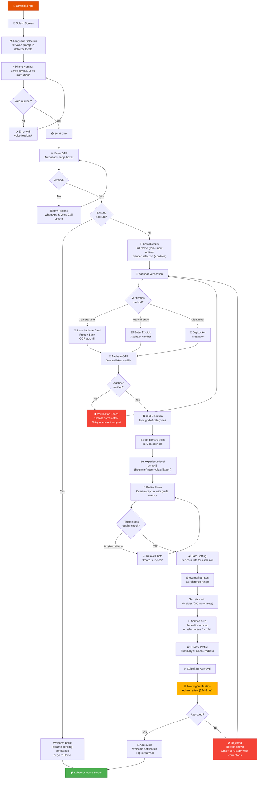

### 3.2 Aadhaar Verification Deep Dive

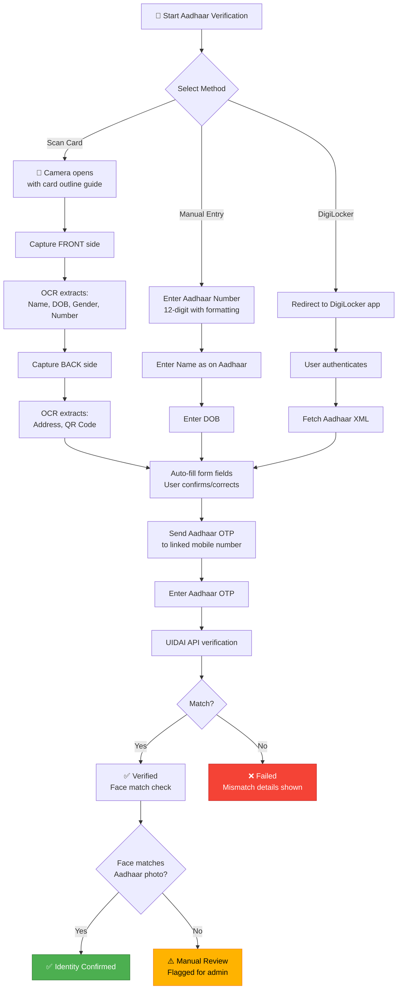

### 3.3 Skill Selection Matrix

| Category | Sub-Skills | Icon | Experience Levels |
|----------|-----------|------|-------------------|
| 🔧 Plumbing | Pipe fitting, Leak repair, Bathroom installation, Water tank | Wrench | Beginner (0-1yr), Intermediate (1-5yr), Expert (5yr+) |
| 🎨 Painting | Interior, Exterior, Texture, Waterproofing | Paint roller | Same |
| ⚡ Electrical | Wiring, Appliance repair, Fan/Light installation, AC service | Lightning bolt | Same |
| 🪚 Carpentry | Furniture repair, Door/Window fitting, Woodwork | Saw | Same |
| 🧹 Cleaning | Deep clean, Regular clean, Post-construction, Office | Broom | Same |
| 📦 Moving | Packing, Loading/Unloading, Full house shifting | Box | Same |
| 🏗️ Masonry | Brickwork, Tiling, Plastering | Trowel | Same |
| 🔩 Welding | Grill work, Gate fabrication, Structural welding | Welding mask | Same |
| 🌿 Gardening | Lawn maintenance, Tree trimming, Landscaping | Plant | Same |
| 🚰 AC/Appliance | AC service, Washing machine, Refrigerator, RO/Water purifier | Snowflake | Same |

---

## 4. Service Booking Flow — Customer

This is the **core revenue-generating flow** of the application. It covers the full lifecycle from service discovery to post-job review.

### 4.1 Complete Booking Flow

```mermaid
flowchart TD
    A["🏠 Customer Home Screen"] --> B["🔍 Select Service Category<br/>Tap category tile or search"]
    B --> C["📋 Browse Available Workers<br/>Filtered by category + location"]
    C --> C1["Sort by: Rating / Price / Distance / Availability"]
    C1 --> D["👤 View Worker Profile<br/>Photo, rating, reviews, skills, rate"]

    D --> D1{"Worker<br/>available?"}
    D1 -- "No" --> D2["⚠️ 'Currently Busy'<br/>Options: Set reminder / Browse others"]
    D1 -- "Yes" --> E["📅 Select Date & Time"]

    E --> E1{"Date/time<br/>valid?"}
    E1 -- "Past date" --> E2["❌ 'Select future date'"] --> E
    E1 -- "Worker busy that slot" --> E3["⚠️ 'Slot unavailable'<br/>Show alternative slots"] --> E
    E1 -- "Valid" --> F["📍 Confirm Service Address"]

    F --> F1{"Use saved<br/>address?"}
    F1 -- "Yes" --> F2["Select from saved addresses"]
    F1 -- "No" --> F3["Enter new address<br/>Map pin + text + landmark"]
    F2 --> G["📝 Add Job Description<br/>(Optional) Voice or text<br/>+ Attach photos"]
    F3 --> G

    G --> H["📋 Review Booking Summary"]
    H --> H1["Show: Worker, Service, Date/Time,<br/>Address, Estimated cost,<br/>Platform fee breakdown"]
    H1 --> I["💳 Select Payment Method"]

    I --> I1{"Payment<br/>method?"}
    I1 -- "UPI" --> I2["Select UPI app<br/>(GPay, PhonePe, Paytm)"]
    I1 -- "Cash" --> I3["Cash on completion<br/>Advance ₹50 platform fee via UPI"]
    I1 -- "Wallet" --> I4["Kuli Wallet balance<br/>Insufficient → top up"]
    I1 -- "Card" --> I5["Saved/New card<br/>via Razorpay"]

    I2 --> J["✅ Confirm Booking"]
    I3 --> J
    I4 --> J
    I5 --> J

    J --> K["📤 Booking Request Sent<br/>to Worker"]
    K --> L{"Worker<br/>responds?"}
    L -- "Accepts" --> M["✅ Booking Confirmed!<br/>Push notification to customer"]
    L -- "Rejects" --> N["🔄 Auto-assign to<br/>next available worker"]
    L -- "No response (5 min)" --> O["⏰ Timeout<br/>Auto-reassign"]
    N --> N1{"Alternative<br/>found?"}
    N1 -- "Yes" --> M
    N1 -- "No" --> N2["❌ No workers available<br/>Notify customer<br/>Option: Schedule for later"]
    O --> N

    M --> P["📍 Track Worker<br/>Live map with ETA"]
    P --> P1["Worker en route<br/>Customer can chat/call"]
    P1 --> Q["🏁 Worker Arrives<br/>Customer gets notification"]
    Q --> Q1["Worker marks 'Arrived'<br/>with geofence verification"]
    Q1 --> R["🔨 Job In Progress<br/>Timer starts"]
    R --> R1["Worker can:<br/>• Log materials used<br/>• Extend time (with approval)<br/>• Add photos of work"]
    R1 --> S["✅ Job Completed<br/>Worker marks done"]
    S --> S1["Customer confirms<br/>job completion"]

    S1 --> T["💰 Payment Processed"]
    T --> T1["Final amount calculated<br/>(hours × rate + materials)"]
    T1 --> U["⭐ Rate & Review<br/>1-5 stars + optional comment"]
    U --> V["🎉 Booking Complete!<br/>Receipt generated<br/>Back to Home"]

    style A fill:#E65100,stroke:#BF360C,color:#fff
    style V fill:#4CAF50,stroke:#2E7D32,color:#fff
    style N2 fill:#F44336,stroke:#C62828,color:#fff
    style D2 fill:#FFB300,stroke:#F57F17,color:#000
```

### 4.2 Booking Confirmation Details

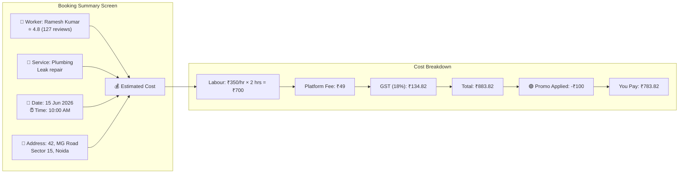

### 4.3 Real-Time Tracking Flow

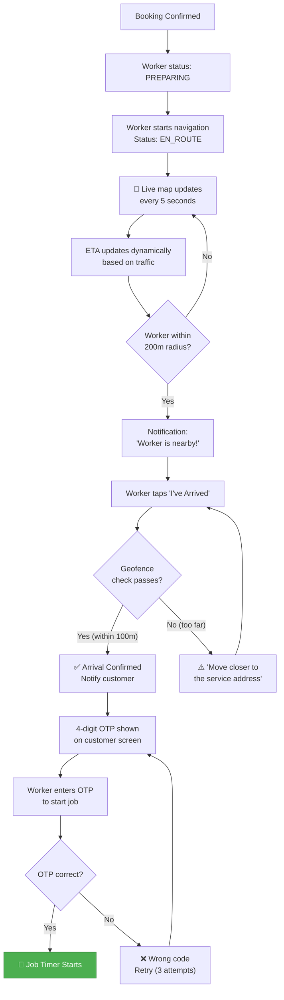

### 4.4 Booking Cancellation Sub-Flow

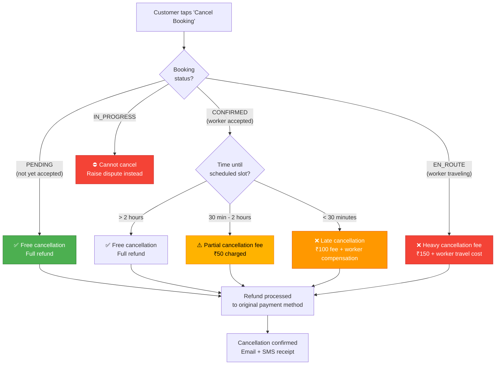

---

## 5. Job Acceptance Flow — Labourer

This flow is optimized for **single-hand operation** with large interactive elements. Labourers can manage jobs even while commuting or at a worksite.

### 5.1 Complete Job Flow

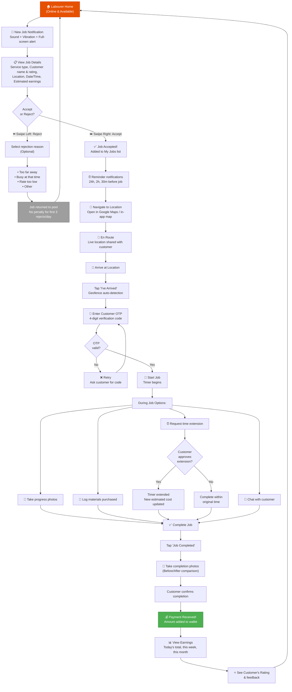

### 5.2 Job Notification — Full Screen Alert Design

```mermaid
flowchart LR
    subgraph "Job Alert Screen (Labourer)"
        direction TB
        A["🔔 NEW JOB REQUEST"]
        B["━━━━━━━━━━━━━━━━━━━━"]
        C["🔧 Plumbing - Leak Repair"]
        D["👤 Customer: Priya S. ⭐ 4.6"]
        E["📍 2.3 km away - Sector 15, Noida"]
        F["📅 Today, 3:00 PM"]
        G["💰 Est. ₹700 (2 hrs × ₹350/hr)"]
        H["━━━━━━━━━━━━━━━━━━━━"]
        I["⬅️ SWIPE LEFT TO REJECT"]
        J["➡️ SWIPE RIGHT TO ACCEPT"]
        K["⏱️ Auto-reject in 60 seconds"]
    end
```

### 5.3 Daily Schedule Management

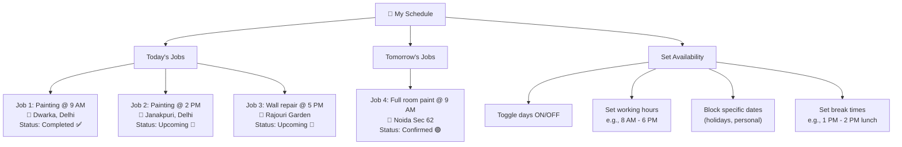

---

## 6. Payment Flow

The payment system handles **multi-method payments**, **commission splitting**, **refunds**, and **worker payouts** in compliance with Indian payment regulations (RBI guidelines, GST).

### 6.1 End-to-End Payment Flow

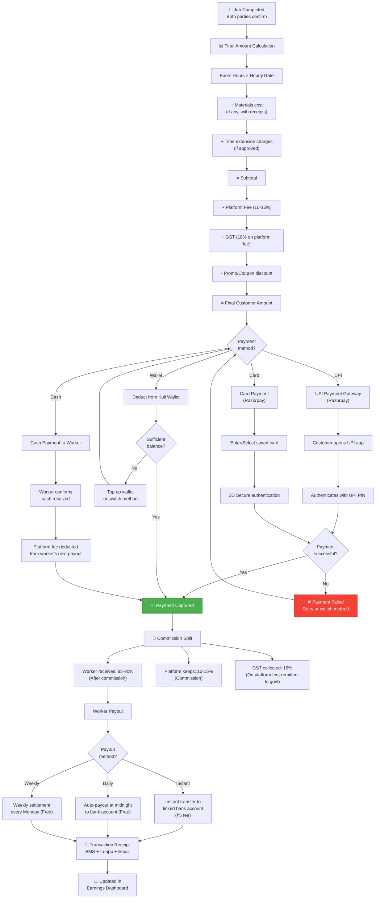

### 6.2 Commission Structure

| Tier | Monthly Bookings | Platform Commission | Worker Gets |
|------|-----------------|---------------------|-------------|
| 🥉 Bronze | 0 - 10 | 15% | 85% |
| 🥈 Silver | 11 - 30 | 12% | 88% |
| 🥇 Gold | 31 - 50 | 10% | 90% |
| 💎 Diamond | 50+ | 8% | 92% |

### 6.3 Refund Processing Flow

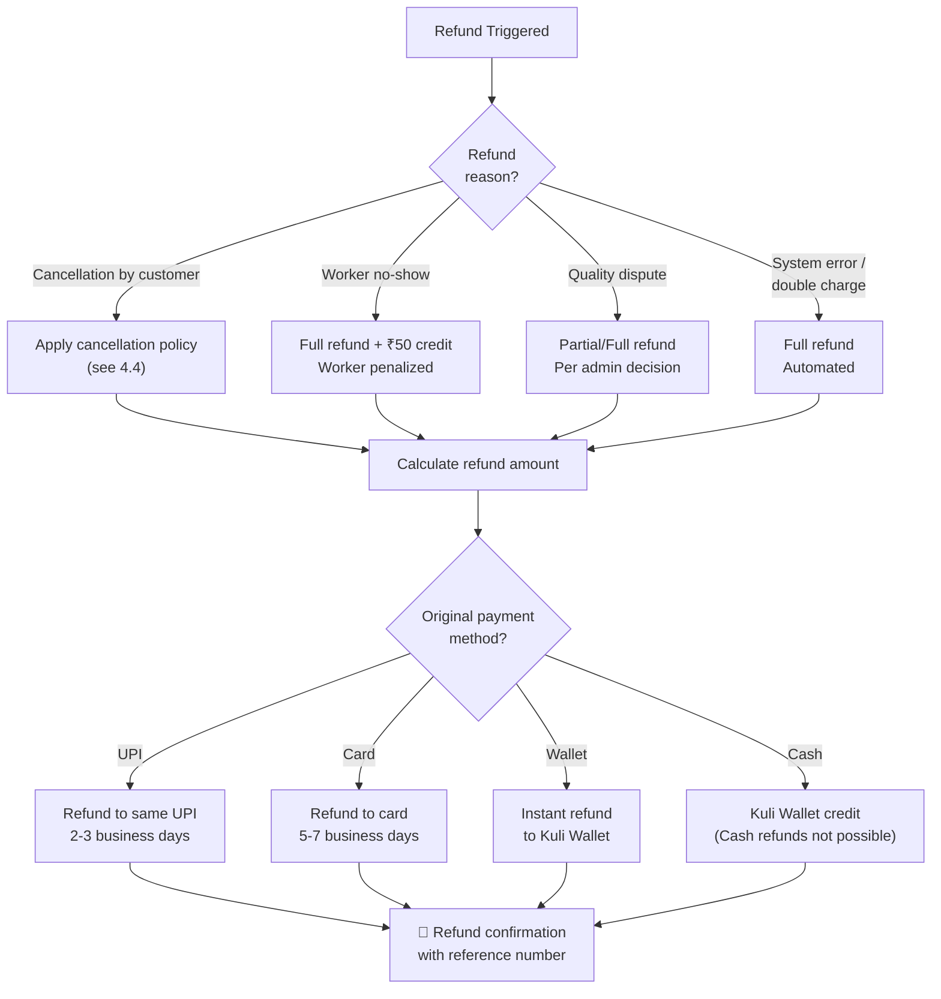

---

## 7. Chat & Communication Flow

Kuli provides **privacy-first communication** between customers and labourers with call masking, in-app chat, and safety features.

### 7.1 Communication Channels

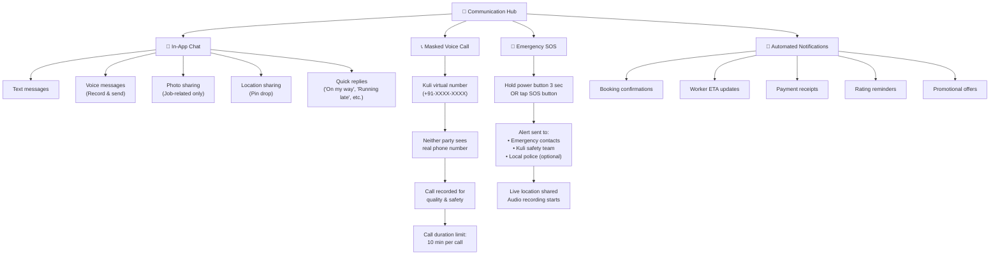

### 7.2 Chat Flow Detail

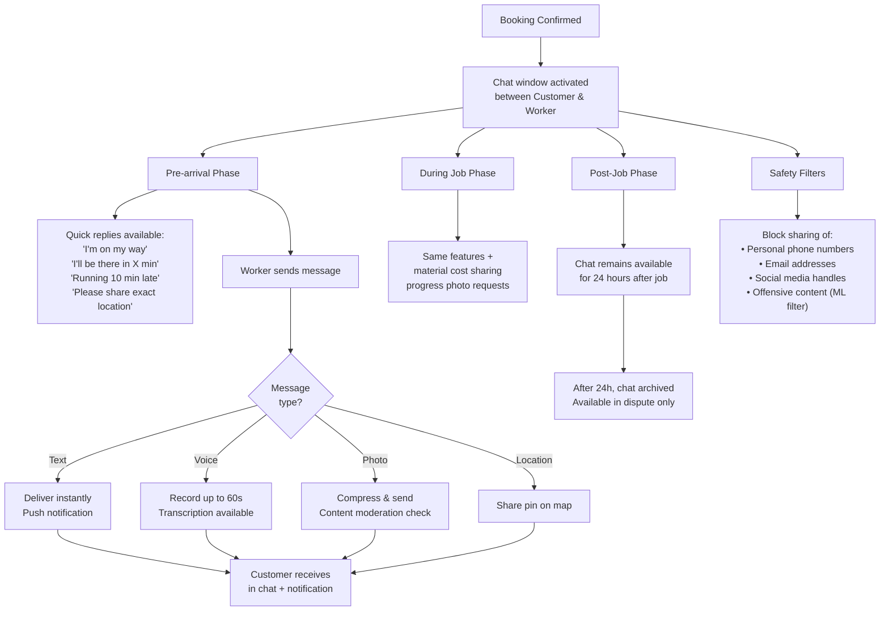

### 7.3 Call Masking Architecture

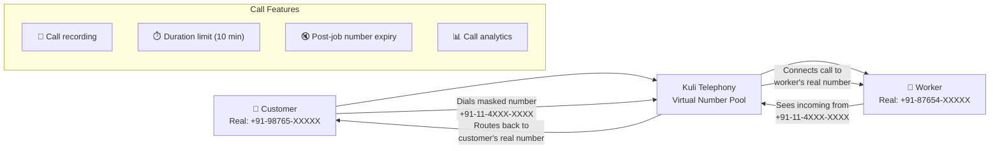

---

## 8. Dispute & Support Flow

### 8.1 Complete Dispute Flow

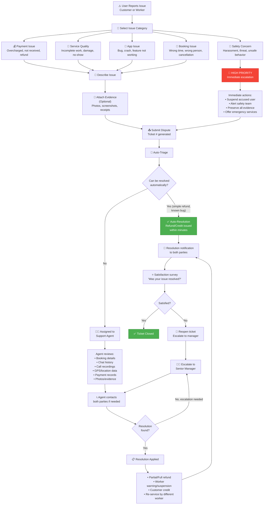

### 8.2 Dispute Resolution SLAs

| Priority | Category | First Response | Resolution Target | Escalation |
|----------|----------|---------------|-------------------|------------|
| 🔴 Critical | Safety concerns | 15 minutes | 2 hours | Immediate to safety team |
| 🟠 High | Payment issues, no-show | 1 hour | 24 hours | After 12 hours |
| 🟡 Medium | Service quality | 4 hours | 48 hours | After 24 hours |
| 🟢 Low | App issues, general | 12 hours | 72 hours | After 48 hours |

### 8.3 Support Channels

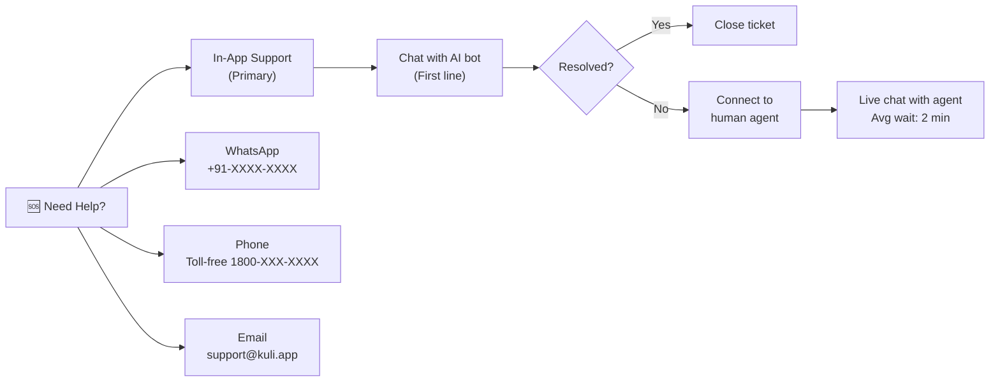

---

## 9. Admin Dashboard Flow

### 9.1 Admin Login & Authentication

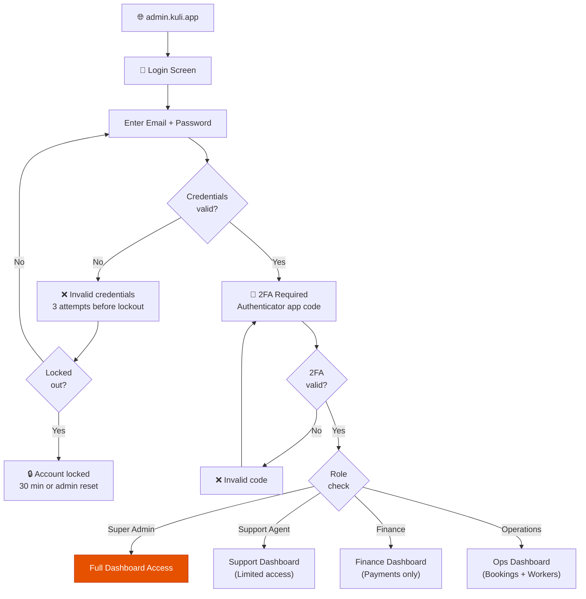

### 9.2 Dashboard Overview Flow

```mermaid
flowchart TD
    A["📊 Admin Dashboard Home"] --> B["Today's Overview Cards"]
    B --> B1["Active Bookings: 1,247"]
    B --> B2["Online Workers: 3,891"]
    B --> B3["Today's Revenue: ₹4,52,300"]
    B --> B4["Open Disputes: 23"]
    B --> B5["Pending Approvals: 156"]

    A --> C["Quick Actions"]
    C --> C1["👤 User Management"]
    C --> C2["📋 Booking Management"]
    C --> C3["💰 Financial Reports"]
    C --> C4["⚙️ System Settings"]
    C --> C5["📢 Push Notifications"]
    C --> C6["🎫 Promo Management"]

    C1 --> D["User Management"]
    D --> D1["Search users<br/>(by name, phone, ID)"]
    D --> D2["View user profile"]
    D --> D3["Approve/Reject workers"]
    D --> D4["Suspend/Ban users"]
    D --> D5["Verify documents"]

    C2 --> E["Booking Management"]
    E --> E1["View all bookings<br/>(filterable table)"]
    E --> E2["Booking details"]
    E --> E3["Reassign worker"]
    E --> E4["Cancel/Refund booking"]
    E --> E5["View dispute history"]

    C3 --> F["Financial Reports"]
    F --> F1["Revenue dashboard<br/>(daily/weekly/monthly)"]
    F --> F2["Commission earned"]
    F --> F3["Pending payouts"]
    F --> F4["Refund reports"]
    F --> F5["Tax reports (GST)"]
    F --> F6["Download CSV/PDF"]

    C4 --> G["System Settings"]
    G --> G1["Commission rates"]
    G --> G2["Service categories"]
    G --> G3["City/Area management"]
    G --> G4["Pricing rules"]
    G --> G5["App content (banners, FAQs)"]
```

### 9.3 Worker Approval Workflow

```mermaid
flowchart TD
    A["📋 Pending Approvals Queue<br/>(156 pending)"] --> B["Select worker application"]
    B --> C["Review Application"]

    C --> C1["📸 Profile photo<br/>Check: Face visible, appropriate"]
    C --> C2["🪪 Aadhaar details<br/>Check: Valid, matches photo"]
    C --> C3["🛠️ Skills claimed<br/>Check: Reasonable for profile"]
    C --> C4["💰 Rates set<br/>Check: Within market range"]
    C --> C5["📍 Service area<br/>Check: We operate there"]
    C --> C6["🤖 Auto-verification<br/>Aadhaar API + Face match score"]

    C6 --> D{"Auto-check<br/>result?"}
    D -- "All green (>90% match)" --> E["✅ Auto-Approve<br/>(with admin notification)"]
    D -- "Flags detected" --> F["⚠️ Manual Review Required"]

    F --> G{"Admin<br/>decision?"}
    G -- "Approve" --> H["✅ Approved<br/>Worker notified<br/>Account activated"]
    G -- "Reject" --> I["❌ Rejected<br/>Reason selected<br/>Worker notified with details"]
    G -- "Need more info" --> J["🔄 Request Additional Info<br/>Worker notified to update"]

    I --> I1["Rejection reasons:<br/>• Blurry/inappropriate photo<br/>• Aadhaar mismatch<br/>• Rates outside acceptable range<br/>• Service area not supported<br/>• Background check concern"]

    J --> K["Worker updates info"] --> B

    style E fill:#4CAF50,stroke:#2E7D32,color:#fff
    style H fill:#4CAF50,stroke:#2E7D32,color:#fff
    style I fill:#F44336,stroke:#C62828,color:#fff
```

### 9.4 Analytics Dashboard Sections

```mermaid
flowchart LR
    subgraph "📊 Analytics Suite"
        direction TB
        A["Business Metrics"]
        B["User Metrics"]
        C["Service Metrics"]
        D["Geographic Metrics"]
        E["Financial Metrics"]
    end

    A --> A1["• Total bookings (trend)<br/>• Booking completion rate<br/>• Average booking value<br/>• Peak hours heatmap<br/>• Repeat booking rate"]

    B --> B1["• New registrations<br/>• DAU / MAU<br/>• User retention cohorts<br/>• Worker churn rate<br/>• Customer lifetime value"]

    C --> C1["• Most booked categories<br/>• Average job duration<br/>• Service rating distribution<br/>• Cancellation rates by type<br/>• Worker utilization rate"]

    D --> D1["• Bookings by city/area<br/>• Worker density heatmap<br/>• Supply-demand gap<br/>• Service coverage map<br/>• Expansion opportunity zones"]

    E --> E1["• GMV (Gross Merch Value)<br/>• Net revenue<br/>• Commission breakdown<br/>• Payout processing<br/>• Refund rate & amount"]
```

---

## 10. Navigation Map

### 10.1 Customer App — Complete Sitemap

```mermaid
graph TD
    ROOT["📱 Kuli Customer App"] --> SPLASH["Splash Screen"]
    SPLASH --> ONBOARD["Onboarding Flow"]
    ONBOARD --> HOME

    ROOT --> NAV["Bottom Navigation"]
    NAV --> HOME["🏠 Home"]
    NAV --> BOOKINGS["📋 My Bookings"]
    NAV --> CHAT["💬 Messages"]
    NAV --> PROFILE["👤 Profile"]

    HOME --> H1["🔍 Search Bar"]
    HOME --> H2["📂 Service Categories Grid"]
    HOME --> H3["⭐ Top Rated Workers"]
    HOME --> H4["🕐 Recent Bookings"]
    HOME --> H5["🎯 Promotions Banner"]

    H2 --> CAT["Category Listing"]
    CAT --> WLIST["Worker List<br/>(Filtered)"]
    WLIST --> WPROF["Worker Profile"]
    WPROF --> BOOK["Booking Form"]
    BOOK --> BCONF["Booking Confirmation"]
    BCONF --> PAY["Payment"]
    PAY --> TRACK["Live Tracking"]
    TRACK --> INPROG["Job In-Progress"]
    INPROG --> COMP["Job Complete"]
    COMP --> REVIEW["Rate & Review"]

    BOOKINGS --> BLIST["Booking List"]
    BLIST --> BDETAIL["Booking Detail"]
    BDETAIL --> BCANCEL["Cancel Booking"]
    BDETAIL --> BREBOOK["Rebook Same Worker"]
    BDETAIL --> BDISPUTE["Report Issue"]
    BDETAIL --> BRECEIPT["View Receipt"]

    CHAT --> CLIST["Chat List"]
    CLIST --> CTHREAD["Chat Thread"]
    CTHREAD --> CCALL["Voice Call"]

    PROFILE --> P1["📝 Edit Profile"]
    PROFILE --> P2["📍 Saved Addresses"]
    PROFILE --> P3["💳 Payment Methods"]
    PROFILE --> P4["🎫 My Coupons"]
    PROFILE --> P5["🌍 Language"]
    PROFILE --> P6["🔔 Notification Settings"]
    PROFILE --> P7["🆘 Help & Support"]
    PROFILE --> P8["📄 About & Legal"]
    PROFILE --> P9["🚪 Logout"]

    P7 --> HELP["Help Center"]
    HELP --> FAQ["FAQs"]
    HELP --> TICKET["Raise Ticket"]
    HELP --> LCHAT["Live Chat Support"]
    HELP --> CALL["Call Support"]

    style ROOT fill:#E65100,stroke:#BF360C,color:#fff
    style HOME fill:#FFF3E0,stroke:#E65100
    style BOOKINGS fill:#FFF3E0,stroke:#E65100
    style CHAT fill:#FFF3E0,stroke:#E65100
    style PROFILE fill:#FFF3E0,stroke:#E65100
```

### 10.2 Labourer App — Complete Sitemap

```mermaid
graph TD
    ROOT["📱 Kuli Labourer App"] --> SPLASH["Splash Screen"]
    SPLASH --> ONBOARD["Onboarding Flow<br/>(Extended with KYC)"]
    ONBOARD --> HOME

    ROOT --> NAV["Bottom Navigation"]
    NAV --> HOME["🏠 Home"]
    NAV --> JOBS["📋 My Jobs"]
    NAV --> EARN["💰 Earnings"]
    NAV --> PROFILE["👤 Profile"]

    HOME --> H1["🟢 Online/Offline Toggle"]
    HOME --> H2["📊 Today's Summary<br/>(Jobs, Earnings, Rating)"]
    HOME --> H3["🔔 Incoming Job Alerts"]
    HOME --> H4["📅 Today's Schedule"]
    HOME --> H5["💡 Tips & Tutorials"]

    H3 --> JALERT["Job Alert<br/>(Full Screen)"]
    JALERT --> JACCEPT["Accept Job"]
    JALERT --> JREJECT["Reject Job"]
    JACCEPT --> JNAV["Navigate to Location"]
    JNAV --> JARRIVE["Mark Arrived"]
    JARRIVE --> JSTART["Start Job (OTP)"]
    JSTART --> JPROG["Job In-Progress"]
    JPROG --> JCOMP["Complete Job"]
    JCOMP --> JPAID["Payment Received"]

    JOBS --> J1["📋 Upcoming Jobs"]
    JOBS --> J2["✅ Completed Jobs"]
    JOBS --> J3["❌ Cancelled Jobs"]
    JOBS --> J4["📅 Calendar View"]
    J1 --> JDETAIL["Job Detail"]
    JDETAIL --> JCHAT["Chat with Customer"]
    JDETAIL --> JCANCEL["Cancel Job"]

    EARN --> E1["📊 Earnings Dashboard"]
    E1 --> E1a["Today's Earnings"]
    E1 --> E1b["Weekly Summary"]
    E1 --> E1c["Monthly Report"]
    EARN --> E2["💸 Transaction History"]
    EARN --> E3["🏦 Bank Account / UPI"]
    EARN --> E4["📥 Withdraw to Bank"]
    EARN --> E5["📈 Earnings Analytics"]

    PROFILE --> P1["📝 Edit Profile"]
    PROFILE --> P2["🛠️ Manage Skills & Rates"]
    PROFILE --> P3["📍 Service Area"]
    PROFILE --> P4["📅 Availability Schedule"]
    PROFILE --> P5["🪪 Documents & KYC"]
    PROFILE --> P6["⭐ My Reviews"]
    PROFILE --> P7["🌍 Language"]
    PROFILE --> P8["🔔 Notifications"]
    PROFILE --> P9["🆘 Help & Support"]
    PROFILE --> P10["🚪 Logout"]

    P2 --> SKILL["Skill Manager"]
    SKILL --> SADD["Add New Skill"]
    SKILL --> SEDIT["Edit Skill/Rate"]
    SKILL --> SREMOVE["Remove Skill"]

    style ROOT fill:#E65100,stroke:#BF360C,color:#fff
    style HOME fill:#FFF3E0,stroke:#E65100
    style JOBS fill:#FFF3E0,stroke:#E65100
    style EARN fill:#FFF3E0,stroke:#E65100
    style PROFILE fill:#FFF3E0,stroke:#E65100
```

### 10.3 Admin Dashboard — Complete Sitemap

```mermaid
graph TD
    ROOT["🖥️ Kuli Admin Dashboard"] --> LOGIN["🔐 Login + 2FA"]
    LOGIN --> DASH

    ROOT --> SIDENAV["Sidebar Navigation"]
    SIDENAV --> DASH["📊 Dashboard Home"]
    SIDENAV --> USERS["👥 User Management"]
    SIDENAV --> BOOK["📋 Booking Management"]
    SIDENAV --> FIN["💰 Finance"]
    SIDENAV --> DISPUTE["⚠️ Disputes"]
    SIDENAV --> CONTENT["📢 Content"]
    SIDENAV --> ANALYTICS["📈 Analytics"]
    SIDENAV --> SETTINGS["⚙️ Settings"]

    USERS --> U1["All Customers"]
    USERS --> U2["All Workers"]
    USERS --> U3["Pending Approvals"]
    USERS --> U4["Suspended Users"]
    USERS --> U5["User Detail View"]
    U5 --> U5a["Edit User"]
    U5 --> U5b["View Bookings"]
    U5 --> U5c["View Transactions"]
    U5 --> U5d["Suspend / Ban"]

    BOOK --> BK1["All Bookings"]
    BOOK --> BK2["Active Bookings"]
    BOOK --> BK3["Booking Detail"]
    BK3 --> BK3a["Reassign Worker"]
    BK3 --> BK3b["Cancel & Refund"]
    BK3 --> BK3c["View Timeline"]

    FIN --> F1["Revenue Dashboard"]
    FIN --> F2["Payouts"]
    FIN --> F3["Refunds"]
    FIN --> F4["Tax Reports"]
    FIN --> F5["Settlement"]

    DISPUTE --> D1["Open Disputes"]
    DISPUTE --> D2["In Progress"]
    DISPUTE --> D3["Resolved"]
    DISPUTE --> D4["Dispute Detail"]
    D4 --> D4a["View Evidence"]
    D4 --> D4b["Contact Parties"]
    D4 --> D4c["Apply Resolution"]

    CONTENT --> CT1["App Banners"]
    CONTENT --> CT2["Push Notifications"]
    CONTENT --> CT3["Promo Codes"]
    CONTENT --> CT4["FAQs"]
    CONTENT --> CT5["Terms & Policies"]

    ANALYTICS --> AN1["Business Overview"]
    ANALYTICS --> AN2["User Analytics"]
    ANALYTICS --> AN3["Service Analytics"]
    ANALYTICS --> AN4["Geographic Analysis"]
    ANALYTICS --> AN5["Custom Reports"]

    SETTINGS --> S1["Commission Rates"]
    SETTINGS --> S2["Service Categories"]
    SETTINGS --> S3["City Management"]
    SETTINGS --> S4["Admin Users & Roles"]
    SETTINGS --> S5["API Keys"]
    SETTINGS --> S6["System Health"]

    style ROOT fill:#00796B,stroke:#004D40,color:#fff
    style DASH fill:#E0F2F1,stroke:#00796B
    style USERS fill:#E0F2F1,stroke:#00796B
    style BOOK fill:#E0F2F1,stroke:#00796B
    style FIN fill:#E0F2F1,stroke:#00796B
    style DISPUTE fill:#E0F2F1,stroke:#00796B
```

---

## 11. State Diagrams

### 11.1 Booking State Machine

```mermaid
stateDiagram-v2
    [*] --> DRAFT: Customer starts booking

    DRAFT --> PENDING_PAYMENT: Submit booking
    DRAFT --> ABANDONED: Customer leaves<br/>(no action for 30 min)

    PENDING_PAYMENT --> PAYMENT_FAILED: Payment declined
    PENDING_PAYMENT --> REQUESTED: Payment successful

    PAYMENT_FAILED --> PENDING_PAYMENT: Retry payment
    PAYMENT_FAILED --> CANCELLED_BY_SYSTEM: 3 failed attempts

    REQUESTED --> ACCEPTED: Worker accepts
    REQUESTED --> REJECTED: Worker rejects
    REQUESTED --> TIMEOUT: No response (5 min)

    REJECTED --> REASSIGNING: Auto-reassign
    TIMEOUT --> REASSIGNING: Auto-reassign

    REASSIGNING --> REQUESTED: New worker found
    REASSIGNING --> NO_WORKER: No workers available

    NO_WORKER --> CANCELLED_BY_SYSTEM: Auto-cancel
    NO_WORKER --> SCHEDULED: Customer opts to wait

    SCHEDULED --> REQUESTED: Retry at scheduled time

    ACCEPTED --> CONFIRMED: Booking confirmed
    CONFIRMED --> WORKER_EN_ROUTE: Worker starts navigation
    WORKER_EN_ROUTE --> WORKER_ARRIVED: Worker at location

    WORKER_ARRIVED --> IN_PROGRESS: OTP verified,<br/>job started
    IN_PROGRESS --> EXTENDED: Time extension<br/>approved

    EXTENDED --> IN_PROGRESS: Continue work

    IN_PROGRESS --> COMPLETED: Worker marks done<br/>+ Customer confirms
    COMPLETED --> RATED: Customer submits<br/>rating

    RATED --> CLOSED: Finalized

    %% Cancellation paths
    CONFIRMED --> CANCELLED_BY_CUSTOMER: Customer cancels
    WORKER_EN_ROUTE --> CANCELLED_BY_CUSTOMER: Customer cancels<br/>(with fee)
    CONFIRMED --> CANCELLED_BY_WORKER: Worker cancels
    WORKER_EN_ROUTE --> CANCELLED_BY_WORKER: Worker cancels

    CANCELLED_BY_CUSTOMER --> REFUND_PROCESSING: Process refund
    CANCELLED_BY_WORKER --> REASSIGNING: Find replacement
    CANCELLED_BY_SYSTEM --> REFUND_PROCESSING: Full refund

    REFUND_PROCESSING --> REFUNDED: Refund complete
    REFUNDED --> CLOSED: Finalized

    %% Dispute paths
    COMPLETED --> DISPUTED: Issue reported
    IN_PROGRESS --> DISPUTED: Issue reported

    DISPUTED --> UNDER_REVIEW: Admin assigned
    UNDER_REVIEW --> RESOLVED_REFUND: Refund issued
    UNDER_REVIEW --> RESOLVED_CREDIT: Credit issued
    UNDER_REVIEW --> RESOLVED_NO_ACTION: No action needed
    UNDER_REVIEW --> ESCALATED: Escalate to manager

    ESCALATED --> UNDER_REVIEW: Re-review

    RESOLVED_REFUND --> CLOSED
    RESOLVED_CREDIT --> CLOSED
    RESOLVED_NO_ACTION --> CLOSED
    ABANDONED --> [*]
    CLOSED --> [*]

    state CANCELLED_BY_CUSTOMER {
        direction LR
        [*] --> calc_fee: Calculate fee
        calc_fee --> apply_fee: Apply cancellation fee
        apply_fee --> [*]
    }
```

### 11.2 Worker Availability State Machine

```mermaid
stateDiagram-v2
    [*] --> OFFLINE: App installed,<br/>not logged in

    OFFLINE --> ONLINE_AVAILABLE: Toggle online<br/>(via big green button)

    ONLINE_AVAILABLE --> OFFLINE: Toggle offline<br/>OR app backgrounded >30 min<br/>OR end of working hours

    ONLINE_AVAILABLE --> JOB_OFFERED: Receive job request
    JOB_OFFERED --> ONLINE_AVAILABLE: Reject job /<br/>Job timeout

    JOB_OFFERED --> BUSY_ACCEPTED: Accept job

    BUSY_ACCEPTED --> BUSY_EN_ROUTE: Start navigation
    BUSY_EN_ROUTE --> BUSY_ON_SITE: Arrive at location
    BUSY_ON_SITE --> BUSY_WORKING: Start job (OTP verified)

    BUSY_WORKING --> ONLINE_AVAILABLE: Complete job
    BUSY_WORKING --> ON_BREAK: Pause job<br/>(with customer approval)

    ON_BREAK --> BUSY_WORKING: Resume job

    %% Edge cases
    BUSY_ACCEPTED --> ONLINE_AVAILABLE: Booking cancelled<br/>by customer
    BUSY_EN_ROUTE --> ONLINE_AVAILABLE: Booking cancelled

    %% Administrative states
    ONLINE_AVAILABLE --> SUSPENDED: Admin suspends<br/>account
    OFFLINE --> SUSPENDED: Admin suspends<br/>account
    SUSPENDED --> OFFLINE: Admin reinstates
    SUSPENDED --> PERMANENTLY_BANNED: Serious violation

    PERMANENTLY_BANNED --> [*]

    note right of ONLINE_AVAILABLE
        Worker is visible in search results
        Can receive job notifications
        Location tracked every 30 seconds
    end note

    note right of BUSY_WORKING
        Worker hidden from search
        Cannot receive new job offers
        Location tracked every 5 seconds
    end note

    note right of ON_BREAK
        Max break: 30 minutes
        Auto-resume after timeout
        Customer notified
    end note
```

### 11.3 Payment State Machine

```mermaid
stateDiagram-v2
    [*] --> INITIATED: Job completed,<br/>payment triggered

    INITIATED --> PROCESSING: Payment gateway<br/>called

    PROCESSING --> CAPTURED: Payment successful
    PROCESSING --> FAILED: Payment declined
    PROCESSING --> TIMEOUT: Gateway timeout

    FAILED --> INITIATED: Retry payment
    TIMEOUT --> INITIATED: Retry payment

    FAILED --> PENDING_MANUAL: 3 retries failed,<br/>manual intervention

    CAPTURED --> HELD: Amount held<br/>(2-hour hold period)

    HELD --> COMMISSION_DEDUCTED: Platform commission<br/>calculated & deducted

    COMMISSION_DEDUCTED --> WORKER_PAYOUT_PENDING: Worker share<br/>queued for payout

    WORKER_PAYOUT_PENDING --> WORKER_PAID: Payout processed<br/>(Instant / Daily / Weekly)
    WORKER_PAYOUT_PENDING --> PAYOUT_FAILED: Bank transfer<br/>failed

    PAYOUT_FAILED --> WORKER_PAYOUT_PENDING: Retry payout

    WORKER_PAID --> SETTLED: All parties paid,<br/>GST remitted

    SETTLED --> [*]

    %% Refund flow
    CAPTURED --> REFUND_INITIATED: Dispute / Cancellation
    HELD --> REFUND_INITIATED: Dispute / Cancellation
    COMMISSION_DEDUCTED --> REFUND_INITIATED: Dispute raised

    REFUND_INITIATED --> PARTIAL_REFUND: Partial amount<br/>refunded
    REFUND_INITIATED --> FULL_REFUND: Full amount<br/>refunded

    PARTIAL_REFUND --> SETTLED
    FULL_REFUND --> SETTLED

    PENDING_MANUAL --> CAPTURED: Manual resolution
    PENDING_MANUAL --> FULL_REFUND: Manual cancellation
```

### 11.4 User Account State Machine

```mermaid
stateDiagram-v2
    [*] --> UNREGISTERED

    UNREGISTERED --> OTP_PENDING: Enter phone number
    OTP_PENDING --> OTP_VERIFIED: OTP verified
    OTP_PENDING --> UNREGISTERED: OTP expired /<br/>max retries

    OTP_VERIFIED --> PROFILE_INCOMPLETE: New user
    OTP_VERIFIED --> ACTIVE: Returning user

    PROFILE_INCOMPLETE --> PENDING_VERIFICATION: Worker submits<br/>profile + Aadhaar
    PROFILE_INCOMPLETE --> ACTIVE: Customer completes<br/>basic profile

    PENDING_VERIFICATION --> ACTIVE: Admin approves
    PENDING_VERIFICATION --> REJECTED: Admin rejects
    REJECTED --> PROFILE_INCOMPLETE: Re-apply with<br/>corrections

    ACTIVE --> SUSPENDED: Policy violation /<br/>Multiple complaints
    SUSPENDED --> ACTIVE: Admin reinstates<br/>(after review)
    SUSPENDED --> BANNED: Severe violation

    ACTIVE --> INACTIVE: No activity<br/>for 90 days
    INACTIVE --> ACTIVE: User logs in<br/>again

    ACTIVE --> DEACTIVATED: User requests<br/>account deletion
    DEACTIVATED --> ACTIVE: Re-activate<br/>within 30 days
    DEACTIVATED --> DELETED: 30-day grace<br/>period expires

    BANNED --> [*]
    DELETED --> [*]

    note right of ACTIVE
        Full platform access
        Can book / accept jobs
        Visible in search
    end note

    note right of SUSPENDED
        Cannot book or accept
        Profile hidden
        Can view history
        Can contact support
    end note
```

### 11.5 Notification State Machine

```mermaid
stateDiagram-v2
    [*] --> CREATED: System event<br/>triggers notification

    CREATED --> QUEUED: Added to<br/>notification queue

    QUEUED --> SENDING: Processing<br/>by worker

    SENDING --> DELIVERED_PUSH: Push notification<br/>sent
    SENDING --> DELIVERED_SMS: SMS sent<br/>(push failed)
    SENDING --> DELIVERED_WHATSAPP: WhatsApp sent<br/>(fallback)
    SENDING --> FAILED: All channels<br/>failed

    DELIVERED_PUSH --> READ: User opens<br/>notification
    DELIVERED_SMS --> READ: User reads SMS
    DELIVERED_WHATSAPP --> READ: User reads<br/>WhatsApp

    DELIVERED_PUSH --> EXPIRED: Not read<br/>within 24h
    DELIVERED_SMS --> EXPIRED: Not read
    DELIVERED_WHATSAPP --> EXPIRED: Not read

    READ --> ACTED_ON: User takes<br/>action
    READ --> DISMISSED: User dismisses

    FAILED --> RETRY: Auto-retry<br/>(up to 3 times)
    RETRY --> SENDING

    ACTED_ON --> [*]
    DISMISSED --> [*]
    EXPIRED --> [*]
```

---

## Appendix A: Flow Metrics & KPIs

| Flow | Target Completion Time | Target Drop-off Rate | Critical Metric |
|------|----------------------|---------------------|-----------------|
| Customer Onboarding | < 90 seconds | < 15% | Registration completion rate |
| Labourer Onboarding | < 10 minutes | < 30% | Aadhaar verification success rate |
| Service Booking | < 3 minutes | < 20% | Booking-to-completion ratio |
| Job Acceptance | < 60 seconds | < 10% | Acceptance rate |
| Payment Processing | < 30 seconds | < 5% | Payment success rate |
| Dispute Resolution | < 48 hours (avg) | N/A | First-response time, satisfaction score |

## Appendix B: Notification Trigger Map

| Event | Customer Notification | Worker Notification | Admin Notification |
|-------|----------------------|--------------------|--------------------|
| Booking created | ✅ Push + SMS | ✅ Push + Sound + Vibration | — |
| Booking accepted | ✅ Push | — | — |
| Worker en route | ✅ Push (with ETA) | — | — |
| Worker arrived | ✅ Push | — | — |
| Job completed | ✅ Push + SMS | ✅ Push | — |
| Payment received | ✅ Push + SMS (receipt) | ✅ Push + SMS (earnings) | — |
| Dispute opened | ✅ Push | ✅ Push | ✅ Email + Dashboard |
| Worker approved | — | ✅ Push + SMS | ✅ Dashboard |
| Low wallet balance | — | ✅ Push | — |
| Booking cancelled | ✅ Push + SMS | ✅ Push + SMS | If dispute |
| System maintenance | ✅ In-app banner | ✅ In-app banner | ✅ Email |
| Promo available | ✅ Push | — | — |

---

> **End of Document 3 — App Flow**
> Next: [04_UI_UX_BRIEF.md](./04_UI_UX_BRIEF.md)
