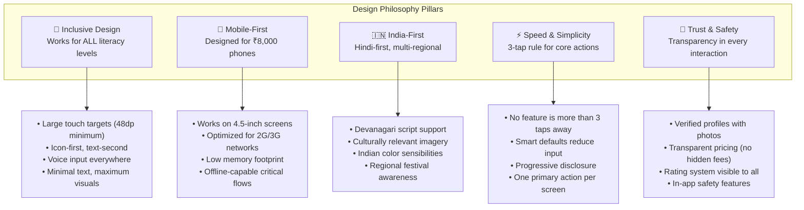
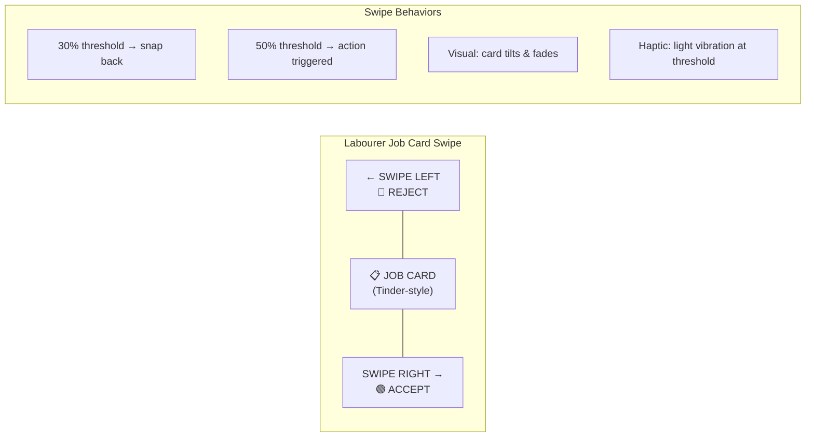
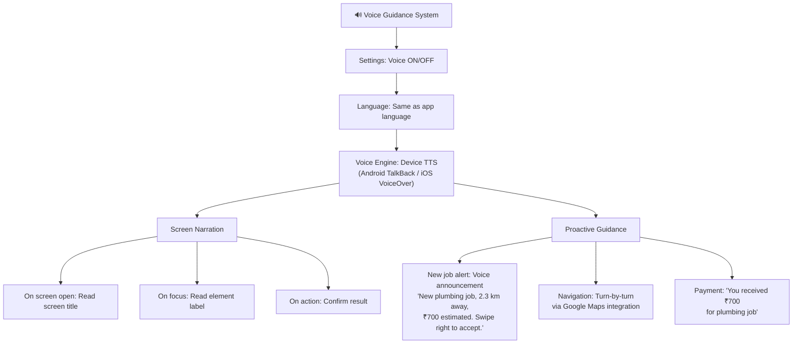
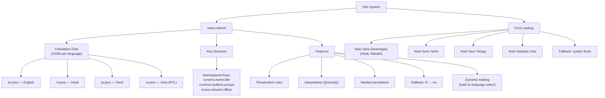

# 🎨 Kuli Labour App — UI & UX Brief

> **Document 4 of the Full Project Documentation Suite**
> **Version**: 1.0.0 | **Last Updated**: 2026-06-01
> **Status**: Final Draft

---

## Table of Contents

1. [Design Philosophy](#1-design-philosophy)
2. [Brand Identity](#2-brand-identity)
3. [Design System Components](#3-design-system-components)
4. [Screen Inventory](#4-screen-inventory)
5. [Key Screen Wireframe Descriptions](#5-key-screen-wireframe-descriptions)
6. [Interaction Patterns](#6-interaction-patterns)
7. [Accessibility Guidelines](#7-accessibility-guidelines)
8. [Responsive Design](#8-responsive-design)
9. [Dark Mode](#9-dark-mode)
10. [Animation & Motion](#10-animation--motion)
11. [Error State Designs](#11-error-state-designs)
12. [Localization Guidelines](#12-localization-guidelines)

---

## 1. Design Philosophy

### 1.1 Core Design Principles

Kuli's design must serve two radically different user personas — **tech-savvy urban homeowners** and **low-literacy daily-wage labourers** — within the same platform. Every design decision is filtered through the lens of **inclusive accessibility**.



### 1.2 User Persona Design Mapping

| Design Aspect | Customer App | Labourer App |
|---------------|-------------|--------------|
| **Visual Complexity** | Moderate — can handle lists, filters, maps | Minimal — large cards, big icons, clear hierarchy |
| **Text Density** | Standard — descriptions, reviews, details | Very Low — icons carry meaning, text is supplementary |
| **Input Methods** | Keyboard + selection | Voice input + large buttons + selection |
| **Navigation Depth** | Up to 4 levels deep | Maximum 3 levels deep |
| **Font Size** | Base 14sp | Base 18sp |
| **Button Size** | 44dp minimum | 56dp minimum |
| **Color Coding** | Subtle accents | Bold, high-contrast status colors |
| **Onboarding** | Quick (4 screens) | Guided with voice instructions (8+ screens) |

### 1.3 Design for Low-Literacy Users (Labourer App)

> [!IMPORTANT]
> The Labourer app MUST be usable by someone who cannot read. Design decisions for the labourer-facing interface are non-negotiable accessibility requirements.

**Key Strategies:**

1. **Icon-First Design** — Every action is represented by a recognizable icon. Text labels are supplementary, never the primary communicator.
2. **Voice Guidance** — Optional TTS (Text-to-Speech) that narrates screen content and button labels when enabled.
3. **Color Semantics** — Green = good/go, Red = stop/danger, Orange = attention, Blue = information. Consistent across all screens.
4. **Minimal Cognitive Load** — One primary action per screen. No multi-step forms on a single page.
5. **Gestural Shortcuts** — Swipe right to accept, swipe left to reject. Physical, intuitive gestures over text buttons.
6. **Visual Feedback** — Every tap produces immediate visual + haptic feedback. No "did my tap register?" confusion.
7. **Photo-Centric** — Customer profiles show photos. Job details include photos of the work location/issue whenever possible.

---

## 2. Brand Identity

### 2.1 Brand Overview

| Element | Detail |
|---------|--------|
| **Brand Name** | **Kuli** (कुली) |
| **Phonetic** | koo-lee |
| **Meaning** | Hindi/Urdu word for "labourer" / "porter" — reclaimed as a badge of honour and respect |
| **Tagline (Primary)** | **"Har Kaam Ka Hero"** (हर काम का हीरो) — Every Job's Hero |
| **Tagline (Secondary)** | **"Mehnat Ka Samman"** (मेहनत का सम्मान) — Respect for Hard Work |
| **Brand Voice** | Warm, respectful, empowering, simple, direct |
| **Brand Personality** | Trustworthy, hardworking, inclusive, modern yet grounded |

### 2.2 Logo Concept

The Kuli logo combines a **stylized worker silhouette** with a **rising sun** motif:
- Worker figure represents dignity of labour
- Rising sun symbolizes new opportunity each day
- Orange gradient reflects energy and warmth
- Rounded typeface conveys friendliness and approachability
- Bilingual lockup: "Kuli" in English + "कुली" in Devanagari

### 2.3 Color Palette

#### Primary Colors

| Swatch | Name | Hex | RGB | Usage |
|--------|------|-----|-----|-------|
| 🟠 | **Deep Orange** (Primary) | `#E65100` | 230, 81, 0 | Primary buttons, headers, brand elements, CTAs |
| 🟢 | **Teal** (Secondary) | `#00796B` | 0, 121, 107 | Secondary buttons, admin dashboard, trust elements |
| 🟡 | **Golden Yellow** (Accent) | `#FFB300` | 255, 179, 0 | Highlights, badges, premium features, star ratings |

#### Extended Palette

| Swatch | Name | Hex | Usage |
|--------|------|-----|-------|
| 🔴 | Error Red | `#D32F2F` | Error states, destructive actions, alerts |
| 🟢 | Success Green | `#388E3C` | Success states, online status, confirmations |
| 🟡 | Warning Amber | `#F57C00` | Warnings, pending states, caution |
| 🔵 | Info Blue | `#1976D2` | Informational elements, links, help text |

#### Neutral Colors

| Swatch | Name | Hex | Usage |
|--------|------|-----|-------|
| ⬛ | Dark Gray | `#212121` | Primary text |
| ◼️ | Medium Gray | `#616161` | Secondary text |
| ◻️ | Light Gray | `#9E9E9E` | Placeholder text, disabled states |
| ▫️ | Border Gray | `#E0E0E0` | Borders, dividers |
| ⬜ | Background Light | `#F5F5F5` | Page backgrounds |
| ⬜ | Surface White | `#FFFFFF` | Cards, sheets, modals |

#### Gradient Definitions

| Name | Start | End | Usage |
|------|-------|-----|-------|
| Brand Gradient | `#E65100` | `#FF8F00` | Headers, splash screen, hero sections |
| Premium Gradient | `#FFB300` | `#FF8F00` | Premium badges, achievements |
| Trust Gradient | `#00796B` | `#00897B` | Verified badges, admin elements |

### 2.4 Typography

| Role | Font Family | Weight | Size (sp) | Line Height | Usage |
|------|-------------|--------|-----------|-------------|-------|
| **H1 — Page Title** | Poppins / Noto Sans Devanagari | Bold (700) | 24 | 32 | Screen titles |
| **H2 — Section Header** | Poppins / Noto Sans Devanagari | SemiBold (600) | 20 | 28 | Section headings |
| **H3 — Sub-header** | Poppins / Noto Sans Devanagari | SemiBold (600) | 18 | 24 | Sub-sections, card titles |
| **Body — Regular** | Noto Sans / Noto Sans Devanagari | Regular (400) | 16 | 24 | Body text, descriptions |
| **Body — Emphasis** | Noto Sans / Noto Sans Devanagari | Medium (500) | 16 | 24 | Emphasized body text |
| **Caption** | Noto Sans / Noto Sans Devanagari | Regular (400) | 14 | 20 | Timestamps, helper text |
| **Small** | Noto Sans / Noto Sans Devanagari | Regular (400) | 12 | 16 | Badges, tags, legal text |
| **Button** | Poppins / Noto Sans Devanagari | SemiBold (600) | 16 | 24 | Button labels |
| **Labourer Body** | Noto Sans / Noto Sans Devanagari | Medium (500) | 18 | 26 | Labourer app body text (larger) |
| **Labourer H1** | Poppins / Noto Sans Devanagari | Bold (700) | 28 | 36 | Labourer app titles (larger) |

> [!NOTE]
> **Poppins** is the primary heading font for its modern, geometric feel. **Noto Sans** is used for body text due to its excellent Devanagari support and readability at small sizes. Both are Google Fonts — free, open-source, and pre-installed on most Android devices.

### 2.5 Iconography

| Property | Specification |
|----------|---------------|
| **Style** | Rounded, filled (Material Design 3 Rounded) |
| **Weight** | 400 for regular, 700 for emphasis |
| **Size** | 24dp standard, 32dp for labourer app, 48dp for category tiles |
| **Color** | Inherits from context (primary, on-surface, etc.) |
| **Custom Icons** | Service category icons (plumber, painter, etc.) — custom illustrated in brand style |
| **Padding** | Minimum 8dp touch padding around all icons |

**Category Icon Set** (Custom Illustrations):

| Category | Icon Description | Style |
|----------|-----------------|-------|
| 🔧 Plumbing | Pipe wrench at 45° angle | Filled, rounded corners |
| 🎨 Painting | Paint roller with drip | Filled, playful drop |
| ⚡ Electrical | Lightning bolt with plug | Filled, energetic |
| 🪚 Carpentry | Hammer and saw crossed | Filled, tool motif |
| 🧹 Cleaning | Sparkle broom | Filled, clean lines |
| 📦 Moving | Stacked boxes with up arrow | Filled, dynamic |
| 🏗️ Masonry | Brick and trowel | Filled, solid |
| 🔩 Welding | Welding mask with sparks | Filled, industrial |
| 🌿 Gardening | Leaf with hand | Filled, organic |
| 🚰 Appliances | Gear with snowflake | Filled, technical |

---

## 3. Design System Components

### 3.1 Buttons

| Variant | Height | Min Width | Padding | Corner Radius | Usage |
|---------|--------|-----------|---------|---------------|-------|
| **Primary** | 48dp | 120dp | 16dp H, 12dp V | 12dp | Main CTAs: "Book Now", "Accept Job" |
| **Primary Large** | 56dp | 160dp | 24dp H, 16dp V | 16dp | Labourer app CTAs |
| **Secondary** | 48dp | 120dp | 16dp H, 12dp V | 12dp | Secondary actions: "View Details" |
| **Outlined** | 48dp | 120dp | 16dp H, 12dp V | 12dp | Tertiary actions: "Cancel", "Skip" |
| **Text** | 40dp | 80dp | 12dp H, 8dp V | 8dp | Inline actions: "See All", "Edit" |
| **Icon Button** | 48dp | 48dp | 12dp all | 24dp (circle) | Action icons: Share, Favourite, Call |
| **FAB** | 56dp | 56dp | 16dp all | 16dp | Primary floating action |
| **FAB Extended** | 56dp | — | 20dp H, 16dp V | 16dp | FAB with label: "+ New Booking" |

**Button States:**

| State | Background | Text Color | Elevation | Border |
|-------|-----------|------------|-----------|--------|
| Default | `#E65100` | `#FFFFFF` | 2dp | — |
| Pressed | `#BF360C` | `#FFFFFF` | 0dp | — |
| Disabled | `#E0E0E0` | `#9E9E9E` | 0dp | — |
| Loading | `#E65100` 70% | Spinner (white) | 2dp | — |
| Hover (web) | `#D84315` | `#FFFFFF` | 4dp | — |

### 3.2 Cards

#### Worker Card (Customer App — Browse Results)

```
┌─────────────────────────────────────────────────┐
│  ┌──────┐  Ramesh Kumar              ⭐ 4.8     │
│  │ PHOTO│  🔧 Plumber  •  5 yrs exp   (127)    │
│  │ 64dp │  📍 2.3 km away                      │
│  └──────┘  ₹350/hr                              │
│                                                  │
│  [🟢 Available Now]         [View Profile →]    │
└─────────────────────────────────────────────────┘
```

| Property | Value |
|----------|-------|
| Width | Full width (screen - 32dp margin) |
| Height | Auto (approx 100dp) |
| Corner Radius | 16dp |
| Elevation | 2dp |
| Padding | 16dp |
| Photo Size | 64 × 64dp, 32dp radius (circle) |
| Background | `#FFFFFF` |
| Divider | None |

#### Booking Card (Customer App — My Bookings)

```
┌─────────────────────────────────────────────────┐
│  [🟢 CONFIRMED]                    15 Jun 2026  │
│  ──────────────────────────────────────────────  │
│  🔧 Plumbing - Leak Repair                     │
│  👷 Ramesh Kumar  ⭐ 4.8                        │
│  📍 42, MG Road, Sector 15, Noida              │
│  ⏰ 10:00 AM - 12:00 PM                         │
│  💰 ₹700 (estimated)                            │
│  ──────────────────────────────────────────────  │
│  [💬 Chat]    [📞 Call]    [❌ Cancel]          │
└─────────────────────────────────────────────────┘
```

#### Earnings Card (Labourer App)

```
┌─────────────────────────────────────────────────┐
│           💰 Today's Earnings                    │
│              ₹2,450                              │
│           ▲ 15% vs yesterday                     │
│  ──────────────────────────────────────────────  │
│  Jobs Completed: 4     Avg Rating: ⭐ 4.9       │
│  Hours Worked: 7h      Tips: ₹200               │
│  ──────────────────────────────────────────────  │
│  [📊 Weekly Report]      [💸 Withdraw →]        │
└─────────────────────────────────────────────────┘
```

### 3.3 Input Fields

| Variant | Height | Usage | Features |
|---------|--------|-------|----------|
| **Standard Text** | 56dp | Name, address, notes | Label + placeholder + helper text |
| **Phone Input** | 56dp | Phone entry | +91 prefix, numeric keyboard, 10-digit max |
| **OTP Input** | 56dp × 6 boxes | OTP verification | Auto-focus, auto-read SMS, paste support |
| **Search** | 48dp | Search bar | Left icon, clear button, voice input button |
| **Voice Input** | 56dp | Labourer app inputs | Mic icon, recording indicator, transcription |
| **Dropdown/Select** | 56dp | Category, city, gender | Bottom sheet picker, searchable |
| **Date Picker** | — | Date selection | Calendar view, blocked dates, today highlight |
| **Time Picker** | — | Time selection | Slot-based (30 min), AM/PM |
| **Slider** | 48dp | Rate setting, radius | Min-Max labels, step indicators, value label |
| **Text Area** | 120dp min | Job description, review | Character count, expand on focus |

**Input States:**

| State | Border Color | Label Color | Background |
|-------|-------------|------------|------------|
| Default | `#E0E0E0` | `#616161` | `#FFFFFF` |
| Focused | `#E65100` | `#E65100` | `#FFFFFF` |
| Filled | `#212121` | `#616161` | `#FFFFFF` |
| Error | `#D32F2F` | `#D32F2F` | `#FFF5F5` |
| Disabled | `#EEEEEE` | `#9E9E9E` | `#F5F5F5` |

### 3.4 Bottom Navigation

**Customer App (4 tabs):**

| Tab | Icon | Label | Badge |
|-----|------|-------|-------|
| Home | 🏠 `home` | Home / होम | — |
| Bookings | 📋 `calendar` | Bookings / बुकिंग | Active booking count |
| Messages | 💬 `chat` | Chat / चैट | Unread count |
| Profile | 👤 `person` | Profile / प्रोफाइल | Notification dot |

**Labourer App (4 tabs):**

| Tab | Icon | Label | Badge |
|-----|------|-------|-------|
| Home | 🏠 `home` | Home / होम | New job alert dot |
| Jobs | 📋 `briefcase` | Jobs / काम | Upcoming count |
| Earnings | 💰 `wallet` | Earnings / कमाई | Today's amount |
| Profile | 👤 `person` | Profile / प्रोफाइल | Notification dot |

**Specs:**

| Property | Value |
|----------|-------|
| Height | 64dp (customer), 72dp (labourer) |
| Icon Size | 24dp (customer), 28dp (labourer) |
| Label Size | 12sp (customer), 14sp (labourer) |
| Active Color | `#E65100` |
| Inactive Color | `#9E9E9E` |
| Background | `#FFFFFF` |
| Elevation | 8dp |
| Safe area padding | 16dp bottom on devices with home indicator |

### 3.5 Status Badges

| Status | Background | Text Color | Icon | Usage |
|--------|-----------|------------|------|-------|
| Pending | `#FFF3E0` | `#E65100` | ⏳ | Booking awaiting acceptance |
| Confirmed | `#E3F2FD` | `#1565C0` | ✓ | Booking accepted by worker |
| En Route | `#E8F5E9` | `#2E7D32` | 🚶 | Worker traveling to location |
| In Progress | `#E8F5E9` | `#1B5E20` | 🔨 | Job underway |
| Completed | `#E8F5E9` | `#388E3C` | ✅ | Job finished |
| Cancelled | `#FFEBEE` | `#C62828` | ✕ | Booking cancelled |
| Disputed | `#FFF3E0` | `#E65100` | ⚠ | Issue reported |
| Online | `#E8F5E9` | `#388E3C` | 🟢 | Worker available |
| Offline | `#F5F5F5` | `#9E9E9E` | ⚫ | Worker not available |
| Busy | `#FFF3E0` | `#E65100` | 🟠 | Worker on a job |

**Badge Specs:** Height: 24dp, Corner Radius: 12dp (pill), Padding: 8dp H × 4dp V, Font: 12sp SemiBold.

### 3.6 Rating Stars

| Property | Value |
|----------|-------|
| Star Size | 24dp (display), 40dp (interactive input) |
| Filled Color | `#FFB300` (Golden Yellow) |
| Empty Color | `#E0E0E0` |
| Half-Star | Supported in display, not in input |
| Spacing | 4dp between stars |
| Animation | Fill animation left-to-right on tap |

### 3.7 Category Tiles

```
┌──────────────┐
│     🔧       │
│   (48dp      │
│    icon)     │
│              │
│   Plumbing   │
│   प्लंबिंग    │
└──────────────┘
```

| Property | Value |
|----------|-------|
| Tile Size | 100 × 110dp (customer), 120 × 130dp (labourer) |
| Corner Radius | 16dp |
| Icon Size | 48dp (customer), 56dp (labourer) |
| Background | `#FFF3E0` (light orange tint) |
| Active Border | 2dp `#E65100` |
| Grid | 3 columns (customer), 2 columns (labourer) |
| Spacing | 12dp |

### 3.8 Map Components

| Component | Description | Library |
|-----------|-------------|---------|
| **Full Map** | Full-screen map for tracking, address selection | Google Maps SDK via `react-native-maps` |
| **Mini Map** | Embedded in cards (booking detail, worker profile) | Static Google Maps image |
| **Pin — Customer** | Orange pin with home icon | Custom marker |
| **Pin — Worker** | Teal pin with tool icon, animated pulse when en route | Custom animated marker |
| **Route Line** | Dashed line from worker to customer | Polyline overlay, `#00796B` |
| **Radius Circle** | Service area radius on worker profile | Semi-transparent `#E65100` fill |
| **ETA Bubble** | "12 min away" floating above worker pin | Custom overlay |

### 3.9 Chat Bubbles

| Sender | Background | Text Color | Corner Radius | Max Width |
|--------|-----------|------------|---------------|-----------|
| Current User (sent) | `#E65100` | `#FFFFFF` | 16dp (0dp bottom-right) | 70% screen width |
| Other User (received) | `#F5F5F5` | `#212121` | 16dp (0dp bottom-left) | 70% screen width |
| System Message | `#E3F2FD` | `#1565C0` | 8dp all | 85% screen width |
| Voice Message | Same as sender/receiver | Play button + waveform | Same | 60% screen width |

### 3.10 Modals & Bottom Sheets

| Component | Usage | Max Height | Corner Radius |
|-----------|-------|-----------|---------------|
| **Bottom Sheet — Peek** | Quick info, confirmations | 30% screen | 24dp top |
| **Bottom Sheet — Half** | Filters, short forms | 50% screen | 24dp top |
| **Bottom Sheet — Full** | Complex forms, detailed views | 90% screen | 24dp top |
| **Dialog Modal** | Confirmations, alerts | Auto (max 60%) | 16dp all |
| **Full-Screen Modal** | Standalone flows (booking, payment) | 100% screen | 0dp |

**Bottom Sheet Handle:** 36dp × 4dp, centered, `#E0E0E0`, 2dp radius.

---

## 4. Screen Inventory

### 4.1 Customer App Screens

| # | Screen Name | Route | Description |
|---|-------------|-------|-------------|
| C01 | Splash Screen | `/splash` | App logo animation, brand gradient background |
| C02 | Language Selection | `/onboard/language` | Grid of language tiles with native script labels |
| C03 | Phone Entry | `/onboard/phone` | +91 prefix, large numeric keypad |
| C04 | OTP Verification | `/onboard/otp` | 6-digit code entry, auto-read, timer |
| C05 | Profile Setup | `/onboard/profile` | Name, optional photo, gender |
| C06 | Location Setup | `/onboard/location` | GPS auto-detect, manual search, map |
| C07 | Home | `/home` | Category tiles, search, top workers, promos |
| C08 | Search Results | `/search` | Worker list with filters and sort |
| C09 | Category Workers | `/category/:id` | Workers filtered by service type |
| C10 | Worker Profile | `/worker/:id` | Photo, rating, reviews, skills, rates, availability |
| C11 | Worker Reviews | `/worker/:id/reviews` | Full review list with filters |
| C12 | Booking — Date/Time | `/book/datetime` | Calendar + time slot picker |
| C13 | Booking — Address | `/book/address` | Map, saved addresses, new address form |
| C14 | Booking — Description | `/book/details` | Text/voice input, photo attachment |
| C15 | Booking — Summary | `/book/summary` | Full cost breakdown, editable |
| C16 | Booking — Payment | `/book/payment` | Payment method selection |
| C17 | Booking — Confirmation | `/book/confirmed` | Success animation, booking details, CTA |
| C18 | My Bookings — List | `/bookings` | Tab bar: Upcoming / Completed / Cancelled |
| C19 | Booking Detail | `/bookings/:id` | Full details, status timeline, actions |
| C20 | Live Tracking | `/bookings/:id/track` | Full map, worker position, ETA, call/chat |
| C21 | Job In-Progress | `/bookings/:id/progress` | Timer, worker status, live updates |
| C22 | Rate & Review | `/bookings/:id/review` | Star rating, text/voice review, photo |
| C23 | Chat List | `/chats` | List of active and recent conversations |
| C24 | Chat Thread | `/chats/:id` | Messages, voice, photos, quick replies |
| C25 | Profile | `/profile` | Name, photo, stats, settings links |
| C26 | Edit Profile | `/profile/edit` | Editable name, photo, phone |
| C27 | Saved Addresses | `/profile/addresses` | List, add, edit, delete addresses |
| C28 | Payment Methods | `/profile/payments` | Saved UPI, cards, wallet balance |
| C29 | Wallet | `/profile/wallet` | Balance, top-up, transaction history |
| C30 | My Coupons | `/profile/coupons` | Available and expired promo codes |
| C31 | Notifications | `/notifications` | All notifications, mark read |
| C32 | Notification Settings | `/profile/notifications` | Push, SMS, email toggles by type |
| C33 | Language Settings | `/profile/language` | Change app language |
| C34 | Help Center | `/help` | FAQ categories, search, contact |
| C35 | Raise Ticket | `/help/ticket` | Issue category, description, evidence |
| C36 | Live Support Chat | `/help/chat` | Chat with support agent |
| C37 | About | `/about` | App version, legal, social links |
| C38 | Terms & Conditions | `/legal/terms` | Full terms in scrollable view |
| C39 | Privacy Policy | `/legal/privacy` | Full privacy policy |
| C40 | Referral Program | `/referral` | Share code, track rewards |

### 4.2 Labourer App Screens

| # | Screen Name | Route | Description |
|---|-------------|-------|-------------|
| L01 | Splash Screen | `/splash` | Same as customer app |
| L02 | Language Selection | `/onboard/language` | Larger tiles, voice prompt |
| L03 | Phone Entry | `/onboard/phone` | Extra-large keypad, voice guide |
| L04 | OTP Verification | `/onboard/otp` | Same + voice read-out of OTP |
| L05 | Basic Details | `/onboard/details` | Name (voice input), gender (icon tiles) |
| L06 | Aadhaar — Method | `/onboard/aadhaar` | Scan / Manual / DigiLocker options |
| L07 | Aadhaar — Camera | `/onboard/aadhaar/scan` | Camera with card guide overlay |
| L08 | Aadhaar — Manual | `/onboard/aadhaar/manual` | 12-digit entry, name, DOB |
| L09 | Aadhaar — OTP | `/onboard/aadhaar/otp` | Aadhaar-linked mobile OTP |
| L10 | Skill Selection | `/onboard/skills` | Icon grid, multi-select, experience level |
| L11 | Profile Photo | `/onboard/photo` | Camera with face guide overlay |
| L12 | Rate Setting | `/onboard/rates` | Per-skill rate slider, market reference |
| L13 | Service Area | `/onboard/area` | Map with radius slider or area list |
| L14 | Profile Review | `/onboard/review` | Summary of all entered info |
| L15 | Approval Pending | `/onboard/pending` | Status screen, estimated time, contact |
| L16 | Home | `/home` | Online toggle, today's summary, alerts |
| L17 | Job Alert | `/jobs/alert` | Full-screen swipeable job card |
| L18 | Job Detail | `/jobs/:id` | Complete job info, customer details |
| L19 | Navigation | `/jobs/:id/navigate` | In-app map or open Google Maps |
| L20 | Arrive & Verify | `/jobs/:id/arrive` | "I've Arrived" button, OTP entry |
| L21 | Job In-Progress | `/jobs/:id/progress` | Timer, actions (photo, material, extend) |
| L22 | Job Complete | `/jobs/:id/complete` | Completion photos, summary |
| L23 | Payment Received | `/jobs/:id/paid` | Earnings breakdown, wallet update |
| L24 | My Jobs — List | `/jobs` | Tabs: Today / Upcoming / Completed |
| L25 | Job History | `/jobs/history` | Past jobs, sortable, searchable |
| L26 | Calendar View | `/jobs/calendar` | Monthly view with job dots |
| L27 | Earnings Dashboard | `/earnings` | Today, week, month charts, withdraw |
| L28 | Transaction History | `/earnings/history` | All transactions, filterable |
| L29 | Withdraw Funds | `/earnings/withdraw` | Bank account, amount, instant/scheduled |
| L30 | Bank Account | `/earnings/bank` | Linked bank details, edit |
| L31 | Chat List | `/chats` | Active and recent customer chats |
| L32 | Chat Thread | `/chats/:id` | Messages with quick replies |
| L33 | Profile | `/profile` | Photo, name, rating, stats, settings |
| L34 | Edit Profile | `/profile/edit` | Name, photo, bio |
| L35 | Manage Skills | `/profile/skills` | Add, edit, remove skills and rates |
| L36 | Service Area | `/profile/area` | Edit service radius/areas |
| L37 | Availability | `/profile/availability` | Working hours, day toggles, blocks |
| L38 | Documents | `/profile/documents` | Aadhaar status, additional docs |
| L39 | My Reviews | `/profile/reviews` | Customer reviews received |
| L40 | Notifications | `/notifications` | All alerts, mark read |
| L41 | Settings | `/settings` | Language, notifications, dark mode |
| L42 | Help & Support | `/help` | FAQ, raise ticket, call support |
| L43 | Quick Tutorial | `/tutorial` | Swipeable guide (icon-heavy, voice) |
| L44 | Achievements | `/achievements` | Badges, tier progress, milestones |

### 4.3 Admin Dashboard Screens

| # | Screen Name | Route | Description |
|---|-------------|-------|-------------|
| A01 | Login | `/login` | Email + password + 2FA |
| A02 | Dashboard Home | `/dashboard` | KPI cards, charts, quick actions |
| A03 | Customers List | `/users/customers` | Searchable, filterable table |
| A04 | Customer Detail | `/users/customers/:id` | Profile, bookings, transactions, actions |
| A05 | Workers List | `/users/workers` | Searchable, filterable table |
| A06 | Worker Detail | `/users/workers/:id` | Profile, KYC, bookings, earnings, actions |
| A07 | Pending Approvals | `/users/approvals` | Queue of worker applications |
| A08 | Approval Review | `/users/approvals/:id` | Full application detail, approve/reject |
| A09 | Suspended Users | `/users/suspended` | List with suspension reason |
| A10 | All Bookings | `/bookings` | Filterable table, status filters |
| A11 | Booking Detail | `/bookings/:id` | Full booking timeline, parties, actions |
| A12 | Active Bookings Map | `/bookings/map` | Live map with all active bookings |
| A13 | Disputes — Open | `/disputes` | Queue of open dispute tickets |
| A14 | Dispute Detail | `/disputes/:id` | Evidence, chat history, resolution form |
| A15 | Revenue Dashboard | `/finance/revenue` | Charts: daily, weekly, monthly revenue |
| A16 | Payouts | `/finance/payouts` | Pending and completed worker payouts |
| A17 | Refunds | `/finance/refunds` | Refund requests and processed refunds |
| A18 | Tax Reports | `/finance/tax` | GST collection, TDS, compliance |
| A19 | Transactions | `/finance/transactions` | All platform transactions |
| A20 | Analytics — Overview | `/analytics` | Business, user, service, geo analytics |
| A21 | Analytics — Users | `/analytics/users` | Registration, retention, DAU/MAU charts |
| A22 | Analytics — Services | `/analytics/services` | Category distribution, ratings, duration |
| A23 | Analytics — Geography | `/analytics/geo` | Heatmaps, city breakdown, coverage |
| A24 | Push Notifications | `/content/push` | Create, schedule, send push notifications |
| A25 | Promo Codes | `/content/promos` | Create, manage promo codes |
| A26 | App Banners | `/content/banners` | Manage home screen banners |
| A27 | FAQ Management | `/content/faq` | Create, edit, organize FAQs |
| A28 | Service Categories | `/settings/categories` | Add, edit, reorder categories |
| A29 | City Management | `/settings/cities` | Manage operational cities and areas |
| A30 | Commission Settings | `/settings/commission` | Tier rates, special overrides |
| A31 | Pricing Rules | `/settings/pricing` | Surge pricing, minimum charges, area rates |
| A32 | Admin Users | `/settings/admins` | Admin accounts, roles, permissions |
| A33 | System Health | `/settings/system` | API status, error rates, performance |
| A34 | Audit Log | `/settings/audit` | All admin actions with timestamps |
| A35 | Reports & Export | `/reports` | Generate and download CSV/PDF reports |

---

## 5. Key Screen Wireframe Descriptions

### 5.1 Customer Home Screen

```
┌──────────────────────────────────────────┐
│ ◄ Noida, Sector 15 ▼    🔔 (2)    👤   │  ← Top bar: location, notifications, avatar
│──────────────────────────────────────────│
│ ┌──────────────────────────────────────┐ │
│ │ 🔍 Search for services...    🎤     │ │  ← Search with voice input
│ └──────────────────────────────────────┘ │
│                                          │
│ ┌─────────────────────────────────────┐  │
│ │  🏠 Home Repair? Get 20% off! →    │  │  ← Promo banner carousel (auto-scroll)
│ └─────────────────────────────────────┘  │
│                                          │
│  📂 Services / सेवाएं                    │  ← Section header
│ ┌──────┐ ┌──────┐ ┌──────┐             │
│ │  🔧  │ │  🎨  │ │  ⚡  │             │
│ │Plumb.│ │Paint │ │Electr│             │  ← Category grid (3 columns, scrollable)
│ └──────┘ └──────┘ └──────┘             │
│ ┌──────┐ ┌──────┐ ┌──────┐             │
│ │  🪚  │ │  🧹  │ │  📦  │             │
│ │Carpen│ │Clean │ │Moving│             │
│ └──────┘ └──────┘ └──────┘             │
│                         [See All →]      │
│                                          │
│  ⭐ Top Rated Near You                   │  ← Horizontal scroll of worker cards
│ ┌─────────┐ ┌─────────┐ ┌──────        │
│ │ 📸      │ │ 📸      │ │ 📸           │
│ │ Ramesh  │ │ Suresh  │ │ Hari         │
│ │ ⭐ 4.9  │ │ ⭐ 4.8  │ │ ⭐ 4.8       │
│ │ Plumber │ │ Painter │ │ Electr       │
│ └─────────┘ └─────────┘ └──────        │
│                                          │
│  🕐 Recent Bookings                     │  ← Vertical list of recent booking cards
│ ┌──────────────────────────────────────┐ │
│ │ 🔧 Plumbing  •  ✅ Completed        │ │
│ │ Ramesh K.  •  12 May  •  ₹700       │ │
│ │ [Rebook →]                           │ │
│ └──────────────────────────────────────┘ │
│                                          │
│══════════════════════════════════════════│
│  🏠      📋       💬       👤           │  ← Bottom navigation
│  Home   Bookings  Chat   Profile        │
└──────────────────────────────────────────┘
```

**Key Interactions:**
- Tapping a category tile → navigates to filtered worker list
- Tapping a worker card → navigates to worker profile
- Tapping search → opens search with recent searches and suggestions
- Swipe promo banner → next promo
- Pull down → refresh home content

### 5.2 Labourer Home Screen

```
┌──────────────────────────────────────────┐
│  कुली                      🔔 (3)  ⚙️  │  ← Brand name, notifications, settings
│──────────────────────────────────────────│
│                                          │
│  ┌──────────────────────────────────┐    │
│  │                                  │    │
│  │    🟢 You are ONLINE             │    │  ← BIG online/offline toggle
│  │    ───────○─────────────          │    │     Green slide = online
│  │    Tap to go offline              │    │     Animated pulse when online
│  │                                  │    │
│  └──────────────────────────────────┘    │
│                                          │
│  ┌──────────────────────────────────┐    │
│  │  📊 Today's Summary              │    │  ← Summary card
│  │  ─────────────────────────────   │    │
│  │  ┌────────┐ ┌────────┐ ┌──────┐ │    │
│  │  │ 💼     │ │ 💰     │ │ ⭐   │ │    │
│  │  │ 3 Jobs │ │ ₹2,450 │ │ 4.9  │ │    │
│  │  └────────┘ └────────┘ └──────┘ │    │
│  └──────────────────────────────────┘    │
│                                          │
│  📅 Today's Schedule / आज का शेड्यूल    │
│  ┌──────────────────────────────────┐    │
│  │ 🟢 9:00 AM  Painting             │    │
│  │     Rajouri Garden  •  ₹500      │    │
│  │ ──────────────────────────────── │    │
│  │ 🔵 2:00 PM  Plumbing             │    │
│  │     Dwarka  •  ₹350              │    │
│  │ ──────────────────────────────── │    │
│  │ 🔵 5:00 PM  Wall Repair          │    │
│  │     Janakpuri  •  ₹600           │    │
│  └──────────────────────────────────┘    │
│                                          │
│  💡 Tip of the Day                       │
│  ┌──────────────────────────────────┐    │
│  │ "Complete 5 more jobs this month  │    │
│  │  to unlock Gold tier! (8% comm.)" │    │
│  └──────────────────────────────────┘    │
│                                          │
│══════════════════════════════════════════│
│   🏠        📋        💰        👤      │
│   Home     Jobs    Earnings   Profile   │  ← Bottom nav (larger icons, 72dp)
└──────────────────────────────────────────┘
```

**Key Interactions:**
- Toggle switch → changes online/offline status with confirmation
- Summary card numbers → tappable to see details
- Schedule items → tap to see job detail
- All text elements have voice-over support

### 5.3 Worker Profile Screen (Customer View)

```
┌──────────────────────────────────────────┐
│  ←  Worker Profile                  ❤️   │  ← Back, Favourite
│──────────────────────────────────────────│
│                                          │
│          ┌────────────────┐              │
│          │                │              │
│          │   PROFILE      │              │  ← 120dp circular photo
│          │   PHOTO        │              │     Verified badge overlay
│          │                │              │
│          └────────────────┘              │
│          ✅ Verified                      │
│                                          │
│      Ramesh Kumar / रमेश कुमार           │  ← Bilingual name
│      🔧 Plumber  •  5 years exp          │
│      📍 2.3 km  •  Sector 15, Noida     │
│                                          │
│      ⭐ 4.8  (127 reviews)   🟢 Online  │
│                                          │
│  ┌──────────────────────────────────┐    │
│  │  💰 ₹350/hr         📞 Call      │    │  ← Rate & quick actions
│  │  🕐 Mon-Sat, 8AM-6PM  💬 Chat   │    │
│  └──────────────────────────────────┘    │
│                                          │
│  Skills & Services / कौशल                │
│  ┌──────┐ ┌──────┐ ┌──────┐             │
│  │ 🔧   │ │ 🚰   │ │ 🔩   │             │
│  │Pipe  │ │Leak  │ │Fitting│            │
│  │fixing│ │repair│ │      │             │
│  └──────┘ └──────┘ └──────┘             │
│                                          │
│  📸 Work Photos (Gallery)                │
│  ┌─────┐ ┌─────┐ ┌─────┐ ┌─────┐       │
│  │     │ │     │ │     │ │     │        │  ← Horizontal scroll of work photos
│  └─────┘ └─────┘ └─────┘ └─────┘       │
│                                          │
│  ⭐ Reviews                    See All → │
│  ┌──────────────────────────────────┐    │
│  │ Priya S.  ⭐⭐⭐⭐⭐  2 days ago  │    │
│  │ "Excellent work! Fixed the leak  │    │
│  │  quickly and cleaned up after."  │    │
│  └──────────────────────────────────┘    │
│  ┌──────────────────────────────────┐    │
│  │ Amit R.  ⭐⭐⭐⭐☆  1 week ago   │    │
│  │ "Good work, but came 15 min late"│    │
│  └──────────────────────────────────┘    │
│                                          │
│  ┌──────────────────────────────────┐    │
│  │     📅  BOOK NOW / बुक करें       │    │  ← Sticky CTA button at bottom
│  └──────────────────────────────────┘    │
│══════════════════════════════════════════│
│  🏠      📋       💬       👤           │
└──────────────────────────────────────────┘
```

### 5.4 Booking Confirmation Screen

```
┌──────────────────────────────────────────┐
│                                          │
│               ✅                          │
│          (Animated checkmark             │
│           with confetti)                 │
│                                          │
│        Booking Confirmed!                │
│        बुकिंग पक्की हो गई!               │
│                                          │
│  ┌──────────────────────────────────┐    │
│  │  👷 Ramesh Kumar                  │    │
│  │  🔧 Plumbing - Leak Repair       │    │
│  │  📅 15 Jun 2026, 10:00 AM        │    │
│  │  📍 42, MG Road, Sector 15       │    │
│  │  💰 ₹883 (estimated)             │    │
│  │  ─────────────────────────────── │    │
│  │  📋 Booking ID: KUL-2026-0815   │    │
│  └──────────────────────────────────┘    │
│                                          │
│  You'll be notified when Ramesh          │
│  accepts the booking.                    │
│                                          │
│  ┌──────────────────────────────────┐    │
│  │  📋  View Booking Details         │    │
│  └──────────────────────────────────┘    │
│  ┌──────────────────────────────────┐    │
│  │  🏠  Back to Home                 │    │
│  └──────────────────────────────────┘    │
│                                          │
│  Share with friends & get ₹100 off! 📤   │
│                                          │
└──────────────────────────────────────────┘
```

### 5.5 Live Tracking Screen

```
┌──────────────────────────────────────────┐
│  ←  Live Tracking              🚨 SOS   │
│──────────────────────────────────────────│
│                                          │
│  ┌──────────────────────────────────┐    │
│  │                                  │    │
│  │          MAP VIEW                │    │
│  │                                  │    │
│  │     🏠 (customer pin)            │    │  ← Full map with route
│  │      \                           │    │
│  │       \  - - - - -               │    │
│  │        \         |               │    │
│  │         - - - - 🔧              │    │  ← Worker pin (animated)
│  │                                  │    │
│  │  ┌─────────────────┐            │    │
│  │  │ ETA: 12 minutes │            │    │  ← ETA bubble
│  │  └─────────────────┘            │    │
│  │                                  │    │
│  └──────────────────────────────────┘    │
│                                          │
│  ┌──────────────────────────────────┐    │
│  │  ┌──────┐  Ramesh Kumar          │    │
│  │  │ 📸   │  🟢 On the way         │    │  ← Worker info card (bottom sheet)
│  │  │      │  ⭐ 4.8  •  2.3 km     │    │
│  │  └──────┘                        │    │
│  │                                  │    │
│  │  ┌────────────┐ ┌──────────────┐ │    │
│  │  │  💬 Chat   │ │  📞 Call     │ │    │  ← Action buttons
│  │  └────────────┘ └──────────────┘ │    │
│  │                                  │    │
│  │  📋 Job: Plumbing - Leak Repair  │    │
│  │  📅 Today, 10:00 AM              │    │
│  │  💰 Est. ₹883                    │    │
│  └──────────────────────────────────┘    │
│                                          │
└──────────────────────────────────────────┘
```

### 5.6 Earnings Dashboard (Labourer)

```
┌──────────────────────────────────────────┐
│  ←  Earnings / कमाई                     │
│──────────────────────────────────────────│
│                                          │
│  ┌──────────────────────────────────┐    │
│  │           💰 Total Balance        │    │
│  │              ₹12,450              │    │  ← Big balance number
│  │                                   │    │
│  │  ┌──────────────────────────┐    │    │
│  │  │  💸 Withdraw to Bank     │    │    │  ← Primary CTA
│  │  └──────────────────────────┘    │    │
│  └──────────────────────────────────┘    │
│                                          │
│  [Today] [This Week] [This Month]        │  ← Tab selector
│                                          │
│  ┌──────────────────────────────────┐    │
│  │  📊 This Week's Earnings          │    │
│  │                                   │    │
│  │  ₹                                │    │
│  │  3k ┤    ██                       │    │
│  │  2k ┤ ██ ██ ██    ██             │    │  ← Bar chart
│  │  1k ┤ ██ ██ ██ ██ ██             │    │
│  │   0 ┼────────────────             │    │
│  │     Mon Tue Wed Thu Fri           │    │
│  │                                   │    │
│  │  Total: ₹12,450  •  Jobs: 14     │    │
│  │  Avg/Job: ₹889  •  Tips: ₹850    │    │
│  └──────────────────────────────────┘    │
│                                          │
│  📋 Recent Transactions                  │
│  ┌──────────────────────────────────┐    │
│  │ 🟢 +₹700   Plumbing             │    │
│  │    Priya S.  •  Today 12:30 PM   │    │
│  │──────────────────────────────────│    │
│  │ 🟢 +₹500   Painting              │    │
│  │    Amit R.  •  Today 10:00 AM    │    │
│  │──────────────────────────────────│    │
│  │ 🔴 -₹100   Platform fee          │    │
│  │    Commission  •  Yesterday      │    │
│  │──────────────────────────────────│    │
│  │ 🔵 ₹5,200  Withdrawal           │    │
│  │    To HDFC ****4523  •  Mon      │    │
│  └──────────────────────────────────┘    │
│                                          │
│══════════════════════════════════════════│
│   🏠        📋        💰        👤      │
└──────────────────────────────────────────┘
```

### 5.7 Admin Dashboard Home

```
┌──────────────────────────────────────────────────────────────────────────┐
│  ┌──────┐                                                               │
│  │ KULI │  Admin Dashboard          🔔 (5)  👤 Admin User ▼            │
│  │ LOGO │                                                               │
│  └──────┘                                                               │
│──────────────────────────────────────────────────────────────────────────│
│ ┌──────────┐ ┌──────────────────────────────────────────────────────┐   │
│ │          │ │                                                      │   │
│ │ 📊 Dash  │ │  Good Morning, Admin!  •  Monday, 15 Jun 2026       │   │
│ │ 👥 Users │ │                                                      │   │
│ │ 📋 Book. │ │  ┌──────────┐ ┌──────────┐ ┌──────────┐ ┌────────┐ │   │
│ │ ⚠️ Disp. │ │  │ 📋       │ │ 👷       │ │ 💰       │ │ ⚠️     │ │   │
│ │ 💰 Fin.  │ │  │ Active   │ │ Online   │ │ Today's  │ │ Open   │ │   │
│ │ 📈 Anal. │ │  │ Bookings │ │ Workers  │ │ Revenue  │ │Disputes│ │   │
│ │ 📢 Cont. │ │  │  1,247   │ │  3,891   │ │ ₹4.52L   │ │   23   │ │   │
│ │ ⚙️ Sett. │ │  │ ▲ 12%    │ │ ▲ 5%     │ │ ▲ 18%    │ │ ▼ 3    │ │   │
│ │          │ │  └──────────┘ └──────────┘ └──────────┘ └────────┘ │   │
│ │          │ │                                                      │   │
│ │          │ │  📈 Revenue Trend (Last 30 Days)                     │   │
│ │          │ │  ┌──────────────────────────────────────────────┐   │   │
│ │          │ │  │          ____                                │   │   │
│ │          │ │  │    _____/    \___     ___                    │   │   │
│ │          │ │  │___/                \_/   \____               │   │   │
│ │          │ │  │                                              │   │   │
│ │          │ │  └──────────────────────────────────────────────┘   │   │
│ │          │ │                                                      │   │
│ │          │ │  ┌─────────────────────┐ ┌─────────────────────┐   │   │
│ │          │ │  │ 🕐 Pending Approvals│ │ 🔥 Urgent Disputes  │   │   │
│ │          │ │  │                     │ │                     │   │   │
│ │          │ │  │  156 workers        │ │  5 critical         │   │   │
│ │          │ │  │  waiting review     │ │  safety reports     │   │   │
│ │          │ │  │                     │ │                     │   │   │
│ │          │ │  │  [Review Now →]     │ │  [View All →]       │   │   │
│ │          │ │  └─────────────────────┘ └─────────────────────┘   │   │
│ │          │ │                                                      │   │
│ │          │ │  📊 Top Services Today        📍 Active by City     │   │
│ │          │ │  1. Plumbing (312)             Delhi: 423           │   │
│ │          │ │  2. Painting (287)             Mumbai: 389          │   │
│ │          │ │  3. Electrical (245)           Bangalore: 201       │   │
│ │          │ │  4. Cleaning (198)             Noida: 187           │   │
│ │          │ │  5. Carpentry (156)            Gurgaon: 147         │   │
│ └──────────┘ └──────────────────────────────────────────────────────┘   │
└──────────────────────────────────────────────────────────────────────────┘
```

---

## 6. Interaction Patterns

### 6.1 Swipe Gestures



| Gesture | Screen | Action | Feedback |
|---------|--------|--------|----------|
| Swipe Right | Job Alert (Labourer) | Accept job | Green flash, ✓ animation, haptic |
| Swipe Left | Job Alert (Labourer) | Reject job | Red flash, ✕ animation, haptic |
| Swipe Right | Booking Card (Customer) | Quick rebook | Orange highlight |
| Swipe Left | Notification | Dismiss | Fade out, undo toast |
| Swipe Down | Any list | Pull to refresh | Loading spinner |
| Swipe Up | Bottom sheet | Expand | Smooth snap to breakpoint |

### 6.2 Pull to Refresh

| Property | Value |
|----------|-------|
| Trigger Distance | 80dp pull-down |
| Indicator | Custom Kuli spinner (tool icon rotating) |
| Animation Duration | 500ms minimum visible time |
| Haptic | Light tap at trigger point |
| Screens | Home, Bookings, Jobs, Earnings, Chat List |

### 6.3 Haptic Feedback

| Event | Haptic Type | Duration |
|-------|------------|----------|
| Button press | Light impact | 10ms |
| Toggle switch | Medium impact | 20ms |
| Swipe threshold reached | Rigid impact | 15ms |
| Job accepted/completed | Success notification | 30ms |
| Error occurred | Error notification | 50ms (double tap) |
| Payment confirmed | Heavy impact | 25ms |
| Pull-to-refresh trigger | Light impact | 10ms |

### 6.4 Skeleton Loading Screens

Every screen that loads data shows a **skeleton placeholder** immediately, not a blank screen or spinner.

```
┌──────────────────────────────────────┐
│  ┌──────┐  ████████████████          │
│  │░░░░░░│  ██████████                │  ← Animated shimmer effect
│  │░░░░░░│  ████████████████████      │     (left-to-right gradient)
│  └──────┘  ██████                    │
│                                      │
│  ┌──────────────────────────────┐    │
│  │  ██████████████              │    │
│  │  ████████████████████        │    │
│  │  ██████████                  │    │
│  └──────────────────────────────┘    │
│                                      │
│  ┌──────────────────────────────┐    │
│  │  ██████████████              │    │
│  │  ████████████████████        │    │
│  │  ██████████                  │    │
│  └──────────────────────────────┘    │
└──────────────────────────────────────┘
```

| Property | Value |
|----------|-------|
| Shimmer Color | `#F5F5F5` → `#E0E0E0` → `#F5F5F5` |
| Animation Speed | 1.5 seconds per cycle |
| Shape Match | Skeleton shapes match actual content shapes |
| Duration | Show until data loads (max 10s, then error) |

### 6.5 Empty States

| Screen | Illustration | Message (Hindi / English) | CTA |
|--------|-------------|--------------------------|-----|
| No Bookings | Worker relaxing under tree | "कोई बुकिंग नहीं / No bookings yet" | "Browse Services" |
| No Workers Found | Map with zero pins | "इस इलाके में कोई कारीगर नहीं / No workers in this area" | "Change Location" |
| No Messages | Empty chat bubbles | "कोई मैसेज नहीं / No messages" | "Book a Service" |
| No Earnings | Empty piggy bank | "अभी तक कोई कमाई नहीं / No earnings yet" | "Go Online" |
| No Jobs | Calendar with nothing | "आज कोई काम नहीं / No jobs today" | "Go Online" |
| Search No Results | Magnifying glass, question mark | "कुछ नहीं मिला / Nothing found" | "Try different keywords" |
| No Internet | Broken WiFi icon | "इंटरनेट नहीं है / No connection" | "Retry" |

### 6.6 Onboarding Tooltips

First-time users see contextual **coach marks** (spotlight overlays) for key features:

| Screen | Tooltip Target | Message |
|--------|---------------|---------|
| Customer Home | Category grid | "Tap a category to find workers nearby" |
| Customer Home | Search bar | "Search by name or skill" |
| Worker Profile | Book Now button | "Tap here to book this worker" |
| Labourer Home | Online toggle | "Go online to start receiving jobs" |
| Labourer Home | Earnings card | "Tap to see your detailed earnings" |
| Job Alert | Card edges | "Swipe right to accept, left to reject" |

**Tooltip Specs:**
- Semi-transparent black overlay (60% opacity)
- Spotlight cutout around target element
- White tooltip card with arrow pointing to target
- "Got it" button to dismiss
- "Skip all" link to disable tooltips
- Max 3 tooltips per session

---

## 7. Accessibility Guidelines

### 7.1 Visual Accessibility

| Guideline | Requirement | Standard |
|-----------|-------------|----------|
| **Minimum Text Size** | 16sp for body text, 14sp absolute minimum for captions | WCAG 2.1 AA |
| **Labourer App Text** | 18sp minimum for body, 28sp for headings | Enhanced |
| **Color Contrast** | 4.5:1 for normal text, 3:1 for large text | WCAG 2.1 AA |
| **Touch Targets** | 48 × 48dp minimum (customer), 56 × 56dp (labourer) | Material Design |
| **Focus Indicators** | 2dp outline in `#E65100` around focused element | WCAG 2.1 |
| **Color Independence** | Never use color alone to convey information — always pair with icon/text | WCAG 2.1 |
| **Text Scaling** | Support system font scaling up to 200% | Android Accessibility |

### 7.2 Screen Reader Support

| Element | Accessibility Label Format | Example |
|---------|---------------------------|---------|
| Worker Card | "Worker name, service, rating, distance, rate" | "Ramesh Kumar, Plumber, 4.8 stars, 2.3 kilometers away, 350 rupees per hour" |
| Status Badge | "Status: current state" | "Status: Booking confirmed" |
| Rating Stars | "N out of 5 stars" | "4.8 out of 5 stars" |
| Toggle | "Label, currently on/off" | "Online status, currently on" |
| Action Button | "Action: description" | "Button: Book now for plumbing service" |
| Image | Descriptive alt text | "Profile photo of Ramesh Kumar" |
| Map | "Map showing worker location, estimated arrival 12 minutes" | — |

### 7.3 Voice Guidance (Labourer App)



### 7.4 Language Simplicity

| User Type | Reading Level | Guidelines |
|-----------|--------------|------------|
| Customer App | Grade 8 (Hindi) | Standard Hindi, avoid English jargon unless commonly understood (e.g., "booking", "cancel") |
| Labourer App | Grade 5 (Hindi) | Simple Hindi, short sentences, avoid compound words, use everyday vocabulary |
| Admin Dashboard | Professional English | Technical terms acceptable, proper grammar |

**Writing Rules for Labourer App:**
- Maximum 6 words per button label
- Maximum 15 words per notification
- Use active voice ("काम स्वीकार करें" not "काम स्वीकार किया जा सकता है")
- Avoid double negatives
- Use numbers instead of words ("₹350" not "तीन सौ पचास")

### 7.5 Icon + Text Pairing Rule

> [!CAUTION]
> **Every interactive element in the labourer app MUST have both an icon AND a text label.** Icon-only or text-only buttons are strictly forbidden. This is a non-negotiable accessibility requirement for low-literacy users.

```
✅ CORRECT:                    ❌ INCORRECT:
┌────────────────┐            ┌────────────┐
│  ✓  Accept     │            │  Accept    │  (no icon)
│     स्वीकार     │            └────────────┘
└────────────────┘
                               ┌────────────┐
                               │     ✓      │  (no text)
                               └────────────┘
```

---

## 8. Responsive Design

### 8.1 Breakpoints

| Breakpoint | Width | Target Devices | Layout |
|------------|-------|---------------|--------|
| **Small Phone** | 320 - 360dp | Budget Android phones (4.5" - 5") | Single column, compact spacing |
| **Medium Phone** | 361 - 400dp | Mid-range phones (5.5" - 6.1") | Single column, standard spacing |
| **Large Phone** | 401 - 480dp | Flagship phones (6.2" - 6.9") | Single column, comfortable spacing |
| **Tablet** | 481 - 768dp | Tablets (7" - 10") | Two-column where appropriate |
| **Admin Web — Tablet** | 769 - 1024px | iPad, small laptops | Collapsed sidebar, responsive grid |
| **Admin Web — Desktop** | 1025 - 1440px | Standard desktop | Full sidebar, 3-col grid |
| **Admin Web — Wide** | 1441px+ | Wide monitors | Max-width container, extra whitespace |

### 8.2 Mobile Adaptation Rules

| Element | Small Phone | Medium Phone | Large Phone |
|---------|------------|--------------|-------------|
| Category Grid | 2 columns | 3 columns | 3 columns |
| Worker Cards | Full width, compact | Full width, standard | Full width, expanded |
| Bottom Nav | 4 items, text hidden | 4 items, text shown | 4 items, text shown |
| Font Scale | 0.9× base | 1× base | 1.1× base |
| Button Height | 44dp | 48dp | 52dp |
| Card Padding | 12dp | 16dp | 20dp |
| Map Height | 40% screen | 50% screen | 50% screen |

### 8.3 Notch & Safe Area Handling

| Area | Handling |
|------|---------|
| Status bar | Transparent status bar with content below, text color adapts to background |
| Top notch | Content starts below notch, no overlap |
| Bottom home indicator | Bottom nav has extra 16dp padding on iPhone X+ |
| Camera cutout (Android) | Content respects `WindowInsets` |
| Folding phones | Reflow to two-pane on inner screen |

---

## 9. Dark Mode

### 9.1 Dark Mode Color Mapping

| Light Mode | Dark Mode | Usage |
|------------|-----------|-------|
| `#FFFFFF` (Surface) | `#1E1E1E` | Card backgrounds, sheets |
| `#F5F5F5` (Background) | `#121212` | Page backgrounds |
| `#212121` (Text Primary) | `#E0E0E0` | Primary text |
| `#616161` (Text Secondary) | `#9E9E9E` | Secondary text |
| `#E0E0E0` (Border) | `#333333` | Dividers, borders |
| `#E65100` (Primary Orange) | `#FF8A50` | Primary actions (lighter for contrast) |
| `#00796B` (Secondary Teal) | `#4DB6AC` | Secondary elements |
| `#FFB300` (Accent Yellow) | `#FFD54F` | Accents (slightly lighter) |
| `#D32F2F` (Error Red) | `#EF5350` | Error states |
| `#388E3C` (Success Green) | `#66BB6A` | Success states |

### 9.2 Dark Mode Design Rules

| Rule | Description |
|------|-------------|
| **Elevation = Lightness** | Higher elevation surfaces are slightly lighter (e.g., `#1E1E1E` → `#2C2C2C` for elevated cards) |
| **No Pure Black** | Background is `#121212`, not `#000000` (reduces eye strain on OLED) |
| **No Pure White Text** | Text is `#E0E0E0`, not `#FFFFFF` (reduces glare) |
| **Desaturated Colors** | All semantic colors are desaturated by 15-20% in dark mode |
| **Images** | Photos unchanged; illustrations get subtle brightness reduction (0.85 opacity overlay) |
| **Maps** | Switch to Google Maps dark mode styling |
| **System Sync** | Dark mode follows system setting by default, with manual override in app settings |
| **Transition** | Smooth 300ms fade when switching modes |

### 9.3 Dark Mode Component Preview

```
LIGHT MODE                          DARK MODE
┌──────────────────┐                ┌──────────────────┐
│  ☀️ Surface: #FFF │                │  🌙 Surface: #1E1E│
│                  │                │                  │
│  Ramesh Kumar    │                │  Ramesh Kumar    │
│  🔧 Plumber      │                │  🔧 Plumber      │
│  ⭐ 4.8 • ₹350/hr│                │  ⭐ 4.8 • ₹350/hr│
│                  │                │                  │
│  ┌──────────┐   │                │  ┌──────────┐   │
│  │ Book Now │   │                │  │ Book Now │   │
│  │ #E65100  │   │                │  │ #FF8A50  │   │
│  └──────────┘   │                │  └──────────┘   │
└──────────────────┘                └──────────────────┘
  Background: #F5F5F5                 Background: #121212
```

---

## 10. Animation & Motion

### 10.1 Motion Principles

| Principle | Description |
|-----------|-------------|
| **Purposeful** | Every animation communicates meaning — never decorative only |
| **Quick** | Most transitions complete in 200-300ms — no waiting |
| **Natural** | Use spring physics and easing — no linear motion |
| **Accessible** | Respect `prefers-reduced-motion` system setting |
| **Consistent** | Same animation patterns used across similar interactions |

### 10.2 Micro-Interactions

| Interaction | Animation | Duration | Easing |
|-------------|-----------|----------|--------|
| Button Press | Scale down to 0.95, then spring back | 150ms | `spring(damping: 15)` |
| Toggle ON | Slide + color fade green | 250ms | `ease-in-out` |
| Toggle OFF | Slide + color fade gray | 250ms | `ease-in-out` |
| Star Rating Tap | Star fills with bounce, left to right | 200ms per star | `spring(stiffness: 300)` |
| Like/Favourite | Heart icon pops with burst particles | 400ms | `spring` |
| Pull to Refresh | Custom tool icon rotates | Duration of load | `linear` rotation |
| Badge Counter | Scale up from 0, bounce | 300ms | `spring(damping: 10)` |
| Status Change | Color morph + icon swap | 400ms | `ease-in-out` |

### 10.3 Page Transitions

| Transition | Type | Duration | Description |
|------------|------|----------|-------------|
| Push (forward) | Slide left + fade | 300ms | New screen slides in from right |
| Pop (back) | Slide right + fade | 250ms | Current screen slides out to right |
| Modal present | Slide up + backdrop fade | 350ms | Modal rises from bottom |
| Modal dismiss | Slide down + backdrop fade | 250ms | Modal falls down |
| Tab switch | Cross-fade | 200ms | Tabs cross-fade, no slide |
| Bottom sheet | Slide up with spring | 350ms | Sheet springs up to breakpoint |
| Full-screen alert | Scale up from center + backdrop | 300ms | Alert scales from 0.8 to 1.0 |

### 10.4 Loading Animations

| Context | Animation | Style |
|---------|-----------|-------|
| App launch | Logo assembles (tool pieces come together) | Brand animation, 2s |
| Page loading | Skeleton shimmer (gradient sweep) | Subtle, continuous |
| Button loading | Circular spinner replaces button text | White spinner on orange |
| Pull to refresh | Wrench icon rotates | Playful, 1s per rotation |
| Payment processing | Coins dropping into wallet animation | Lottie, 3s loop |
| Booking confirmed | Checkmark draws itself + confetti burst | Celebratory, 1.5s |
| Job completed | Trophy rises + star burst | Achievement, 2s |
| Sending message | Bubble floats up | Smooth, 300ms |
| Data sync | Circular arrows rotate | Subtle, continuous |

### 10.5 Lottie Animation Inventory

| Animation Name | File | Screens Used | Loop |
|----------------|------|-------------|------|
| `splash_logo.json` | Logo assembly | Splash | No (once) |
| `booking_confirmed.json` | Checkmark + confetti | Booking Confirmation | No (once) |
| `payment_success.json` | Coins to wallet | Payment Receipt | No (once) |
| `loading_tools.json` | Rotating tools | All loading states | Yes |
| `empty_search.json` | Magnifying glass | Search no results | Yes (slow) |
| `no_internet.json` | Broken WiFi | Offline state | Yes (slow) |
| `job_complete.json` | Trophy + stars | Job Completed | No (once) |
| `worker_walking.json` | Walking figure | Tracking screen | Yes |
| `earnings_coins.json` | Falling coins | Earnings update | No (once) |
| `onboarding_wave.json` | Hand waving | Welcome screen | Yes (slow) |

---

## 11. Error State Designs

### 11.1 Error State Taxonomy

```mermaid
flowchart TD
    A["Error States"] --> B["Network Errors"]
    A --> C["Input Validation Errors"]
    A --> D["Server Errors"]
    A --> E["Empty States"]
    A --> F["Permission Errors"]

    B --> B1["No Internet Connection"]
    B --> B2["Slow Connection / Timeout"]
    B --> B3["API Unreachable"]

    C --> C1["Required Field Missing"]
    C --> C2["Invalid Format"]
    C --> C3["Out of Range"]
    C --> C4["Duplicate Entry"]

    D --> D1["500 Internal Server Error"]
    D --> D2["503 Service Unavailable"]
    D --> D3["Rate Limited (429)"]
    D --> D4["Unauthorized (401)"]

    E --> E1["No Data Yet"]
    E --> E2["No Search Results"]
    E --> E3["Filtered to Empty"]

    F --> F1["Location Permission Denied"]
    F --> F2["Camera Permission Denied"]
    F --> F3["Notification Permission Denied"]
```



### 11.2 Network Error Screen

```
┌──────────────────────────────────────┐
│                                      │
│                                      │
│          ┌────────────┐              │
│          │   📡 ✕     │              │
│          │  (Animated  │              │
│          │   Lottie)   │              │
│          └────────────┘              │
│                                      │
│      No Internet Connection          │
│      इंटरनेट कनेक्शन नहीं है          │
│                                      │
│      Check your connection and       │
│      try again.                      │
│                                      │
│      ┌────────────────────┐          │
│      │   🔄  Retry         │          │
│      │      पुनः प्रयास करें │          │
│      └────────────────────┘          │
│                                      │
│      ┌────────────────────┐          │
│      │  📶 Open Settings   │          │  ← Secondary action
│      └────────────────────┘          │
│                                      │
└──────────────────────────────────────┘
```

### 11.3 Form Validation Rules

| Field | Validation | Error Message (English / Hindi) |
|-------|-----------|-------------------------------|
| Name | Min 2 chars, max 50, no numbers | "Enter a valid name" / "सही नाम डालें" |
| Phone | 10 digits, starts with 6-9 | "Enter valid 10-digit number" / "सही 10 अंक का नंबर डालें" |
| OTP | 6 digits | "Enter 6-digit code" / "6 अंक का कोड डालें" |
| Aadhaar | 12 digits, Verhoeff checksum | "Enter valid Aadhaar number" / "सही आधार नंबर डालें" |
| Address | Min 10 chars | "Enter complete address" / "पूरा पता डालें" |
| Rate | ₹100 - ₹5,000 | "Rate must be ₹100 - ₹5,000" / "दर ₹100 से ₹5,000 के बीच होनी चाहिए" |
| Review | Max 500 chars | "Review is too long" / "समीक्षा बहुत लंबी है" |

**Validation UI Pattern:**
- Real-time validation on field blur (not on every keystroke)
- Error text appears below field in `#D32F2F`, 12sp
- Field border turns red
- Error icon (⚠️) appears in field
- Voice read-out of error on labourer app

### 11.4 Server Error Screen

```
┌──────────────────────────────────────┐
│                                      │
│          ┌────────────┐              │
│          │   🔧 ⚠️    │              │
│          │  (Animated  │              │
│          │   Lottie)   │              │
│          └────────────┘              │
│                                      │
│      Something went wrong            │
│      कुछ गलत हो गया                   │
│                                      │
│      We're fixing it! Please try     │
│      again in a moment.              │
│                                      │
│      Error Code: 500-API-BOOK        │
│                                      │
│      ┌────────────────────┐          │
│      │   🔄  Try Again     │          │
│      └────────────────────┘          │
│                                      │
│      ┌────────────────────┐          │
│      │  🆘 Contact Support │          │
│      └────────────────────┘          │
│                                      │
└──────────────────────────────────────┘
```

### 11.5 Error Handling Strategy

| Error Type | User-Facing Action | Background Action |
|------------|-------------------|-------------------|
| Network timeout | Show retry button, cache last state | Log to Sentry, track failure rate |
| 401 Unauthorized | Force re-login | Clear tokens, re-authenticate |
| 403 Forbidden | Show "Access denied" message | Log suspicious access |
| 404 Not Found | Show "Not found" with back button | Log broken references |
| 429 Rate Limited | Show "Too many requests, wait" | Implement exponential backoff |
| 500 Server Error | Show generic error with retry | Alert on-call team, log details |
| 503 Maintenance | Show maintenance screen with ETA | — |
| Payment Failed | Show error with alternative methods | Retry silently once, then show error |
| GPS Unavailable | Fallback to manual address | — |

---

## 12. Localization Guidelines

### 12.1 Supported Languages

| Language | Script | Code | Direction | Priority |
|----------|--------|------|-----------|----------|
| **Hindi** | Devanagari | `hi` | LTR | P0 — Launch language |
| **English** | Latin | `en` | LTR | P0 — Launch language |
| **Marathi** | Devanagari | `mr` | LTR | P1 — Phase 2 |
| **Tamil** | Tamil | `ta` | LTR | P1 — Phase 2 |
| **Telugu** | Telugu | `te` | LTR | P1 — Phase 2 |
| **Kannada** | Kannada | `kn` | LTR | P2 — Phase 3 |
| **Bengali** | Bengali | `bn` | LTR | P2 — Phase 3 |
| **Gujarati** | Gujarati | `gu` | LTR | P2 — Phase 3 |
| **Punjabi** | Gurmukhi | `pa` | LTR | P2 — Phase 3 |
| **Urdu** | Nastaliq | `ur` | **RTL** | P2 — Phase 3 |

### 12.2 Text Expansion Budget

| Base Language | Target Language | Expected Expansion | Layout Impact |
|---------------|----------------|-------------------|---------------|
| English | Hindi | 20-35% longer | Wider buttons, taller cards |
| English | Tamil | 30-45% longer | Significantly wider/taller |
| English | Bengali | 15-25% longer | Moderate expansion |
| English | Urdu (RTL) | 15-25% longer | Full mirror layout |

**Design Rule:** All UI containers must accommodate **150% of English text length** without breaking layout.

### 12.3 RTL (Right-to-Left) Considerations for Urdu

| Element | LTR Layout | RTL Layout |
|---------|-----------|------------|
| Navigation back arrow | ← (left side) | → (right side) |
| Text alignment | Left-aligned | Right-aligned |
| Icon position | Left of text | Right of text |
| Progress bars | Left to right fill | Right to left fill |
| Swipe gestures | Same direction (accept = right) | Maintain natural direction |
| Bottom nav | Left to right | Right to left |
| Chat bubbles | Sent = right, Received = left | Sent = left, Received = right |
| Lists & cards | Left-aligned content | Right-aligned content |
| Number formatting | 1,234.56 | ۱,۲۳۴.۵۶ (Eastern Arabic numerals optional) |
| Calendar | Left to right | Right to left |
| Map | No change | No change |

### 12.4 Date, Time, and Currency Formats

| Format | Hindi/English | Notes |
|--------|--------------|-------|
| Date | DD/MM/YYYY (15/06/2026) | Indian standard |
| Date (long) | 15 जून 2026 / 15 June 2026 | Localized month names |
| Time | 12-hour with AM/PM | "10:00 AM" / "सुबह 10:00" |
| Currency | ₹ prefix, Indian comma system | ₹1,23,456.78 (not ₹123,456.78) |
| Phone | +91 XXXXX XXXXX | 5-5 grouping |
| Distance | km (1 decimal) | "2.3 km" / "2.3 किमी" |

### 12.5 Localization Implementation



### 12.6 Translation Key Examples

```json
{
  "screens": {
    "home": {
      "title": "Home",
      "search_placeholder": "Search for services...",
      "categories_heading": "Services",
      "top_rated": "Top Rated Near You",
      "recent_bookings": "Recent Bookings"
    },
    "booking": {
      "confirm_title": "Booking Confirmed!",
      "estimated_cost": "Estimated Cost",
      "book_now": "Book Now"
    }
  },
  "common": {
    "buttons": {
      "accept": "Accept",
      "reject": "Reject",
      "cancel": "Cancel",
      "retry": "Retry",
      "submit": "Submit",
      "save": "Save",
      "back": "Back"
    },
    "status": {
      "online": "Online",
      "offline": "Offline",
      "pending": "Pending",
      "confirmed": "Confirmed",
      "completed": "Completed",
      "cancelled": "Cancelled"
    }
  },
  "errors": {
    "network": {
      "offline": "No Internet Connection",
      "timeout": "Connection timed out. Please try again.",
      "server": "Something went wrong. We're fixing it!"
    },
    "validation": {
      "phone_invalid": "Enter a valid 10-digit number",
      "name_required": "Name is required",
      "otp_invalid": "Enter 6-digit code"
    }
  }
}
```

Hindi equivalent (`hi.json`):
```json
{
  "screens": {
    "home": {
      "title": "होम",
      "search_placeholder": "सेवाएं खोजें...",
      "categories_heading": "सेवाएं",
      "top_rated": "आपके पास टॉप रेटेड",
      "recent_bookings": "हाल की बुकिंग"
    },
    "booking": {
      "confirm_title": "बुकिंग पक्की हो गई!",
      "estimated_cost": "अनुमानित लागत",
      "book_now": "बुक करें"
    }
  },
  "common": {
    "buttons": {
      "accept": "स्वीकार करें",
      "reject": "अस्वीकार करें",
      "cancel": "रद्द करें",
      "retry": "पुनः प्रयास करें",
      "submit": "जमा करें",
      "save": "सेव करें",
      "back": "वापस"
    },
    "status": {
      "online": "ऑनलाइन",
      "offline": "ऑफलाइन",
      "pending": "लंबित",
      "confirmed": "पक्की",
      "completed": "पूरी हो गई",
      "cancelled": "रद्द"
    }
  },
  "errors": {
    "network": {
      "offline": "इंटरनेट कनेक्शन नहीं है",
      "timeout": "कनेक्शन टाइम आउट हो गया। पुनः प्रयास करें।",
      "server": "कुछ गलत हो गया। हम इसे ठीक कर रहे हैं!"
    },
    "validation": {
      "phone_invalid": "सही 10 अंक का नंबर डालें",
      "name_required": "नाम ज़रूरी है",
      "otp_invalid": "6 अंक का कोड डालें"
    }
  }
}
```

---

## Appendix A: Design Checklist

Use this checklist before signing off on any screen design:

| # | Check | Customer App | Labourer App | Admin Dashboard |
|---|-------|-------------|--------------|-----------------|
| 1 | Minimum touch target 48dp+ | ✅ Required | ✅ 56dp+ | N/A (web) |
| 2 | Icon + text pairing on all actions | Recommended | ✅ Required | Recommended |
| 3 | Color contrast ratio ≥ 4.5:1 | ✅ Required | ✅ Required | ✅ Required |
| 4 | Supports Hindi and English | ✅ Required | ✅ Required | English only |
| 5 | Text scales with system settings | ✅ Required | ✅ Required | N/A |
| 6 | Dark mode variant exists | ✅ Required | ✅ Required | Optional (Phase 2) |
| 7 | Skeleton loading state | ✅ Required | ✅ Required | ✅ Required |
| 8 | Empty state with illustration | ✅ Required | ✅ Required | ✅ Required |
| 9 | Error state with recovery action | ✅ Required | ✅ Required | ✅ Required |
| 10 | Offline-capable or graceful degradation | ✅ Required | ✅ Required | N/A |
| 11 | Screen reader labels on all elements | ✅ Required | ✅ Required | ✅ Required |
| 12 | Voice input available on text fields | Optional | ✅ Required | N/A |
| 13 | Haptic feedback on key actions | ✅ Required | ✅ Required | N/A |
| 14 | Animation respects reduced-motion | ✅ Required | ✅ Required | ✅ Required |
| 15 | Layout handles 150% text expansion | ✅ Required | ✅ Required | ✅ Required |

## Appendix B: Design Tool & Asset Specifications

| Item | Specification |
|------|---------------|
| **Design Tool** | Figma (primary), with component library |
| **Handoff Tool** | Figma Dev Mode |
| **Icon Library** | Material Design Icons 3 (Rounded, Filled) + Custom category icons |
| **Illustration Style** | Flat, minimal, diverse Indian characters, warm color palette |
| **Animation Tool** | Lottie (After Effects → Bodymovin export) |
| **Prototype Tool** | Figma Interactive Prototypes |
| **Design Tokens** | JSON format, synced via Style Dictionary |
| **Version Control** | Figma branching + Abstract for version history |
| **Component Naming** | `[Category]/[Component]/[Variant]/[State]` e.g., `Button/Primary/Large/Pressed` |

---

> **End of Document 4 — UI & UX Brief**
> Previous: [03_APP_FLOW.md](./03_APP_FLOW.md)
