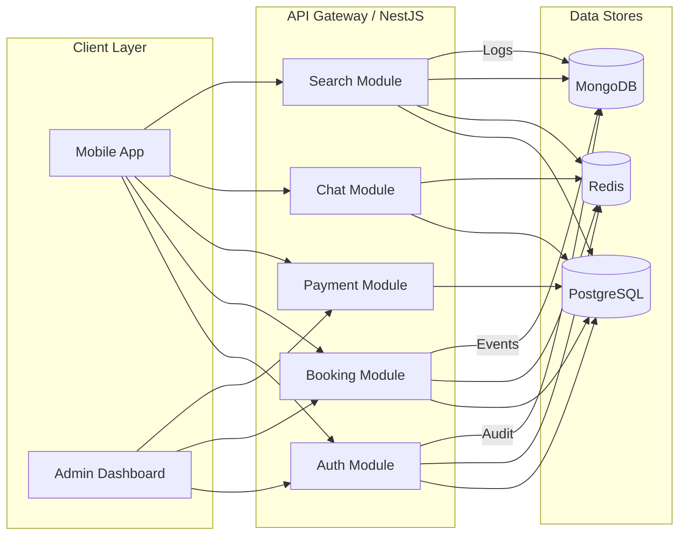
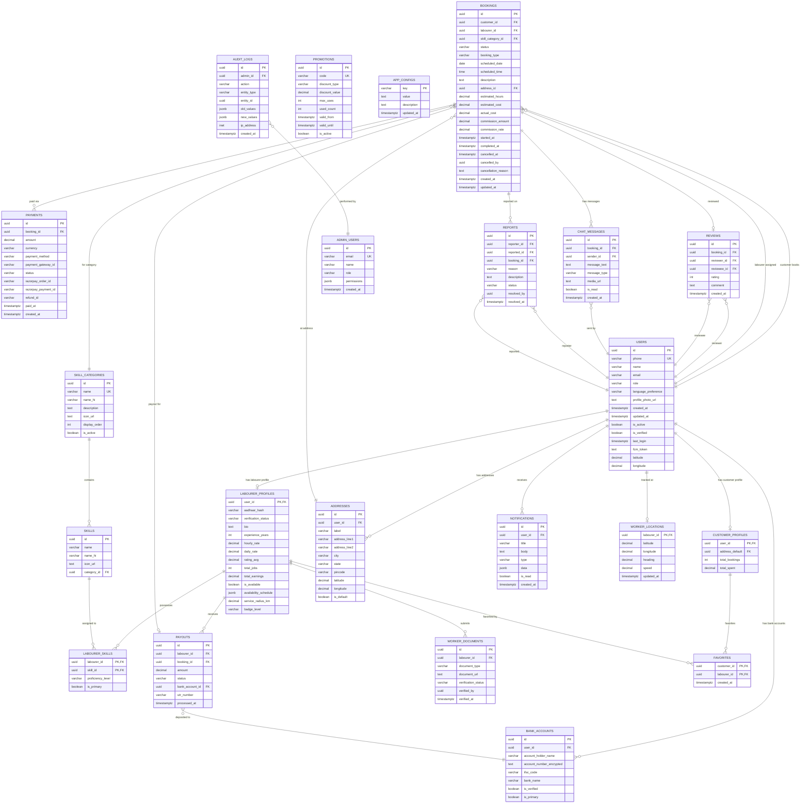
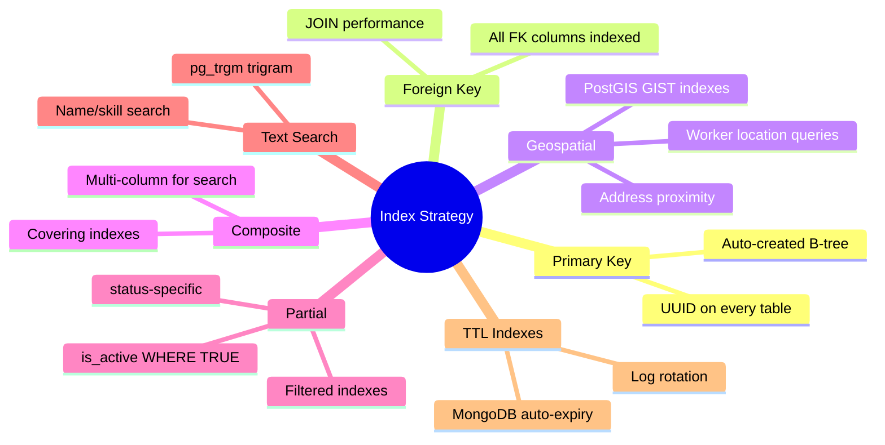

# 📦 Kuli Labour App — Backend Schema & API Reference

> **Document 5 of the Kuli Full-Project Documentation Suite**
> Version 1.0 · June 2026 · Confidential

---

## Table of Contents

1. [Database Design Overview](#1-database-design-overview)
2. [Entity Relationship Diagram](#2-entity-relationship-diagram)
3. [Detailed Table Schemas (PostgreSQL)](#3-detailed-table-schemas-postgresql)
4. [Redis Schema](#4-redis-schema)
5. [MongoDB Collections](#5-mongodb-collections)
6. [Indexes Strategy](#6-indexes-strategy)
7. [Data Migration Strategy](#7-data-migration-strategy)
8. [API Endpoints Catalog](#8-api-endpoints-catalog)
9. [Database Seeding](#9-database-seeding)

---

## 1. Database Design Overview

Kuli employs a **polyglot persistence** architecture — three purpose-built data stores working in concert to serve the platform's transactional, caching, and analytical workloads.

### 1.1 Multi-Database Strategy

| Database | Version | Purpose | Hosting |
|---|---|---|---|
| **PostgreSQL 16** | Primary transactional store | All ACID-critical data: users, bookings, payments, reviews | AWS RDS Multi-AZ |
| **Redis 7** | In-memory cache & pub/sub | Sessions, OTP, location cache, rate limiting, real-time availability, Socket.IO adapter | AWS ElastiCache (cluster mode) |
| **MongoDB 7** | Document store for analytics | Event streams, search logs, API audit logs, location history | AWS DocumentDB / MongoDB Atlas |

### 1.2 Data Flow Architecture



### 1.3 Data Ownership Boundaries

| Boundary | PostgreSQL | Redis | MongoDB |
|---|---|---|---|
| **Users & Auth** | Master record, profiles, documents | Session tokens, OTP codes, FCM tokens | Login event logs |
| **Bookings** | Booking lifecycle, status history | Active booking status cache | Booking analytics events |
| **Payments** | Transaction records, payouts | — | Payment analytics |
| **Location** | Last-known worker location | Real-time location cache (TTL 60s) | Full location history trail |
| **Search** | Indexed worker data | Search result cache | Search query logs |
| **Chat** | Message persistence | Typing indicators, online status | — |
| **Notifications** | Notification records | Unread count cache | Notification delivery logs |
| **Admin** | Admin users, audit logs | Admin session tokens | Detailed API request logs |

### 1.4 Naming Conventions

| Element | Convention | Example |
|---|---|---|
| Tables | `snake_case`, plural nouns | `labourer_profiles` |
| Columns | `snake_case` | `scheduled_date` |
| Primary Keys | `id` (UUID v4) | `id UUID DEFAULT gen_random_uuid()` |
| Foreign Keys | `<entity>_id` | `customer_id` |
| Timestamps | `*_at` suffix | `created_at`, `verified_at` |
| Booleans | `is_*` prefix | `is_active`, `is_verified` |
| JSON columns | descriptive noun | `availability_schedule`, `permissions` |
| Enums | `<table>_<column>_enum` | `bookings_status_enum` |
| Indexes | `idx_<table>_<columns>` | `idx_bookings_customer_id` |

---

## 2. Entity Relationship Diagram



---

## 3. Detailed Table Schemas (PostgreSQL)

### 3.0 Enum Definitions

```sql
-- User roles
CREATE TYPE user_role_enum AS ENUM ('labourer', 'customer', 'admin');

-- Verification statuses
CREATE TYPE verification_status_enum AS ENUM (
  'unverified', 'pending', 'under_review', 'verified', 'rejected'
);

-- Booking statuses
CREATE TYPE booking_status_enum AS ENUM (
  'pending',           -- Customer submitted, awaiting labourer accept
  'accepted',          -- Labourer accepted
  'labourer_en_route', -- Labourer on the way
  'in_progress',       -- Work started
  'completed',         -- Work finished, pending payment
  'paid',              -- Payment received
  'cancelled',         -- Cancelled by either party
  'disputed'           -- Under dispute resolution
);

-- Booking types
CREATE TYPE booking_type_enum AS ENUM ('instant', 'scheduled');

-- Payment statuses
CREATE TYPE payment_status_enum AS ENUM (
  'pending', 'authorized', 'captured', 'failed', 'refunded', 'partially_refunded'
);

-- Payment methods
CREATE TYPE payment_method_enum AS ENUM ('upi', 'card', 'netbanking', 'wallet', 'cash');

-- Payout statuses
CREATE TYPE payout_status_enum AS ENUM ('pending', 'processing', 'completed', 'failed');

-- Chat message types
CREATE TYPE message_type_enum AS ENUM ('text', 'image', 'audio', 'location', 'system');

-- Notification types
CREATE TYPE notification_type_enum AS ENUM (
  'booking_request', 'booking_accepted', 'booking_cancelled',
  'booking_completed', 'payment_received', 'payout_processed',
  'review_received', 'document_verified', 'document_rejected',
  'promotion', 'system', 'chat_message'
);

-- Document types
CREATE TYPE document_type_enum AS ENUM (
  'aadhaar_front', 'aadhaar_back', 'pan_card',
  'skill_certificate', 'police_clearance', 'profile_photo'
);

-- Report statuses
CREATE TYPE report_status_enum AS ENUM ('open', 'investigating', 'resolved', 'dismissed');

-- Discount types
CREATE TYPE discount_type_enum AS ENUM ('percentage', 'flat');

-- Worker badge levels
CREATE TYPE badge_level_enum AS ENUM ('bronze', 'silver', 'gold', 'platinum');

-- Proficiency levels
CREATE TYPE proficiency_level_enum AS ENUM ('beginner', 'intermediate', 'expert');

-- Admin roles
CREATE TYPE admin_role_enum AS ENUM ('super_admin', 'operations', 'support', 'finance', 'viewer');
```

---

### 3.1 `users`

> **Purpose**: Central identity table for all platform participants — labourers, customers, and (optionally) admin links. Every person on the platform has exactly one row here.

```sql
CREATE TABLE users (
    id                  UUID PRIMARY KEY DEFAULT gen_random_uuid(),
    phone               VARCHAR(15) NOT NULL UNIQUE,
    name                VARCHAR(100),
    email               VARCHAR(255),
    role                user_role_enum NOT NULL DEFAULT 'customer',
    language_preference VARCHAR(10) NOT NULL DEFAULT 'en',
    profile_photo_url   TEXT,
    created_at          TIMESTAMPTZ NOT NULL DEFAULT NOW(),
    updated_at          TIMESTAMPTZ NOT NULL DEFAULT NOW(),
    is_active           BOOLEAN NOT NULL DEFAULT TRUE,
    is_verified         BOOLEAN NOT NULL DEFAULT FALSE,
    last_login          TIMESTAMPTZ,
    fcm_token           TEXT,
    latitude            DECIMAL(10, 7),
    longitude           DECIMAL(10, 7)
);

-- Indexes
CREATE INDEX idx_users_phone ON users (phone);
CREATE INDEX idx_users_role ON users (role);
CREATE INDEX idx_users_is_active ON users (is_active) WHERE is_active = TRUE;
CREATE INDEX idx_users_location ON users USING GIST (
    ST_SetSRID(ST_MakePoint(longitude, latitude), 4326)
) WHERE latitude IS NOT NULL AND longitude IS NOT NULL;

-- Triggers
CREATE TRIGGER trg_users_updated_at
    BEFORE UPDATE ON users
    FOR EACH ROW EXECUTE FUNCTION update_updated_at_column();
```

| Column | Type | Constraints | Description |
|---|---|---|---|
| `id` | `UUID` | PK, DEFAULT `gen_random_uuid()` | Unique user identifier |
| `phone` | `VARCHAR(15)` | NOT NULL, UNIQUE | Indian mobile number (+91XXXXXXXXXX) |
| `name` | `VARCHAR(100)` | — | Display name |
| `email` | `VARCHAR(255)` | — | Optional email address |
| `role` | `user_role_enum` | NOT NULL, DEFAULT `'customer'` | User role on platform |
| `language_preference` | `VARCHAR(10)` | NOT NULL, DEFAULT `'en'` | ISO 639-1 language code |
| `profile_photo_url` | `TEXT` | — | S3 URL for profile photo |
| `created_at` | `TIMESTAMPTZ` | NOT NULL, DEFAULT `NOW()` | Registration timestamp |
| `updated_at` | `TIMESTAMPTZ` | NOT NULL, DEFAULT `NOW()` | Last profile update |
| `is_active` | `BOOLEAN` | NOT NULL, DEFAULT `TRUE` | Soft-delete / deactivation flag |
| `is_verified` | `BOOLEAN` | NOT NULL, DEFAULT `FALSE` | Phone verified via OTP |
| `last_login` | `TIMESTAMPTZ` | — | Most recent login |
| `fcm_token` | `TEXT` | — | Firebase Cloud Messaging token |
| `latitude` | `DECIMAL(10,7)` | — | Last-known latitude |
| `longitude` | `DECIMAL(10,7)` | — | Last-known longitude |

---

### 3.2 `labourer_profiles`

> **Purpose**: Extended profile data for users with `role = 'labourer'`. Contains verification, skills metadata, rate cards, earnings, and availability configuration.

```sql
CREATE TABLE labourer_profiles (
    user_id               UUID PRIMARY KEY REFERENCES users(id) ON DELETE CASCADE,
    aadhaar_hash          VARCHAR(64),
    verification_status   verification_status_enum NOT NULL DEFAULT 'unverified',
    bio                   TEXT,
    experience_years      INTEGER DEFAULT 0 CHECK (experience_years >= 0),
    hourly_rate           DECIMAL(10, 2) CHECK (hourly_rate >= 0),
    daily_rate            DECIMAL(10, 2) CHECK (daily_rate >= 0),
    rating_avg            DECIMAL(3, 2) DEFAULT 0.00 CHECK (rating_avg >= 0 AND rating_avg <= 5),
    total_jobs            INTEGER NOT NULL DEFAULT 0 CHECK (total_jobs >= 0),
    total_earnings        DECIMAL(12, 2) NOT NULL DEFAULT 0.00 CHECK (total_earnings >= 0),
    is_available          BOOLEAN NOT NULL DEFAULT FALSE,
    availability_schedule JSONB DEFAULT '{}',
    service_radius_km     DECIMAL(5, 2) DEFAULT 10.00 CHECK (service_radius_km > 0),
    badge_level           badge_level_enum NOT NULL DEFAULT 'bronze',
    created_at            TIMESTAMPTZ NOT NULL DEFAULT NOW(),
    updated_at            TIMESTAMPTZ NOT NULL DEFAULT NOW()
);

-- Indexes
CREATE INDEX idx_lp_verification_status ON labourer_profiles (verification_status);
CREATE INDEX idx_lp_is_available ON labourer_profiles (is_available) WHERE is_available = TRUE;
CREATE INDEX idx_lp_rating_avg ON labourer_profiles (rating_avg DESC);
CREATE INDEX idx_lp_badge_level ON labourer_profiles (badge_level);
CREATE INDEX idx_lp_aadhaar_hash ON labourer_profiles (aadhaar_hash) WHERE aadhaar_hash IS NOT NULL;

-- Trigger
CREATE TRIGGER trg_lp_updated_at
    BEFORE UPDATE ON labourer_profiles
    FOR EACH ROW EXECUTE FUNCTION update_updated_at_column();
```

| Column | Type | Constraints | Description |
|---|---|---|---|
| `user_id` | `UUID` | PK, FK → `users(id)` ON DELETE CASCADE | One-to-one link to users table |
| `aadhaar_hash` | `VARCHAR(64)` | — | SHA-256 hash of Aadhaar number (never stored raw) |
| `verification_status` | `verification_status_enum` | NOT NULL, DEFAULT `'unverified'` | KYC verification stage |
| `bio` | `TEXT` | — | Worker self-description |
| `experience_years` | `INTEGER` | DEFAULT 0, CHECK ≥ 0 | Years of professional experience |
| `hourly_rate` | `DECIMAL(10,2)` | CHECK ≥ 0 | Hourly charge in INR |
| `daily_rate` | `DECIMAL(10,2)` | CHECK ≥ 0 | Full-day charge in INR |
| `rating_avg` | `DECIMAL(3,2)` | DEFAULT 0.00, CHECK 0–5 | Rolling average rating |
| `total_jobs` | `INTEGER` | NOT NULL, DEFAULT 0 | Completed jobs counter |
| `total_earnings` | `DECIMAL(12,2)` | NOT NULL, DEFAULT 0.00 | Lifetime earnings in INR |
| `is_available` | `BOOLEAN` | NOT NULL, DEFAULT FALSE | Currently accepting jobs |
| `availability_schedule` | `JSONB` | DEFAULT `'{}'` | Weekly schedule (see JSON schema below) |
| `service_radius_km` | `DECIMAL(5,2)` | DEFAULT 10.00, CHECK > 0 | Max travel distance for jobs |
| `badge_level` | `badge_level_enum` | NOT NULL, DEFAULT `'bronze'` | Gamification tier |

**`availability_schedule` JSON Schema:**

```json
{
  "monday":    { "start": "08:00", "end": "18:00", "is_available": true },
  "tuesday":   { "start": "08:00", "end": "18:00", "is_available": true },
  "wednesday": { "start": "08:00", "end": "18:00", "is_available": true },
  "thursday":  { "start": "08:00", "end": "18:00", "is_available": true },
  "friday":    { "start": "08:00", "end": "18:00", "is_available": true },
  "saturday":  { "start": "09:00", "end": "14:00", "is_available": true },
  "sunday":    { "start": null, "end": null, "is_available": false }
}
```

---

### 3.3 `customer_profiles`

> **Purpose**: Extended profile for users with `role = 'customer'`. Lightweight — most customer data lives in `users` and `addresses`.

```sql
CREATE TABLE customer_profiles (
    user_id        UUID PRIMARY KEY REFERENCES users(id) ON DELETE CASCADE,
    address_default UUID REFERENCES addresses(id) ON DELETE SET NULL,
    total_bookings INTEGER NOT NULL DEFAULT 0 CHECK (total_bookings >= 0),
    total_spent    DECIMAL(12, 2) NOT NULL DEFAULT 0.00 CHECK (total_spent >= 0),
    created_at     TIMESTAMPTZ NOT NULL DEFAULT NOW(),
    updated_at     TIMESTAMPTZ NOT NULL DEFAULT NOW()
);

-- Indexes
CREATE INDEX idx_cp_address_default ON customer_profiles (address_default);

-- Trigger
CREATE TRIGGER trg_cp_updated_at
    BEFORE UPDATE ON customer_profiles
    FOR EACH ROW EXECUTE FUNCTION update_updated_at_column();
```

| Column | Type | Constraints | Description |
|---|---|---|---|
| `user_id` | `UUID` | PK, FK → `users(id)` ON DELETE CASCADE | Link to users table |
| `address_default` | `UUID` | FK → `addresses(id)` ON DELETE SET NULL | Default service address |
| `total_bookings` | `INTEGER` | NOT NULL, DEFAULT 0, CHECK ≥ 0 | Lifetime booking count |
| `total_spent` | `DECIMAL(12,2)` | NOT NULL, DEFAULT 0.00, CHECK ≥ 0 | Total amount spent in INR |

---

### 3.4 `skill_categories`

> **Purpose**: Top-level service categories displayed on the app home screen (e.g., Plumbing, Painting, Electrical).

```sql
CREATE TABLE skill_categories (
    id            UUID PRIMARY KEY DEFAULT gen_random_uuid(),
    name          VARCHAR(100) NOT NULL UNIQUE,
    name_hi       VARCHAR(100),
    description   TEXT,
    icon_url      TEXT,
    display_order INTEGER NOT NULL DEFAULT 0,
    is_active     BOOLEAN NOT NULL DEFAULT TRUE,
    created_at    TIMESTAMPTZ NOT NULL DEFAULT NOW(),
    updated_at    TIMESTAMPTZ NOT NULL DEFAULT NOW()
);

-- Indexes
CREATE INDEX idx_sc_display_order ON skill_categories (display_order) WHERE is_active = TRUE;
CREATE INDEX idx_sc_is_active ON skill_categories (is_active);
```

| Column | Type | Constraints | Description |
|---|---|---|---|
| `id` | `UUID` | PK | Category identifier |
| `name` | `VARCHAR(100)` | NOT NULL, UNIQUE | English category name |
| `name_hi` | `VARCHAR(100)` | — | Hindi category name |
| `description` | `TEXT` | — | Category description |
| `icon_url` | `TEXT` | — | Category icon asset URL |
| `display_order` | `INTEGER` | NOT NULL, DEFAULT 0 | Sort order on home screen |
| `is_active` | `BOOLEAN` | NOT NULL, DEFAULT TRUE | Visibility toggle |

---

### 3.5 `skills`

> **Purpose**: Granular skills within each category (e.g., "Wall Painting" under Painting, "Pipe Fitting" under Plumbing).

```sql
CREATE TABLE skills (
    id          UUID PRIMARY KEY DEFAULT gen_random_uuid(),
    name        VARCHAR(100) NOT NULL,
    name_hi     VARCHAR(100),
    icon_url    TEXT,
    category_id UUID NOT NULL REFERENCES skill_categories(id) ON DELETE CASCADE,
    is_active   BOOLEAN NOT NULL DEFAULT TRUE,
    created_at  TIMESTAMPTZ NOT NULL DEFAULT NOW(),

    UNIQUE (name, category_id)
);

-- Indexes
CREATE INDEX idx_skills_category_id ON skills (category_id);
CREATE INDEX idx_skills_is_active ON skills (is_active) WHERE is_active = TRUE;
```

| Column | Type | Constraints | Description |
|---|---|---|---|
| `id` | `UUID` | PK | Skill identifier |
| `name` | `VARCHAR(100)` | NOT NULL, UNIQUE per category | English skill name |
| `name_hi` | `VARCHAR(100)` | — | Hindi skill name |
| `icon_url` | `TEXT` | — | Skill icon URL |
| `category_id` | `UUID` | NOT NULL, FK → `skill_categories(id)` | Parent category |

---

### 3.6 `labourer_skills`

> **Purpose**: Many-to-many join between labourers and skills. Tracks proficiency and which skill is the worker's primary offering.

```sql
CREATE TABLE labourer_skills (
    labourer_id       UUID NOT NULL REFERENCES labourer_profiles(user_id) ON DELETE CASCADE,
    skill_id          UUID NOT NULL REFERENCES skills(id) ON DELETE CASCADE,
    proficiency_level proficiency_level_enum NOT NULL DEFAULT 'beginner',
    is_primary        BOOLEAN NOT NULL DEFAULT FALSE,
    created_at        TIMESTAMPTZ NOT NULL DEFAULT NOW(),

    PRIMARY KEY (labourer_id, skill_id)
);

-- Indexes
CREATE INDEX idx_ls_skill_id ON labourer_skills (skill_id);
CREATE INDEX idx_ls_is_primary ON labourer_skills (labourer_id) WHERE is_primary = TRUE;
```

| Column | Type | Constraints | Description |
|---|---|---|---|
| `labourer_id` | `UUID` | PK (composite), FK → `labourer_profiles(user_id)` | Worker reference |
| `skill_id` | `UUID` | PK (composite), FK → `skills(id)` | Skill reference |
| `proficiency_level` | `proficiency_level_enum` | NOT NULL, DEFAULT `'beginner'` | Self-reported proficiency |
| `is_primary` | `BOOLEAN` | NOT NULL, DEFAULT FALSE | Primary skill flag |

---

### 3.7 `addresses`

> **Purpose**: Stores multiple addresses per user (home, office, etc.) for both labourers and customers. Used as booking service locations.

```sql
CREATE TABLE addresses (
    id            UUID PRIMARY KEY DEFAULT gen_random_uuid(),
    user_id       UUID NOT NULL REFERENCES users(id) ON DELETE CASCADE,
    label         VARCHAR(50) NOT NULL DEFAULT 'Home',
    address_line1 VARCHAR(255) NOT NULL,
    address_line2 VARCHAR(255),
    city          VARCHAR(100) NOT NULL,
    state         VARCHAR(100) NOT NULL,
    pincode       VARCHAR(6) NOT NULL,
    latitude      DECIMAL(10, 7) NOT NULL,
    longitude     DECIMAL(10, 7) NOT NULL,
    is_default    BOOLEAN NOT NULL DEFAULT FALSE,
    created_at    TIMESTAMPTZ NOT NULL DEFAULT NOW(),
    updated_at    TIMESTAMPTZ NOT NULL DEFAULT NOW()
);

-- Indexes
CREATE INDEX idx_addr_user_id ON addresses (user_id);
CREATE INDEX idx_addr_location ON addresses USING GIST (
    ST_SetSRID(ST_MakePoint(longitude, latitude), 4326)
);
CREATE INDEX idx_addr_is_default ON addresses (user_id) WHERE is_default = TRUE;
CREATE INDEX idx_addr_pincode ON addresses (pincode);
```

| Column | Type | Constraints | Description |
|---|---|---|---|
| `id` | `UUID` | PK | Address identifier |
| `user_id` | `UUID` | NOT NULL, FK → `users(id)` | Owner of this address |
| `label` | `VARCHAR(50)` | NOT NULL, DEFAULT `'Home'` | Friendly label (Home/Office/Other) |
| `address_line1` | `VARCHAR(255)` | NOT NULL | Street address |
| `address_line2` | `VARCHAR(255)` | — | Landmark, floor, etc. |
| `city` | `VARCHAR(100)` | NOT NULL | City name |
| `state` | `VARCHAR(100)` | NOT NULL | Indian state |
| `pincode` | `VARCHAR(6)` | NOT NULL | 6-digit Indian PIN code |
| `latitude` | `DECIMAL(10,7)` | NOT NULL | GPS latitude |
| `longitude` | `DECIMAL(10,7)` | NOT NULL | GPS longitude |
| `is_default` | `BOOLEAN` | NOT NULL, DEFAULT FALSE | Default address flag |

---

### 3.8 `bookings`

> **Purpose**: Core transactional table. Each row represents a single service booking from a customer to a labourer. Tracks the full lifecycle from creation through completion/cancellation.

```sql
CREATE TABLE bookings (
    id                 UUID PRIMARY KEY DEFAULT gen_random_uuid(),
    customer_id        UUID NOT NULL REFERENCES users(id),
    labourer_id        UUID REFERENCES users(id),
    skill_category_id  UUID NOT NULL REFERENCES skill_categories(id),
    status             booking_status_enum NOT NULL DEFAULT 'pending',
    booking_type       booking_type_enum NOT NULL DEFAULT 'instant',
    scheduled_date     DATE,
    scheduled_time     TIME,
    description        TEXT,
    address_id         UUID NOT NULL REFERENCES addresses(id),
    estimated_hours    DECIMAL(5, 2) CHECK (estimated_hours > 0),
    estimated_cost     DECIMAL(10, 2) CHECK (estimated_cost >= 0),
    actual_cost        DECIMAL(10, 2) CHECK (actual_cost >= 0),
    commission_amount  DECIMAL(10, 2) DEFAULT 0.00,
    commission_rate    DECIMAL(4, 2) DEFAULT 15.00,
    started_at         TIMESTAMPTZ,
    completed_at       TIMESTAMPTZ,
    cancelled_at       TIMESTAMPTZ,
    cancelled_by       UUID REFERENCES users(id),
    cancellation_reason TEXT,
    created_at         TIMESTAMPTZ NOT NULL DEFAULT NOW(),
    updated_at         TIMESTAMPTZ NOT NULL DEFAULT NOW(),

    -- Constraints
    CONSTRAINT chk_scheduled_booking CHECK (
        booking_type = 'instant' OR (scheduled_date IS NOT NULL AND scheduled_time IS NOT NULL)
    ),
    CONSTRAINT chk_cancelled_fields CHECK (
        (status != 'cancelled') OR (cancelled_at IS NOT NULL AND cancelled_by IS NOT NULL)
    )
);

-- Indexes
CREATE INDEX idx_bk_customer_id ON bookings (customer_id);
CREATE INDEX idx_bk_labourer_id ON bookings (labourer_id);
CREATE INDEX idx_bk_status ON bookings (status);
CREATE INDEX idx_bk_skill_category_id ON bookings (skill_category_id);
CREATE INDEX idx_bk_created_at ON bookings (created_at DESC);
CREATE INDEX idx_bk_customer_status ON bookings (customer_id, status);
CREATE INDEX idx_bk_labourer_status ON bookings (labourer_id, status);
CREATE INDEX idx_bk_scheduled ON bookings (scheduled_date, scheduled_time)
    WHERE booking_type = 'scheduled' AND status IN ('pending', 'accepted');
CREATE INDEX idx_bk_active ON bookings (status)
    WHERE status IN ('pending', 'accepted', 'labourer_en_route', 'in_progress');

-- Trigger
CREATE TRIGGER trg_bk_updated_at
    BEFORE UPDATE ON bookings
    FOR EACH ROW EXECUTE FUNCTION update_updated_at_column();
```

| Column | Type | Constraints | Description |
|---|---|---|---|
| `id` | `UUID` | PK | Booking identifier |
| `customer_id` | `UUID` | NOT NULL, FK → `users(id)` | Customer who placed booking |
| `labourer_id` | `UUID` | FK → `users(id)` | Assigned labourer (null until accepted) |
| `skill_category_id` | `UUID` | NOT NULL, FK → `skill_categories(id)` | Service category requested |
| `status` | `booking_status_enum` | NOT NULL, DEFAULT `'pending'` | Current booking state |
| `booking_type` | `booking_type_enum` | NOT NULL, DEFAULT `'instant'` | Instant or scheduled |
| `scheduled_date` | `DATE` | — | Required for scheduled bookings |
| `scheduled_time` | `TIME` | — | Required for scheduled bookings |
| `description` | `TEXT` | — | Customer's description of the job |
| `address_id` | `UUID` | NOT NULL, FK → `addresses(id)` | Service location |
| `estimated_hours` | `DECIMAL(5,2)` | CHECK > 0 | Estimated duration |
| `estimated_cost` | `DECIMAL(10,2)` | CHECK ≥ 0 | Pre-calculated cost estimate |
| `actual_cost` | `DECIMAL(10,2)` | CHECK ≥ 0 | Final cost after completion |
| `commission_amount` | `DECIMAL(10,2)` | DEFAULT 0.00 | Platform commission in INR |
| `commission_rate` | `DECIMAL(4,2)` | DEFAULT 15.00 | Commission % (e.g., 15.00 = 15%) |
| `started_at` | `TIMESTAMPTZ` | — | When labourer started work |
| `completed_at` | `TIMESTAMPTZ` | — | When work was marked complete |
| `cancelled_at` | `TIMESTAMPTZ` | — | Cancellation timestamp |
| `cancelled_by` | `UUID` | FK → `users(id)` | Who cancelled |
| `cancellation_reason` | `TEXT` | — | Reason for cancellation |
| `created_at` | `TIMESTAMPTZ` | NOT NULL, DEFAULT `NOW()` | Booking creation time |
| `updated_at` | `TIMESTAMPTZ` | NOT NULL, DEFAULT `NOW()` | Last status change |

---

### 3.9 `payments`

> **Purpose**: Records every payment transaction against a booking. Integrates with Razorpay for order creation, payment capture, and refunds.

```sql
CREATE TABLE payments (
    id                  UUID PRIMARY KEY DEFAULT gen_random_uuid(),
    booking_id          UUID NOT NULL REFERENCES bookings(id),
    amount              DECIMAL(10, 2) NOT NULL CHECK (amount > 0),
    currency            VARCHAR(3) NOT NULL DEFAULT 'INR',
    payment_method      payment_method_enum,
    payment_gateway_id  VARCHAR(100),
    status              payment_status_enum NOT NULL DEFAULT 'pending',
    razorpay_order_id   VARCHAR(100),
    razorpay_payment_id VARCHAR(100),
    refund_id           VARCHAR(100),
    paid_at             TIMESTAMPTZ,
    created_at          TIMESTAMPTZ NOT NULL DEFAULT NOW()
);

-- Indexes
CREATE INDEX idx_pay_booking_id ON payments (booking_id);
CREATE INDEX idx_pay_status ON payments (status);
CREATE INDEX idx_pay_razorpay_order ON payments (razorpay_order_id) WHERE razorpay_order_id IS NOT NULL;
CREATE INDEX idx_pay_razorpay_payment ON payments (razorpay_payment_id) WHERE razorpay_payment_id IS NOT NULL;
CREATE INDEX idx_pay_created_at ON payments (created_at DESC);
```

| Column | Type | Constraints | Description |
|---|---|---|---|
| `id` | `UUID` | PK | Payment record identifier |
| `booking_id` | `UUID` | NOT NULL, FK → `bookings(id)` | Associated booking |
| `amount` | `DECIMAL(10,2)` | NOT NULL, CHECK > 0 | Payment amount in currency |
| `currency` | `VARCHAR(3)` | NOT NULL, DEFAULT `'INR'` | ISO 4217 currency code |
| `payment_method` | `payment_method_enum` | — | UPI / Card / Netbanking / Wallet / Cash |
| `payment_gateway_id` | `VARCHAR(100)` | — | Internal gateway reference |
| `status` | `payment_status_enum` | NOT NULL, DEFAULT `'pending'` | Transaction state |
| `razorpay_order_id` | `VARCHAR(100)` | — | Razorpay order identifier |
| `razorpay_payment_id` | `VARCHAR(100)` | — | Razorpay payment identifier |
| `refund_id` | `VARCHAR(100)` | — | Razorpay refund identifier |
| `paid_at` | `TIMESTAMPTZ` | — | When payment was captured |
| `created_at` | `TIMESTAMPTZ` | NOT NULL, DEFAULT `NOW()` | Record creation time |

---

### 3.10 `payouts`

> **Purpose**: Tracks money disbursed from the platform to labourers after a completed booking. Linked to specific bank accounts.

```sql
CREATE TABLE payouts (
    id              UUID PRIMARY KEY DEFAULT gen_random_uuid(),
    labourer_id     UUID NOT NULL REFERENCES users(id),
    booking_id      UUID NOT NULL REFERENCES bookings(id),
    amount          DECIMAL(10, 2) NOT NULL CHECK (amount > 0),
    status          payout_status_enum NOT NULL DEFAULT 'pending',
    bank_account_id UUID NOT NULL REFERENCES bank_accounts(id),
    utr_number      VARCHAR(50),
    processed_at    TIMESTAMPTZ,
    created_at      TIMESTAMPTZ NOT NULL DEFAULT NOW()
);

-- Indexes
CREATE INDEX idx_po_labourer_id ON payouts (labourer_id);
CREATE INDEX idx_po_booking_id ON payouts (booking_id);
CREATE INDEX idx_po_status ON payouts (status);
CREATE INDEX idx_po_processed_at ON payouts (processed_at DESC) WHERE processed_at IS NOT NULL;
```

| Column | Type | Constraints | Description |
|---|---|---|---|
| `id` | `UUID` | PK | Payout identifier |
| `labourer_id` | `UUID` | NOT NULL, FK → `users(id)` | Recipient labourer |
| `booking_id` | `UUID` | NOT NULL, FK → `bookings(id)` | Source booking |
| `amount` | `DECIMAL(10,2)` | NOT NULL, CHECK > 0 | Payout amount after commission |
| `status` | `payout_status_enum` | NOT NULL, DEFAULT `'pending'` | Disbursement state |
| `bank_account_id` | `UUID` | NOT NULL, FK → `bank_accounts(id)` | Destination bank account |
| `utr_number` | `VARCHAR(50)` | — | Unique Transaction Reference from bank |
| `processed_at` | `TIMESTAMPTZ` | — | When funds were disbursed |

---

### 3.11 `bank_accounts`

> **Purpose**: Stores labourer bank account details for payouts. Account numbers are encrypted at rest using AES-256-GCM.

```sql
CREATE TABLE bank_accounts (
    id                       UUID PRIMARY KEY DEFAULT gen_random_uuid(),
    user_id                  UUID NOT NULL REFERENCES users(id) ON DELETE CASCADE,
    account_holder_name      VARCHAR(150) NOT NULL,
    account_number_encrypted TEXT NOT NULL,
    ifsc_code                VARCHAR(11) NOT NULL,
    bank_name                VARCHAR(100) NOT NULL,
    is_verified              BOOLEAN NOT NULL DEFAULT FALSE,
    is_primary               BOOLEAN NOT NULL DEFAULT FALSE,
    created_at               TIMESTAMPTZ NOT NULL DEFAULT NOW(),
    updated_at               TIMESTAMPTZ NOT NULL DEFAULT NOW()
);

-- Indexes
CREATE INDEX idx_ba_user_id ON bank_accounts (user_id);
CREATE INDEX idx_ba_is_primary ON bank_accounts (user_id) WHERE is_primary = TRUE;

-- Trigger
CREATE TRIGGER trg_ba_updated_at
    BEFORE UPDATE ON bank_accounts
    FOR EACH ROW EXECUTE FUNCTION update_updated_at_column();
```

| Column | Type | Constraints | Description |
|---|---|---|---|
| `id` | `UUID` | PK | Bank account record ID |
| `user_id` | `UUID` | NOT NULL, FK → `users(id)` ON DELETE CASCADE | Account owner |
| `account_holder_name` | `VARCHAR(150)` | NOT NULL | As per bank records |
| `account_number_encrypted` | `TEXT` | NOT NULL | AES-256-GCM encrypted account number |
| `ifsc_code` | `VARCHAR(11)` | NOT NULL | IFSC code (e.g., SBIN0001234) |
| `bank_name` | `VARCHAR(100)` | NOT NULL | Bank name |
| `is_verified` | `BOOLEAN` | NOT NULL, DEFAULT FALSE | Penny-drop verification status |
| `is_primary` | `BOOLEAN` | NOT NULL, DEFAULT FALSE | Default payout destination |

---

### 3.12 `reviews`

> **Purpose**: Post-booking reviews. Both parties can review each other (customer → labourer, labourer → customer). Rating updates `labourer_profiles.rating_avg` via trigger.

```sql
CREATE TABLE reviews (
    id          UUID PRIMARY KEY DEFAULT gen_random_uuid(),
    booking_id  UUID NOT NULL REFERENCES bookings(id),
    reviewer_id UUID NOT NULL REFERENCES users(id),
    reviewee_id UUID NOT NULL REFERENCES users(id),
    rating      INTEGER NOT NULL CHECK (rating >= 1 AND rating <= 5),
    comment     TEXT,
    created_at  TIMESTAMPTZ NOT NULL DEFAULT NOW(),

    -- One review per party per booking
    UNIQUE (booking_id, reviewer_id)
);

-- Indexes
CREATE INDEX idx_rv_booking_id ON reviews (booking_id);
CREATE INDEX idx_rv_reviewee_id ON reviews (reviewee_id);
CREATE INDEX idx_rv_reviewer_id ON reviews (reviewer_id);
CREATE INDEX idx_rv_rating ON reviews (reviewee_id, rating);
CREATE INDEX idx_rv_created_at ON reviews (created_at DESC);
```

| Column | Type | Constraints | Description |
|---|---|---|---|
| `id` | `UUID` | PK | Review identifier |
| `booking_id` | `UUID` | NOT NULL, FK → `bookings(id)` | Associated booking |
| `reviewer_id` | `UUID` | NOT NULL, FK → `users(id)` | Who wrote the review |
| `reviewee_id` | `UUID` | NOT NULL, FK → `users(id)` | Who is being reviewed |
| `rating` | `INTEGER` | NOT NULL, CHECK 1–5 | Star rating |
| `comment` | `TEXT` | — | Optional review text |
| `created_at` | `TIMESTAMPTZ` | NOT NULL, DEFAULT `NOW()` | When review was submitted |

**Rating Update Trigger:**

```sql
CREATE OR REPLACE FUNCTION update_labourer_rating()
RETURNS TRIGGER AS $$
BEGIN
    UPDATE labourer_profiles
    SET rating_avg = (
        SELECT ROUND(AVG(rating)::numeric, 2)
        FROM reviews
        WHERE reviewee_id = NEW.reviewee_id
    )
    WHERE user_id = NEW.reviewee_id;
    RETURN NEW;
END;
$$ LANGUAGE plpgsql;

CREATE TRIGGER trg_update_rating
    AFTER INSERT ON reviews
    FOR EACH ROW EXECUTE FUNCTION update_labourer_rating();
```

---

### 3.13 `chat_messages`

> **Purpose**: Persistent storage for in-booking chat messages. Real-time delivery uses Socket.IO; this table is the source of truth for message history.

```sql
CREATE TABLE chat_messages (
    id           UUID PRIMARY KEY DEFAULT gen_random_uuid(),
    booking_id   UUID NOT NULL REFERENCES bookings(id),
    sender_id    UUID NOT NULL REFERENCES users(id),
    message_text TEXT,
    message_type message_type_enum NOT NULL DEFAULT 'text',
    media_url    TEXT,
    is_read      BOOLEAN NOT NULL DEFAULT FALSE,
    created_at   TIMESTAMPTZ NOT NULL DEFAULT NOW()
);

-- Indexes
CREATE INDEX idx_cm_booking_id ON chat_messages (booking_id, created_at);
CREATE INDEX idx_cm_sender_id ON chat_messages (sender_id);
CREATE INDEX idx_cm_unread ON chat_messages (booking_id, is_read) WHERE is_read = FALSE;
```

| Column | Type | Constraints | Description |
|---|---|---|---|
| `id` | `UUID` | PK | Message identifier |
| `booking_id` | `UUID` | NOT NULL, FK → `bookings(id)` | Chat belongs to this booking |
| `sender_id` | `UUID` | NOT NULL, FK → `users(id)` | Message author |
| `message_text` | `TEXT` | — | Text content (null for media) |
| `message_type` | `message_type_enum` | NOT NULL, DEFAULT `'text'` | text/image/audio/location/system |
| `media_url` | `TEXT` | — | S3 URL for media attachments |
| `is_read` | `BOOLEAN` | NOT NULL, DEFAULT FALSE | Read receipt |
| `created_at` | `TIMESTAMPTZ` | NOT NULL, DEFAULT `NOW()` | Sent timestamp |

---

### 3.14 `notifications`

> **Purpose**: Stores all push/in-app notifications. FCM delivers real-time; this table tracks read state and provides notification history.

```sql
CREATE TABLE notifications (
    id         UUID PRIMARY KEY DEFAULT gen_random_uuid(),
    user_id    UUID NOT NULL REFERENCES users(id) ON DELETE CASCADE,
    title      VARCHAR(200) NOT NULL,
    body       TEXT NOT NULL,
    type       notification_type_enum NOT NULL,
    data       JSONB DEFAULT '{}',
    is_read    BOOLEAN NOT NULL DEFAULT FALSE,
    created_at TIMESTAMPTZ NOT NULL DEFAULT NOW()
);

-- Indexes
CREATE INDEX idx_notif_user_id ON notifications (user_id, created_at DESC);
CREATE INDEX idx_notif_unread ON notifications (user_id, is_read) WHERE is_read = FALSE;
CREATE INDEX idx_notif_type ON notifications (type);
```

| Column | Type | Constraints | Description |
|---|---|---|---|
| `id` | `UUID` | PK | Notification identifier |
| `user_id` | `UUID` | NOT NULL, FK → `users(id)` ON DELETE CASCADE | Recipient user |
| `title` | `VARCHAR(200)` | NOT NULL | Notification title |
| `body` | `TEXT` | NOT NULL | Notification body |
| `type` | `notification_type_enum` | NOT NULL | Notification category |
| `data` | `JSONB` | DEFAULT `'{}'` | Payload (e.g., `{"booking_id": "..."}`) |
| `is_read` | `BOOLEAN` | NOT NULL, DEFAULT FALSE | Read status |
| `created_at` | `TIMESTAMPTZ` | NOT NULL, DEFAULT `NOW()` | When notification was created |

---

### 3.15 `worker_documents`

> **Purpose**: KYC and verification document storage. Files are uploaded to S3; URLs stored here. Admin verifies and updates status.

```sql
CREATE TABLE worker_documents (
    id                  UUID PRIMARY KEY DEFAULT gen_random_uuid(),
    labourer_id         UUID NOT NULL REFERENCES labourer_profiles(user_id) ON DELETE CASCADE,
    document_type       document_type_enum NOT NULL,
    document_url        TEXT NOT NULL,
    verification_status verification_status_enum NOT NULL DEFAULT 'pending',
    verified_by         UUID REFERENCES admin_users(id),
    verified_at         TIMESTAMPTZ,
    created_at          TIMESTAMPTZ NOT NULL DEFAULT NOW(),
    updated_at          TIMESTAMPTZ NOT NULL DEFAULT NOW(),

    -- One document per type per worker
    UNIQUE (labourer_id, document_type)
);

-- Indexes
CREATE INDEX idx_wd_labourer_id ON worker_documents (labourer_id);
CREATE INDEX idx_wd_verification_status ON worker_documents (verification_status);
CREATE INDEX idx_wd_pending ON worker_documents (verification_status) WHERE verification_status = 'pending';
```

| Column | Type | Constraints | Description |
|---|---|---|---|
| `id` | `UUID` | PK | Document record identifier |
| `labourer_id` | `UUID` | NOT NULL, FK → `labourer_profiles(user_id)` | Document owner |
| `document_type` | `document_type_enum` | NOT NULL, UNIQUE per labourer | Document category |
| `document_url` | `TEXT` | NOT NULL | S3 URL of uploaded document |
| `verification_status` | `verification_status_enum` | NOT NULL, DEFAULT `'pending'` | Review state |
| `verified_by` | `UUID` | FK → `admin_users(id)` | Admin who reviewed |
| `verified_at` | `TIMESTAMPTZ` | — | Verification timestamp |

---

### 3.16 `favorites`

> **Purpose**: Customers can save labourers they liked for quick re-booking.

```sql
CREATE TABLE favorites (
    customer_id UUID NOT NULL REFERENCES users(id) ON DELETE CASCADE,
    labourer_id UUID NOT NULL REFERENCES users(id) ON DELETE CASCADE,
    created_at  TIMESTAMPTZ NOT NULL DEFAULT NOW(),

    PRIMARY KEY (customer_id, labourer_id)
);

-- Indexes
CREATE INDEX idx_fav_labourer_id ON favorites (labourer_id);
```

| Column | Type | Constraints | Description |
|---|---|---|---|
| `customer_id` | `UUID` | PK (composite), FK → `users(id)` | Customer who favorited |
| `labourer_id` | `UUID` | PK (composite), FK → `users(id)` | Favorited labourer |
| `created_at` | `TIMESTAMPTZ` | NOT NULL, DEFAULT `NOW()` | When favorited |

---

### 3.17 `reports`

> **Purpose**: User-generated reports for disputes, inappropriate behavior, or safety concerns. Admin reviews and resolves.

```sql
CREATE TABLE reports (
    id          UUID PRIMARY KEY DEFAULT gen_random_uuid(),
    reporter_id UUID NOT NULL REFERENCES users(id),
    reported_id UUID NOT NULL REFERENCES users(id),
    booking_id  UUID REFERENCES bookings(id),
    reason      VARCHAR(100) NOT NULL,
    description TEXT,
    status      report_status_enum NOT NULL DEFAULT 'open',
    resolved_by UUID REFERENCES admin_users(id),
    resolved_at TIMESTAMPTZ,
    created_at  TIMESTAMPTZ NOT NULL DEFAULT NOW()
);

-- Indexes
CREATE INDEX idx_rpt_reporter_id ON reports (reporter_id);
CREATE INDEX idx_rpt_reported_id ON reports (reported_id);
CREATE INDEX idx_rpt_booking_id ON reports (booking_id);
CREATE INDEX idx_rpt_status ON reports (status);
CREATE INDEX idx_rpt_open ON reports (status) WHERE status = 'open';
```

| Column | Type | Constraints | Description |
|---|---|---|---|
| `id` | `UUID` | PK | Report identifier |
| `reporter_id` | `UUID` | NOT NULL, FK → `users(id)` | Who filed the report |
| `reported_id` | `UUID` | NOT NULL, FK → `users(id)` | Who is being reported |
| `booking_id` | `UUID` | FK → `bookings(id)` | Associated booking (if any) |
| `reason` | `VARCHAR(100)` | NOT NULL | Report reason category |
| `description` | `TEXT` | — | Detailed description |
| `status` | `report_status_enum` | NOT NULL, DEFAULT `'open'` | Investigation status |
| `resolved_by` | `UUID` | FK → `admin_users(id)` | Admin who resolved |
| `resolved_at` | `TIMESTAMPTZ` | — | Resolution timestamp |

---

### 3.18 `worker_locations`

> **Purpose**: Real-time worker location for live tracking during active bookings. Single row per worker, constantly overwritten. Historical trail stored in MongoDB.

```sql
CREATE TABLE worker_locations (
    labourer_id UUID PRIMARY KEY REFERENCES users(id) ON DELETE CASCADE,
    latitude    DECIMAL(10, 7) NOT NULL,
    longitude   DECIMAL(10, 7) NOT NULL,
    heading     DECIMAL(5, 2),
    speed       DECIMAL(6, 2),
    updated_at  TIMESTAMPTZ NOT NULL DEFAULT NOW()
);

-- Geospatial index for "nearby workers" queries
CREATE INDEX idx_wl_location ON worker_locations USING GIST (
    ST_SetSRID(ST_MakePoint(longitude, latitude), 4326)
);
CREATE INDEX idx_wl_updated_at ON worker_locations (updated_at);
```

| Column | Type | Constraints | Description |
|---|---|---|---|
| `labourer_id` | `UUID` | PK, FK → `users(id)` ON DELETE CASCADE | Worker reference |
| `latitude` | `DECIMAL(10,7)` | NOT NULL | Current GPS latitude |
| `longitude` | `DECIMAL(10,7)` | NOT NULL | Current GPS longitude |
| `heading` | `DECIMAL(5,2)` | — | Compass heading in degrees (0–360) |
| `speed` | `DECIMAL(6,2)` | — | Speed in km/h |
| `updated_at` | `TIMESTAMPTZ` | NOT NULL, DEFAULT `NOW()` | Last location report |

---

### 3.19 `promotions`

> **Purpose**: Promo codes, referral discounts, and marketing campaigns. Applied at checkout.

```sql
CREATE TABLE promotions (
    id             UUID PRIMARY KEY DEFAULT gen_random_uuid(),
    code           VARCHAR(30) NOT NULL UNIQUE,
    discount_type  discount_type_enum NOT NULL,
    discount_value DECIMAL(10, 2) NOT NULL CHECK (discount_value > 0),
    max_uses       INTEGER,
    used_count     INTEGER NOT NULL DEFAULT 0,
    valid_from     TIMESTAMPTZ NOT NULL,
    valid_until    TIMESTAMPTZ NOT NULL,
    is_active      BOOLEAN NOT NULL DEFAULT TRUE,
    min_order_value DECIMAL(10, 2) DEFAULT 0,
    max_discount    DECIMAL(10, 2),
    created_at     TIMESTAMPTZ NOT NULL DEFAULT NOW(),

    CONSTRAINT chk_promo_dates CHECK (valid_until > valid_from),
    CONSTRAINT chk_promo_uses CHECK (max_uses IS NULL OR used_count <= max_uses)
);

-- Indexes
CREATE INDEX idx_promo_code ON promotions (code);
CREATE INDEX idx_promo_active ON promotions (is_active, valid_from, valid_until)
    WHERE is_active = TRUE;
```

| Column | Type | Constraints | Description |
|---|---|---|---|
| `id` | `UUID` | PK | Promotion identifier |
| `code` | `VARCHAR(30)` | NOT NULL, UNIQUE | Promo code (e.g., KULI20) |
| `discount_type` | `discount_type_enum` | NOT NULL | Percentage or flat discount |
| `discount_value` | `DECIMAL(10,2)` | NOT NULL, CHECK > 0 | Discount amount or percentage |
| `max_uses` | `INTEGER` | — | Usage cap (NULL = unlimited) |
| `used_count` | `INTEGER` | NOT NULL, DEFAULT 0 | Times used |
| `valid_from` | `TIMESTAMPTZ` | NOT NULL | Start of validity |
| `valid_until` | `TIMESTAMPTZ` | NOT NULL | End of validity |
| `is_active` | `BOOLEAN` | NOT NULL, DEFAULT TRUE | Active toggle |
| `min_order_value` | `DECIMAL(10,2)` | DEFAULT 0 | Minimum booking value to apply |
| `max_discount` | `DECIMAL(10,2)` | — | Maximum discount cap (for percentage type) |

---

### 3.20 `app_configs`

> **Purpose**: Runtime feature flags and configuration values. Eliminates the need to redeploy for simple configuration changes.

```sql
CREATE TABLE app_configs (
    key         VARCHAR(100) PRIMARY KEY,
    value       TEXT NOT NULL,
    description TEXT,
    updated_at  TIMESTAMPTZ NOT NULL DEFAULT NOW(),
    updated_by  UUID REFERENCES admin_users(id)
);

-- Trigger
CREATE TRIGGER trg_ac_updated_at
    BEFORE UPDATE ON app_configs
    FOR EACH ROW EXECUTE FUNCTION update_updated_at_column();
```

| Column | Type | Constraints | Description |
|---|---|---|---|
| `key` | `VARCHAR(100)` | PK | Configuration key |
| `value` | `TEXT` | NOT NULL | Configuration value (JSON-encoded if complex) |
| `description` | `TEXT` | — | Human-readable description |
| `updated_at` | `TIMESTAMPTZ` | NOT NULL, DEFAULT `NOW()` | Last modified |
| `updated_by` | `UUID` | FK → `admin_users(id)` | Who last modified |

**Example Keys:**

| Key | Value | Description |
|---|---|---|
| `commission_rate_default` | `15.00` | Default platform commission percentage |
| `max_service_radius_km` | `50` | Maximum worker service radius |
| `booking_cancel_window_minutes` | `30` | Free cancellation window |
| `feature_chat_enabled` | `true` | Enable/disable in-app chat |
| `feature_scheduled_booking` | `true` | Enable/disable scheduled bookings |
| `min_app_version_android` | `1.2.0` | Minimum Android app version |
| `min_app_version_ios` | `1.2.0` | Minimum iOS app version |
| `otp_expiry_seconds` | `300` | OTP validity duration |
| `razorpay_key_id` | `rzp_live_xxxxx` | Razorpay API key (fetched server-side) |

---

### 3.21 `admin_users`

> **Purpose**: Admin dashboard users with role-based access control (RBAC). Completely separate from the `users` table for security isolation.

```sql
CREATE TABLE admin_users (
    id            UUID PRIMARY KEY DEFAULT gen_random_uuid(),
    email         VARCHAR(255) NOT NULL UNIQUE,
    password_hash VARCHAR(255) NOT NULL,
    name          VARCHAR(100) NOT NULL,
    role          admin_role_enum NOT NULL DEFAULT 'viewer',
    permissions   JSONB NOT NULL DEFAULT '{}',
    is_active     BOOLEAN NOT NULL DEFAULT TRUE,
    last_login    TIMESTAMPTZ,
    created_at    TIMESTAMPTZ NOT NULL DEFAULT NOW(),
    updated_at    TIMESTAMPTZ NOT NULL DEFAULT NOW()
);

-- Indexes
CREATE INDEX idx_au_email ON admin_users (email);
CREATE INDEX idx_au_role ON admin_users (role);
CREATE INDEX idx_au_is_active ON admin_users (is_active) WHERE is_active = TRUE;
```

| Column | Type | Constraints | Description |
|---|---|---|---|
| `id` | `UUID` | PK | Admin identifier |
| `email` | `VARCHAR(255)` | NOT NULL, UNIQUE | Login email |
| `password_hash` | `VARCHAR(255)` | NOT NULL | bcrypt hashed password |
| `name` | `VARCHAR(100)` | NOT NULL | Admin display name |
| `role` | `admin_role_enum` | NOT NULL, DEFAULT `'viewer'` | Access level |
| `permissions` | `JSONB` | NOT NULL, DEFAULT `'{}'` | Granular permission overrides |
| `is_active` | `BOOLEAN` | NOT NULL, DEFAULT TRUE | Account active flag |
| `last_login` | `TIMESTAMPTZ` | — | Most recent login |

**Permissions JSON Schema:**

```json
{
  "users": { "read": true, "write": true, "delete": false },
  "bookings": { "read": true, "write": true, "delete": false },
  "payments": { "read": true, "write": false, "delete": false },
  "reports": { "read": true, "write": true, "delete": false },
  "settings": { "read": true, "write": true, "delete": false }
}
```

---

### 3.22 `audit_logs`

> **Purpose**: Immutable audit trail for every admin action. Required for compliance and dispute resolution. Append-only — no updates or deletes.

```sql
CREATE TABLE audit_logs (
    id          UUID PRIMARY KEY DEFAULT gen_random_uuid(),
    admin_id    UUID NOT NULL REFERENCES admin_users(id),
    action      VARCHAR(50) NOT NULL,
    entity_type VARCHAR(50) NOT NULL,
    entity_id   UUID,
    old_values  JSONB,
    new_values  JSONB,
    ip_address  INET NOT NULL,
    user_agent  TEXT,
    created_at  TIMESTAMPTZ NOT NULL DEFAULT NOW()
);

-- Indexes
CREATE INDEX idx_al_admin_id ON audit_logs (admin_id);
CREATE INDEX idx_al_entity ON audit_logs (entity_type, entity_id);
CREATE INDEX idx_al_action ON audit_logs (action);
CREATE INDEX idx_al_created_at ON audit_logs (created_at DESC);

-- Partition by month for performance (production)
-- CREATE TABLE audit_logs PARTITION BY RANGE (created_at);
```

| Column | Type | Constraints | Description |
|---|---|---|---|
| `id` | `UUID` | PK | Log entry identifier |
| `admin_id` | `UUID` | NOT NULL, FK → `admin_users(id)` | Acting admin |
| `action` | `VARCHAR(50)` | NOT NULL | Action performed (CREATE, UPDATE, DELETE, VERIFY, etc.) |
| `entity_type` | `VARCHAR(50)` | NOT NULL | Target entity (user, booking, payment, etc.) |
| `entity_id` | `UUID` | — | Target entity primary key |
| `old_values` | `JSONB` | — | Previous state (for updates) |
| `new_values` | `JSONB` | — | New state (for creates/updates) |
| `ip_address` | `INET` | NOT NULL | Admin's IP address |
| `user_agent` | `TEXT` | — | Browser user agent string |
| `created_at` | `TIMESTAMPTZ` | NOT NULL, DEFAULT `NOW()` | Action timestamp |

---

### 3.23 Shared Function: `update_updated_at_column`

```sql
CREATE OR REPLACE FUNCTION update_updated_at_column()
RETURNS TRIGGER AS $$
BEGIN
    NEW.updated_at = NOW();
    RETURN NEW;
END;
$$ LANGUAGE plpgsql;
```

---

### 3.24 PostGIS Extension

```sql
-- Required for geospatial indexes and queries
CREATE EXTENSION IF NOT EXISTS postgis;
CREATE EXTENSION IF NOT EXISTS pg_trgm;  -- For text search
CREATE EXTENSION IF NOT EXISTS pgcrypto; -- For gen_random_uuid()
```

---

## 4. Redis Schema

### 4.1 Key Pattern Overview

| Pattern | TTL | Purpose |
|---|---|---|
| `session:{userId}` | 7 days | JWT refresh token / session data |
| `otp:{phone}` | 5 min | OTP verification codes |
| `otp:attempts:{phone}` | 15 min | Rate limiting OTP requests |
| `worker:location:{labourerId}` | 60 sec | Real-time location cache |
| `worker:available:{cityCode}` | 30 sec | Set of available workers per city |
| `booking:status:{bookingId}` | 1 hr | Active booking status cache |
| `booking:active:{userId}` | 1 hr | User's active booking IDs |
| `rate_limit:{endpoint}:{ip}` | Window | API rate limiting counters |
| `rate_limit:user:{userId}:{endpoint}` | Window | Per-user rate limiting |
| `search:results:{hash}` | 5 min | Cached search results |
| `notif:unread:{userId}` | 24 hr | Unread notification count |
| `user:online:{userId}` | 5 min | Online presence indicator |
| `config:{key}` | 1 hr | App config cache |
| `fcm:{userId}` | 30 days | FCM token cache |

### 4.2 Detailed Key Schemas

#### 4.2.1 Sessions

```
KEY:    session:{userId}
TYPE:   Hash
TTL:    604800 (7 days)
FIELDS:
  - refreshToken: string    (JWT refresh token)
  - deviceId: string        (device identifier)
  - platform: string        (android/ios)
  - appVersion: string      (e.g., "1.2.0")
  - loginAt: string         (ISO timestamp)
  - ip: string              (login IP)

EXAMPLE:
  HSET session:a1b2c3d4 refreshToken "eyJhbG..." deviceId "dev_123" platform "android"
  EXPIRE session:a1b2c3d4 604800
```

#### 4.2.2 OTP Storage

```
KEY:    otp:{phone}
TYPE:   Hash
TTL:    300 (5 minutes)
FIELDS:
  - code: string            (6-digit OTP)
  - attempts: number        (verification attempts, max 3)
  - createdAt: string       (ISO timestamp)

EXAMPLE:
  HSET otp:+919876543210 code "482193" attempts 0 createdAt "2026-06-01T12:00:00Z"
  EXPIRE otp:+919876543210 300

-- Rate limiting key
KEY:    otp:attempts:{phone}
TYPE:   String (counter)
TTL:    900 (15 minutes)
MAX:    5 (requests per window)

EXAMPLE:
  INCR otp:attempts:+919876543210
  EXPIRE otp:attempts:+919876543210 900
```

#### 4.2.3 Worker Location Cache

```
KEY:    worker:location:{labourerId}
TYPE:   Hash
TTL:    60 (1 minute - auto-expires if worker stops sending updates)
FIELDS:
  - lat: string             (latitude as string)
  - lng: string             (longitude as string)
  - heading: string         (compass heading)
  - speed: string           (km/h)
  - ts: string              (Unix timestamp ms)

EXAMPLE:
  HSET worker:location:w123 lat "19.0760" lng "72.8777" heading "45.0" speed "15.5" ts "1717234800000"
  EXPIRE worker:location:w123 60

-- Geospatial index for nearby queries
KEY:    worker:geo:{cityCode}
TYPE:   Geo Set
TTL:    None (managed by application)

EXAMPLE:
  GEOADD worker:geo:MUM 72.8777 19.0760 "w123"
  GEOADD worker:geo:MUM 72.8656 19.0880 "w456"
  GEORADIUS worker:geo:MUM 72.8777 19.0760 10 km ASC COUNT 20
```

#### 4.2.4 Booking Status Cache

```
KEY:    booking:status:{bookingId}
TYPE:   Hash
TTL:    3600 (1 hour)
FIELDS:
  - status: string          (current status)
  - customerId: string      (customer UUID)
  - labourerId: string      (labourer UUID)
  - updatedAt: string       (ISO timestamp)

EXAMPLE:
  HSET booking:status:b789 status "in_progress" customerId "c111" labourerId "w222" updatedAt "2026-06-01T12:30:00Z"

-- Active bookings per user
KEY:    booking:active:{userId}
TYPE:   Set
TTL:    3600 (1 hour)

EXAMPLE:
  SADD booking:active:c111 "b789"
  SREM booking:active:c111 "b789"
```

#### 4.2.5 Rate Limiting

```
-- Sliding window rate limiting using sorted sets
KEY:    rate_limit:{endpoint}:{identifier}
TYPE:   Sorted Set
TTL:    Window duration + buffer

EXAMPLE (100 requests per minute for /api/v1/workers/search):
  ZADD rate_limit:workers_search:192.168.1.1 1717234800000 "req_uuid_1"
  ZREMRANGEBYSCORE rate_limit:workers_search:192.168.1.1 0 (now - 60000)
  ZCARD rate_limit:workers_search:192.168.1.1  -- If >= 100, reject

-- Per-user limits (more generous)
KEY:    rate_limit:user:{userId}:{endpoint}
TYPE:   Sorted Set
TTL:    Matches window

RATE LIMITS BY ENDPOINT:
  | Endpoint          | Anonymous | Authenticated | Window |
  |-------------------|-----------|---------------|--------|
  | /auth/send-otp    | 5/min     | N/A           | 60s    |
  | /workers/search   | 30/min    | 60/min        | 60s    |
  | /workers/nearby   | 20/min    | 40/min        | 60s    |
  | /bookings (POST)  | N/A       | 10/min        | 60s    |
  | /chat/send        | N/A       | 60/min        | 60s    |
  | Default           | 60/min    | 120/min       | 60s    |
```

#### 4.2.6 Real-Time Availability

```
-- Set of available workers per skill category per city
KEY:    available:{cityCode}:{categoryId}
TYPE:   Set
TTL:    None (managed by application, refreshed on toggle)

EXAMPLE:
  SADD available:MUM:cat_plumbing "w123" "w456" "w789"
  SREM available:MUM:cat_plumbing "w789"
  SMEMBERS available:MUM:cat_plumbing
  SINTERSTORE temp:result available:MUM:cat_plumbing worker:online_set
```

### 4.3 Pub/Sub Channels

| Channel | Purpose | Payload |
|---|---|---|
| `booking:{bookingId}` | Real-time booking status updates | `{ status, updatedAt }` |
| `location:{bookingId}` | Live location tracking for active booking | `{ lat, lng, heading, speed }` |
| `chat:{bookingId}` | New chat message notification | `{ messageId, senderId, preview }` |
| `notification:{userId}` | Push notification delivery | `{ type, title, data }` |
| `admin:alerts` | Critical alerts for admin dashboard | `{ type, message, severity }` |

---

## 5. MongoDB Collections

### 5.1 `analytics_events`

> **Purpose**: High-volume event stream for business intelligence. Every significant user action produces an event.

```javascript
// Collection: analytics_events
// Capped: No (TTL index for auto-cleanup)
// Write concern: { w: 1 }  — Performance over durability

{
  _id: ObjectId,
  event_type: String,        // "booking_created", "search_performed", "worker_accepted", etc.
  event_category: String,    // "booking", "search", "auth", "payment", "engagement"
  user_id: String,           // UUID from PostgreSQL
  user_role: String,         // "customer" | "labourer"
  properties: {              // Event-specific payload
    booking_id: String,
    skill_category: String,
    search_query: String,
    result_count: Number,
    latitude: Number,
    longitude: Number,
    // ... varies by event type
  },
  device: {
    platform: String,        // "android" | "ios"
    os_version: String,
    app_version: String,
    device_model: String,
    screen_resolution: String
  },
  session_id: String,
  ip_address: String,
  city: String,
  created_at: ISODate        // Indexed with TTL
}

// Indexes
db.analytics_events.createIndex({ event_type: 1, created_at: -1 });
db.analytics_events.createIndex({ user_id: 1, created_at: -1 });
db.analytics_events.createIndex({ event_category: 1, created_at: -1 });
db.analytics_events.createIndex({ city: 1, event_type: 1 });
db.analytics_events.createIndex({ created_at: 1 }, { expireAfterSeconds: 7776000 }); // 90-day TTL
```

**Event Types:**

| Event | Category | Key Properties |
|---|---|---|
| `app_opened` | engagement | `session_id` |
| `search_performed` | search | `query`, `category_id`, `lat`, `lng`, `result_count` |
| `worker_profile_viewed` | engagement | `worker_id`, `source` |
| `booking_created` | booking | `booking_id`, `booking_type`, `category_id` |
| `booking_accepted` | booking | `booking_id`, `response_time_ms` |
| `booking_completed` | booking | `booking_id`, `duration_minutes`, `actual_cost` |
| `booking_cancelled` | booking | `booking_id`, `cancelled_by`, `reason` |
| `payment_completed` | payment | `booking_id`, `amount`, `method` |
| `review_submitted` | engagement | `booking_id`, `rating` |
| `otp_sent` | auth | `phone_masked` |
| `login_success` | auth | `method` |

---

### 5.2 `search_logs`

> **Purpose**: Detailed search query logs for search optimization, autocomplete training, and understanding demand patterns.

```javascript
// Collection: search_logs
{
  _id: ObjectId,
  user_id: String,
  query: {
    text: String,                  // Free-text search term
    category_id: String,           // Category filter
    latitude: Number,
    longitude: Number,
    radius_km: Number,
    filters: {
      min_rating: Number,
      max_hourly_rate: Number,
      experience_years_min: Number,
      is_verified_only: Boolean,
      availability: String         // "now" | "scheduled"
    }
  },
  results: {
    total_count: Number,
    returned_count: Number,
    worker_ids: [String],          // Top results (first page)
    response_time_ms: Number
  },
  interaction: {
    clicked_worker_ids: [String],  // Workers user clicked on
    booked_worker_id: String,      // Worker ultimately booked (if any)
    time_to_booking_ms: Number
  },
  city: String,
  platform: String,
  created_at: ISODate
}

// Indexes
db.search_logs.createIndex({ created_at: -1 });
db.search_logs.createIndex({ "query.category_id": 1, city: 1, created_at: -1 });
db.search_logs.createIndex({ "query.text": "text" });  // Text index for search term analysis
db.search_logs.createIndex({ user_id: 1, created_at: -1 });
db.search_logs.createIndex({ created_at: 1 }, { expireAfterSeconds: 15552000 }); // 180-day TTL
```

---

### 5.3 `api_logs`

> **Purpose**: Detailed API request/response logging for debugging, monitoring, and security analysis. Production uses sampling (10% of 2xx, 100% of 4xx/5xx).

```javascript
// Collection: api_logs
{
  _id: ObjectId,
  request_id: String,            // UUID correlation ID
  method: String,                // "GET", "POST", etc.
  path: String,                  // "/api/v1/bookings"
  query_params: Object,
  request_body: Object,          // Sanitized (no passwords, tokens)
  request_headers: {
    user_agent: String,
    content_type: String,
    x_forwarded_for: String
  },
  response: {
    status_code: Number,
    body_size_bytes: Number,
    error_message: String        // Only for errors
  },
  auth: {
    user_id: String,
    role: String,
    token_type: String           // "access" | "admin"
  },
  performance: {
    total_duration_ms: Number,
    db_query_ms: Number,
    redis_ms: Number,
    external_api_ms: Number
  },
  ip_address: String,
  geo: {
    city: String,
    region: String,
    country: String
  },
  created_at: ISODate
}

// Indexes
db.api_logs.createIndex({ created_at: -1 });
db.api_logs.createIndex({ request_id: 1 });
db.api_logs.createIndex({ "response.status_code": 1, created_at: -1 });
db.api_logs.createIndex({ "auth.user_id": 1, created_at: -1 });
db.api_logs.createIndex({ path: 1, method: 1, created_at: -1 });
db.api_logs.createIndex({ created_at: 1 }, { expireAfterSeconds: 2592000 }); // 30-day TTL
```

---

### 5.4 `worker_location_history`

> **Purpose**: Full GPS trail for worker movements during active bookings. Used for dispute resolution, route optimization analytics, and compliance.

```javascript
// Collection: worker_location_history
{
  _id: ObjectId,
  labourer_id: String,           // UUID
  booking_id: String,            // UUID (if during active booking)
  location: {
    type: "Point",
    coordinates: [Number, Number] // [longitude, latitude] — GeoJSON format
  },
  heading: Number,               // 0-360 degrees
  speed: Number,                 // km/h
  accuracy: Number,              // GPS accuracy in meters
  battery_level: Number,         // 0-100 percent
  is_moving: Boolean,
  recorded_at: ISODate           // Device timestamp
}

// Indexes
db.worker_location_history.createIndex({ labourer_id: 1, recorded_at: -1 });
db.worker_location_history.createIndex({ booking_id: 1, recorded_at: 1 });
db.worker_location_history.createIndex({ location: "2dsphere" });
db.worker_location_history.createIndex({ recorded_at: 1 }, { expireAfterSeconds: 7776000 }); // 90-day TTL
```

---

## 6. Indexes Strategy

### 6.1 Index Categories



### 6.2 Geospatial Indexes

| Table | Index | Type | Purpose |
|---|---|---|---|
| `users` | `idx_users_location` | GIST (PostGIS) | Proximity search for nearby workers |
| `addresses` | `idx_addr_location` | GIST (PostGIS) | Service location queries |
| `worker_locations` | `idx_wl_location` | GIST (PostGIS) | Real-time "find nearest" queries |
| MongoDB `worker_location_history` | `location_2dsphere` | 2dsphere | Historical geo queries |

**Sample Nearby Worker Query:**

```sql
-- Find available workers within 10km of a given point
SELECT
    u.id,
    u.name,
    lp.rating_avg,
    lp.hourly_rate,
    ST_Distance(
        ST_SetSRID(ST_MakePoint(u.longitude, u.latitude), 4326)::geography,
        ST_SetSRID(ST_MakePoint(72.8777, 19.0760), 4326)::geography
    ) / 1000 AS distance_km
FROM users u
JOIN labourer_profiles lp ON lp.user_id = u.id
JOIN labourer_skills ls ON ls.labourer_id = u.id
WHERE u.role = 'labourer'
  AND u.is_active = TRUE
  AND lp.is_available = TRUE
  AND lp.verification_status = 'verified'
  AND ls.skill_id = 'target_skill_uuid'
  AND ST_DWithin(
      ST_SetSRID(ST_MakePoint(u.longitude, u.latitude), 4326)::geography,
      ST_SetSRID(ST_MakePoint(72.8777, 19.0760), 4326)::geography,
      10000  -- 10km in meters
  )
ORDER BY distance_km ASC
LIMIT 20;
```

### 6.3 Composite Indexes

| Table | Index | Columns | Rationale |
|---|---|---|---|
| `bookings` | `idx_bk_customer_status` | `(customer_id, status)` | Customer's bookings filtered by status |
| `bookings` | `idx_bk_labourer_status` | `(labourer_id, status)` | Worker's bookings filtered by status |
| `bookings` | `idx_bk_scheduled` | `(scheduled_date, scheduled_time)` | Upcoming scheduled booking queries |
| `reviews` | `idx_rv_rating` | `(reviewee_id, rating)` | Worker rating distribution |
| `notifications` | `idx_notif_user_id` | `(user_id, created_at DESC)` | User's notification feed |
| `chat_messages` | `idx_cm_booking_id` | `(booking_id, created_at)` | Chat history ordered by time |
| `audit_logs` | `idx_al_entity` | `(entity_type, entity_id)` | Find all changes to a specific entity |

### 6.4 Partial Indexes

| Table | Index | Condition | Rationale |
|---|---|---|---|
| `users` | `idx_users_is_active` | `WHERE is_active = TRUE` | 99%+ of queries filter on active users |
| `labourer_profiles` | `idx_lp_is_available` | `WHERE is_available = TRUE` | Only available workers appear in search |
| `bookings` | `idx_bk_active` | `WHERE status IN ('pending', 'accepted', ...)` | Active booking dashboard queries |
| `worker_documents` | `idx_wd_pending` | `WHERE verification_status = 'pending'` | Admin verification queue |
| `reports` | `idx_rpt_open` | `WHERE status = 'open'` | Admin open reports queue |
| `promotions` | `idx_promo_active` | `WHERE is_active = TRUE` | Valid promotion lookup at checkout |

### 6.5 Text Search Indexes

```sql
-- Trigram index for fuzzy name/skill search
CREATE INDEX idx_users_name_trgm ON users USING GIN (name gin_trgm_ops);
CREATE INDEX idx_skills_name_trgm ON skills USING GIN (name gin_trgm_ops);
CREATE INDEX idx_sc_name_trgm ON skill_categories USING GIN (name gin_trgm_ops);
```

---

## 7. Data Migration Strategy

### 7.1 Migration Tooling

| Tool | Purpose |
|---|---|
| **node-pg-migrate** | PostgreSQL schema migrations (TypeScript-based) |
| **Redis** | No schema migrations (schemaless) — version via key naming |
| **migrate-mongo** | MongoDB index and collection migrations |

### 7.2 Migration File Naming Convention

```
migrations/
├── postgres/
│   ├── 001_create-extensions.sql
│   ├── 002_create-enums.sql
│   ├── 003_create-users-table.sql
│   ├── 004_create-labourer-profiles.sql
│   ├── 005_create-customer-profiles.sql
│   ├── ...
│   └── 025_add-promotions-min-order.sql
├── mongo/
│   ├── 001_create-analytics-events-indexes.js
│   ├── 002_create-search-logs-indexes.js
│   ├── 003_create-api-logs-indexes.js
│   └── 004_create-location-history-indexes.js
└── seeds/
    ├── 001_seed-skill-categories.sql
    ├── 002_seed-skills.sql
    ├── 003_seed-app-configs.sql
    └── 004_seed-admin-user.sql
```

### 7.3 Migration Versioning


### 7.4 Rollback Plan

| Scenario | Strategy |
|---|---|
| **Additive change** (new column, new table) | Drop the added column/table |
| **Column rename** | Rename back; aliases during transition |
| **Column type change** | Restore old type if data-compatible |
| **Data backfill** | Revert via `old_values` column or backup restore |
| **Destructive change** (drop column) | Restore from backup; never drop in same release as deploy |

**Best Practices:**

1. Every `up` migration has a corresponding `down` migration
2. Destructive migrations are a two-phase deploy: Phase 1 = stop using the column, Phase 2 = drop column in next release
3. All migrations run inside transactions (`BEGIN ... COMMIT`)
4. Large data migrations use batched updates (`UPDATE ... WHERE id IN (SELECT ... LIMIT 1000)`)
5. Schema changes never require downtime — use `ALTER TABLE ... ADD COLUMN ... DEFAULT ...` (non-blocking in PG 11+)

### 7.5 Backup Strategy

| Database | Method | Frequency | Retention |
|---|---|---|---|
| PostgreSQL | AWS RDS automated snapshots | Daily | 30 days |
| PostgreSQL | pg_dump for logical backups | Weekly | 90 days |
| Redis | RDB snapshots | Hourly | 7 days |
| MongoDB | mongodump / Atlas continuous backup | Daily | 30 days |

---

## 8. API Endpoints Catalog

> **Base URL**: `https://api.kuli.app/api/v1`
> **Auth**: JWT Bearer token in `Authorization` header unless marked "Public"
> **Content-Type**: `application/json` (default)
> **Rate Limits**: Per-endpoint limits noted; default 120 req/min for authenticated, 60 req/min for anonymous

### 8.1 Auth Module

#### `POST /auth/send-otp`

> Send a 6-digit OTP to the given phone number via SMS.

| Field | Value |
|---|---|
| **Auth** | Public |
| **Rate Limit** | 5 req/min per phone |

**Request Body:**
```json
{
  "phone": "+919876543210",
  "device_id": "device_abc123"
}
```

**Response (200):**
```json
{
  "success": true,
  "message": "OTP sent successfully",
  "data": {
    "expires_in": 300,
    "retry_after": 30
  }
}
```

**Error Responses:**

| Code | Condition |
|---|---|
| `400` | Invalid phone number format |
| `429` | Too many OTP requests |

---

#### `POST /auth/verify-otp`

> Verify OTP and return JWT tokens. Creates user account if first login.

| Field | Value |
|---|---|
| **Auth** | Public |
| **Rate Limit** | 10 req/min per phone |

**Request Body:**
```json
{
  "phone": "+919876543210",
  "otp": "482193",
  "device_id": "device_abc123",
  "fcm_token": "fcm_xxxxx",
  "platform": "android",
  "role": "customer"
}
```

**Response (200):**
```json
{
  "success": true,
  "data": {
    "access_token": "eyJhbG...",
    "refresh_token": "eyJhbG...",
    "expires_in": 3600,
    "user": {
      "id": "uuid-here",
      "phone": "+919876543210",
      "name": null,
      "role": "customer",
      "is_new_user": true,
      "is_verified": true
    }
  }
}
```

**Error Responses:**

| Code | Condition |
|---|---|
| `400` | Invalid OTP format |
| `401` | Incorrect or expired OTP |
| `429` | Too many verification attempts |

---

#### `POST /auth/refresh-token`

> Refresh an expired access token using a valid refresh token.

| Field | Value |
|---|---|
| **Auth** | Refresh token in body |
| **Rate Limit** | 10 req/min |

**Request Body:**
```json
{
  "refresh_token": "eyJhbG..."
}
```

**Response (200):**
```json
{
  "success": true,
  "data": {
    "access_token": "eyJhbG...",
    "refresh_token": "eyJhbG...",
    "expires_in": 3600
  }
}
```

---

#### `POST /auth/logout`

> Invalidate current session and remove refresh token.

| Field | Value |
|---|---|
| **Auth** | Required (Bearer) |
| **Rate Limit** | 10 req/min |

**Request Body:**
```json
{
  "device_id": "device_abc123"
}
```

**Response (200):**
```json
{
  "success": true,
  "message": "Logged out successfully"
}
```

---

### 8.2 Users Module

#### `GET /users/profile`

> Get current user's full profile (includes role-specific profile data).

| Field | Value |
|---|---|
| **Auth** | Required |
| **Rate Limit** | 60 req/min |

**Response (200):**
```json
{
  "success": true,
  "data": {
    "id": "uuid",
    "phone": "+919876543210",
    "name": "Rajesh Kumar",
    "email": "rajesh@email.com",
    "role": "labourer",
    "language_preference": "hi",
    "profile_photo_url": "https://cdn.kuli.app/photos/uuid.jpg",
    "is_verified": true,
    "labourer_profile": {
      "verification_status": "verified",
      "bio": "10 years experience in plumbing",
      "experience_years": 10,
      "hourly_rate": 300.00,
      "daily_rate": 2000.00,
      "rating_avg": 4.72,
      "total_jobs": 156,
      "total_earnings": 312000.00,
      "is_available": true,
      "badge_level": "gold",
      "skills": [
        { "id": "skill-uuid", "name": "Pipe Fitting", "proficiency_level": "expert", "is_primary": true }
      ]
    },
    "addresses": [
      { "id": "addr-uuid", "label": "Home", "city": "Mumbai", "is_default": true }
    ]
  }
}
```

---

#### `PUT /users/profile`

> Update current user's profile fields.

| Field | Value |
|---|---|
| **Auth** | Required |
| **Rate Limit** | 30 req/min |

**Request Body:**
```json
{
  "name": "Rajesh Kumar",
  "email": "rajesh@email.com",
  "language_preference": "hi"
}
```

**Response (200):**
```json
{
  "success": true,
  "data": { "...updated user object..." }
}
```

---

#### `POST /users/upload-photo`

> Upload profile photo. Accepts multipart/form-data with image file.

| Field | Value |
|---|---|
| **Auth** | Required |
| **Content-Type** | `multipart/form-data` |
| **Rate Limit** | 10 req/min |
| **Max File Size** | 5 MB |
| **Formats** | JPEG, PNG, WebP |

**Request:** `multipart/form-data` with field `photo`

**Response (200):**
```json
{
  "success": true,
  "data": {
    "profile_photo_url": "https://cdn.kuli.app/photos/uuid-v2.jpg"
  }
}
```

---

#### `PUT /users/location`

> Update user's current GPS location.

| Field | Value |
|---|---|
| **Auth** | Required |
| **Rate Limit** | 120 req/min (high frequency for location) |

**Request Body:**
```json
{
  "latitude": 19.0760,
  "longitude": 72.8777,
  "heading": 45.0,
  "speed": 15.5
}
```

**Response (200):**
```json
{
  "success": true,
  "message": "Location updated"
}
```

---

#### `PUT /users/fcm-token`

> Update FCM push notification token.

| Field | Value |
|---|---|
| **Auth** | Required |
| **Rate Limit** | 10 req/min |

**Request Body:**
```json
{
  "fcm_token": "fcm_new_token_xxxxx"
}
```

---

#### `PUT /users/language`

> Update language preference for localized content.

| Field | Value |
|---|---|
| **Auth** | Required |
| **Rate Limit** | 10 req/min |

**Request Body:**
```json
{
  "language": "hi"
}
```

---

### 8.3 Categories Module

#### `GET /categories`

> List all active skill categories for the home screen.

| Field | Value |
|---|---|
| **Auth** | Public |
| **Rate Limit** | 60 req/min |
| **Cache** | Redis 5 min |

**Query Params:**

| Param | Type | Default | Description |
|---|---|---|---|
| `lang` | string | `en` | Language for names (`en`, `hi`) |

**Response (200):**
```json
{
  "success": true,
  "data": [
    {
      "id": "cat-uuid",
      "name": "Plumbing",
      "name_hi": "प्लंबिंग",
      "description": "Pipe fitting, repairs, installations",
      "icon_url": "https://cdn.kuli.app/icons/plumbing.svg",
      "display_order": 1,
      "worker_count": 234
    }
  ]
}
```

---

#### `GET /categories/:id/workers`

> List workers available for a specific category, with optional location and filter parameters.

| Field | Value |
|---|---|
| **Auth** | Required |
| **Rate Limit** | 30 req/min |

**Query Params:**

| Param | Type | Required | Description |
|---|---|---|---|
| `latitude` | number | Yes | User's latitude |
| `longitude` | number | Yes | User's longitude |
| `radius_km` | number | No (default 10) | Search radius |
| `min_rating` | number | No | Minimum rating filter |
| `sort_by` | string | No | `distance`, `rating`, `price` |
| `page` | number | No (default 1) | Pagination |
| `limit` | number | No (default 20) | Results per page |

**Response (200):**
```json
{
  "success": true,
  "data": {
    "workers": [
      {
        "id": "worker-uuid",
        "name": "Suresh Patel",
        "profile_photo_url": "...",
        "rating_avg": 4.8,
        "total_jobs": 89,
        "hourly_rate": 350.00,
        "experience_years": 8,
        "badge_level": "gold",
        "distance_km": 2.3,
        "is_available": true,
        "skills": ["Pipe Fitting", "Drain Cleaning"]
      }
    ],
    "pagination": {
      "page": 1,
      "limit": 20,
      "total": 45,
      "total_pages": 3
    }
  }
}
```

---

### 8.4 Workers Module

#### `GET /workers/search`

> Full-text search for workers by name, skill, or description.

| Field | Value |
|---|---|
| **Auth** | Required |
| **Rate Limit** | 30 req/min |

**Query Params:**

| Param | Type | Description |
|---|---|---|
| `q` | string | Search query |
| `category_id` | uuid | Filter by category |
| `latitude` | number | User latitude |
| `longitude` | number | User longitude |
| `radius_km` | number | Search radius (default 10) |
| `min_rating` | number | Min rating (1–5) |
| `max_hourly_rate` | number | Max rate filter |
| `verified_only` | boolean | Only verified workers |
| `available_now` | boolean | Currently available only |
| `sort_by` | string | `relevance`, `distance`, `rating`, `price_low`, `price_high` |
| `page` | number | Page number |
| `limit` | number | Results per page (max 50) |

**Response (200):** Same structure as `GET /categories/:id/workers`

---

#### `GET /workers/:id`

> Get detailed worker profile.

| Field | Value |
|---|---|
| **Auth** | Required |
| **Rate Limit** | 60 req/min |

**Response (200):**
```json
{
  "success": true,
  "data": {
    "id": "worker-uuid",
    "name": "Suresh Patel",
    "profile_photo_url": "...",
    "bio": "Experienced plumber serving Mumbai for 8 years",
    "experience_years": 8,
    "hourly_rate": 350.00,
    "daily_rate": 2500.00,
    "rating_avg": 4.8,
    "total_jobs": 89,
    "badge_level": "gold",
    "verification_status": "verified",
    "is_available": true,
    "skills": [
      { "name": "Pipe Fitting", "proficiency_level": "expert", "is_primary": true },
      { "name": "Drain Cleaning", "proficiency_level": "intermediate" }
    ],
    "reviews": {
      "average": 4.8,
      "total": 67,
      "distribution": { "5": 45, "4": 15, "3": 5, "2": 1, "1": 1 },
      "recent": [
        {
          "id": "review-uuid",
          "rating": 5,
          "comment": "Excellent work!",
          "reviewer_name": "A****a",
          "created_at": "2026-05-28T10:30:00Z"
        }
      ]
    },
    "documents": {
      "aadhaar_verified": true,
      "skill_certificates": 2
    }
  }
}
```

---

#### `GET /workers/nearby`

> Get nearby available workers based on GPS coordinates.

| Field | Value |
|---|---|
| **Auth** | Required |
| **Rate Limit** | 20 req/min |

**Query Params:**

| Param | Type | Required | Description |
|---|---|---|---|
| `latitude` | number | Yes | Center latitude |
| `longitude` | number | Yes | Center longitude |
| `radius_km` | number | No (default 5) | Radius |
| `category_id` | uuid | No | Filter by category |
| `limit` | number | No (default 10) | Max results |

---

#### `PUT /workers/availability`

> Toggle worker availability or update schedule.

| Field | Value |
|---|---|
| **Auth** | Required (labourer) |
| **Rate Limit** | 30 req/min |

**Request Body:**
```json
{
  "is_available": true,
  "availability_schedule": {
    "monday": { "start": "08:00", "end": "18:00", "is_available": true }
  }
}
```

---

#### `PUT /workers/rates`

> Update hourly and daily rates.

| Field | Value |
|---|---|
| **Auth** | Required (labourer) |
| **Rate Limit** | 10 req/min |

**Request Body:**
```json
{
  "hourly_rate": 400.00,
  "daily_rate": 2800.00
}
```

---

#### `POST /workers/skills`

> Add or update worker skills.

| Field | Value |
|---|---|
| **Auth** | Required (labourer) |
| **Rate Limit** | 10 req/min |

**Request Body:**
```json
{
  "skills": [
    { "skill_id": "skill-uuid", "proficiency_level": "expert", "is_primary": true },
    { "skill_id": "skill-uuid-2", "proficiency_level": "intermediate", "is_primary": false }
  ]
}
```

---

#### `GET /workers/earnings`

> Get worker's earnings summary and history.

| Field | Value |
|---|---|
| **Auth** | Required (labourer) |
| **Rate Limit** | 30 req/min |

**Query Params:**

| Param | Type | Description |
|---|---|---|
| `period` | string | `today`, `week`, `month`, `year`, `all` |
| `from_date` | date | Start date for custom range |
| `to_date` | date | End date for custom range |

**Response (200):**
```json
{
  "success": true,
  "data": {
    "total_earnings": 45000.00,
    "total_jobs": 18,
    "commission_paid": 6750.00,
    "net_earnings": 38250.00,
    "pending_payouts": 2500.00,
    "daily_breakdown": [
      { "date": "2026-05-30", "earnings": 2500.00, "jobs": 2 },
      { "date": "2026-05-31", "earnings": 3200.00, "jobs": 3 }
    ]
  }
}
```

---

### 8.5 Bookings Module

#### `POST /bookings`

> Create a new booking (instant or scheduled).

| Field | Value |
|---|---|
| **Auth** | Required (customer) |
| **Rate Limit** | 10 req/min |

**Request Body:**
```json
{
  "labourer_id": "worker-uuid",
  "skill_category_id": "category-uuid",
  "booking_type": "instant",
  "scheduled_date": null,
  "scheduled_time": null,
  "description": "Kitchen sink pipe is leaking, needs repair",
  "address_id": "address-uuid",
  "estimated_hours": 2,
  "promo_code": "KULI20"
}
```

**Response (201):**
```json
{
  "success": true,
  "data": {
    "id": "booking-uuid",
    "status": "pending",
    "booking_type": "instant",
    "estimated_cost": 700.00,
    "discount_applied": 140.00,
    "final_estimated_cost": 560.00,
    "labourer": {
      "id": "worker-uuid",
      "name": "Suresh Patel",
      "phone": "+91XXXXXXXX10",
      "profile_photo_url": "..."
    },
    "created_at": "2026-06-01T12:00:00Z"
  }
}
```

---

#### `GET /bookings`

> List bookings for the current user (customer or labourer).

| Field | Value |
|---|---|
| **Auth** | Required |
| **Rate Limit** | 30 req/min |

**Query Params:**

| Param | Type | Description |
|---|---|---|
| `status` | string | Filter by status (comma-separated) |
| `booking_type` | string | `instant` or `scheduled` |
| `from_date` | date | Start date filter |
| `to_date` | date | End date filter |
| `page` | number | Page number |
| `limit` | number | Results per page |

**Response (200):**
```json
{
  "success": true,
  "data": {
    "bookings": [
      {
        "id": "booking-uuid",
        "status": "completed",
        "booking_type": "instant",
        "skill_category": { "id": "cat-uuid", "name": "Plumbing" },
        "labourer": { "id": "w-uuid", "name": "Suresh Patel", "rating_avg": 4.8 },
        "customer": { "id": "c-uuid", "name": "Amit Shah" },
        "estimated_cost": 700.00,
        "actual_cost": 650.00,
        "scheduled_date": null,
        "created_at": "2026-05-30T10:00:00Z",
        "completed_at": "2026-05-30T12:30:00Z"
      }
    ],
    "pagination": { "page": 1, "limit": 20, "total": 5, "total_pages": 1 }
  }
}
```

---

#### `GET /bookings/:id`

> Get full details of a specific booking.

| Field | Value |
|---|---|
| **Auth** | Required (booking participant) |
| **Rate Limit** | 60 req/min |

**Response (200):**
```json
{
  "success": true,
  "data": {
    "id": "booking-uuid",
    "status": "in_progress",
    "booking_type": "instant",
    "skill_category": { "id": "cat-uuid", "name": "Plumbing", "icon_url": "..." },
    "customer": { "id": "c-uuid", "name": "Amit Shah", "phone": "+91XXXXXXXX20" },
    "labourer": {
      "id": "w-uuid",
      "name": "Suresh Patel",
      "phone": "+91XXXXXXXX10",
      "profile_photo_url": "...",
      "rating_avg": 4.8
    },
    "address": {
      "address_line1": "42, Lotus Colony",
      "city": "Mumbai",
      "latitude": 19.0760,
      "longitude": 72.8777
    },
    "description": "Kitchen sink pipe is leaking",
    "estimated_hours": 2,
    "estimated_cost": 700.00,
    "actual_cost": null,
    "commission_rate": 15.00,
    "started_at": "2026-06-01T10:30:00Z",
    "completed_at": null,
    "created_at": "2026-06-01T10:00:00Z",
    "has_review": false,
    "tracking_enabled": true
  }
}
```

---

#### `PUT /bookings/:id/status`

> Update booking status (accept, start work, complete).

| Field | Value |
|---|---|
| **Auth** | Required (booking participant) |
| **Rate Limit** | 20 req/min |

**Request Body:**
```json
{
  "status": "accepted"
}
```

**Valid State Transitions:**

| Current Status | Allowed Transitions | Who Can Transition |
|---|---|---|
| `pending` | `accepted`, `cancelled` | Labourer (accept), Either (cancel) |
| `accepted` | `labourer_en_route`, `cancelled` | Labourer (en route), Either (cancel) |
| `labourer_en_route` | `in_progress`, `cancelled` | Labourer (start), Either (cancel) |
| `in_progress` | `completed` | Labourer |
| `completed` | `paid` | System (auto on payment) |
| `paid` | — | Terminal |
| `cancelled` | — | Terminal |

---

#### `PUT /bookings/:id/cancel`

> Cancel a booking with reason.

| Field | Value |
|---|---|
| **Auth** | Required (booking participant) |
| **Rate Limit** | 10 req/min |

**Request Body:**
```json
{
  "reason": "Worker is taking too long to arrive"
}
```

**Response (200):**
```json
{
  "success": true,
  "data": {
    "id": "booking-uuid",
    "status": "cancelled",
    "cancelled_at": "2026-06-01T10:45:00Z",
    "refund_applicable": true,
    "refund_amount": 700.00
  }
}
```

---

#### `POST /bookings/:id/review`

> Submit a review for a completed booking.

| Field | Value |
|---|---|
| **Auth** | Required (booking participant) |
| **Rate Limit** | 5 req/min |

**Request Body:**
```json
{
  "rating": 5,
  "comment": "Excellent work! Fixed the leak quickly and cleaned up after."
}
```

---

### 8.6 Payments Module

#### `POST /payments/create-order`

> Create a Razorpay order for a booking payment.

| Field | Value |
|---|---|
| **Auth** | Required (customer) |
| **Rate Limit** | 10 req/min |

**Request Body:**
```json
{
  "booking_id": "booking-uuid",
  "amount": 650.00,
  "promo_code": "KULI20"
}
```

**Response (200):**
```json
{
  "success": true,
  "data": {
    "payment_id": "payment-uuid",
    "razorpay_order_id": "order_xxxxx",
    "amount": 650.00,
    "currency": "INR",
    "razorpay_key_id": "rzp_live_xxxxx",
    "prefill": {
      "name": "Amit Shah",
      "contact": "+919876543220"
    }
  }
}
```

---

#### `POST /payments/verify`

> Verify Razorpay payment after checkout completion.

| Field | Value |
|---|---|
| **Auth** | Required (customer) |
| **Rate Limit** | 10 req/min |

**Request Body:**
```json
{
  "razorpay_order_id": "order_xxxxx",
  "razorpay_payment_id": "pay_xxxxx",
  "razorpay_signature": "signature_hash"
}
```

**Response (200):**
```json
{
  "success": true,
  "data": {
    "payment_id": "payment-uuid",
    "status": "captured",
    "amount": 650.00,
    "booking_status": "paid",
    "paid_at": "2026-06-01T13:00:00Z"
  }
}
```

---

#### `GET /payments/history`

> Get payment history for the current user.

| Field | Value |
|---|---|
| **Auth** | Required |
| **Rate Limit** | 30 req/min |

**Query Params:**

| Param | Type | Description |
|---|---|---|
| `from_date` | date | Start date |
| `to_date` | date | End date |
| `status` | string | Filter by status |
| `page` | number | Page |
| `limit` | number | Per page |

---

#### `POST /payouts/request`

> Labourer requests payout of earnings to registered bank account.

| Field | Value |
|---|---|
| **Auth** | Required (labourer) |
| **Rate Limit** | 5 req/min |

**Request Body:**
```json
{
  "amount": 5000.00,
  "bank_account_id": "bank-uuid"
}
```

**Response (200):**
```json
{
  "success": true,
  "data": {
    "payout_id": "payout-uuid",
    "amount": 5000.00,
    "status": "pending",
    "estimated_arrival": "2026-06-03T00:00:00Z",
    "bank_account": {
      "bank_name": "State Bank of India",
      "account_last4": "7890"
    }
  }
}
```

---

### 8.7 Chat Module

#### `GET /chat/:bookingId/messages`

> Get chat message history for a booking.

| Field | Value |
|---|---|
| **Auth** | Required (booking participant) |
| **Rate Limit** | 30 req/min |

**Query Params:**

| Param | Type | Description |
|---|---|---|
| `before` | uuid | Messages before this ID (cursor pagination) |
| `limit` | number | Messages per page (default 50) |

**Response (200):**
```json
{
  "success": true,
  "data": {
    "messages": [
      {
        "id": "msg-uuid",
        "sender_id": "user-uuid",
        "sender_name": "Suresh",
        "message_text": "I'll be there in 15 minutes",
        "message_type": "text",
        "media_url": null,
        "is_read": true,
        "created_at": "2026-06-01T10:35:00Z"
      }
    ],
    "has_more": true
  }
}
```

---

#### `POST /chat/:bookingId/send`

> Send a chat message in a booking conversation.

| Field | Value |
|---|---|
| **Auth** | Required (booking participant) |
| **Rate Limit** | 60 req/min |

**Request Body:**
```json
{
  "message_text": "I'm on my way!",
  "message_type": "text"
}
```

For media messages:
```json
{
  "message_type": "image",
  "media_url": "https://cdn.kuli.app/chat/img-uuid.jpg"
}
```

---

#### WebSocket Events (Socket.IO)

| Event | Direction | Payload | Description |
|---|---|---|---|
| `connect` | Client → Server | `{ token: "JWT" }` | Authenticate WebSocket |
| `join:booking` | Client → Server | `{ booking_id: "uuid" }` | Join booking room |
| `leave:booking` | Client → Server | `{ booking_id: "uuid" }` | Leave booking room |
| `message:new` | Server → Client | `{ id, sender_id, text, type, created_at }` | New message received |
| `message:read` | Client → Server | `{ message_id: "uuid" }` | Mark message as read |
| `typing:start` | Client → Server | `{ booking_id: "uuid" }` | User started typing |
| `typing:stop` | Client → Server | `{ booking_id: "uuid" }` | User stopped typing |
| `typing:indicator` | Server → Client | `{ user_id, is_typing }` | Other user typing status |
| `location:update` | Server → Client | `{ lat, lng, heading, speed }` | Real-time worker location |
| `booking:status` | Server → Client | `{ booking_id, status, updated_at }` | Booking status changed |
| `disconnect` | Automatic | — | Connection lost |

---

### 8.8 Notifications Module

#### `GET /notifications`

> Get notification history for current user.

| Field | Value |
|---|---|
| **Auth** | Required |
| **Rate Limit** | 30 req/min |

**Query Params:**

| Param | Type | Description |
|---|---|---|
| `is_read` | boolean | Filter by read status |
| `type` | string | Filter by notification type |
| `page` | number | Page |
| `limit` | number | Per page (default 20) |

**Response (200):**
```json
{
  "success": true,
  "data": {
    "notifications": [
      {
        "id": "notif-uuid",
        "title": "Booking Accepted!",
        "body": "Suresh Patel has accepted your plumbing request",
        "type": "booking_accepted",
        "data": { "booking_id": "booking-uuid" },
        "is_read": false,
        "created_at": "2026-06-01T10:15:00Z"
      }
    ],
    "unread_count": 3,
    "pagination": { "page": 1, "limit": 20, "total": 15 }
  }
}
```

---

#### `PUT /notifications/:id/read`

> Mark a single notification as read.

| Field | Value |
|---|---|
| **Auth** | Required |
| **Rate Limit** | 60 req/min |

---

#### `PUT /notifications/read-all`

> Mark all notifications as read.

| Field | Value |
|---|---|
| **Auth** | Required |
| **Rate Limit** | 10 req/min |

---

### 8.9 Admin Module

> **Base URL**: `https://api.kuli.app/api/v1/admin`
> **Auth**: All endpoints require admin JWT token with appropriate permissions.

#### Dashboard

| Method | Path | Description | Permission |
|---|---|---|---|
| `GET` | `/admin/dashboard/stats` | Platform statistics (users, bookings, revenue) | `viewer+` |
| `GET` | `/admin/dashboard/revenue` | Revenue breakdown by period | `finance+` |
| `GET` | `/admin/dashboard/charts` | Time-series chart data | `viewer+` |

#### User Management

| Method | Path | Description | Permission |
|---|---|---|---|
| `GET` | `/admin/users` | List all users with filters | `viewer+` |
| `GET` | `/admin/users/:id` | Get detailed user profile | `viewer+` |
| `PUT` | `/admin/users/:id` | Update user (activate/deactivate) | `operations+` |
| `PUT` | `/admin/users/:id/verify` | Verify user identity | `operations+` |
| `DELETE` | `/admin/users/:id` | Soft-delete user | `super_admin` |

#### Worker Verification

| Method | Path | Description | Permission |
|---|---|---|---|
| `GET` | `/admin/workers/pending` | List workers pending verification | `operations+` |
| `GET` | `/admin/workers/:id/documents` | Get worker's documents | `operations+` |
| `PUT` | `/admin/workers/:id/verify` | Approve/reject worker verification | `operations+` |
| `PUT` | `/admin/workers/documents/:id/verify` | Verify a specific document | `operations+` |

#### Booking Management

| Method | Path | Description | Permission |
|---|---|---|---|
| `GET` | `/admin/bookings` | List all bookings with filters | `viewer+` |
| `GET` | `/admin/bookings/:id` | Get booking details | `viewer+` |
| `PUT` | `/admin/bookings/:id/status` | Force status change | `operations+` |
| `PUT` | `/admin/bookings/:id/reassign` | Reassign to different worker | `operations+` |

#### Payment Management

| Method | Path | Description | Permission |
|---|---|---|---|
| `GET` | `/admin/payments` | List all payments | `finance+` |
| `GET` | `/admin/payments/:id` | Payment details | `finance+` |
| `POST` | `/admin/payments/:id/refund` | Process refund | `finance+` |
| `GET` | `/admin/payouts` | List all payouts | `finance+` |
| `PUT` | `/admin/payouts/:id/process` | Process a pending payout | `finance+` |

#### Reports & Disputes

| Method | Path | Description | Permission |
|---|---|---|---|
| `GET` | `/admin/reports` | List all reports | `support+` |
| `GET` | `/admin/reports/:id` | Report details | `support+` |
| `PUT` | `/admin/reports/:id/resolve` | Resolve a report | `support+` |

#### Categories & Skills

| Method | Path | Description | Permission |
|---|---|---|---|
| `GET` | `/admin/categories` | List all categories | `viewer+` |
| `POST` | `/admin/categories` | Create category | `operations+` |
| `PUT` | `/admin/categories/:id` | Update category | `operations+` |
| `DELETE` | `/admin/categories/:id` | Deactivate category | `operations+` |
| `POST` | `/admin/categories/:id/skills` | Add skill to category | `operations+` |
| `PUT` | `/admin/skills/:id` | Update skill | `operations+` |
| `DELETE` | `/admin/skills/:id` | Deactivate skill | `operations+` |

#### Promotions

| Method | Path | Description | Permission |
|---|---|---|---|
| `GET` | `/admin/promotions` | List all promotions | `viewer+` |
| `POST` | `/admin/promotions` | Create promotion | `operations+` |
| `PUT` | `/admin/promotions/:id` | Update promotion | `operations+` |
| `DELETE` | `/admin/promotions/:id` | Deactivate promotion | `operations+` |

#### App Config & Feature Flags

| Method | Path | Description | Permission |
|---|---|---|---|
| `GET` | `/admin/configs` | List all configurations | `viewer+` |
| `PUT` | `/admin/configs/:key` | Update configuration | `super_admin` |

#### Admin Users

| Method | Path | Description | Permission |
|---|---|---|---|
| `GET` | `/admin/admins` | List admin users | `super_admin` |
| `POST` | `/admin/admins` | Create admin user | `super_admin` |
| `PUT` | `/admin/admins/:id` | Update admin permissions | `super_admin` |
| `DELETE` | `/admin/admins/:id` | Deactivate admin | `super_admin` |

#### Audit Logs

| Method | Path | Description | Permission |
|---|---|---|---|
| `GET` | `/admin/audit-logs` | List audit logs | `super_admin` |
| `GET` | `/admin/audit-logs/:entityType/:entityId` | Logs for specific entity | `super_admin` |

---

### 8.10 Standard Response Envelope

All API responses follow this structure:

**Success:**
```json
{
  "success": true,
  "data": { },
  "message": "Optional success message"
}
```

**Error:**
```json
{
  "success": false,
  "error": {
    "code": "VALIDATION_ERROR",
    "message": "Phone number is required",
    "details": [
      { "field": "phone", "message": "Phone number must be a valid Indian mobile number" }
    ]
  }
}
```

**Error Codes:**

| HTTP | Code | Description |
|---|---|---|
| 400 | `VALIDATION_ERROR` | Request validation failed |
| 400 | `INVALID_STATUS_TRANSITION` | Invalid booking status change |
| 401 | `UNAUTHORIZED` | Missing or invalid token |
| 401 | `TOKEN_EXPIRED` | Access token expired |
| 403 | `FORBIDDEN` | Insufficient permissions |
| 404 | `NOT_FOUND` | Resource not found |
| 409 | `CONFLICT` | Duplicate resource / concurrent modification |
| 422 | `UNPROCESSABLE` | Business logic error |
| 429 | `RATE_LIMITED` | Too many requests |
| 500 | `INTERNAL_ERROR` | Server error |

---

## 9. Database Seeding

### 9.1 Seed Script — Skill Categories & Skills

```sql
-- ============================================
-- KULI DATABASE SEED DATA
-- Run after all migrations have completed
-- ============================================

-- Skill Categories
INSERT INTO skill_categories (id, name, name_hi, description, icon_url, display_order, is_active) VALUES
  ('11111111-0001-0001-0001-000000000001', 'Plumbing',     'प्लंबिंग',    'Pipe fitting, leak repair, bathroom installations',  'https://cdn.kuli.app/icons/plumbing.svg',     1,  TRUE),
  ('11111111-0001-0001-0001-000000000002', 'Electrical',   'इलेक्ट्रिकल', 'Wiring, switch repair, fan installation, inverters',  'https://cdn.kuli.app/icons/electrical.svg',   2,  TRUE),
  ('11111111-0001-0001-0001-000000000003', 'Painting',     'पेंटिंग',     'Wall painting, waterproofing, texture work',           'https://cdn.kuli.app/icons/painting.svg',     3,  TRUE),
  ('11111111-0001-0001-0001-000000000004', 'Carpentry',    'बढ़ईगीरी',    'Furniture repair, door fitting, wood work',             'https://cdn.kuli.app/icons/carpentry.svg',    4,  TRUE),
  ('11111111-0001-0001-0001-000000000005', 'Cleaning',     'सफाई',       'Home deep cleaning, kitchen cleaning, sofa cleaning',  'https://cdn.kuli.app/icons/cleaning.svg',     5,  TRUE),
  ('11111111-0001-0001-0001-000000000006', 'Moving',       'सामान ढुलाई', 'Packers and movers, loading/unloading',                'https://cdn.kuli.app/icons/moving.svg',       6,  TRUE),
  ('11111111-0001-0001-0001-000000000007', 'AC Repair',    'एसी रिपेयर',  'AC installation, servicing, gas refill',               'https://cdn.kuli.app/icons/ac-repair.svg',    7,  TRUE),
  ('11111111-0001-0001-0001-000000000008', 'Appliance Repair', 'उपकरण मरम्मत', 'Washing machine, refrigerator, geyser repair',   'https://cdn.kuli.app/icons/appliance.svg',    8,  TRUE),
  ('11111111-0001-0001-0001-000000000009', 'Masonry',      'राजगीरी',     'Tiling, brickwork, plastering, flooring',              'https://cdn.kuli.app/icons/masonry.svg',      9,  TRUE),
  ('11111111-0001-0001-0001-000000000010', 'Gardening',    'बागवानी',     'Lawn care, plant care, garden maintenance',            'https://cdn.kuli.app/icons/gardening.svg',    10, TRUE);

-- Skills (linked to categories)
INSERT INTO skills (id, name, name_hi, icon_url, category_id) VALUES
  -- Plumbing skills
  ('22222222-0001-0001-0001-000000000001', 'Pipe Fitting',      'पाइप फिटिंग',     NULL, '11111111-0001-0001-0001-000000000001'),
  ('22222222-0001-0001-0001-000000000002', 'Leak Repair',       'रिसाव मरम्मत',    NULL, '11111111-0001-0001-0001-000000000001'),
  ('22222222-0001-0001-0001-000000000003', 'Drain Cleaning',    'नाली सफाई',       NULL, '11111111-0001-0001-0001-000000000001'),
  ('22222222-0001-0001-0001-000000000004', 'Toilet Installation', 'शौचालय स्थापना', NULL, '11111111-0001-0001-0001-000000000001'),
  ('22222222-0001-0001-0001-000000000005', 'Water Tank Repair', 'पानी टंकी मरम्मत', NULL, '11111111-0001-0001-0001-000000000001'),
  -- Electrical skills
  ('22222222-0001-0001-0001-000000000006', 'Wiring',            'वायरिंग',         NULL, '11111111-0001-0001-0001-000000000002'),
  ('22222222-0001-0001-0001-000000000007', 'Switch/Socket Repair', 'स्विच/सॉकेट मरम्मत', NULL, '11111111-0001-0001-0001-000000000002'),
  ('22222222-0001-0001-0001-000000000008', 'Fan Installation',  'पंखा स्थापना',    NULL, '11111111-0001-0001-0001-000000000002'),
  ('22222222-0001-0001-0001-000000000009', 'Inverter/UPS Setup', 'इन्वर्टर/यूपीएस', NULL, '11111111-0001-0001-0001-000000000002'),
  ('22222222-0001-0001-0001-000000000010', 'MCB/Fuse Box Repair', 'एमसीबी/फ्यूज बॉक्स', NULL, '11111111-0001-0001-0001-000000000002'),
  -- Painting skills
  ('22222222-0001-0001-0001-000000000011', 'Wall Painting',     'दीवार पेंटिंग',    NULL, '11111111-0001-0001-0001-000000000003'),
  ('22222222-0001-0001-0001-000000000012', 'Waterproofing',     'वॉटरप्रूफिंग',    NULL, '11111111-0001-0001-0001-000000000003'),
  ('22222222-0001-0001-0001-000000000013', 'Texture Painting',  'टेक्सचर पेंटिंग', NULL, '11111111-0001-0001-0001-000000000003'),
  ('22222222-0001-0001-0001-000000000014', 'Wood Polishing',    'लकड़ी पॉलिशिंग',  NULL, '11111111-0001-0001-0001-000000000003'),
  -- Carpentry skills
  ('22222222-0001-0001-0001-000000000015', 'Furniture Repair',  'फर्नीचर मरम्मत',  NULL, '11111111-0001-0001-0001-000000000004'),
  ('22222222-0001-0001-0001-000000000016', 'Door/Window Fitting', 'दरवाजा/खिड़की फिटिंग', NULL, '11111111-0001-0001-0001-000000000004'),
  ('22222222-0001-0001-0001-000000000017', 'Custom Furniture',  'कस्टम फर्नीचर',   NULL, '11111111-0001-0001-0001-000000000004'),
  ('22222222-0001-0001-0001-000000000018', 'Lock Repair',       'ताला मरम्मत',     NULL, '11111111-0001-0001-0001-000000000004'),
  -- Cleaning skills
  ('22222222-0001-0001-0001-000000000019', 'Full Home Cleaning', 'पूरे घर की सफाई', NULL, '11111111-0001-0001-0001-000000000005'),
  ('22222222-0001-0001-0001-000000000020', 'Kitchen Deep Clean', 'किचन डीप क्लीन',  NULL, '11111111-0001-0001-0001-000000000005'),
  ('22222222-0001-0001-0001-000000000021', 'Bathroom Cleaning', 'बाथरूम सफाई',     NULL, '11111111-0001-0001-0001-000000000005'),
  ('22222222-0001-0001-0001-000000000022', 'Sofa/Carpet Cleaning', 'सोफा/कालीन सफाई', NULL, '11111111-0001-0001-0001-000000000005');
```

### 9.2 Seed Script — App Configs

```sql
INSERT INTO app_configs (key, value, description) VALUES
  ('commission_rate_default',          '15.00',   'Default platform commission percentage'),
  ('max_service_radius_km',            '50',      'Maximum allowed worker service radius'),
  ('booking_cancel_window_minutes',    '30',      'Free cancellation window after booking creation'),
  ('booking_auto_cancel_minutes',      '15',      'Auto-cancel if worker does not accept within this period'),
  ('feature_chat_enabled',             'true',    'Enable/disable in-app chat feature'),
  ('feature_scheduled_booking',        'true',    'Enable/disable scheduled bookings'),
  ('feature_promotions_enabled',       'true',    'Enable/disable promo code system'),
  ('min_app_version_android',          '1.0.0',   'Minimum supported Android app version'),
  ('min_app_version_ios',              '1.0.0',   'Minimum supported iOS app version'),
  ('otp_expiry_seconds',               '300',     'OTP validity duration in seconds'),
  ('otp_max_attempts',                 '3',       'Maximum OTP verification attempts'),
  ('otp_resend_cooldown_seconds',      '30',      'Cooldown between OTP resend requests'),
  ('max_search_radius_km',             '50',      'Maximum search radius for nearby workers'),
  ('default_search_radius_km',         '10',      'Default search radius'),
  ('max_file_upload_mb',               '5',       'Maximum file upload size in MB'),
  ('worker_location_update_interval_s','10',      'How often worker app should send location'),
  ('payout_min_amount',                '100',     'Minimum payout request amount in INR'),
  ('payout_processing_days',           '2',       'Business days for payout processing'),
  ('support_phone',                    '+911800XXXX', 'Customer support phone number'),
  ('support_email',                    'support@kuli.app', 'Customer support email');
```

### 9.3 Seed Script — Admin Users

```sql
-- Default super admin (password: ChangeMe@2026 — must be changed on first login)
INSERT INTO admin_users (id, email, password_hash, name, role, permissions, is_active) VALUES
  (
    '00000000-0000-0000-0000-000000000001',
    'admin@kuli.app',
    '$2b$12$LJ3m4ks9Hyl0vF9TjGKRYuZ9Rj5L3yKmN8vP0wQ1xA2bC3dE4fG5h', -- bcrypt hash
    'Super Admin',
    'super_admin',
    '{"users":{"read":true,"write":true,"delete":true},"bookings":{"read":true,"write":true,"delete":true},"payments":{"read":true,"write":true,"delete":true},"reports":{"read":true,"write":true,"delete":true},"settings":{"read":true,"write":true,"delete":true}}',
    TRUE
  );
```

### 9.4 Seed Script — Sample Users (Development Only)

```sql
-- ⚠️ DEVELOPMENT ENVIRONMENT ONLY — DO NOT RUN IN PRODUCTION

-- Sample customers
INSERT INTO users (id, phone, name, email, role, language_preference, is_active, is_verified) VALUES
  ('aaaaaaaa-0001-0001-0001-000000000001', '+919876543201', 'Amit Shah',     'amit@example.com',   'customer', 'en', TRUE, TRUE),
  ('aaaaaaaa-0001-0001-0001-000000000002', '+919876543202', 'Priya Sharma',  'priya@example.com',  'customer', 'hi', TRUE, TRUE),
  ('aaaaaaaa-0001-0001-0001-000000000003', '+919876543203', 'Rahul Verma',   'rahul@example.com',  'customer', 'en', TRUE, TRUE);

INSERT INTO customer_profiles (user_id, total_bookings, total_spent) VALUES
  ('aaaaaaaa-0001-0001-0001-000000000001', 5,  3500.00),
  ('aaaaaaaa-0001-0001-0001-000000000002', 3,  2100.00),
  ('aaaaaaaa-0001-0001-0001-000000000003', 0,  0.00);

-- Sample labourers
INSERT INTO users (id, phone, name, role, language_preference, is_active, is_verified, latitude, longitude) VALUES
  ('bbbbbbbb-0001-0001-0001-000000000001', '+919876543211', 'Suresh Patel',  'labourer', 'hi', TRUE, TRUE, 19.0760, 72.8777),
  ('bbbbbbbb-0001-0001-0001-000000000002', '+919876543212', 'Ramesh Kumar',  'labourer', 'hi', TRUE, TRUE, 19.0890, 72.8656),
  ('bbbbbbbb-0001-0001-0001-000000000003', '+919876543213', 'Vijay Singh',   'labourer', 'hi', TRUE, TRUE, 19.0650, 72.8900);

INSERT INTO labourer_profiles (user_id, verification_status, bio, experience_years, hourly_rate, daily_rate, rating_avg, total_jobs, total_earnings, is_available, service_radius_km, badge_level) VALUES
  ('bbbbbbbb-0001-0001-0001-000000000001', 'verified', '10 years experience in plumbing. Specialist in bathroom fittings.', 10, 350.00, 2500.00, 4.72, 156, 312000.00, TRUE,  15.00, 'gold'),
  ('bbbbbbbb-0001-0001-0001-000000000002', 'verified', '7 years experience in electrical work. Certified electrician.',      7,  300.00, 2000.00, 4.55, 89,  178000.00, TRUE,  10.00, 'silver'),
  ('bbbbbbbb-0001-0001-0001-000000000003', 'pending',  'Experienced painter. Quality wall painting and waterproofing.',      5,  250.00, 1800.00, 4.30, 45,  81000.00,  FALSE, 10.00, 'bronze');

-- Sample labourer skills
INSERT INTO labourer_skills (labourer_id, skill_id, proficiency_level, is_primary) VALUES
  ('bbbbbbbb-0001-0001-0001-000000000001', '22222222-0001-0001-0001-000000000001', 'expert',       TRUE),
  ('bbbbbbbb-0001-0001-0001-000000000001', '22222222-0001-0001-0001-000000000002', 'expert',       FALSE),
  ('bbbbbbbb-0001-0001-0001-000000000001', '22222222-0001-0001-0001-000000000003', 'intermediate', FALSE),
  ('bbbbbbbb-0001-0001-0001-000000000002', '22222222-0001-0001-0001-000000000006', 'expert',       TRUE),
  ('bbbbbbbb-0001-0001-0001-000000000002', '22222222-0001-0001-0001-000000000008', 'intermediate', FALSE),
  ('bbbbbbbb-0001-0001-0001-000000000003', '22222222-0001-0001-0001-000000000011', 'expert',       TRUE),
  ('bbbbbbbb-0001-0001-0001-000000000003', '22222222-0001-0001-0001-000000000012', 'intermediate', FALSE);

-- Sample addresses
INSERT INTO addresses (id, user_id, label, address_line1, address_line2, city, state, pincode, latitude, longitude, is_default) VALUES
  ('cccccccc-0001-0001-0001-000000000001', 'aaaaaaaa-0001-0001-0001-000000000001', 'Home',   '42, Lotus Colony, Andheri West', 'Near Metro Station',  'Mumbai',    'Maharashtra', '400058', 19.1364, 72.8296, TRUE),
  ('cccccccc-0001-0001-0001-000000000002', 'aaaaaaaa-0001-0001-0001-000000000001', 'Office', '5th Floor, Tech Park, BKC',      'Bandra Kurla Complex', 'Mumbai',   'Maharashtra', '400051', 19.0596, 72.8656, FALSE),
  ('cccccccc-0001-0001-0001-000000000003', 'aaaaaaaa-0001-0001-0001-000000000002', 'Home',   '15, Green Park Society',         'Near City Mall',       'Ahmedabad', 'Gujarat',    '380015', 23.0225, 72.5714, TRUE);

-- Sample booking
INSERT INTO bookings (id, customer_id, labourer_id, skill_category_id, status, booking_type, description, address_id, estimated_hours, estimated_cost, actual_cost, commission_amount, commission_rate, started_at, completed_at, created_at) VALUES
  ('dddddddd-0001-0001-0001-000000000001', 'aaaaaaaa-0001-0001-0001-000000000001', 'bbbbbbbb-0001-0001-0001-000000000001', '11111111-0001-0001-0001-000000000001', 'paid', 'instant', 'Kitchen sink pipe leaking badly', 'cccccccc-0001-0001-0001-000000000001', 2.00, 700.00, 650.00, 97.50, 15.00, '2026-05-30T10:30:00Z', '2026-05-30T12:15:00Z', '2026-05-30T10:00:00Z');

-- Sample payment for completed booking
INSERT INTO payments (id, booking_id, amount, currency, payment_method, status, razorpay_order_id, razorpay_payment_id, paid_at) VALUES
  ('eeeeeeee-0001-0001-0001-000000000001', 'dddddddd-0001-0001-0001-000000000001', 650.00, 'INR', 'upi', 'captured', 'order_sample001', 'pay_sample001', '2026-05-30T12:20:00Z');

-- Sample review
INSERT INTO reviews (id, booking_id, reviewer_id, reviewee_id, rating, comment) VALUES
  ('ffffffff-0001-0001-0001-000000000001', 'dddddddd-0001-0001-0001-000000000001', 'aaaaaaaa-0001-0001-0001-000000000001', 'bbbbbbbb-0001-0001-0001-000000000001', 5, 'Excellent work! Fixed the leak quickly and cleaned up after. Very professional.');

-- Sample promotion
INSERT INTO promotions (id, code, discount_type, discount_value, max_uses, used_count, valid_from, valid_until, is_active, min_order_value, max_discount) VALUES
  ('99999999-0001-0001-0001-000000000001', 'KULI20',    'percentage', 20.00, 1000, 150, '2026-06-01T00:00:00Z', '2026-07-31T23:59:59Z', TRUE, 200.00, 500.00),
  ('99999999-0001-0001-0001-000000000002', 'WELCOME50', 'flat',       50.00, NULL, 42,  '2026-06-01T00:00:00Z', '2026-12-31T23:59:59Z', TRUE, 100.00, NULL),
  ('99999999-0001-0001-0001-000000000003', 'DIWALI100', 'flat',      100.00, 5000, 0,   '2026-10-15T00:00:00Z', '2026-11-15T23:59:59Z', FALSE, 300.00, NULL);
```

---

> **End of Document 5 — Backend Schema & API Reference**
> Next: [06_IMPLEMENTATION_PLAN.md](./06_IMPLEMENTATION_PLAN.md)
