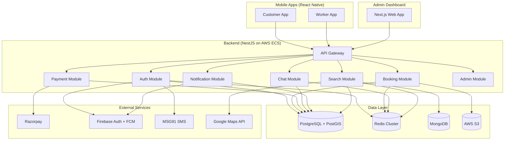
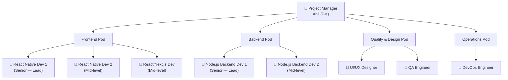
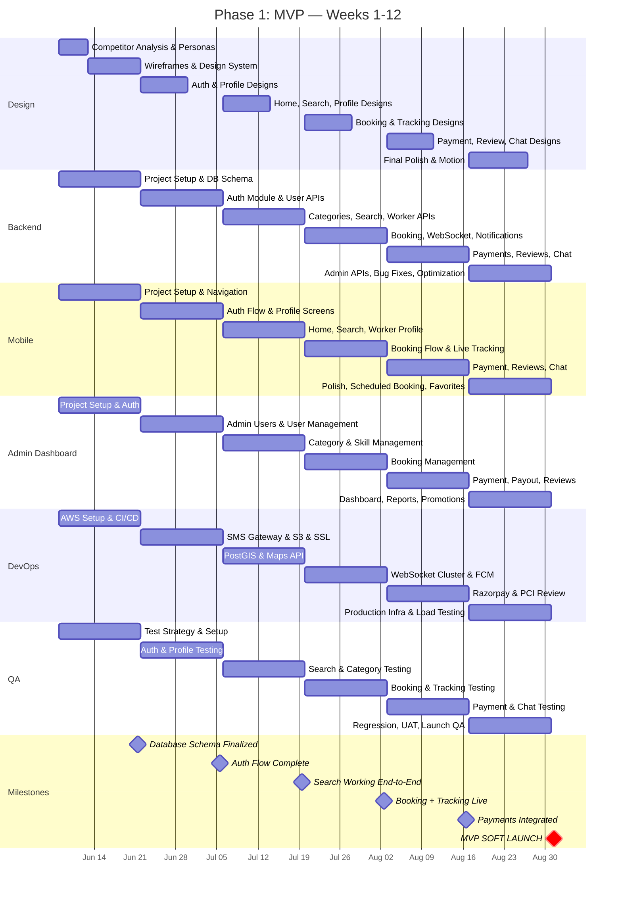
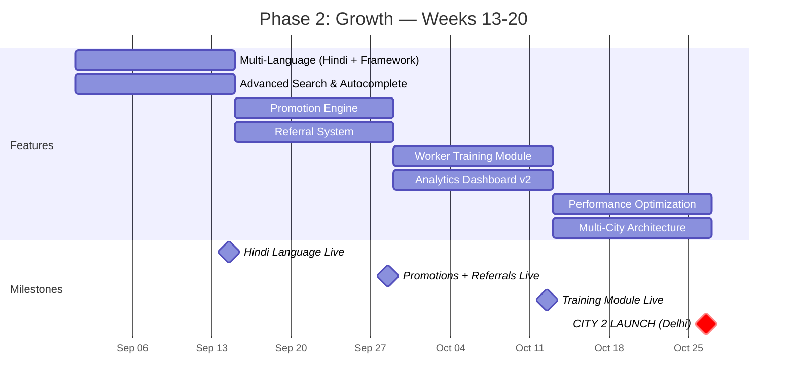
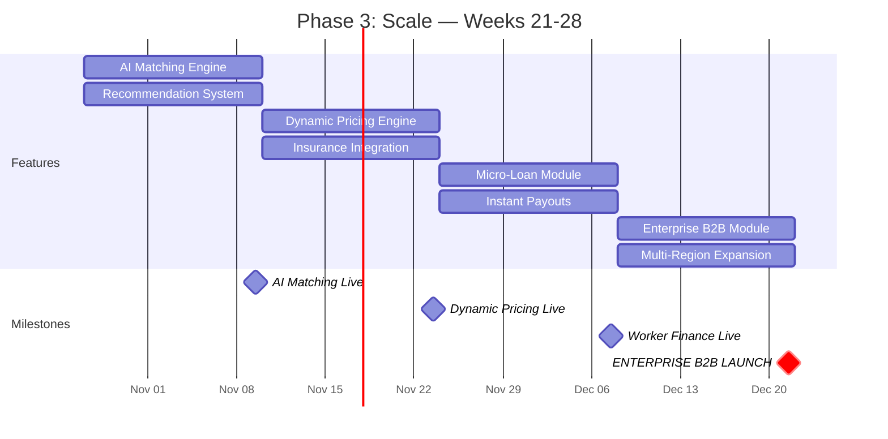
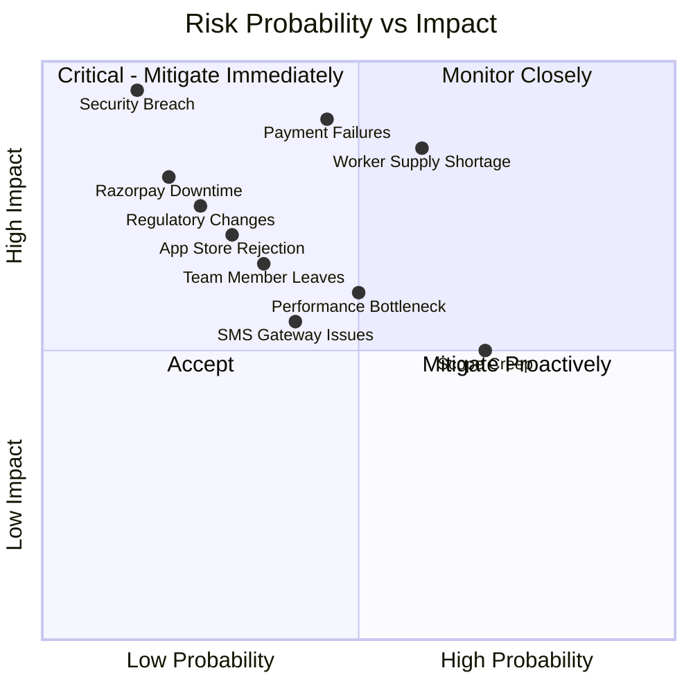
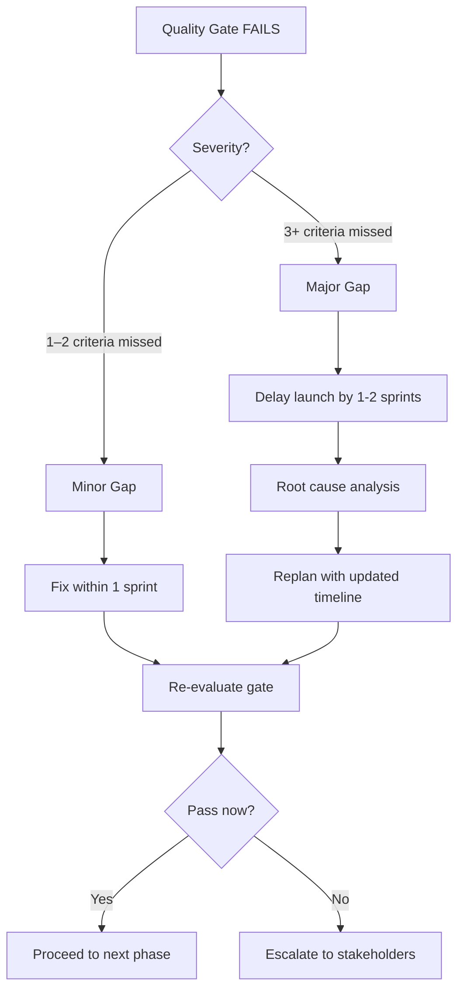
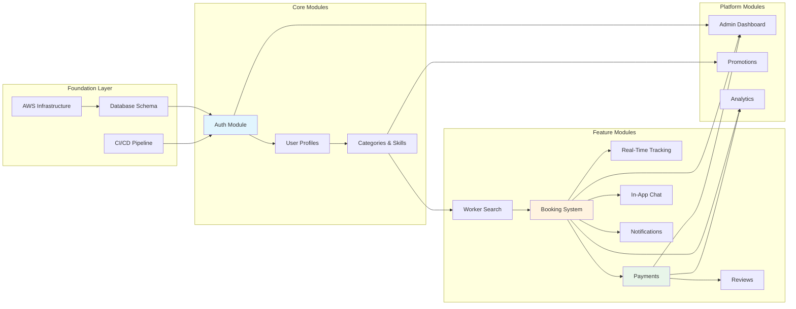
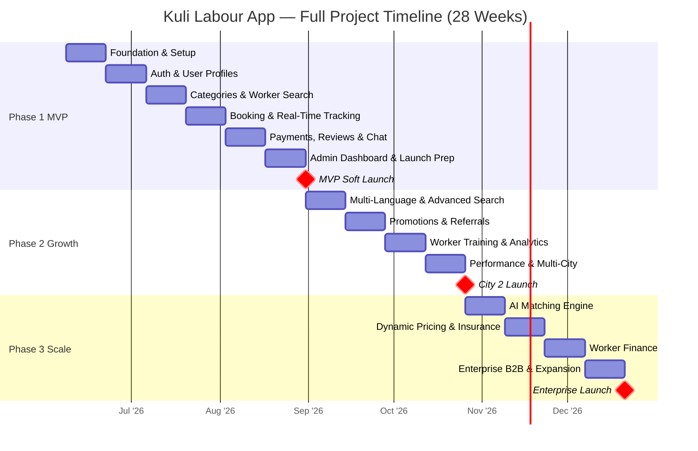

# 🗓️ Kuli Labour App — Implementation Plan

> **Document 6 of the Kuli Full-Project Documentation Suite**
> Version 1.0 · June 2026 · Confidential

---

## Table of Contents

1. [Project Overview](#1-project-overview)
2. [Team Requirements](#2-team-requirements)
3. [Phase 1: MVP (Weeks 1–12)](#3-phase-1-mvp-weeks-112)
4. [Phase 2: Growth (Weeks 13–20)](#4-phase-2-growth-weeks-1320)
5. [Phase 3: Scale (Weeks 21–28)](#5-phase-3-scale-weeks-2128)
6. [Technical Milestones](#6-technical-milestones)
7. [Risk Register](#7-risk-register)
8. [Budget Estimation](#8-budget-estimation)
9. [Quality Gates](#9-quality-gates)
10. [Launch Checklist](#10-launch-checklist)
11. [Dependency Map](#11-dependency-map)
12. [Success Criteria per Phase](#12-success-criteria-per-phase)

---

## 1. Project Overview

### 1.1 Vision Statement

**Kuli** is an on-demand labour hiring platform for India — connecting daily-wage workers (painters, plumbers, electricians, carpenters, cleaners, movers, etc.) with individual homeowners who need their services. Think of it as "Uber for skilled labour."

### 1.2 Goals

| # | Goal | Measurable Target |
|---|---|---|
| G1 | Launch a working MVP in the first Indian metro city | Mumbai — within 12 weeks |
| G2 | Onboard labourers with verified profiles | 500+ verified workers in Month 3 |
| G3 | Enable seamless booking + payment | < 3 taps from search to booking confirmation |
| G4 | Achieve market-ready quality | < 1% crash rate, < 2s avg API response |
| G5 | Establish platform trust | Aadhaar verification, reviews, badge system |
| G6 | Prepare for multi-city expansion | Architecture supports horizontal scaling |

### 1.3 Product Scope

| In Scope (MVP) | In Scope (Post-MVP) | Out of Scope |
|---|---|---|
| Customer + Labourer mobile apps | Multi-language UI | Enterprise/B2B bulk hiring |
| OTP-based authentication | AI-powered worker matching | Worker insurance |
| Category browsing + search | Dynamic pricing engine | Micro-loans / Fintech |
| Instant + scheduled bookings | Referral & promotions | International expansion |
| Razorpay payments (UPI, cards) | Advanced analytics dashboard | Desktop customer app |
| Real-time worker tracking | Worker training modules | Hardware devices |
| In-app chat + notifications | Push marketing automation | Social media integration |
| Review & rating system | | |
| Basic admin dashboard | | |

### 1.4 Methodology

We follow a modified **Agile/Scrum** framework:

| Element | Configuration |
|---|---|
| **Sprint Length** | 2 weeks |
| **Ceremonies** | Daily standup (15 min), Sprint Planning (2 hr), Sprint Review (1 hr), Retrospective (1 hr) |
| **Tools** | Jira (project management), Confluence (docs), Slack (communication), GitHub (code), Figma (design) |
| **Branching** | GitFlow — `main` → `develop` → `feature/*` → `release/*` |
| **CI/CD** | GitHub Actions → Docker → AWS ECS (staging) → AWS ECS (production) |
| **Code Review** | All PRs require 1 approval; backend PRs require 2 |
| **Definition of Done** | Code reviewed, tests pass, no critical bugs, documentation updated |

### 1.5 Technical Architecture Summary



---

## 2. Team Requirements

### 2.1 Team Structure



### 2.2 Role Definitions

| # | Role | Count | Level | Key Responsibilities |
|---|---|---|---|---|
| 1 | **Project Manager** | 1 | Senior | Sprint planning, stakeholder communication, risk management, timeline tracking, resource allocation |
| 2 | **React Native Dev** (Mobile Lead) | 1 | Senior (5+ yr) | Architecture decisions, code reviews, complex features (maps, real-time), mentoring RN Dev 2 |
| 3 | **React Native Dev** | 1 | Mid (3+ yr) | Feature implementation, UI screens, state management, unit tests |
| 4 | **React/Next.js Dev** (Admin) | 1 | Mid (3+ yr) | Admin dashboard, data tables, charts, RBAC, responsive design |
| 5 | **Node.js Backend Dev** (Lead) | 1 | Senior (5+ yr) | System design, DB schema, API architecture, payment integration, code reviews |
| 6 | **Node.js Backend Dev** | 1 | Mid (3+ yr) | API implementation, integrations (SMS, FCM, Razorpay), WebSocket, unit/integration tests |
| 7 | **UI/UX Designer** | 1 | Mid (3+ yr) | User research, wireframes, high-fidelity mockups, design system, icon/asset creation, prototyping |
| 8 | **QA Engineer** | 1 | Mid (3+ yr) | Test planning, manual testing, automation (Detox for mobile, Jest for API), regression, UAT coordination |
| 9 | **DevOps Engineer** | 1 | Mid (3+ yr) | CI/CD pipelines, AWS infrastructure, Docker, monitoring (CloudWatch, Sentry), SSL, backups, security |

### 2.3 Team Working Agreements

| Policy | Detail |
|---|---|
| **Working Hours** | 10:00 AM – 7:00 PM IST, with 1-hour overlap for distributed members |
| **Standup** | Daily at 10:15 AM IST via Slack Huddle |
| **Code Reviews** | Response within 4 business hours |
| **On-call** | Rotating weekly after launch (Backend Lead + DevOps) |
| **Knowledge Sharing** | Friday 30-min tech talk / demo |
| **Leave Policy** | 48-hr notice for planned leave; immediate notification for emergencies |

### 2.4 RACI Matrix (Key Activities)

| Activity | PM | RN Lead | RN Dev | Web Dev | BE Lead | BE Dev | UX | QA | DevOps |
|---|---|---|---|---|---|---|---|---|---|
| Sprint Planning | **A** | C | I | I | C | I | C | C | I |
| UI/UX Design | I | C | I | I | I | I | **R** | C | — |
| Mobile Architecture | C | **R/A** | C | — | C | — | — | I | — |
| Backend Architecture | C | I | — | — | **R/A** | C | — | I | C |
| Feature Development | I | **R** | **R** | **R** | **R** | **R** | — | I | — |
| Code Review | I | **R** | R | R | **R** | R | — | — | R |
| Testing | I | C | C | C | C | C | — | **R/A** | — |
| Deployment | I | — | — | — | C | — | — | C | **R/A** |
| Monitoring | I | — | — | — | C | C | — | — | **R/A** |

*R = Responsible, A = Accountable, C = Consulted, I = Informed*

---

## 3. Phase 1: MVP (Weeks 1–12)

### 3.1 Phase Overview

> **Goal**: Deliver a fully functional MVP with core booking flow — from worker search to payment — ready for soft launch in Mumbai with ~100 workers and ~500 customers (closed beta).

### 3.2 Week-by-Week Breakdown

---

#### 📅 Sprint 1 — Weeks 1–2: Foundation

> **Theme**: Project setup, design system, database schema, API scaffolding

| Track | Tasks | Owner | Deliverables |
|---|---|---|---|
| **PM** | Finalize requirements, set up Jira board, create epics/stories, establish ceremonies schedule | PM | Jira board with all MVP stories, communication channels |
| **Design** | Competitor analysis (Urban Company, Housejoy), user personas, information architecture, wireframes (all key flows), design system (colors, typography, spacing, components) | UX | Figma — wireframes for 15+ screens, design tokens, component library |
| **Mobile** | RN project initialization (Expo managed → bare if needed), folder structure, navigation setup (React Navigation), state management (Zustand), theme system, common components library | RN Lead + RN Dev | Boilerplate repo with navigation shell, theme, reusable components |
| **Backend** | NestJS project scaffolding, module structure, PostgreSQL schema creation (all tables), Redis & MongoDB connections, Docker Compose for local dev, environment config | BE Lead + BE Dev | Running NestJS server with health check, DB migrations applied |
| **Admin** | Next.js project setup, folder structure, auth scaffolding, layout with sidebar navigation, Tailwind CSS + shadcn/ui configuration | Web Dev | Admin shell with login page and dashboard layout |
| **DevOps** | AWS account setup, VPC + subnets, RDS PostgreSQL instance, ElastiCache Redis, S3 buckets, Docker registry (ECR), CI/CD pipeline skeleton (GitHub Actions), staging environment | DevOps | Staging URL live, CI runs on push, Docker builds succeed |
| **QA** | Test strategy document, test environment setup, device matrix, install Detox + Jest, create test plan template | QA | Test strategy doc, test plan for Sprint 1 |

**Sprint 1 Definition of Done:**
- [ ] All repos created with README and contributing guidelines
- [ ] Design system published in Figma with developer handoff
- [ ] Database schema applied to staging PostgreSQL
- [ ] NestJS boots with `/health` endpoint returning 200
- [ ] Mobile app shell builds on Android + iOS simulator
- [ ] Admin dashboard accessible at staging URL
- [ ] CI/CD pipeline runs lint + type-check on every PR

---

#### 📅 Sprint 2 — Weeks 3–4: Auth & Profiles

> **Theme**: Authentication module, user profiles, Aadhaar verification flow

| Track | Tasks | Owner | Deliverables |
|---|---|---|---|
| **Design** | High-fidelity designs: Onboarding, OTP login, profile setup (customer + worker), Aadhaar upload, profile photo | UX | 12 high-fidelity screens |
| **Mobile** | OTP login flow (phone input → OTP verify → role selection), profile setup screens (customer: name/email/photo, worker: name/bio/skills/rates/photo), Aadhaar capture (camera + gallery), profile view/edit | RN Lead + RN Dev | Auth flow complete end-to-end, profile screens |
| **Backend** | Auth module: OTP generation (MSG91), OTP verification, JWT access + refresh tokens, Firebase Auth integration, rate limiting on OTP. Users module: CRUD, profile photo upload (S3), Aadhaar hash + document upload, worker verification status machine | BE Lead + BE Dev | Auth APIs working, user CRUD, document upload |
| **Admin** | Admin login (email + password), admin user management (list, create, edit permissions), basic dashboard shell with placeholder stats | Web Dev | Admin auth, user management CRUD |
| **DevOps** | MSG91 integration, S3 bucket policies for uploads, HTTPS/SSL for staging API, environment variable management (AWS Secrets Manager) | DevOps | SMS gateway live, S3 upload working, HTTPS enabled |
| **QA** | Auth flow testing (happy path + edge cases: expired OTP, wrong OTP, rate limiting), profile creation tests, Aadhaar upload test | QA | Test report for auth module |

**Sprint 2 Definition of Done:**
- [ ] User can sign up via OTP on both Android and iOS
- [ ] JWT tokens issued and refresh flow works
- [ ] Worker can upload Aadhaar document and set profile
- [ ] Customer can set profile with name + photo
- [ ] Admin can log in and manage admin users
- [ ] Rate limiting prevents OTP abuse (max 5/min per phone)
- [ ] All auth API endpoints have integration tests (>80% coverage)

---

#### 📅 Sprint 3 — Weeks 5–6: Categories & Worker Search

> **Theme**: Category browsing, worker search with location, worker profiles

| Track | Tasks | Owner | Deliverables |
|---|---|---|---|
| **Design** | Home screen (category grid), category detail (worker list), worker profile page, search/filter UI, empty states, loading skeletons | UX | 10 high-fidelity screens with interactions |
| **Mobile** | Home screen with category grid, category → worker list with distance, search bar with filters (rating, price, distance, verified), worker profile detail page, Google Maps integration (user location permission, map view for workers nearby), pull-to-refresh, infinite scroll pagination | RN Lead + RN Dev | Home → Search → Profile flow complete |
| **Backend** | Categories API (list, detail), Skills API, Worker search API with PostGIS spatial queries (nearby workers, radius filter), worker profile API (with reviews, skills, documents), composite search with filters (rating, price, distance, availability), Redis caching for category list + search results | BE Lead + BE Dev | Search returning workers sorted by distance |
| **Admin** | Category management CRUD (create, edit, reorder, toggle active), skill management within categories, user listing with filters (role, status, city) | Web Dev | Category + skill management, user listing page |
| **DevOps** | PostGIS extension on RDS, Google Maps API key management, Redis monitoring | DevOps | Geospatial queries working on staging |
| **QA** | Search accuracy testing (verify distance calculations), category browsing, worker profile display, search filter combinations, performance testing (search < 500ms) | QA | Test report for search module |

**Sprint 3 Definition of Done:**
- [ ] Customer sees category grid on home screen
- [ ] Tapping category shows nearby workers sorted by distance
- [ ] Search with text query returns relevant workers
- [ ] Filters work: rating ≥ X, price ≤ Y, distance ≤ Z km, verified only
- [ ] Worker profile shows bio, rating, reviews, skills, badge
- [ ] PostGIS spatial query returns correct results within radius
- [ ] Category list cached in Redis with 5-min TTL
- [ ] Search API responds in < 500ms for 95th percentile

---

#### 📅 Sprint 4 — Weeks 7–8: Booking & Tracking

> **Theme**: Booking system, real-time tracking, push notifications

| Track | Tasks | Owner | Deliverables |
|---|---|---|---|
| **Design** | Booking creation flow, booking confirmation screen, booking status tracker (stepper), live tracking map view, notification center, booking history list + detail | UX | 14 high-fidelity screens |
| **Mobile** | Booking creation (select worker → add description → choose address → confirm), booking status live updates via WebSocket, live map tracking (worker location on map), push notification handling (foreground + background), notification center screen, booking history list with status filters, booking detail view | RN Lead + RN Dev | Full booking flow from creation to completion |
| **Backend** | Booking module: create booking, status state machine (pending → accepted → en_route → in_progress → completed → paid), booking assignment logic. WebSocket server (Socket.IO): real-time status updates, live location broadcasting. Worker location module: receive + cache location updates (Redis), persist to PostgreSQL + MongoDB. Push notifications (Firebase FCM): booking request to worker, status change to customer. Notification persistence + read tracking | BE Lead + BE Dev | Booking APIs, WebSocket events, FCM delivery |
| **Admin** | Booking management (list, detail, force-status-change), real-time active bookings view, booking analytics (count by status) | Web Dev | Booking management pages |
| **DevOps** | Socket.IO deployment (sticky sessions on ECS), Redis pub/sub for Socket.IO adapter, FCM service account configuration, WebSocket load testing setup | DevOps | WebSocket cluster working across ECS tasks |
| **QA** | Full booking lifecycle testing (happy path + cancellation), WebSocket connection testing (reconnection on network change), push notification delivery (Android + iOS), location tracking accuracy, state machine validation (invalid transitions rejected) | QA | Test report for booking + tracking |

**Sprint 4 Definition of Done:**
- [ ] Customer can create instant booking from worker profile
- [ ] Worker receives push notification for new booking request
- [ ] Worker accepts → status changes → customer sees live update
- [ ] Worker location appears on customer's map during en_route
- [ ] Worker marks work as started → in_progress status
- [ ] Worker marks complete → completed status
- [ ] Booking history shows all past bookings with status
- [ ] Notification center shows all notifications with read/unread
- [ ] WebSocket reconnects within 3 seconds after network loss
- [ ] State machine rejects invalid transitions (e.g., pending → completed)

---

#### 📅 Sprint 5 — Weeks 9–10: Payments, Reviews & Chat

> **Theme**: Payment integration (Razorpay), review system, in-app chat

| Track | Tasks | Owner | Deliverables |
|---|---|---|---|
| **Design** | Payment checkout screen, payment success/failure states, earnings dashboard (worker), review submission form, review display on profile, chat interface (bubbles, timestamps, media), worker bank account setup | UX | 12 high-fidelity screens |
| **Mobile** | Razorpay SDK integration (checkout flow), payment status handling (success, failure, pending), worker earnings screen (daily/weekly/monthly breakdown), review submission (star rating + comment), reviews display on worker profile. Chat UI: message bubbles, auto-scroll, send button, typing indicator, image attachment upload (S3). Bank account setup screen for workers | RN Lead + RN Dev | Payment flow, reviews, chat feature complete |
| **Backend** | Payment module: Razorpay order creation, payment verification (signature validation), webhook handler for async status updates, refund processing. Payout module: payout request, bank account CRUD, penny-drop verification mock. Review module: create review (with booking validation), update `rating_avg` trigger, review listing. Chat module: message CRUD, Socket.IO events for real-time delivery, typing indicators, read receipts, media upload. Commission calculation (15% default, configurable via app_configs) | BE Lead + BE Dev | Payment + payout APIs, review APIs, chat APIs + WebSocket events |
| **Admin** | Payment dashboard (transactions list, revenue summary, refund management), payout management (pending payouts, approve/process), review moderation | Web Dev | Payment + payout management, review moderation |
| **DevOps** | Razorpay test + live key management, payment webhook endpoint (separate from main API for reliability), PCI compliance review for bank account storage, backup verification | DevOps | Razorpay integration live on staging |
| **QA** | Payment flow testing (UPI, card, netbanking — test mode), refund testing, review submission + rating recalculation, chat message delivery + ordering, chat with media, payment edge cases (network failure during payment, duplicate payments) | QA | Test report for payments, reviews, chat |

**Sprint 5 Definition of Done:**
- [ ] Customer can pay via Razorpay (UPI at minimum)
- [ ] Payment captures correctly, booking moves to "paid"
- [ ] Worker sees earnings on dashboard with daily breakdown
- [ ] Worker can request payout to bank account
- [ ] Customer can leave review after booking completes
- [ ] Rating average updates automatically on worker profile
- [ ] Customer and worker can chat during active booking
- [ ] Chat messages persist and load correctly on reopening
- [ ] Typing indicator shows when other party is typing
- [ ] Image messages upload to S3 and display in chat

---

#### 📅 Sprint 6 — Weeks 11–12: Admin Dashboard, Polish & Launch Prep

> **Theme**: Admin dashboard MVP, testing, bug fixes, soft launch preparation

| Track | Tasks | Owner | Deliverables |
|---|---|---|---|
| **Design** | Admin dashboard visual polish, customer-facing UI polish (animations, transitions, micro-interactions), empty states for all screens, error states, offline state UI | UX | Final polished designs, motion specs |
| **Mobile** | Bug fixes from QA backlog, performance optimization (list virtualization, image caching, lazy loading), scheduled booking flow (date/time picker), address management (add/edit/delete addresses), favorites (save/remove workers), app settings (language, notifications toggle), deep linking for notifications, offline mode handling (graceful degradation), error boundary screens, analytics event tracking integration | RN Lead + RN Dev | Production-ready mobile app |
| **Backend** | Bug fixes, API optimization (N+1 query resolution, query plan analysis), admin dashboard APIs (aggregated stats: total users, active workers, bookings today, revenue this month, growth charts), favorites API, address CRUD, scheduled booking logic (reminders), promotion code validation + application, app config APIs for feature flags, rate limiting finalization | BE Lead + BE Dev | All APIs production-ready, admin stats API |
| **Admin** | Dashboard home (KPI cards: total users, active workers, today's bookings, MTD revenue, charts), worker verification workflow (view documents, approve/reject with notes), report management (list, detail, resolve), promotion management (create, edit, deactivate), app config management UI, audit log viewer | Web Dev | Full admin dashboard MVP |
| **DevOps** | Production AWS setup (separate VPC, RDS Multi-AZ, ElastiCache Multi-AZ), production CI/CD pipeline, domain + SSL (api.kuli.app, admin.kuli.app), CloudWatch alarms + dashboards, Sentry error tracking, log aggregation (CloudWatch Logs), database backup verification, security audit (OWASP top 10), load testing (k6 — target 1000 concurrent users) | DevOps | Production infrastructure, monitoring, alerting |
| **QA** | Full regression testing (all modules), UAT with internal team, cross-device testing (5+ Android devices, 3+ iOS devices), edge case testing, API load testing results, accessibility basics check, Play Store / App Store compliance check | QA | QA sign-off document, bug-free release candidate |
| **PM** | App Store listing assets (screenshots, description, privacy policy, terms), soft launch plan (Mumbai — 100 workers, 500 beta users), support workflow setup, feedback collection mechanism | PM | Store listings, launch plan doc |

**Sprint 6 Definition of Done:**
- [ ] All critical + high bugs resolved (zero open P0/P1)
- [ ] App crash rate < 1% across 50 test devices
- [ ] API 95th percentile response time < 2 seconds
- [ ] Load test passes: 1000 concurrent users, < 5% error rate
- [ ] Admin dashboard shows real-time stats
- [ ] Admin can verify workers, manage bookings, process refunds
- [ ] App Store and Play Store builds submitted for review
- [ ] Production infrastructure deployed and monitoring active
- [ ] Backup + restore tested successfully
- [ ] Security audit complete — no critical/high findings open

---

### 3.3 Sprint Calendar (Phase 1)



---

## 4. Phase 2: Growth (Weeks 13–20)

### 4.1 Phase Overview

> **Goal**: Add growth features, scale to additional cities, improve retention through engagement features.

### 4.2 Week-by-Week Breakdown

---

#### 📅 Sprint 7 — Weeks 13–14: Multi-Language & Advanced Search

| Track | Tasks | Owner |
|---|---|---|
| **Design** | Language switcher UI, search autocomplete, advanced filter sheet, "no results" → suggestions | UX |
| **Mobile** | i18n framework (react-i18next), Hindi translations for all screens, language switcher in settings, dynamic RTL support. Advanced search: autocomplete suggestions, recent searches, popular categories, filter bottom sheet with save preferences | RN Lead + RN Dev |
| **Backend** | i18n API (category/skill names in requested language), search optimization (Elasticsearch evaluation), autocomplete API (based on MongoDB search_logs), trending categories API | BE Lead + BE Dev |
| **Admin** | Translation management interface, search analytics dashboard (top queries, no-result queries, conversion rates) | Web Dev |
| **DevOps** | CDN setup (CloudFront) for static assets, performance monitoring baseline | DevOps |
| **QA** | Multi-language testing (Hindi flow end-to-end), search autocomplete testing, RTL layout testing | QA |

---

#### 📅 Sprint 8 — Weeks 15–16: Promotions & Referrals

| Track | Tasks | Owner |
|---|---|---|
| **Design** | Promo code entry at checkout, referral share screen, referral tracking, reward notification, wallet/credits UI | UX |
| **Mobile** | Promo code input during booking, promo validation + discount display, referral system (generate unique code, share via WhatsApp/SMS, track referral status), reward notification, Kuli Credits/wallet balance display | RN Lead + RN Dev |
| **Backend** | Promotion engine: code validation, usage tracking, first-time user detection, max discount calculation. Referral system: unique referral code generation, referral tracking, credit disbursement (both referrer + referee), anti-fraud checks. Kuli Credits: wallet ledger, credit application at checkout | BE Lead + BE Dev |
| **Admin** | Promotion management (create campaigns, set budgets, usage analytics), referral analytics (viral coefficient, top referrers), credit audit trail | Web Dev |
| **QA** | Promo code testing (valid, expired, max usage, min order value), referral flow testing, credit application testing | QA |

---

#### 📅 Sprint 9 — Weeks 17–18: Worker Training & Analytics

| Track | Tasks | Owner |
|---|---|---|
| **Design** | Worker training module (video list, completion tracking, certificate), safety guidelines, analytics charts for admin dashboard | UX |
| **Mobile** | Worker app: training module (video player, progress tracking, quiz, completion certificate), safety guidelines checklist, improved earnings analytics (charts, trends), profile completion prompts | RN Lead + RN Dev |
| **Backend** | Training module: content management API, progress tracking, completion certificates (PDF generation). Analytics aggregation: daily/weekly/monthly revenue, user growth, booking trends, worker utilization, city-wise breakdown, category demand heat map | BE Lead + BE Dev |
| **Admin** | Analytics dashboard: interactive charts (Recharts), date range filters, city/category filters, export to CSV, real-time KPI ticker. Training content management CRUD | Web Dev |
| **DevOps** | MongoDB aggregation pipeline optimization, scheduled jobs (cron) for analytics pre-computation, Redis caching for dashboard data | DevOps |
| **QA** | Training module testing, analytics accuracy verification, dashboard performance testing | QA |

---

#### 📅 Sprint 10 — Weeks 19–20: Performance & Multi-City

| Track | Tasks | Owner |
|---|---|---|
| **Design** | City selector UI, onboarding improvements for new cities, performance audit UX (loading, skeleton, transitions) | UX |
| **Mobile** | Performance optimization: image lazy loading + progressive JPEG, list virtualization (FlashList), bundle size reduction, code splitting. City selection on onboarding, location-aware defaults. Offline queue for critical actions (booking cancel works offline, syncs when online). App size optimization (< 25 MB APK) | RN Lead + RN Dev |
| **Backend** | Multi-city support: city-based worker pools, city-level pricing, regional config. API performance: response compression, pagination optimization, database connection pooling tuning, Redis pipeline batching. Horizontal scaling: stateless service verification, database read replicas | BE Lead + BE Dev |
| **Admin** | Multi-city management (city CRUD, regional settings, per-city analytics), performance monitoring dashboard | Web Dev |
| **DevOps** | Auto-scaling policies (ECS + ALB), read replica for PostgreSQL, CloudFront CDN optimization, APM setup (AWS X-Ray), load testing for 5000 concurrent users | DevOps |
| **QA** | Performance testing (response times, memory, battery), multi-city flow testing, scalability testing, full regression | QA |

---

### 4.3 Phase 2 Sprint Calendar



---

## 5. Phase 3: Scale (Weeks 21–28)

### 5.1 Phase Overview

> **Goal**: Introduce AI-powered features, dynamic pricing, insurance integration, worker financial services, and enterprise module for large-scale operations.

### 5.2 Week-by-Week Breakdown

---

#### 📅 Sprint 11 — Weeks 21–22: AI-Powered Matching

| Track | Tasks | Owner |
|---|---|---|
| **Backend** | ML matching engine: worker scoring model (distance, rating, availability, response time, skill match, past customer satisfaction), recommendation API, A/B testing framework for matching algorithms. Training data pipeline from MongoDB analytics events | BE Lead + BE Dev |
| **Mobile** | "Recommended for you" worker carousel, smart suggestions during booking ("Based on your past bookings..."), one-tap rebooking for previous workers | RN Lead + RN Dev |
| **Admin** | A/B test management, matching algorithm metrics (acceptance rate, completion rate by match type) | Web Dev |

---

#### 📅 Sprint 12 — Weeks 23–24: Dynamic Pricing & Insurance

| Track | Tasks | Owner |
|---|---|---|
| **Backend** | Dynamic pricing engine: surge pricing during high demand (rain, festivals, peak hours), demand-supply ratio by area/category, price multiplier calculation, price caps for consumer protection. Insurance module: integrate with insurance partner API, per-booking micro-insurance, claim filing API | BE Lead + BE Dev |
| **Mobile** | Surge pricing indicator + explanation, insurance opt-in during booking, insurance certificate view, claim filing flow | RN Lead + RN Dev |
| **Admin** | Dynamic pricing controls (set multiplier caps, blackout dates), insurance dashboard (active policies, claims) | Web Dev |

---

#### 📅 Sprint 13 — Weeks 25–26: Worker Finance

| Track | Tasks | Owner |
|---|---|---|
| **Backend** | Micro-loan module: eligibility scoring (based on earnings history, rating, tenure), loan application API, repayment tracking (auto-deduct from earnings), partner lending API integration. Advance earnings: instant payout (for a fee), earnings forecast | BE Lead + BE Dev |
| **Mobile** | Worker finance hub: available balance, pending payouts, loan eligibility checker, loan application flow, repayment schedule, instant payout option | RN Lead + RN Dev |
| **Admin** | Loan management (applications, approvals, disbursements, repayment tracking), financial risk dashboard | Web Dev |

---

#### 📅 Sprint 14 — Weeks 27–28: Enterprise B2B & Expansion

| Track | Tasks | Owner |
|---|---|---|
| **Backend** | Enterprise module: company registration, bulk booking API, dedicated worker pools, monthly invoicing, SLA-based matching, company admin API. Multi-region: state-level compliance, regional language packs (Tamil, Telugu, Bengali, Marathi), currency localization (already INR) | BE Lead + BE Dev |
| **Mobile** | Enterprise user flows (if needed — most B2B via admin portal), regional language selector expansion | RN Lead + RN Dev |
| **Admin** | Enterprise management (company onboarding, contract management, bulk booking dashboard, invoicing), expansion readiness dashboard (city launch checklist tracker) | Web Dev |
| **DevOps** | Multi-region AWS deployment (Mumbai + Hyderabad regions), global CDN, database cross-region replication evaluation | DevOps |

---

### 5.3 Phase 3 Sprint Calendar



---

## 6. Technical Milestones

### 6.1 Sprint Deliverables & Definition of Done

| Sprint | Week | Deliverable | Definition of Done |
|---|---|---|---|
| **S1** | 1–2 | Foundation Complete | DB schema applied, all repos initialized, CI/CD pipeline running, staging environment live |
| **S2** | 3–4 | Auth Module Complete | OTP login works on both platforms, JWT refresh flow, profile CRUD, Aadhaar upload, admin login, >80% API test coverage |
| **S3** | 5–6 | Search Module Complete | Category browsing, geospatial worker search, filters working, search <500ms P95, Redis caching active |
| **S4** | 7–8 | Booking Module Complete | Full booking lifecycle (create → accept → track → complete), WebSocket real-time updates, push notifications delivered, admin booking management |
| **S5** | 9–10 | Payment Module Complete | Razorpay checkout working (UPI + card), refund flow, payout request, reviews with auto-rating update, chat with media support |
| **S6** | 11–12 | **MVP Launch** | All P0/P1 bugs resolved, <1% crash rate, load test passed (1000 users), app store submissions, production monitoring active |
| **S7** | 13–14 | Multi-Language | Hindi localization complete, language switcher, advanced search with autocomplete |
| **S8** | 15–16 | Growth Features | Promotion engine, referral system, Kuli Credits wallet |
| **S9** | 17–18 | Engagement Features | Worker training module, analytics dashboard v2, CSV export |
| **S10** | 19–20 | **Multi-City Launch** | Performance optimized, multi-city architecture, 5000 concurrent user load test, City 2 (Delhi) launch |
| **S11** | 21–22 | AI Matching | ML scoring model deployed, recommendation API, A/B testing |
| **S12** | 23–24 | Dynamic Pricing | Surge pricing engine, insurance integration |
| **S13** | 25–26 | Worker Finance | Micro-loan module, instant payouts |
| **S14** | 27–28 | **Enterprise Launch** | B2B module, bulk bookings, multi-region infrastructure |

### 6.2 Technical Debt Budget

Each sprint allocates **15% of velocity** to technical debt reduction:

| Category | Sprint Budget | Examples |
|---|---|---|
| Code quality | 5% | Refactoring, removing dead code, improving types |
| Test coverage | 5% | Adding missing unit/integration tests |
| Performance | 3% | Query optimization, caching improvements |
| Documentation | 2% | API docs, architecture decision records (ADRs) |

---

## 7. Risk Register

### 7.1 Risk Assessment Matrix



### 7.2 Detailed Risk Register

| ID | Risk | Probability | Impact | Severity | Mitigation Strategy | Contingency | Owner |
|---|---|---|---|---|---|---|---|
| R01 | **Payment processing failures** — Razorpay downtime, failed transactions, stuck payments | Medium (0.45) | Critical (0.90) | 🔴 High | Implement retry logic with exponential backoff, webhook-based async confirmation, clear error messages, manual payment recording option for cash payments | Switch to backup gateway (Cashfree), manual reconciliation process | BE Lead |
| R02 | **Worker supply shortage** — Not enough verified workers in launch city | High (0.60) | Critical (0.85) | 🔴 High | Start on-ground recruitment 4 weeks before launch, partner with worker unions/contractors, offer sign-up incentives (₹500 bonus for first 5 jobs), simplified onboarding | Expand geographic radius, lower verification requirements temporarily, partner with staffing agencies | PM |
| R03 | **App Store rejection** — Apple/Google rejects app submission | Low-Med (0.30) | High (0.70) | 🟡 Medium | Follow platform guidelines strictly, pre-submission review checklist, include clear privacy policy + terms, proper permission justifications | Fix rejection reason within 48 hrs, fast-track re-review, distribute via TestFlight / APK during delay | RN Lead |
| R04 | **Security breach** — Data leak, unauthorized access to Aadhaar data, PII exposure | Low (0.15) | Critical (0.95) | 🔴 High | Never store raw Aadhaar (hash only), encrypt bank accounts at rest, regular penetration testing, WAF on API gateway, input validation, SQL injection prevention (parameterized queries), rate limiting, audit logging | Incident response plan (notify users within 72 hrs per DPDP Act), engage security firm, temporary service suspension if needed | DevOps |
| R05 | **Team member departure** — Key developer leaves mid-project | Medium (0.35) | High (0.65) | 🟡 Medium | Knowledge sharing sessions, code documentation, pair programming, no single point of failure (bus factor ≥ 2 for each module), competitive compensation | Cross-trained team members take over, hire replacement immediately, adjust sprint velocity | PM |
| R06 | **Scope creep** — Stakeholder requests beyond MVP definition | High (0.70) | Medium (0.50) | 🟡 Medium | Strict MVP scope document signed by stakeholders, change request process (CR form → impact analysis → approval), "parking lot" list for post-MVP features | Extend timeline by 2 weeks maximum, defer non-critical CRs to Phase 2 | PM |
| R07 | **SMS gateway failures** — MSG91 downtime, OTP delivery failures | Medium (0.40) | Medium (0.55) | 🟡 Medium | Implement fallback SMS provider (Twilio India), retry with alternate provider on failure, WhatsApp OTP as backup channel | Manual verification process, email OTP fallback | BE Dev |
| R08 | **Performance bottleneck** — API response times exceed 2s under load | Medium (0.50) | High (0.60) | 🟡 Medium | Performance testing from Sprint 4 onward, Redis caching for hot paths, database query optimization, connection pooling, CDN for static assets | Emergency scaling (double ECS tasks), identify and cache specific bottleneck queries, database read replica | DevOps |
| R09 | **Regulatory changes** — New labor laws, digital payment regulations, data protection requirements | Low-Med (0.25) | High (0.75) | 🟡 Medium | Monitor labor ministry announcements, legal review of platform model, DPDP Act compliance built-in, consult with labor law attorney | Engage compliance consultant, implement required changes within 30 days | PM |
| R10 | **Razorpay integration complexity** — UPI auto-debit restrictions, mandate flow changes | Low-Med (0.30) | Medium (0.60) | 🟡 Medium | Use Razorpay Standard Checkout (handles complexity), test thoroughly in test mode, maintain Razorpay support relationship | Implement alternative payment flow, add cash payment option as interim | BE Lead |

---

## 8. Budget Estimation

### 8.1 Team Costs (Monthly)

> Based on Indian market rates (Tier 1 cities, 2026 estimates)

| Role | Count | Monthly CTC (₹) | Monthly Total (₹) | 7-Month Total (₹) |
|---|---|---|---|---|
| Project Manager | 1 | 1,50,000 | 1,50,000 | 10,50,000 |
| React Native Dev (Senior) | 1 | 1,80,000 | 1,80,000 | 12,60,000 |
| React Native Dev (Mid) | 1 | 1,20,000 | 1,20,000 | 8,40,000 |
| React/Next.js Dev (Mid) | 1 | 1,20,000 | 1,20,000 | 8,40,000 |
| Node.js Backend Dev (Senior) | 1 | 1,80,000 | 1,80,000 | 12,60,000 |
| Node.js Backend Dev (Mid) | 1 | 1,20,000 | 1,20,000 | 8,40,000 |
| UI/UX Designer | 1 | 1,00,000 | 1,00,000 | 7,00,000 |
| QA Engineer | 1 | 90,000 | 90,000 | 6,30,000 |
| DevOps Engineer | 1 | 1,40,000 | 1,40,000 | 9,80,000 |
| **Team Total** | **9** | | **₹12,00,000/mo** | **₹84,00,000** |

### 8.2 Infrastructure Costs (Monthly)

| Service | Specification | Monthly Cost (₹) |
|---|---|---|
| **AWS RDS PostgreSQL** | db.r6g.large, Multi-AZ, 100GB SSD | ₹25,000 |
| **AWS ElastiCache Redis** | cache.r6g.large, 2 nodes | ₹18,000 |
| **MongoDB Atlas** | M30 cluster (or AWS DocumentDB) | ₹15,000 |
| **AWS ECS Fargate** | 4 tasks × 2 vCPU, 4GB RAM | ₹20,000 |
| **AWS S3** | 100GB storage + transfer | ₹2,000 |
| **AWS CloudFront CDN** | 500GB transfer/month | ₹3,000 |
| **AWS ALB** | Application Load Balancer | ₹5,000 |
| **AWS VPC + NAT** | NAT Gateway + data transfer | ₹8,000 |
| **AWS CloudWatch** | Logs, metrics, alarms | ₹5,000 |
| **Domain + SSL** | Route 53 + ACM | ₹500 |
| **Infrastructure Total** | | **₹1,01,500/mo** |

> **7-month infrastructure total: ₹7,10,500** (will scale up in later phases)

### 8.3 Third-Party Services (Monthly)

| Service | Purpose | Monthly Cost (₹) |
|---|---|---|
| **MSG91** | SMS OTP (10,000 SMS/month) | ₹5,000 |
| **Firebase** | Auth + FCM (free tier) | ₹0 |
| **Razorpay** | Payment gateway (2% per txn — variable) | ₹10,000 est. |
| **Google Maps API** | Geocoding + Distance Matrix | ₹15,000 |
| **Sentry** | Error tracking (Team plan) | ₹3,000 |
| **Figma** | Design tool (2 seats) | ₹2,500 |
| **Jira + Confluence** | Project management (10 users) | ₹6,000 |
| **GitHub** | Code hosting (Team plan) | ₹4,000 |
| **Apple Developer** | iOS App Store (annual ÷ 12) | ₹700 |
| **Google Play Console** | One-time ÷ 12 | ₹200 |
| **Third-Party Total** | | **₹46,400/mo** |

> **7-month third-party total: ₹3,24,800**

### 8.4 One-Time Costs

| Item | Cost (₹) |
|---|---|
| Security audit (external) | ₹2,00,000 |
| Legal (privacy policy, terms, labor law review) | ₹1,50,000 |
| App Store assets (screenshots, preview video) | ₹30,000 |
| Test devices (5 Android + 2 iOS, refurbished) | ₹1,50,000 |
| Domain registration (kuli.app — 2 years) | ₹5,000 |
| **One-Time Total** | **₹5,35,000** |

### 8.5 Marketing Budget (Soft Launch)

| Channel | 3-Month Budget (₹) |
|---|---|
| On-ground worker recruitment (pamphlets, field agents) | ₹3,00,000 |
| Digital ads (Google + Meta — customer acquisition) | ₹5,00,000 |
| Referral incentives (₹100/referral × 500) | ₹50,000 |
| Worker sign-up bonuses (₹500 × 100 workers) | ₹50,000 |
| Content creation (social media, blog) | ₹1,00,000 |
| **Marketing Total** | **₹10,00,000** |

### 8.6 Total Budget Summary

| Category | Amount (₹) | Amount (USD est.) |
|---|---|---|
| Team (7 months) | ₹84,00,000 | ~$100,000 |
| Infrastructure (7 months) | ₹7,10,500 | ~$8,500 |
| Third-Party Services (7 months) | ₹3,24,800 | ~$3,900 |
| One-Time Costs | ₹5,35,000 | ~$6,400 |
| Marketing (Soft Launch) | ₹10,00,000 | ~$12,000 |
| **Contingency (15%)** | **₹16,45,545** | ~$19,700 |
| **Grand Total** | **₹1,26,15,845** | **~$150,500** |

> [!NOTE]
> Budget estimates are based on Indian market rates as of 2026. Actual costs may vary based on team location (Tier 1 vs Tier 2 cities), experience levels, and negotiated rates with service providers. Infrastructure costs will increase significantly during Phase 3 scaling.

---

## 9. Quality Gates

### 9.1 Gate Definitions

Each phase transition requires passing a formal quality gate review. The PM convenes the gate review meeting with all leads.

#### Gate 1: MVP → Soft Launch (End of Week 12)

| # | Criterion | Measurement | Threshold | Status |
|---|---|---|---|---|
| QG1.1 | **Bug Count** | Open P0 + P1 bugs | **0** | ⬜ |
| QG1.2 | **Crash Rate** | Firebase Crashlytics (7-day rolling) | **< 1%** | ⬜ |
| QG1.3 | **API Response Time** | P95 latency across all endpoints | **< 2 seconds** | ⬜ |
| QG1.4 | **API Test Coverage** | Jest integration tests | **> 80%** | ⬜ |
| QG1.5 | **Load Test** | k6 — concurrent users at P95 < 2s | **1,000 users** | ⬜ |
| QG1.6 | **Security Audit** | External pen-test findings | **No critical/high** | ⬜ |
| QG1.7 | **Core Flow Success** | Full booking cycle (search → book → pay → review) | **100% pass** | ⬜ |
| QG1.8 | **Cross-Platform** | Tested on Android (5 devices) + iOS (3 devices) | **All pass** | ⬜ |
| QG1.9 | **App Store Ready** | Store listing assets, privacy policy, terms uploaded | **Complete** | ⬜ |
| QG1.10 | **Monitoring Active** | CloudWatch alarms, Sentry, uptime checks | **Configured** | ⬜ |
| QG1.11 | **Backup Tested** | PostgreSQL backup → restore successful | **Verified** | ⬜ |
| QG1.12 | **Stakeholder Sign-off** | Product demo to stakeholders | **Approved** | ⬜ |

#### Gate 2: Growth Features → Multi-City Launch (End of Week 20)

| # | Criterion | Threshold |
|---|---|---|
| QG2.1 | All Phase 1 gate criteria still met | Maintained |
| QG2.2 | Hindi localization complete | 100% screen coverage |
| QG2.3 | Load test for multi-city | 5,000 concurrent users |
| QG2.4 | City 2 worker onboarding | 200+ verified workers |
| QG2.5 | Promotion engine tested | All discount scenarios pass |
| QG2.6 | Performance budget | APK < 25 MB, app launch < 3s |
| QG2.7 | Analytics dashboard verified | Data matches source of truth ± 1% |

#### Gate 3: Scale Features → Enterprise Launch (End of Week 28)

| # | Criterion | Threshold |
|---|---|---|
| QG3.1 | All Gate 2 criteria still met | Maintained |
| QG3.2 | AI matching A/B test | Matching acceptance rate improved by ≥ 10% |
| QG3.3 | Dynamic pricing | Surge pricing triggers correctly, caps enforced |
| QG3.4 | Load test | 10,000 concurrent users |
| QG3.5 | Enterprise pilot | 1 enterprise customer onboarded |
| QG3.6 | Multi-region deployment | 2 AWS regions active |
| QG3.7 | Compliance review | DPDP Act, labor law compliance verified |

### 9.2 Escalation Process



---

## 10. Launch Checklist

### 10.1 Pre-Launch (T-14 days to T-1 day)

#### Infrastructure & DevOps
- [ ] Production AWS environment fully provisioned and tested
- [ ] SSL certificates active for `api.kuli.app`, `admin.kuli.app`
- [ ] DNS records configured and propagated
- [ ] CDN (CloudFront) active for static assets
- [ ] Database backups automated and verified (restore tested)
- [ ] Auto-scaling policies configured (min 2, max 10 ECS tasks)
- [ ] CloudWatch alarms set for: CPU > 80%, memory > 80%, 5xx rate > 1%, latency P95 > 2s
- [ ] Sentry configured for mobile + backend error tracking
- [ ] Uptime monitoring active (e.g., Better Uptime / AWS Health)
- [ ] WAF rules active (SQL injection, XSS, rate limiting)
- [ ] Secrets rotated (fresh API keys for production)

#### Application
- [ ] Production environment variables set via AWS Secrets Manager
- [ ] Production database migrated (all migrations applied)
- [ ] Seed data loaded (categories, skills, configs, admin user)
- [ ] Razorpay production keys activated and tested (₹1 test transaction)
- [ ] MSG91 production sender ID approved and tested
- [ ] Firebase production project configured (FCM + Auth)
- [ ] Google Maps production API key with billing enabled
- [ ] Admin dashboard accessible at `admin.kuli.app`
- [ ] Admin super-admin account created with strong password
- [ ] Feature flags reviewed and set for launch

#### Quality
- [ ] Full regression test pass on production build
- [ ] Performance test on production infrastructure
- [ ] Cross-device testing (5 Android + 3 iOS, final build)
- [ ] Accessibility basics verified (font sizes, touch targets, contrast)
- [ ] Offline behavior verified (graceful degradation)
- [ ] Deep link testing (notification → correct screen)
- [ ] App update flow tested (force update mechanism)

#### Legal & Compliance
- [ ] Privacy Policy published at `kuli.app/privacy`
- [ ] Terms of Service published at `kuli.app/terms`
- [ ] Cookie/consent popup implemented (if web)
- [ ] DPDP Act data processing notice implemented
- [ ] Grievance officer details published

#### App Stores
- [ ] Google Play Store listing submitted (title, description, screenshots, feature graphic)
- [ ] Apple App Store listing submitted
- [ ] App Store review notes prepared (test credentials, feature walkthrough)
- [ ] Content rating questionnaire completed
- [ ] Age rating set correctly
- [ ] Play Store data safety section completed

#### Operations
- [ ] Worker onboarding pipeline active (500+ workers onboarded in launch city)
- [ ] Customer support email/phone configured
- [ ] In-app feedback mechanism tested
- [ ] On-call rotation schedule finalized
- [ ] Incident response playbook documented

---

### 10.2 Launch Day (T-0)

| Time | Action | Owner | Status |
|---|---|---|---|
| 06:00 AM | Final health check — all services green | DevOps | ⬜ |
| 06:30 AM | Verify database connectivity + query performance | BE Lead | ⬜ |
| 07:00 AM | Push app to Google Play Store (phased rollout — 10%) | RN Lead | ⬜ |
| 07:00 AM | Apple App Store release (if approved) | RN Lead | ⬜ |
| 07:30 AM | Send SMS blast to beta workers — "App is live!" | PM | ⬜ |
| 08:00 AM | Monitor error rates on Sentry dashboard | QA | ⬜ |
| 08:00 AM | Monitor server metrics (CPU, memory, latency) | DevOps | ⬜ |
| 09:00 AM | First booking smoke test (PM books a real service) | PM | ⬜ |
| 10:00 AM | Review first-hour metrics (signups, bookings, errors) | PM + Team | ⬜ |
| 12:00 PM | Expand Play Store rollout to 25% (if stable) | RN Lead | ⬜ |
| 02:00 PM | Mid-day metrics review | PM | ⬜ |
| 04:00 PM | Expand Play Store rollout to 50% | RN Lead | ⬜ |
| 06:00 PM | Day-end metrics report | PM | ⬜ |
| 08:00 PM | Expand rollout to 100% (if all clear) | RN Lead | ⬜ |

### 10.3 Post-Launch (T+1 to T+14)

| Day | Action | Owner |
|---|---|---|
| **T+1** | Morning metrics review (DAU, signups, bookings, crash rate, errors) | PM |
| **T+1** | Address any critical bugs from day 1 (hotfix release if needed) | BE Lead + RN Lead |
| **T+1** | Respond to all Play Store / App Store reviews | PM |
| **T+2** | User feedback analysis (in-app feedback + support tickets) | PM + UX |
| **T+3** | First patch release with bug fixes (if any) | RN Lead |
| **T+5** | Week 1 metrics report (KPIs vs targets) | PM |
| **T+7** | Retrospective meeting — "What worked, what didn't" | All |
| **T+7** | Plan optimizations based on real usage data | PM + Leads |
| **T+10** | Second patch release (performance + UX improvements) | Team |
| **T+14** | Two-week launch report to stakeholders | PM |
| **T+14** | Decision: Proceed to Phase 2 or extend Phase 1 stabilization | PM + Stakeholders |

### 10.4 Rollback Plan

| Trigger | Action | Time to Rollback |
|---|---|---|
| **> 5% crash rate** | Halt Play Store rollout, notify users via push, investigate | < 30 min |
| **Payment failures > 10%** | Disable Razorpay, enable cash-only mode, investigate | < 15 min |
| **API 5xx > 5%** | Roll back to last known-good ECS task definition | < 10 min |
| **Database corruption** | Restore from latest RDS snapshot (max 5 min data loss) | < 30 min |
| **Security breach detected** | Immediate service suspension, engage security team | < 5 min |

---

## 11. Dependency Map

### 11.1 Module Dependencies



### 11.2 Critical Path

The critical path determines the minimum project duration:

```
Infrastructure → Database Schema → Auth Module → User Profiles →
Categories → Worker Search → Booking System → Payment Integration →
Testing & Polish → MVP Launch
```

> [!IMPORTANT]
> The **Booking System** is the highest-risk module on the critical path. It has the most dependencies (search, location, notifications, WebSocket) and the most complex state machine. Allocate extra buffer (2 days) within Sprint 4 for unforeseen complexity.

### 11.3 Full Project Gantt Chart



---

## 12. Success Criteria per Phase

### 12.1 Phase 1: MVP — Success Metrics

| Metric | Target | Measurement Method |
|---|---|---|
| **App Crash Rate** | < 1% | Firebase Crashlytics |
| **API Uptime** | > 99.5% | CloudWatch / Better Uptime |
| **API P95 Latency** | < 2 seconds | CloudWatch metrics |
| **Registered Workers** | 500+ verified | PostgreSQL count |
| **Registered Customers** | 500+ (beta) | PostgreSQL count |
| **Completed Bookings** | 100+ in first month | PostgreSQL count |
| **Payment Success Rate** | > 95% | Razorpay dashboard |
| **Average Rating** | > 4.0 | PostgreSQL avg |
| **App Store Rating** | > 4.0 | Play Store / App Store |
| **Customer Repeat Rate** | > 20% | Analytics (return bookings) |
| **Worker Acceptance Rate** | > 70% | Booking funnel analytics |
| **Avg Booking-to-Accept Time** | < 5 minutes (instant) | Booking timestamps |

### 12.2 Phase 2: Growth — Success Metrics

| Metric | Target | Measurement Method |
|---|---|---|
| **Monthly Active Users (MAU)** | 5,000+ | Analytics |
| **Daily Bookings** | 50+ | PostgreSQL daily count |
| **Monthly Revenue (GMV)** | ₹5,00,000+ | Payment aggregation |
| **Cities Active** | 2 (Mumbai + Delhi) | Admin dashboard |
| **Hindi Adoption** | > 30% of users use Hindi | Language preference stats |
| **Referral Conversion** | > 15% referral sign-up rate | Referral tracking |
| **Promo Usage** | 500+ redemptions | Promotion analytics |
| **Worker Training Completion** | > 50% of workers complete 1 module | Training analytics |
| **Search Conversion** | > 10% search → booking | Analytics funnel |
| **App Size** | < 25 MB (APK) | Build output |

### 12.3 Phase 3: Scale — Success Metrics

| Metric | Target | Measurement Method |
|---|---|---|
| **Monthly Active Users** | 25,000+ | Analytics |
| **Daily Bookings** | 500+ | PostgreSQL |
| **Monthly GMV** | ₹50,00,000+ | Payment aggregation |
| **Cities Active** | 5+ | Admin dashboard |
| **AI Match Acceptance Rate** | > 80% (vs 70% baseline) | A/B test |
| **Dynamic Pricing Revenue Uplift** | +15% during surge | Revenue analytics |
| **Enterprise Clients** | 5+ | CRM |
| **Enterprise Monthly Revenue** | ₹10,00,000+ | Enterprise billing |
| **Worker Loan Disbursement** | ₹25,00,000+ cumulative | Loan ledger |
| **Platform Uptime** | > 99.9% | Monitoring |
| **Concurrent Users Supported** | 10,000+ | Load test results |

### 12.4 North Star Metrics

| Metric | Why It Matters | Phase 1 Target | Phase 3 Target |
|---|---|---|---|
| **Completed Bookings / Week** | Core value delivery | 25 | 3,500 |
| **Worker Net Promoter Score (NPS)** | Supply-side satisfaction | > 30 | > 50 |
| **Customer NPS** | Demand-side satisfaction | > 40 | > 60 |
| **Time to First Booking** | Onboarding friction | < 10 min | < 5 min |
| **Take Rate (Commission %)** | Business sustainability | 15% | 12-18% (dynamic) |

---

## Appendix A: Sprint Velocity Tracker Template

| Sprint | Planned Points | Completed Points | Velocity | Carry-over | Notes |
|---|---|---|---|---|---|
| S1 (Wk 1-2) | — | — | — | — | Foundation sprint |
| S2 (Wk 3-4) | — | — | — | — | |
| S3 (Wk 5-6) | — | — | — | — | |
| S4 (Wk 7-8) | — | — | — | — | |
| S5 (Wk 9-10) | — | — | — | — | |
| S6 (Wk 11-12) | — | — | — | — | Launch sprint |

---

## Appendix B: Key Decisions Log

| # | Decision | Date | Rationale | Alternatives Considered |
|---|---|---|---|---|
| D1 | React Native over Flutter | Pre-project | Larger talent pool in India, better JS ecosystem fit with Node.js backend | Flutter (Dart learning curve), Native (2x development cost) |
| D2 | NestJS over Express.js | Pre-project | Built-in structure, TypeScript-first, module system, better for team scaling | Express (too unopinionated), Fastify (smaller community) |
| D3 | PostgreSQL + PostGIS over MongoDB-only | Pre-project | ACID compliance for financial data, PostGIS for geospatial queries | MongoDB (less structured), MySQL (weaker geospatial) |
| D4 | Razorpay over Paytm/Cashfree | Pre-project | Best UPI experience, developer-friendly API, strong market position | PayU (less developer-friendly), Stripe (limited India coverage) |
| D5 | Firebase Auth for OTP over custom | Pre-project | Handles SMS delivery, device verification, free tier generous | MSG91-only (more control), Twilio (higher cost) |
| D6 | Socket.IO over WebSocket raw | Pre-project | Auto-reconnection, room management, fallback to polling, Redis adapter | ws library (too low-level), Pusher (external dependency) |

---

> **End of Document 6 — Implementation Plan**
> Previous: [05_BACKEND_SCHEMA.md](./05_BACKEND_SCHEMA.md)
