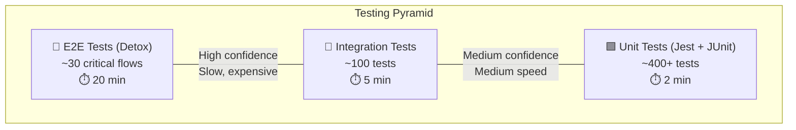
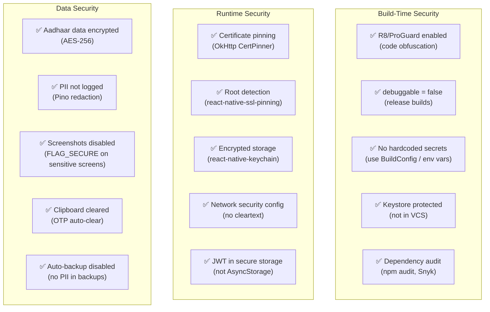

# 🤖 Kuli — Android Build & Deployment Guide

| Field              | Detail                                              |
| ------------------ | --------------------------------------------------- |
| **Document Title** | Android APK Build, Packaging & Distribution Guide   |
| **Version**        | 1.0                                                 |
| **Date**           | 5 June 2026                                         |
| **Status**         | Final                                               |
| **Author**         | Senior Android / Mobile Lead                        |
| **Audience**       | Mobile Developers, DevOps, QA                       |
| **Tech Stack**     | React Native 0.74+ · Hermes · Gradle 8.x · AGP 8.x |

---

## Table of Contents

1. [Code Quality](#1-code-quality)
2. [Build Configuration](#2-build-configuration)
3. [Testing Strategy](#3-testing-strategy)
4. [Compatibility](#4-compatibility)
5. [Security](#5-security)
6. [APK Optimization](#6-apk-optimization)
7. [Deployment — Generating a Signed Release APK](#7-deployment--generating-a-signed-release-apk)
8. [Troubleshooting](#8-troubleshooting)
9. [CI/CD Pipeline for Android](#9-cicd-pipeline-for-android)
10. [Appendix — Checklists](#10-appendix--checklists)

---

## 1. Code Quality

### 1.1 Project Structure (React Native + Android)

```
kuli-app/
├── android/                          # Native Android project
│   ├── app/
│   │   ├── build.gradle              # App-level Gradle config
│   │   ├── proguard-rules.pro        # ProGuard/R8 rules
│   │   ├── src/
│   │   │   ├── main/
│   │   │   │   ├── AndroidManifest.xml
│   │   │   │   ├── java/com/kuli/
│   │   │   │   │   ├── MainActivity.kt
│   │   │   │   │   ├── MainApplication.kt
│   │   │   │   │   ├── modules/       # Native modules
│   │   │   │   │   │   ├── LocationModule.kt
│   │   │   │   │   │   ├── SosModule.kt
│   │   │   │   │   │   └── AadhaarScanModule.kt
│   │   │   │   │   └── services/      # Background services
│   │   │   │   │       ├── LocationTrackingService.kt
│   │   │   │   │       └── NotificationService.kt
│   │   │   │   └── res/
│   │   │   │       ├── drawable/      # Adaptive icons, splash
│   │   │   │       ├── values/        # Strings, colors, themes
│   │   │   │       ├── values-hi/     # Hindi strings
│   │   │   │       ├── values-gu/     # Gujarati strings
│   │   │   │       ├── values-mr/     # Marathi strings
│   │   │   │       ├── values-ta/     # Tamil strings
│   │   │   │       ├── values-te/     # Telugu strings
│   │   │   │       ├── values-bn/     # Bengali strings
│   │   │   │       ├── values-kn/     # Kannada strings
│   │   │   │       └── xml/
│   │   │   │           ├── network_security_config.xml
│   │   │   │           └── backup_rules.xml
│   │   │   ├── debug/
│   │   │   │   └── AndroidManifest.xml   # Debug-only permissions
│   │   │   ├── staging/
│   │   │   │   └── AndroidManifest.xml
│   │   │   └── release/
│   │   │       └── AndroidManifest.xml
│   │   └── keystore/
│   │       └── .gitkeep               # Keystore NOT committed
│   ├── build.gradle                   # Project-level Gradle
│   ├── gradle.properties              # Gradle JVM & RN settings
│   ├── settings.gradle
│   └── gradle/
│       └── wrapper/
│           └── gradle-wrapper.properties
├── src/                               # React Native JS/TS source
│   ├── app/
│   ├── components/
│   ├── screens/
│   ├── navigation/
│   ├── services/
│   ├── store/
│   ├── i18n/
│   ├── utils/
│   └── types/
├── __tests__/
├── e2e/
├── package.json
├── tsconfig.json
├── babel.config.js
├── metro.config.js
├── .eslintrc.js
├── .prettierrc
└── app.json
```

### 1.2 Naming Conventions

| Element | Convention | Example |
|---|---|---|
| **Package name** | Reverse domain, lowercase | `com.kuli.app` |
| **Kotlin classes** | PascalCase | `LocationTrackingService` |
| **Kotlin functions** | camelCase | `startLocationUpdates()` |
| **Resource IDs** | snake_case with prefix | `btn_book_now`, `tv_worker_name`, `iv_profile_photo` |
| **Layout files** | `type_name` | `activity_main.xml`, `fragment_booking.xml` |
| **Drawable files** | `ic_` for icons, `bg_` for backgrounds | `ic_worker_verified.xml`, `bg_gradient_orange.xml` |
| **String keys** | dot-separated, hierarchical | `home.search.placeholder`, `booking.confirm.title` |
| **Color resources** | Semantic naming | `colorPrimary`, `colorOnSurface`, `colorBookingAccepted` |
| **Build variants** | lowerCamelCase | `customerDebug`, `labourerRelease` |

### 1.3 Code Quality Tooling

| Tool | Purpose | Config File |
|---|---|---|
| **ESLint** | JS/TS linting | `.eslintrc.js` |
| **Prettier** | Code formatting | `.prettierrc` |
| **TypeScript** | Type checking (strict mode) | `tsconfig.json` with `"strict": true` |
| **ktlint** | Kotlin linting | `build.gradle` plugin |
| **Detekt** | Kotlin static analysis | `detekt.yml` |
| **lint** (Android) | Android-specific lint | `build.gradle` `lintOptions` |
| **Husky + lint-staged** | Pre-commit hooks | `package.json` |

### 1.4 Lint Configuration (Android)

```groovy
// android/app/build.gradle
android {
    lintOptions {
        // Treat warnings as errors in CI
        warningsAsErrors true
        // Abort build on error
        abortOnError true
        // Check all issues including experimental
        checkAllWarnings true
        // Generate HTML report
        htmlReport true
        htmlOutput file("${project.buildDir}/reports/lint-report.html")
        // Baseline file to suppress known issues during migration
        baseline file("lint-baseline.xml")
        // Disable specific checks if justified
        disable 'MissingTranslation' // Handled by react-i18next, not Android resources
    }
}
```

### 1.5 Modularization Strategy

For React Native, native Android code should be modularized by feature:

```
android/app/src/main/java/com/kuli/
├── MainApplication.kt        # App entry point
├── MainActivity.kt           # Single activity (RN manages screens)
├── modules/                   # React Native Native Modules
│   ├── location/
│   │   ├── LocationModule.kt           # JS-callable bridge
│   │   ├── LocationPackage.kt          # Package registration
│   │   └── FusedLocationProvider.kt    # Android location logic
│   ├── sos/
│   │   ├── SosModule.kt
│   │   └── SosPackage.kt
│   ├── aadhaar/
│   │   ├── AadhaarScanModule.kt
│   │   └── AadhaarScanPackage.kt
│   └── deeplink/
│       ├── DeepLinkModule.kt
│       └── DeepLinkPackage.kt
├── services/
│   ├── LocationTrackingService.kt      # Foreground service
│   └── KuliFirebaseMessagingService.kt # FCM handler
└── utils/
    ├── PermissionHelper.kt
    └── DeviceInfoHelper.kt
```

---

## 2. Build Configuration

### 2.1 Project-Level `build.gradle`

```groovy
// android/build.gradle
buildscript {
    ext {
        buildToolsVersion = "34.0.0"
        minSdkVersion = 24           // Android 7.0 — covers 97%+ of Indian devices
        compileSdkVersion = 34       // Android 14
        targetSdkVersion = 34        // Required for Play Store (Aug 2026 deadline)
        kotlinVersion = "1.9.22"
        ndkVersion = "26.1.10909125"

        // React Native
        reactNativeVersion = "0.74.0"
    }

    repositories {
        google()
        mavenCentral()
    }

    dependencies {
        classpath("com.android.tools.build:gradle:8.2.2")
        classpath("org.jetbrains.kotlin:kotlin-gradle-plugin:$kotlinVersion")
        classpath("com.google.gms:google-services:4.4.0")      // Firebase
        classpath("com.google.firebase:firebase-crashlytics-gradle:2.9.9")
    }
}

allprojects {
    repositories {
        google()
        mavenCentral()
        maven { url "https://www.jitpack.io" }
    }
}
```

### 2.2 App-Level `build.gradle`

```groovy
// android/app/build.gradle
apply plugin: "com.android.application"
apply plugin: "org.jetbrains.kotlin.android"
apply plugin: "com.google.gms.google-services"
apply plugin: "com.google.firebase.crashlytics"
apply plugin: "com.facebook.react"

import com.android.build.OutputFile

/**
 * Signing configuration loaded from environment variables or local properties.
 * NEVER hardcode keystore credentials.
 */
def keystorePropertiesFile = rootProject.file("keystore.properties")
def keystoreProperties = new Properties()
if (keystorePropertiesFile.exists()) {
    keystoreProperties.load(new FileInputStream(keystorePropertiesFile))
}

android {
    namespace "com.kuli.app"
    compileSdkVersion rootProject.ext.compileSdkVersion
    ndkVersion rootProject.ext.ndkVersion

    defaultConfig {
        applicationId "com.kuli.app"
        minSdkVersion rootProject.ext.minSdkVersion
        targetSdkVersion rootProject.ext.targetSdkVersion
        versionCode 1
        versionName "1.0.0"

        // Multi-dex for method count > 65K
        multiDexEnabled true

        // Hermes JS engine (mandatory for RN 0.74+)
        // Hermes is enabled by default in react.gradle

        // Supported ABIs — exclude x86 for smaller APK
        ndk {
            abiFilters "armeabi-v7a", "arm64-v8a"
        }

        // Resource configurations — only include needed languages
        resConfigs "en", "hi", "gu", "mr", "ta", "te", "bn", "kn"
    }

    signingConfigs {
        debug {
            storeFile file("debug.keystore")
            storePassword "android"
            keyAlias "androiddebugkey"
            keyPassword "android"
        }

        release {
            if (keystorePropertiesFile.exists()) {
                storeFile file(keystoreProperties['STORE_FILE'] ?: "release.keystore")
                storePassword keystoreProperties['STORE_PASSWORD'] ?: System.getenv("KEYSTORE_PASSWORD")
                keyAlias keystoreProperties['KEY_ALIAS'] ?: System.getenv("KEY_ALIAS")
                keyPassword keystoreProperties['KEY_PASSWORD'] ?: System.getenv("KEY_PASSWORD")
            }
        }
    }

    buildTypes {
        debug {
            debuggable true
            signingConfig signingConfigs.debug
            // Enable React Native dev server
            buildConfigField "String", "API_BASE_URL", '"http://10.0.2.2:3000/api/v1"'
            buildConfigField "String", "SOCKET_URL", '"http://10.0.2.2:3001"'
        }

        staging {
            initWith release
            debuggable false
            signingConfig signingConfigs.release
            matchingFallbacks = ['release']
            buildConfigField "String", "API_BASE_URL", '"https://staging-api.kuli.app/api/v1"'
            buildConfigField "String", "SOCKET_URL", '"wss://staging-ws.kuli.app"'
            // Use staging Firebase config
            firebaseCrashlytics {
                mappingFileUploadEnabled true
            }
        }

        release {
            debuggable false
            minifyEnabled true          // Enable R8/ProGuard
            shrinkResources true        // Remove unused resources
            signingConfig signingConfigs.release

            proguardFiles getDefaultProguardFile("proguard-android-optimize.txt"),
                          "proguard-rules.pro"

            buildConfigField "String", "API_BASE_URL", '"https://api.kuli.app/api/v1"'
            buildConfigField "String", "SOCKET_URL", '"wss://ws.kuli.app"'

            firebaseCrashlytics {
                mappingFileUploadEnabled true
                nativeSymbolUploadEnabled true
            }
        }
    }

    // Product flavors for Customer vs Labourer builds (optional)
    flavorDimensions "userType"
    productFlavors {
        customer {
            dimension "userType"
            applicationIdSuffix ".customer"
            versionNameSuffix "-customer"
            buildConfigField "String", "USER_TYPE", '"customer"'
        }
        labourer {
            dimension "userType"
            applicationIdSuffix ".labourer"
            versionNameSuffix "-labourer"
            buildConfigField "String", "USER_TYPE", '"labourer"'
        }
        // Unified build (both roles in one app — recommended for MVP)
        unified {
            dimension "userType"
            // No suffix — uses base applicationId
            buildConfigField "String", "USER_TYPE", '"unified"'
        }
    }

    // Split APKs by ABI for smaller download
    splits {
        abi {
            enable true
            reset()
            include "armeabi-v7a", "arm64-v8a"
            universalApk true  // Also generate a universal APK
        }
    }

    // Per-ABI version codes so Play Store accepts split APKs
    applicationVariants.all { variant ->
        variant.outputs.each { output ->
            def versionCodes = ["armeabi-v7a": 1, "arm64-v8a": 2, "x86": 3, "x86_64": 4]
            def abi = output.getFilter(OutputFile.ABI)
            if (abi != null) {
                output.versionCodeOverride = defaultConfig.versionCode * 1000 + versionCodes.get(abi, 0)
            }
        }
    }

    compileOptions {
        sourceCompatibility JavaVersion.VERSION_17
        targetCompatibility JavaVersion.VERSION_17
    }

    kotlinOptions {
        jvmTarget = "17"
    }

    buildFeatures {
        buildConfig true
    }

    packagingOptions {
        // Exclude duplicate files
        pickFirst "lib/armeabi-v7a/libc++_shared.so"
        pickFirst "lib/arm64-v8a/libc++_shared.so"
        // Exclude unnecessary files
        exclude "META-INF/DEPENDENCIES"
        exclude "META-INF/LICENSE"
        exclude "META-INF/NOTICE"
    }
}

dependencies {
    // React Native (auto-linked via autolinking)
    implementation("com.facebook.react:react-android")
    implementation("com.facebook.react:hermes-android")

    // Firebase
    implementation platform("com.google.firebase:firebase-bom:32.7.0")
    implementation "com.google.firebase:firebase-analytics"
    implementation "com.google.firebase:firebase-messaging"
    implementation "com.google.firebase:firebase-auth"
    implementation "com.google.firebase:firebase-crashlytics"

    // Google Maps
    implementation "com.google.android.gms:play-services-maps:18.2.0"
    implementation "com.google.android.gms:play-services-location:21.0.1"

    // Kotlin
    implementation "org.jetbrains.kotlin:kotlin-stdlib:$kotlinVersion"
    implementation "org.jetbrains.kotlinx:kotlinx-coroutines-android:1.7.3"

    // Multidex
    implementation "androidx.multidex:multidex:2.0.1"

    // Testing
    testImplementation "junit:junit:4.13.2"
    androidTestImplementation "androidx.test.ext:junit:1.1.5"
    androidTestImplementation "androidx.test.espresso:espresso-core:3.5.1"
}

// Auto-link React Native libraries
apply from: file("../../node_modules/@react-native-community/cli-platform-android/native_modules.gradle")
applyNativeModulesAppBuildGradle(project)
```

### 2.3 ProGuard / R8 Rules

```proguard
# android/app/proguard-rules.pro

# ============================================================================
# KULI APP — R8 / ProGuard Configuration
# ============================================================================

# ----- React Native Core -----
-keep class com.facebook.hermes.unicode.** { *; }
-keep class com.facebook.jni.** { *; }
-keep class com.facebook.react.** { *; }
-keep class com.facebook.react.bridge.** { *; }
-keep class com.facebook.react.modules.** { *; }
-keep class com.facebook.react.uimanager.** { *; }
-keep class com.facebook.react.views.** { *; }

# Keep React Native bridge methods
-keepclassmembers class * {
    @com.facebook.react.bridge.ReactMethod *;
}
-keepclassmembers class * {
    @com.facebook.react.uimanager.annotations.ReactProp *;
}

# ----- Hermes Engine -----
-keep class com.facebook.hermes.** { *; }
-dontwarn com.facebook.hermes.**

# ----- Firebase -----
-keep class com.google.firebase.** { *; }
-dontwarn com.google.firebase.**
-keep class com.google.android.gms.** { *; }
-dontwarn com.google.android.gms.**

# Crashlytics
-keepattributes SourceFile,LineNumberTable
-keep public class * extends java.lang.Exception

# ----- Razorpay -----
-keep class com.razorpay.** { *; }
-dontwarn com.razorpay.**
-keepclassmembers class * implements android.os.Parcelable {
    public static final android.os.Parcelable$Creator *;
}
-keepattributes *Annotation*

# ----- OkHttp / Retrofit (used by some RN libraries) -----
-dontwarn okhttp3.**
-dontwarn okio.**
-keep class okhttp3.** { *; }
-keep class okio.** { *; }

# ----- Socket.IO -----
-keep class io.socket.** { *; }
-dontwarn io.socket.**

# ----- Google Maps -----
-keep class com.google.android.gms.maps.** { *; }
-keep class com.google.maps.** { *; }

# ----- Kotlin -----
-dontwarn kotlin.**
-keep class kotlin.Metadata { *; }
-keepclassmembers class kotlin.Metadata {
    public <methods>;
}

# ----- General Android -----
# Keep custom Application class
-keep class com.kuli.app.MainApplication { *; }
-keep class com.kuli.app.MainActivity { *; }

# Keep native modules
-keep class com.kuli.app.modules.** { *; }

# Keep services
-keep class com.kuli.app.services.** { *; }

# Keep Parcelable implementations
-keep class * implements android.os.Parcelable {
    public static final android.os.Parcelable$Creator *;
}

# Keep Serializable
-keepclassmembers class * implements java.io.Serializable {
    static final long serialVersionUID;
    private static final java.io.ObjectStreamField[] serialPersistentFields;
    private void writeObject(java.io.ObjectOutputStream);
    private void readObject(java.io.ObjectInputStream);
    java.lang.Object writeReplace();
    java.lang.Object readResolve();
}

# ----- Prevent stripping of BuildConfig -----
-keep class com.kuli.app.BuildConfig { *; }

# ----- Logging removal in release -----
-assumenosideeffects class android.util.Log {
    public static boolean isLoggable(java.lang.String, int);
    public static int v(...);
    public static int i(...);
    public static int w(...);
    public static int d(...);
}
```

### 2.4 Gradle Properties

```properties
# android/gradle.properties

# ==========================================
# Project-wide Gradle settings
# ==========================================

# JVM Memory — increase for large RN projects
org.gradle.jvmargs=-Xmx4096m -XX:MaxMetaspaceSize=1024m -XX:+HeapDumpOnOutOfMemoryError

# Parallel execution
org.gradle.parallel=true

# Gradle caching
org.gradle.caching=true

# Daemon
org.gradle.daemon=true

# AndroidX migration
android.useAndroidX=true
android.enableJetifier=true

# React Native — New Architecture (enable for RN 0.74+)
newArchEnabled=true

# Hermes engine
hermesEnabled=true

# Build optimization
android.nonTransitiveRClass=true
android.nonFinalResIds=true

# Disable unnecessary features
android.defaults.buildfeatures.aidl=false
android.defaults.buildfeatures.renderscript=false
android.defaults.buildfeatures.resvalues=true
android.defaults.buildfeatures.shaders=false
```

---

## 3. Testing Strategy

### 3.1 Testing Pyramid for Kuli Android



### 3.2 Unit Tests (JavaScript — Jest)

```json
// package.json — jest config
{
  "jest": {
    "preset": "react-native",
    "setupFilesAfterSetup": ["./jest.setup.js"],
    "transformIgnorePatterns": [
      "node_modules/(?!(react-native|@react-native|react-native-maps|@react-navigation)/)"
    ],
    "coverageThreshold": {
      "global": {
        "branches": 70,
        "functions": 75,
        "lines": 80,
        "statements": 80
      }
    },
    "collectCoverageFrom": [
      "src/**/*.{ts,tsx}",
      "!src/**/*.d.ts",
      "!src/**/types.ts"
    ]
  }
}
```

**What to test:**

| Layer | Tests | Example |
|---|---|---|
| **Utility functions** | Pure logic | `calculateCommission(2500, 0.12)` → `300` |
| **API services** | Request/response mocking | `bookingService.create()` with msw |
| **Zustand stores** | State transitions | `useBookingStore.accept()` changes status |
| **React Query hooks** | Cache behavior | `useNearbyWorkers()` caching/refetch |
| **Form validation** | Zod schemas | Phone number, Aadhaar format, rate ranges |
| **i18n** | Translation keys | All keys exist in all 8 language files |
| **Navigation** | Route params | Deep link parsing, screen param validation |

### 3.3 Unit Tests (Native Android — JUnit)

```kotlin
// android/app/src/test/java/com/kuli/app/LocationModuleTest.kt
class LocationModuleTest {
    @Test
    fun `calculateDistance returns correct value`() {
        val distance = LocationUtils.calculateDistance(
            lat1 = 23.0225,  // Ahmedabad
            lng1 = 72.5714,
            lat2 = 23.0300,
            lng2 = 72.5800
        )
        assertTrue(distance < 2.0) // Less than 2 km
    }

    @Test
    fun `formatETA returns Hindi string for Hindi locale`() {
        val eta = EtaFormatter.format(minutes = 15, locale = "hi")
        assertEquals("15 मिनट में पहुंचेंगे", eta)
    }
}
```

### 3.4 Integration / Instrumentation Tests (Espresso)

```kotlin
// android/app/src/androidTest/java/com/kuli/app/MainActivityTest.kt
@RunWith(AndroidJUnit4::class)
class MainActivityTest {
    @get:Rule
    val activityRule = ActivityScenarioRule(MainActivity::class.java)

    @Test
    fun appLaunches_showsReactNativeContent() {
        // Verify React Native root view loads
        onView(withId(R.id.react_root))
            .check(matches(isDisplayed()))
    }

    @Test
    fun locationPermission_isRequestedOnLaunch() {
        // Verify location permission dialog appears
        val permissionResult = InstrumentationRegistry
            .getInstrumentation()
            .uiAutomation
        assertNotNull(permissionResult)
    }
}
```

### 3.5 End-to-End Tests (Detox)

```javascript
// e2e/booking.test.js
describe('Booking Flow', () => {
  beforeAll(async () => {
    await device.launchApp({ permissions: { location: 'always' } });
  });

  it('should complete a full booking flow', async () => {
    // 1. Login with OTP
    await element(by.id('input-phone')).typeText('9876543210');
    await element(by.id('btn-send-otp')).tap();
    await element(by.id('input-otp')).typeText('123456');
    await element(by.id('btn-verify-otp')).tap();

    // 2. Select category
    await expect(element(by.id('home-screen'))).toBeVisible();
    await element(by.id('category-painting')).tap();

    // 3. Select worker
    await expect(element(by.id('worker-list'))).toBeVisible();
    await element(by.id('worker-card-0')).tap();

    // 4. Book
    await element(by.id('btn-book-now')).tap();
    await element(by.id('btn-confirm-address')).tap();
    await element(by.id('btn-confirm-booking')).tap();

    // 5. Verify confirmation
    await expect(element(by.id('booking-confirmed'))).toBeVisible();
    await expect(element(by.text('Booking Confirmed!'))).toBeVisible();
  });
});
```

### 3.6 Pre-Build Test Checklist

| Test | Command | Pass Criteria |
|---|---|---|
| **Lint (JS/TS)** | `npm run lint` | Zero errors, zero warnings |
| **Type check** | `npx tsc --noEmit` | Zero type errors |
| **Unit tests** | `npm test -- --coverage` | > 80% coverage, all pass |
| **Android Lint** | `./gradlew lint` | Zero errors |
| **Build (debug)** | `./gradlew assembleDebug` | Build succeeds, 0 warnings |
| **Build (release)** | `./gradlew assembleRelease` | Build succeeds with R8 |
| **Detox (E2E)** | `detox test --configuration android.emu.release` | All critical flows pass |

---

## 4. Compatibility

### 4.1 SDK Version Strategy

| Setting | Value | Rationale |
|---|---|---|
| **minSdkVersion** | **24** (Android 7.0 Nougat) | Covers 97.3% of Indian Android devices (2026); supports Fused Location, JobScheduler, multi-window |
| **targetSdkVersion** | **34** (Android 14) | Required by Play Store for new apps/updates (Aug 2026 deadline) |
| **compileSdkVersion** | **34** | Access to latest APIs, compile-time checks |

> [!IMPORTANT]
> **Why minSdk 24 and not lower?** Our labourer persona uses ₹8,000–12,000 phones that typically run Android 10-12. Android 7.0 (API 24) as minimum ensures near-universal coverage while allowing us to use modern APIs without excessive compat libraries. Devices below API 24 represent < 3% of Indian market and dropping them eliminates hundreds of compatibility issues.

### 4.2 Screen & Density Support

```xml
<!-- android/app/src/main/AndroidManifest.xml -->
<supports-screens
    android:anyDensity="true"
    android:largeScreens="true"
    android:normalScreens="true"
    android:smallScreens="true"
    android:xlargeScreens="true" />
```

| Density | DPI Range | Typical Device | Icon Size |
|---|---|---|---|
| **mdpi** | 160 dpi | Low-end phones | 48×48 |
| **hdpi** | 240 dpi | Budget phones (₹5K–8K) | 72×72 |
| **xhdpi** | 320 dpi | Mid-range phones (₹8K–15K) | 96×96 |
| **xxhdpi** | 480 dpi | Flagship phones (₹15K+) | 144×144 |
| **xxxhdpi** | 640 dpi | Premium flagships | 192×192 |

### 4.3 Device Testing Matrix

| Device Category | Representative Devices | Priority |
|---|---|---|
| **Budget (₹6K–10K)** | Samsung Galaxy A05, Redmi 12C, Realme C55 | P0 (Labourer primary) |
| **Mid-range (₹10K–20K)** | Samsung Galaxy A34, Redmi Note 13, OnePlus Nord CE | P0 (Customer primary) |
| **Flagship (₹20K+)** | Samsung Galaxy S24, OnePlus 12, Pixel 8 | P1 |
| **Low RAM (2-3 GB)** | JioPhone Next, Lava Blaze | P1 (Edge case) |
| **Tablets** | Samsung Tab A8 | P2 |

### 4.4 Required Permissions

```xml
<!-- android/app/src/main/AndroidManifest.xml -->
<manifest xmlns:android="http://schemas.android.com/apk/res/android">

    <!-- Internet (required) -->
    <uses-permission android:name="android.permission.INTERNET" />
    <uses-permission android:name="android.permission.ACCESS_NETWORK_STATE" />

    <!-- Location — for worker tracking and nearby search -->
    <uses-permission android:name="android.permission.ACCESS_FINE_LOCATION" />
    <uses-permission android:name="android.permission.ACCESS_COARSE_LOCATION" />
    <!-- Background location — worker tracking during active job (requires Play Store justification) -->
    <uses-permission android:name="android.permission.ACCESS_BACKGROUND_LOCATION" />
    <!-- Foreground service for location tracking -->
    <uses-permission android:name="android.permission.FOREGROUND_SERVICE" />
    <uses-permission android:name="android.permission.FOREGROUND_SERVICE_LOCATION" />

    <!-- Camera — Aadhaar scanning, work photos -->
    <uses-permission android:name="android.permission.CAMERA" />

    <!-- Storage — save/upload photos -->
    <uses-permission android:name="android.permission.READ_MEDIA_IMAGES" />

    <!-- Phone — call masking feature -->
    <uses-permission android:name="android.permission.CALL_PHONE" />

    <!-- Notifications (Android 13+) -->
    <uses-permission android:name="android.permission.POST_NOTIFICATIONS" />

    <!-- Vibrate — haptic feedback -->
    <uses-permission android:name="android.permission.VIBRATE" />

    <!-- Wake lock — prevent sleep during tracking -->
    <uses-permission android:name="android.permission.WAKE_LOCK" />

    <!-- Boot receiver — restart tracking service after reboot -->
    <uses-permission android:name="android.permission.RECEIVE_BOOT_COMPLETED" />

    <application
        android:name=".MainApplication"
        android:allowBackup="false"
        android:icon="@mipmap/ic_launcher"
        android:roundIcon="@mipmap/ic_launcher_round"
        android:label="@string/app_name"
        android:theme="@style/AppTheme"
        android:supportsRtl="true"
        android:networkSecurityConfig="@xml/network_security_config"
        android:usesCleartextTraffic="false"
        android:fullBackupContent="@xml/backup_rules"
        android:dataExtractionRules="@xml/backup_rules">

        <!-- Main Activity -->
        <activity
            android:name=".MainActivity"
            android:label="@string/app_name"
            android:configChanges="keyboard|keyboardHidden|orientation|screenLayout|screenSize|smallestScreenSize|uiMode"
            android:launchMode="singleTask"
            android:windowSoftInputMode="adjustResize"
            android:exported="true">

            <intent-filter>
                <action android:name="android.intent.action.MAIN" />
                <category android:name="android.intent.category.LAUNCHER" />
            </intent-filter>

            <!-- Deep links -->
            <intent-filter android:autoVerify="true">
                <action android:name="android.intent.action.VIEW" />
                <category android:name="android.intent.category.DEFAULT" />
                <category android:name="android.intent.category.BROWSABLE" />
                <data android:scheme="https" android:host="kuli.app" />
                <data android:scheme="kuli" />
            </intent-filter>
        </activity>

        <!-- Foreground service for worker location tracking -->
        <service
            android:name=".services.LocationTrackingService"
            android:foregroundServiceType="location"
            android:exported="false" />

        <!-- FCM Service -->
        <service
            android:name=".services.KuliFirebaseMessagingService"
            android:exported="false">
            <intent-filter>
                <action android:name="com.google.firebase.MESSAGING_EVENT" />
            </intent-filter>
        </service>

        <!-- Google Maps API Key -->
        <meta-data
            android:name="com.google.android.geo.API_KEY"
            android:value="${GOOGLE_MAPS_API_KEY}" />

    </application>
</manifest>
```

---

## 5. Security

### 5.1 Security Hardening Checklist



### 5.2 Network Security Config

```xml
<!-- android/app/src/main/res/xml/network_security_config.xml -->
<?xml version="1.0" encoding="utf-8"?>
<network-security-config>
    <!-- Production: Only allow HTTPS to Kuli servers -->
    <domain-config cleartextTrafficPermitted="false">
        <domain includeSubdomains="true">kuli.app</domain>
        <domain includeSubdomains="true">api.kuli.app</domain>

        <!-- Certificate pinning for API server -->
        <pin-set expiration="2027-06-01">
            <!-- Primary pin (SHA-256 of public key) -->
            <pin digest="SHA-256">AAAAAAAAAAAAAAAAAAAAAAAAAAAAAAAAAAAAAAAAAAA=</pin>
            <!-- Backup pin (different CA) -->
            <pin digest="SHA-256">BBBBBBBBBBBBBBBBBBBBBBBBBBBBBBBBBBBBBBBBBBB=</pin>
        </pin-set>
    </domain-config>

    <!-- Debug only: Allow localhost cleartext -->
    <debug-overrides>
        <trust-anchors>
            <certificates src="system" />
            <certificates src="user" />
        </trust-anchors>
    </debug-overrides>
</network-security-config>
```

### 5.3 Secrets Management

| Secret | Where Stored | How Accessed |
|---|---|---|
| **Keystore password** | CI/CD secrets (GitHub Encrypted Secrets) | `System.getenv("KEYSTORE_PASSWORD")` |
| **Google Maps API key** | `local.properties` (not committed) or CI secret | `manifestPlaceholders` in Gradle |
| **Firebase config** | `google-services.json` (per variant) | Gradle plugin auto-reads |
| **Razorpay key** | Backend only — never in APK | Fetched via API at runtime |
| **Sentry DSN** | `.env` file (not committed) | `react-native-config` |
| **JWT tokens** | `react-native-keychain` (Android Keystore) | Encrypted hardware-backed storage |

> [!CAUTION]
> **NEVER commit these files to Git:**
> - `*.keystore`, `*.jks` (signing keys)
> - `keystore.properties` (keystore credentials)
> - `local.properties` (SDK path, API keys)
> - `.env`, `.env.production` (secrets)
> - `google-services.json` (can contain API keys — add per-variant in CI)

### 5.4 `.gitignore` (Android-specific)

```gitignore
# android/.gitignore
*.iml
.gradle
/local.properties
/.idea
.DS_Store
/build
/captures
.externalNativeBuild
.cxx

# Signing
*.keystore
*.jks
keystore.properties

# Firebase config (added per-variant in CI)
app/google-services.json

# Generated
app/build/
```

### 5.5 Prevent Screenshots on Sensitive Screens

```kotlin
// In native module — called from JS on sensitive screens
class SecurityModule(reactContext: ReactApplicationContext) : ReactContextBaseJavaModule(reactContext) {
    @ReactMethod
    fun enableScreenshotProtection() {
        currentActivity?.runOnUiThread {
            currentActivity?.window?.setFlags(
                WindowManager.LayoutParams.FLAG_SECURE,
                WindowManager.LayoutParams.FLAG_SECURE
            )
        }
    }

    @ReactMethod
    fun disableScreenshotProtection() {
        currentActivity?.runOnUiThread {
            currentActivity?.window?.clearFlags(
                WindowManager.LayoutParams.FLAG_SECURE
            )
        }
    }
}
```

**Enable on:** Aadhaar upload, bank account entry, OTP input, payment screens.

---

## 6. APK Optimization

### 6.1 Size Budget

| Component | Budget | Actual Target |
|---|---|---|
| **Total APK (universal)** | < 30 MB | 22-28 MB |
| **APK (arm64-v8a split)** | < 20 MB | 15-18 MB |
| **APK (armeabi-v7a split)** | < 18 MB | 13-16 MB |
| **JS bundle (Hermes bytecode)** | < 2 MB | 1.2-1.8 MB |
| **Native libraries** | < 10 MB | 8-10 MB |
| **Resources (images, fonts)** | < 5 MB | 3-4 MB |
| **DEX (compiled Java/Kotlin)** | < 8 MB | 5-7 MB |

### 6.2 Optimization Techniques

| Technique | Impact | How |
|---|---|---|
| **ABI splits** | -40% APK size | `splits { abi { enable true } }` — separate APK per architecture |
| **Hermes bytecode** | -30% JS bundle | Enabled by default in RN 0.74+; precompiles JS to bytecode |
| **R8 + ProGuard** | -20% DEX size | `minifyEnabled true` + `shrinkResources true` |
| **Resource shrinking** | -10% resources | `shrinkResources true` removes unused drawables, layouts |
| **WebP images** | -25% image size | Convert all PNG/JPEG to WebP |
| **Vector drawables** | -80% icon size | Use `VectorDrawable` (XML) instead of PNGs for icons |
| **Remove unused locales** | -5% resources | `resConfigs "en", "hi", "gu", "mr", "ta", "te", "bn", "kn"` |
| **Dynamic delivery** | -15% initial download | Android App Bundle (AAB) — Google Play serves only needed ABI/density |
| **ProGuard aggressive** | -10% more | Use `proguard-android-optimize.txt` as base |
| **Remove console logs** | -5% JS bundle | Babel plugin `transform-remove-console` for production |

### 6.3 Image Optimization Pipeline

```
Original PNG/JPEG
       ↓
  Convert to WebP (lossy, quality 80%)    → 60-80% smaller
       ↓
  Multiple densities (mdpi → xxxhdpi)     → Correct size per device
       ↓
  Vector Drawable for icons               → Resolution-independent
       ↓
  Cloudinary on-the-fly for user content  → No local storage needed
```

### 6.4 Bundle Analyzer

```bash
# Analyze JS bundle size
npx react-native-bundle-visualizer

# Analyze APK contents
# In Android Studio: Build → Analyze APK → select APK file
# Or use: bundletool dump manifest --bundle=app.aab
```

### 6.5 Performance Optimization

| Area | Technique | Impact |
|---|---|---|
| **App startup** | Hermes precompiled bytecode, lazy loading screens | Cold start < 3s |
| **List rendering** | `FlashList` instead of `FlatList` | 5x faster scrolling |
| **Images** | `react-native-fast-image` with caching | No re-downloads |
| **Navigation** | `react-native-screens` (native stack) | Native-quality transitions |
| **Animations** | `react-native-reanimated` (UI thread) | 60fps always |
| **Memory** | Unmount off-screen tabs, image cache limits | < 150MB active |
| **Location** | Fused Location with batching, geofencing | < 5%/hr battery |
| **Bundle** | Inline requires, tree-shaking, code splitting | < 2MB JS |

---

## 7. Deployment — Generating a Signed Release APK

### 7.1 Step-by-Step: Generate Release Keystore

```bash
# ⚠️ Run this ONCE and store the keystore securely (it's irreplaceable)
keytool -genkeypair \
  -v \
  -storetype PKCS12 \
  -keystore kuli-release.keystore \
  -alias kuli-key \
  -keyalg RSA \
  -keysize 2048 \
  -validity 10000 \
  -storepass YOUR_SECURE_PASSWORD \
  -keypass YOUR_SECURE_PASSWORD \
  -dname "CN=Kuli App, OU=Mobile, O=Kuli Technologies Pvt Ltd, L=Ahmedabad, ST=Gujarat, C=IN"
```

> [!WARNING]
> **BACK UP YOUR KEYSTORE IMMEDIATELY!** If you lose it, you can NEVER update the app on Play Store. Store copies in:
> 1. Encrypted cloud storage (AWS S3 with KMS)
> 2. Physical USB drive in a safe
> 3. Google Play App Signing (enrolled)

### 7.2 Configure Keystore Properties

```properties
# android/keystore.properties (NOT committed to Git)
STORE_FILE=../keystore/kuli-release.keystore
STORE_PASSWORD=your_secure_password
KEY_ALIAS=kuli-key
KEY_PASSWORD=your_secure_password
```

### 7.3 Build Release APK

```bash
# From project root

# 1. Clean previous builds
cd android && ./gradlew clean && cd ..

# 2. Bundle JS (Hermes bytecode)
npx react-native bundle \
  --platform android \
  --dev false \
  --entry-file index.js \
  --bundle-output android/app/src/main/assets/index.android.bundle \
  --assets-dest android/app/src/main/res

# 3. Generate Release APK
cd android
./gradlew assembleUnifiedRelease

# Output location:
# android/app/build/outputs/apk/unified/release/
#   ├── app-unified-armeabi-v7a-release.apk    (ARM 32-bit)
#   ├── app-unified-arm64-v8a-release.apk       (ARM 64-bit — most devices)
#   └── app-unified-universal-release.apk        (All architectures)
```

### 7.4 Build Android App Bundle (AAB) — for Play Store

```bash
# AAB is REQUIRED for Play Store (not APK)
cd android
./gradlew bundleUnifiedRelease

# Output:
# android/app/build/outputs/bundle/unifiedRelease/app-unified-release.aab
```

### 7.5 Verify the Build

```bash
# 1. Verify APK signing
apksigner verify --verbose app-unified-release.apk

# Expected output:
# Verified using v2 scheme (APK Signature Scheme v2): true
# Verified using v3 scheme (APK Signature Scheme v3): true

# 2. Verify APK contents
aapt dump badging app-unified-release.apk | grep -E "package|sdkVersion|uses-permission"

# 3. Check APK size
ls -lh app-unified-release.apk

# 4. Install and test on real device
adb install -r app-unified-arm64-v8a-release.apk
```

### 7.6 Play Store Upload Checklist

| Step | Action | Status |
|---|---|---|
| 1 | Enroll in **Google Play App Signing** | ☐ |
| 2 | Upload AAB (not APK) to Play Console | ☐ |
| 3 | Fill store listing (title, description in all 8 languages) | ☐ |
| 4 | Upload screenshots (phone + tablet, all languages) | ☐ |
| 5 | Set content rating (IARC questionnaire) | ☐ |
| 6 | Set pricing & distribution (Free, India first) | ☐ |
| 7 | Privacy policy URL (required for location, camera, contacts) | ☐ |
| 8 | Data safety form (declare all data collected) | ☐ |
| 9 | Background location justification (required for worker tracking) | ☐ |
| 10 | Internal testing → Closed testing → Open testing → Production | ☐ |

---

## 8. Troubleshooting

### 8.1 Common Build Errors & Fixes

| Error | Cause | Fix |
|---|---|---|
| `Execution failed for task ':app:mergeReleaseResources'` | Duplicate resources from RN libraries | Add `pickFirst` rules in `packagingOptions` |
| `java.lang.OutOfMemoryError: GC overhead limit exceeded` | Gradle needs more heap | Increase `org.gradle.jvmargs=-Xmx4096m` |
| `Could not find com.facebook.react:react-android` | Maven repo missing or RN version mismatch | Ensure `mavenCentral()` and correct RN version in `package.json` |
| `Duplicate class kotlin.collections.jdk8.*` | Kotlin version conflict | Add `implementation(platform("org.jetbrains.kotlin:kotlin-bom:1.9.22"))` |
| `Task :app:processReleaseResources FAILED` | Invalid resource files (uppercase, special chars) | Rename files to lowercase snake_case; run `./gradlew clean` |
| `R8: Missing class com.some.library.SomeClass` | ProGuard stripping needed classes | Add `-keep class com.some.library.** { *; }` to proguard-rules.pro |
| `Firebase initialization error` | `google-services.json` missing or wrong package | Ensure correct file for build variant in `app/src/[variant]/` |
| `Cleartext HTTP traffic not permitted` | Network security config blocking HTTP | Ensure `usesCleartextTraffic="false"` and all URLs use HTTPS |
| `APK not installed` (on device) | Signature mismatch with installed version | Uninstall existing app first: `adb uninstall com.kuli.app` |
| `Metro bundler connection refused` | Dev server not running or wrong IP | Check `adb reverse tcp:8081 tcp:8081` |

### 8.2 Runtime Crashes & Fixes

| Crash | Cause | Fix |
|---|---|---|
| **ANR (Application Not Responding)** | Heavy work on main thread | Move to coroutine / background thread; use `InteractionManager.runAfterInteractions()` |
| **OOM (Out of Memory)** | Large images not compressed | Use `react-native-fast-image` with resize; limit image cache to 100MB |
| **Native crash in `libc++_shared.so`** | ABI mismatch | Ensure `ndk.abiFilters` matches device architecture |
| **SSL handshake failure** | Certificate pinning mismatch | Update pins; add backup pin; check `network_security_config.xml` |
| **Location not updating** | Missing foreground service notification (Android 12+) | Use `FOREGROUND_SERVICE_LOCATION` type with persistent notification |
| **Push notifications not received** | FCM token not refreshed | Implement `onNewToken()` in `FirebaseMessagingService` |
| **WebSocket disconnects** | Doze mode / battery optimization | Use `WorkManager` for reconnection; request battery optimization exemption |

### 8.3 Performance Diagnostics

```bash
# 1. Profile startup time
adb shell am start -W com.kuli.app/.MainActivity
# Look for: TotalTime: XXXX (should be < 3000ms)

# 2. Check memory usage
adb shell dumpsys meminfo com.kuli.app
# Look for: TOTAL PSS (should be < 150MB during active use)

# 3. Check for memory leaks
# In React Native: Enable "Performance Monitor" from dev menu
# In Android Studio: Use Memory Profiler

# 4. Network inspection
# Use Flipper (debug builds) or Charles Proxy

# 5. Frame rate monitoring
adb shell dumpsys gfxinfo com.kuli.app
# Look for: Janky frames (should be < 5%)

# 6. Battery usage
adb shell dumpsys batterystats --charged com.kuli.app
```

### 8.4 Debugging Release Builds

```bash
# 1. Generate release build with source maps
npx react-native bundle \
  --platform android \
  --dev false \
  --entry-file index.js \
  --bundle-output android/app/src/main/assets/index.android.bundle \
  --sourcemap-output android/app/src/main/assets/index.android.bundle.map

# 2. Upload source maps to Sentry
npx sentry-cli react-native appcenter \
  --source-map android/app/src/main/assets/index.android.bundle.map \
  --bundle android/app/src/main/assets/index.android.bundle

# 3. Upload ProGuard mapping to Firebase Crashlytics
# (Handled automatically by firebase-crashlytics-gradle plugin)

# 4. Test release build on device
adb install -r android/app/build/outputs/apk/unified/release/app-unified-arm64-v8a-release.apk
adb logcat | grep -E "ReactNative|kuli|FATAL"
```

---

## 9. CI/CD Pipeline for Android

### 9.1 GitHub Actions Workflow

```yaml
# .github/workflows/android-release.yml
name: Android Release Build

on:
  push:
    branches: [main]
    tags: ['v*']
  pull_request:
    branches: [main]

env:
  JAVA_VERSION: '17'
  NODE_VERSION: '20'
  RUBY_VERSION: '3.2'

jobs:
  # ─── Stage 1: Lint & Test ───
  lint-and-test:
    runs-on: ubuntu-latest
    steps:
      - uses: actions/checkout@v4

      - name: Setup Node.js
        uses: actions/setup-node@v4
        with:
          node-version: ${{ env.NODE_VERSION }}
          cache: 'npm'

      - name: Install dependencies
        run: npm ci

      - name: Lint
        run: npm run lint

      - name: Type check
        run: npx tsc --noEmit

      - name: Unit tests
        run: npm test -- --coverage --ci

      - name: Upload coverage
        uses: codecov/codecov-action@v4
        with:
          token: ${{ secrets.CODECOV_TOKEN }}

  # ─── Stage 2: Android Build ───
  android-build:
    needs: lint-and-test
    runs-on: ubuntu-latest
    strategy:
      matrix:
        build_type: [staging, release]
    steps:
      - uses: actions/checkout@v4

      - name: Setup Java
        uses: actions/setup-java@v4
        with:
          distribution: 'zulu'
          java-version: ${{ env.JAVA_VERSION }}

      - name: Setup Node.js
        uses: actions/setup-node@v4
        with:
          node-version: ${{ env.NODE_VERSION }}
          cache: 'npm'

      - name: Install JS dependencies
        run: npm ci

      - name: Cache Gradle
        uses: actions/cache@v4
        with:
          path: |
            ~/.gradle/caches
            ~/.gradle/wrapper
          key: gradle-${{ runner.os }}-${{ hashFiles('**/*.gradle*', '**/gradle-wrapper.properties') }}

      - name: Decode keystore
        run: |
          echo "${{ secrets.KEYSTORE_BASE64 }}" | base64 --decode > android/app/kuli-release.keystore

      - name: Create keystore.properties
        run: |
          cat > android/keystore.properties << EOF
          STORE_FILE=kuli-release.keystore
          STORE_PASSWORD=${{ secrets.KEYSTORE_PASSWORD }}
          KEY_ALIAS=${{ secrets.KEY_ALIAS }}
          KEY_PASSWORD=${{ secrets.KEY_PASSWORD }}
          EOF

      - name: Setup google-services.json
        run: |
          echo "${{ secrets.GOOGLE_SERVICES_JSON }}" | base64 --decode > android/app/google-services.json

      - name: Build APK (${{ matrix.build_type }})
        run: |
          cd android
          chmod +x gradlew
          ./gradlew assembleUnified${{ matrix.build_type == 'release' && 'Release' || 'Staging' }} --no-daemon

      - name: Build AAB (release only)
        if: matrix.build_type == 'release'
        run: |
          cd android
          ./gradlew bundleUnifiedRelease --no-daemon

      - name: Upload APK artifact
        uses: actions/upload-artifact@v4
        with:
          name: kuli-android-${{ matrix.build_type }}
          path: android/app/build/outputs/apk/unified/${{ matrix.build_type }}/

      - name: Upload AAB artifact (release only)
        if: matrix.build_type == 'release'
        uses: actions/upload-artifact@v4
        with:
          name: kuli-android-aab
          path: android/app/build/outputs/bundle/unifiedRelease/

  # ─── Stage 3: Deploy to Play Store ───
  deploy-play-store:
    needs: android-build
    runs-on: ubuntu-latest
    if: startsWith(github.ref, 'refs/tags/v')
    steps:
      - uses: actions/checkout@v4

      - name: Setup Ruby (for Fastlane)
        uses: ruby/setup-ruby@v1
        with:
          ruby-version: ${{ env.RUBY_VERSION }}
          bundler-cache: true

      - name: Download AAB
        uses: actions/download-artifact@v4
        with:
          name: kuli-android-aab
          path: android/app/build/outputs/bundle/unifiedRelease/

      - name: Deploy to Play Store (Internal Track)
        uses: r0adkll/upload-google-play@v1
        with:
          serviceAccountJsonPlainText: ${{ secrets.PLAY_STORE_SERVICE_ACCOUNT }}
          packageName: com.kuli.app
          releaseFiles: android/app/build/outputs/bundle/unifiedRelease/app-unified-release.aab
          track: internal
          status: completed
```

### 9.2 Fastlane Configuration

```ruby
# android/fastlane/Fastfile
default_platform(:android)

platform :android do
  desc "Build and deploy to internal track"
  lane :internal do
    gradle(
      task: "bundle",
      build_type: "Release",
      flavor: "unified"
    )
    upload_to_play_store(
      track: "internal",
      aab: "app/build/outputs/bundle/unifiedRelease/app-unified-release.aab",
      skip_upload_metadata: true,
      skip_upload_images: true,
      skip_upload_screenshots: true
    )
  end

  desc "Promote internal to production"
  lane :production do
    upload_to_play_store(
      track: "internal",
      track_promote_to: "production",
      skip_upload_aab: true,
      skip_upload_metadata: false
    )
  end

  desc "Increment version code"
  lane :bump_version do
    # Reads current versionCode, increments by 1
    android_set_version_code(
      gradle_file: "app/build.gradle",
      version_code: google_play_track_version_codes(track: "internal").first + 1
    )
  end
end
```

---

## 10. Appendix — Checklists

### 10.1 Pre-Release Checklist

| # | Check | Status |
|---|---|---|
| 1 | All lint errors resolved (JS + Android) | ☐ |
| 2 | Unit tests passing with > 80% coverage | ☐ |
| 3 | E2E tests passing (Detox — 8 critical flows) | ☐ |
| 4 | `debuggable = false` in release build type | ☐ |
| 5 | `minifyEnabled = true` and `shrinkResources = true` | ☐ |
| 6 | ProGuard rules tested (no runtime crashes from stripping) | ☐ |
| 7 | No hardcoded API keys, passwords, or tokens in code | ☐ |
| 8 | `console.log` removed (babel plugin `transform-remove-console`) | ☐ |
| 9 | APK signed with release keystore | ☐ |
| 10 | APK size within budget (< 25 MB per ABI split) | ☐ |
| 11 | Tested on 3+ real devices (budget, mid-range, flagship) | ☐ |
| 12 | All 8 languages verified (no missing translations) | ☐ |
| 13 | Deep links tested (kuli:// and https://kuli.app/) | ☐ |
| 14 | Push notifications tested (foreground + background + killed) | ☐ |
| 15 | Location tracking tested (foreground service, battery impact) | ☐ |
| 16 | Offline mode tested (queue actions, reconnection) | ☐ |
| 17 | Network security config verified (no cleartext, cert pinning) | ☐ |
| 18 | Crashlytics mapping file uploaded | ☐ |
| 19 | Source maps uploaded to Sentry | ☐ |
| 20 | Version code and version name incremented | ☐ |

### 10.2 Post-Release Monitoring Checklist

| # | Check | Timeframe |
|---|---|---|
| 1 | Monitor Crashlytics for new crashes | First 24h |
| 2 | Check ANR rate in Play Console (< 0.47%) | First 48h |
| 3 | Check crash-free rate (> 99.5%) | First 72h |
| 4 | Monitor Sentry for JS errors | First 24h |
| 5 | Check Play Store reviews for reported issues | Daily for 1 week |
| 6 | Monitor API error rates for new version | First 24h |
| 7 | Verify push notification delivery rate | First 24h |
| 8 | Check memory/battery metrics vs previous version | First 72h |
| 9 | Staged rollout: 1% → 5% → 25% → 100% | Over 1 week |
| 10 | Rollback plan ready if crash rate > 1% | Always |

### 10.3 Version Naming Convention

```
Version Name: MAJOR.MINOR.PATCH
Version Code: MAJOR * 10000 + MINOR * 100 + PATCH

Examples:
  1.0.0  → versionCode: 10000
  1.0.1  → versionCode: 10001
  1.1.0  → versionCode: 10100
  2.0.0  → versionCode: 20000

ABI-specific version codes (for split APKs):
  arm64-v8a:   versionCode * 1000 + 2   → 10000002
  armeabi-v7a: versionCode * 1000 + 1   → 10000001
```

---

> [!NOTE]
> This guide is specific to the **Kuli Labour App** (React Native 0.74+, Hermes, targeting Indian market). Adapt the minSdkVersion, language configs, and third-party SDK rules if reusing for another project.

---

*End of Document — Android Build & Deployment Guide v1.0*
